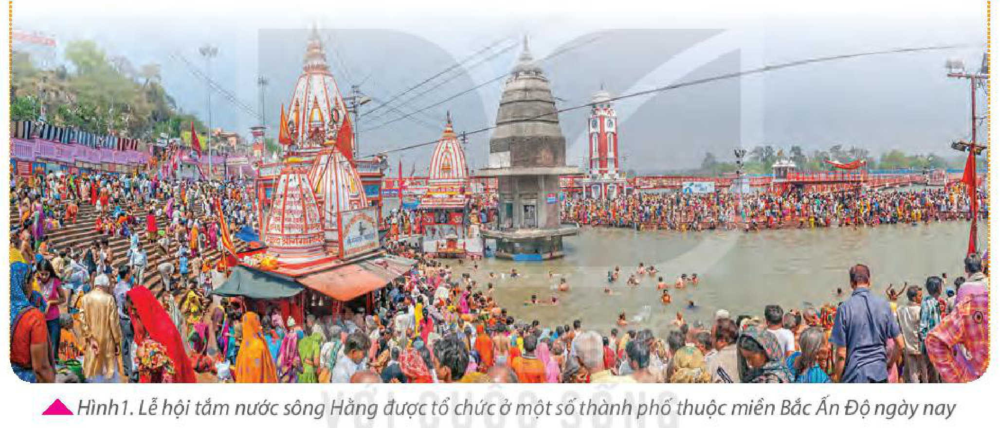
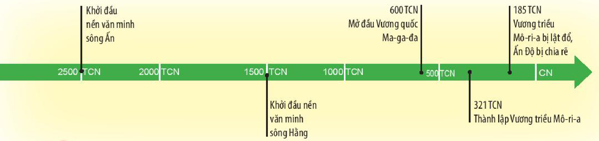
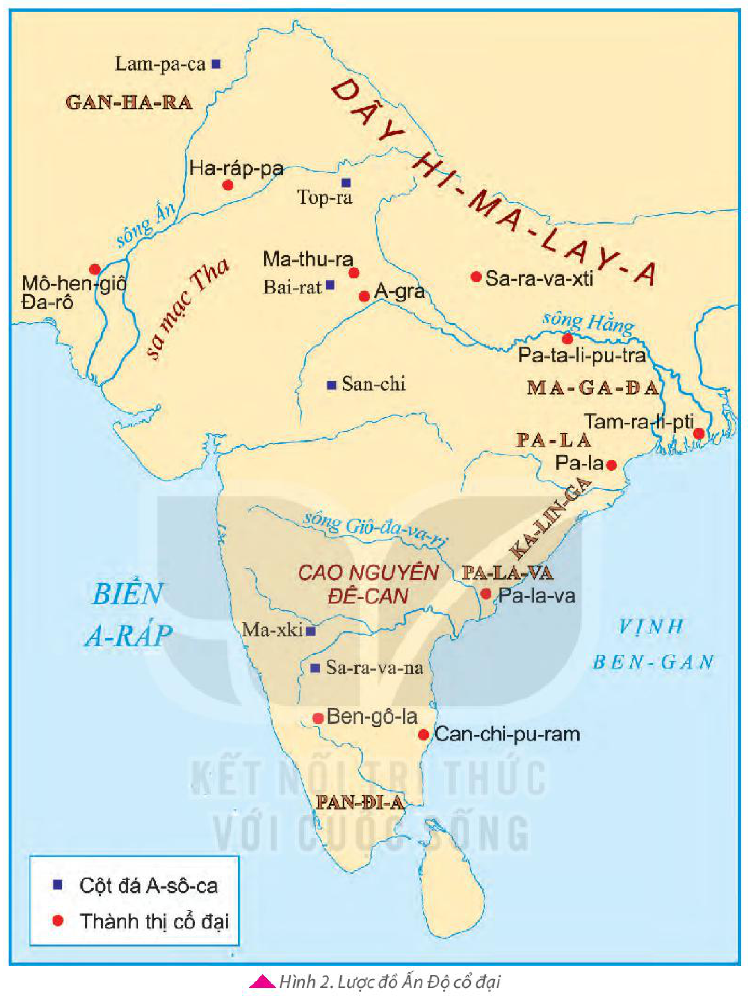
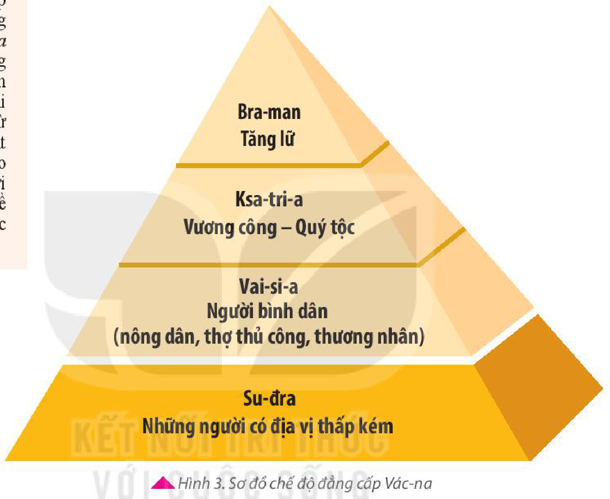
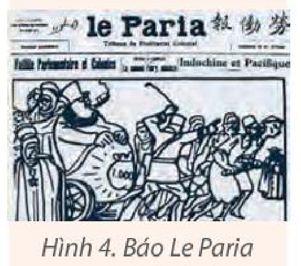
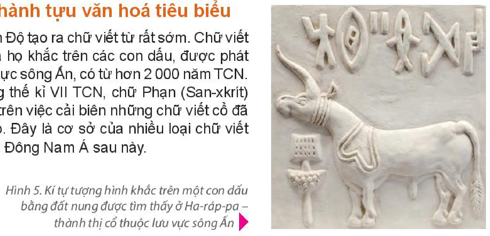
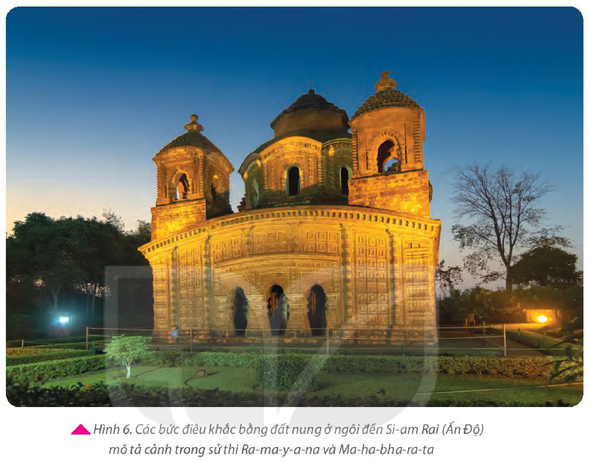
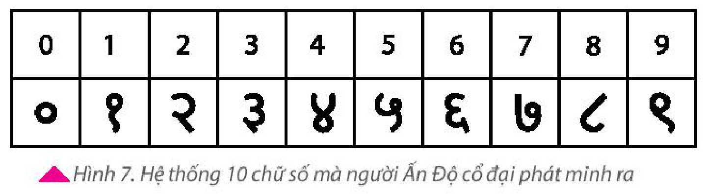
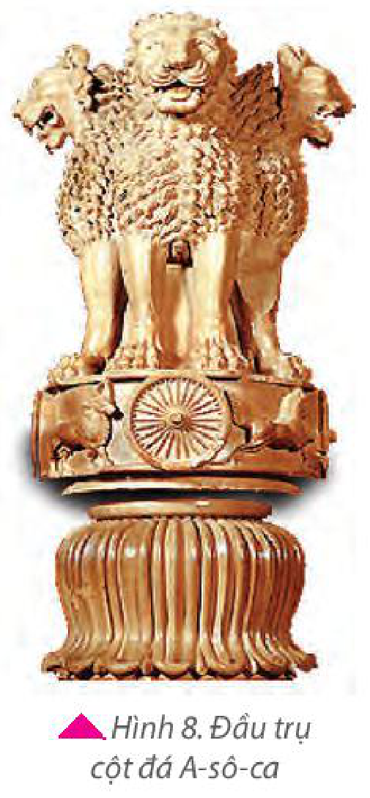
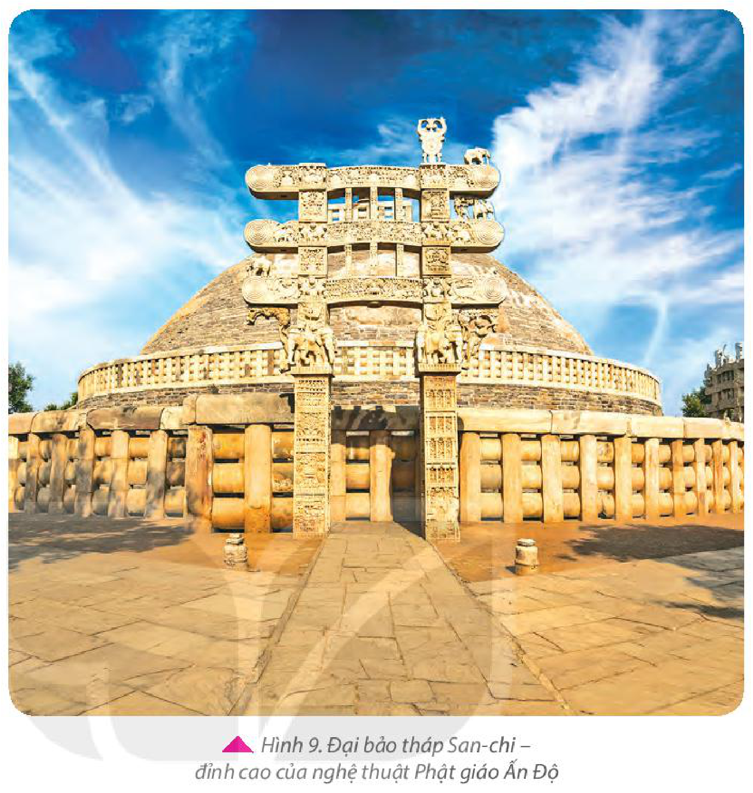

<!-- pdf:35 -->

# BÀI 8: ẤN ĐỘ CỔ ĐẠI

## 🎯 Học xong bài này, em sẽ:

- Nêu được những nét chính về điều kiện tự nhiên của lưu vực sông Ấn, sông Hằng ảnh hưởng đến sự hình thành của nền văn minh.
- Trình bày được những điểm chính về chế độ xã hội của Ấn Độ thời cổ đại.
- Nhận biết được những thành tựu văn hoá tiêu biểu của Ấn Độ thời cổ đại.

## 🔴 Mở đầu

Tắm nước sông Hằng (Cum Me-la) là một trong những lễ hội tôn giáo cổ và lớn nhất thế giới. Tín đồ Ấn Độ giáo tin tưởng nước ở sông Hằng (sông Mẹ) linh thiêng sẽ tẩy rửa mọi tội lỗi của họ. Vì sao ở Ấn Độ – một cường quốc kinh tế hiện nay mà vẫn còn duy trì những phong tục cổ xưa như thế? Các con sông lớn đã có vai trò ra sao trong việc hình thành, phát triển nền văn minh Ấn Độ cổ đại? Cư dân cổ nơi đây đã đóng góp những gì cho nhân loại?

Hình1. Lễ hội tắm nước sông Hằng được tổ chức ở một số thành phố thuộc miền Bắc Ấn Độ ngày nay

## 1. Điều kiện tự nhiên

Ấn Độ là một bán đảo ở Nam Á, có ba mặt giáp biển, nằm trên trục đường biển từ Tây sang Đông. Phía bắc được bao bọc bởi một vòng cung khổng lồ là dãy Hi-ma-lay-a; thoải dần về phía nam là các đồng bằng sông Ấn, sông Hằng rộng lớn. Chính nơi đây đã hình thành nên những trung tâm văn minh sớm nhất của nhân loại.

> **Trục thời gian:**
> - 2500 TCN: Khởi đầu nền văn minh sông Ấn
> - 1500 TCN: Khởi đầu nền văn minh sông Hằng
> - 600 TCN: Mở đầu Vương quốc Ma-ga-đa
> - 321 TCN: Thành lập Vương triều Mô-ri-a
> - 185 TCN: Vương triều Mô-ri-a bị lật đổ, Ấn Độ bị chia rẽ
<!-- ocr-ok: đã đối chiếu ảnh trang gốc p035, chữ trên trục thời gian tách thành nhiều cột nên OCR đọc lẫn thứ tự -->

<!-- pdf:36 -->

Hình 2. Lược đồ Ấn Độ cổ đại

Miền Trung và miền Nam là cao nguyên Đê-can với rừng rậm và núi đá hiểm trở; chỉ có vùng cực Nam và dọc theo hai bờ ven biển là những đồng bằng nhỏ hẹp, là nơi sinh sống tương đối thuận lợi, dân cư đông đúc.

Lưu vực sông Ấn chịu tác động của sa mạc nên rất ít mưa, khí hậu khô nóng. Ở lưu vực sông Hằng, do tác động của gió mùa nên lượng mưa nhiều, cây cối tươi tốt.

> **Kết nối với địa lí**
>
> Sông Ấn dài gần 3 000km, theo tiếng Phạn là Sindhu (Sin-đu), về sau, người Ba Tư đọc thành Hindus (Hin-đu) và gọi bán đảo Ấn Độ là Hindustan (Hin-đu-xtan) (nghĩa là “xứ các con sông”).

> ❓ Khai thác lược đồ trên và thông tin trong mục 1, hãy cho biết nét chính về điều kiện tự nhiên của lưu vực sông Ấn, sông Hằng ở Ấn Độ.

<!-- pdf:37 -->

## 2. Chế độ xã hội ở Ấn Độ cổ đại

Khoảng năm 2500 TCN, người bản địa Đra-vi-đa đã xây dựng những thành thị đầu tiên dọc theo hai bên bờ sông Ấn.

Giữa thiên niên kỉ II TCN, người A-ri-a từ vùng Trung Á tràn vào miền Bắc Ấn Độ, xua đuổi người Đra-vi-đa và biến họ thành đẳng cấp thứ tư (Su-đra) trong hệ thống bốn đẳng cấp (dựa trên sự phân biệt về chủng tộc và màu da). Chế độ này còn được gọi là **chế độ đẳng cấp Vác-na**.

Hình 3. Sơ đồ chế độ đẳng cấp Vác-na

> **Sơ đồ chế độ đẳng cấp Vác-na:**
> - **Bra-man:** Tăng lữ
> - **Ksa-tri-a:** Vương công – Quý tộc
> - **Vai-si-a:** Người bình dân (nông dân, thợ thủ công, thương nhân)
> - **Su-đra:** Những người có địa vị thấp kém
<!-- ocr-ok: đã đối chiếu ảnh trang gốc p037, sơ đồ tháp Hình 3 có chữ chìm nền đè lên -->

> **Kết nối với văn hoá**
>
> 
>
> Hình 4. Báo Le Paria
>
> Tầng lớp thấp kém nhất trong xã hội là **Pa-ri-a** (*Pariah*) (sự không thừa nhận). Năm 1922, Nguyễn Ái Quốc đã dùng từ *“Pariah”* để đặt tên cho tờ báo *Le Paria* (Người cùng khổ) nói về đời sống của các dân tộc bị áp bức.

> ❓ Nêu những điểm chính của chế độ xã hội ở Ấn Độ cổ đại.

## 3. Những thành tựu văn hoá tiêu biểu

Người Ấn Độ tạo ra chữ viết từ rất sớm. Chữ viết cổ nhất của họ khắc trên các con dấu, được phát hiện ở lưu vực sông Ấn, có từ hơn 2 000 năm TCN. Vào khoảng thế kỉ VII TCN, **chữ Phạn** (San-xkrít) ra đời dựa trên việc cải biên những chữ viết cổ đã có trước đó. Đây là cơ sở của nhiều loại chữ viết ở Ấn Độ và Đông Nam Á sau này.

Hình 5. Kí tự tượng hình khắc trên một con dấu bằng đất nung được tìm thấy ở Ha-ráp-pa – thành thị cổ thuộc lưu vực sông Ấn

<!-- pdf:38 -->

Hai tác phẩm văn học nổi bật nhất thời cổ đại là *Ma-ha-bha-ra-ta* và *Ra-ma-y-a-na*, có ảnh hưởng to lớn tới sự phát triển của văn học Ấn Độ và Đông Nam Á ở các giai đoạn sau này.

Hình 6. Các bức điêu khắc bằng đất nung ở ngôi đền Si-am Rai (Ấn Độ) mô tả cảnh trong sử thi Ra-ma-y-a-na và Ma-ha-bha-ra-ta

Người Ấn Độ cổ đại đã biết làm lịch. Họ cũng là chủ nhân của 10 chữ số mà ngày nay được dùng rộng rãi trên thế giới, đặc biệt là chữ số 0. Người Ả Rập đã học tập chữ số Ấn Độ rồi truyền sang châu Âu.

Hình 7. Hệ thống 10 chữ số mà người Ấn Độ cổ đại phát minh ra

> **Kết nối với văn học**
>
> **Ma-ha-bha-ra-ta** là bản trường ca gồm 110 000 câu thơ đôi, được coi là một bộ “bách khoa toàn thư” về đời sống xã hội Ấn Độ thời cổ đại. **Ra-ma-y-a-na** là một bộ sử thi dài 24 000 câu thơ đôi, kể về tình yêu giữa chàng Hoàng tử Ra-ma và Công chúa Si-ta.
<!-- ocr-ok: đã đối chiếu ảnh trang gốc p038, hộp Kết nối với văn học đặt ở cột hẹp bên phải nên OCR trộn dòng với cột trái -->

Ấn Độ cổ đại là quê hương của các tôn giáo lớn. Ra đời sớm nhất là **đạo Bà La Môn**. Những thế kỉ đầu Công nguyên, đạo Bà La Môn phát triển thành đạo Hin-đu (**Ấn Độ giáo**).

Khoảng thế kỉ VI TCN, **Phật giáo** được hình thành, người sáng lập là Xít-đác-ta Gô-ta-ma (Thích Ca Mâu Ni).

Công trình kiến trúc tiêu biểu của Ấn Độ cổ đại là cột đá A-sô-ca và đại bảo tháp San-chi.

<!-- pdf:39 -->

> **Kết nối với ngày nay**
>
> Quốc huy của Ấn Độ hiện nay có biểu tượng đầu trụ cột đá A-sô-ca, cùng với dòng chữ *Satyameva Jayate* (Chỉ có chân lí đắc thắng).
<!-- ocr-ok: đã đối chiếu ảnh trang gốc p039, chữ tiếng Phạn phiên La-tinh in nghiêng khiến OCR đọc sai -->

Hình 8. Đầu trụ cột đá A-sô-ca

Hình 9. Đại bảo tháp San-chi – đỉnh cao của nghệ thuật Phật giáo Ấn Độ

> ❓ Dựa vào thông tin và các hình ảnh ở trên, hãy nêu những thành tựu văn hoá tiêu biểu của Ấn Độ cổ đại.

## ✏️ Luyện tập và Vận dụng

1. Sự phân hoá trong xã hội Ấn Độ cổ đại được biểu hiện như thế nào?

2. Thành tựu văn hoá nào của người Ấn Độ cổ đại vẫn được sử dụng hoặc được bảo tồn đến ngày nay?

## 📷 Danh sách hình trong bài

| Mã hình | Trang PDF | Vị trí trong bài | Chú thích gốc |
| --- | :---: | --- | --- |
| H6-lich_su_va_dia_ly-ls-b08-01 | 35 | Mở đầu (trang 34, chung khung viền nét đứt với chữ Mở đầu) | Hình1. Lễ hội tắm nước sông Hằng được tổ chức ở một số thành phố thuộc miền Bắc Ấn Độ ngày nay |
| H6-lich_su_va_dia_ly-ls-b08-02 | 35 | Cuối trang 34 (trục thời gian tràn sát mép trái trang sách) | (sách không đánh số, trục thời gian lịch sử Ấn Độ cổ đại) |
| H6-lich_su_va_dia_ly-ls-b08-03 | 36 | Mục 1 (trang 35) | Hình 2. Lược đồ Ấn Độ cổ đại |
| H6-lich_su_va_dia_ly-ls-b08-04 | 37 | Mục 2 (trang 36, đáy tháp vươn sang trái dưới hộp Kết nối với văn hoá) | Hình 3. Sơ đồ chế độ đẳng cấp Vác-na |
| H6-lich_su_va_dia_ly-ls-b08-05 | 37 | Mục 2, hộp Kết nối với văn hoá (trang 36) | Hình 4. Báo Le Paria |
| H6-lich_su_va_dia_ly-ls-b08-06 | 37 | Mục 3 (trang 36, chú thích đặt bên trái ảnh ngay dưới đoạn văn mục 3) | Hình 5. Kí tự tượng hình khắc trên một con dấu bằng đất nung được tìm thấy ở Ha-ráp-pa – thành thị cổ thuộc lưu vực sông Ấn |
| H6-lich_su_va_dia_ly-ls-b08-07 | 38 | Mục 3 (trang 37) | Hình 6. Các bức điêu khắc bằng đất nung ở ngôi đền Si-am Rai (Ấn Độ) mô tả cảnh trong sử thi Ra-ma-y-a-na và Ma-ha-bha-ra-ta |
| H6-lich_su_va_dia_ly-ls-b08-08 | 38 | Mục 3 (trang 37) | Hình 7. Hệ thống 10 chữ số mà người Ấn Độ cổ đại phát minh ra |
| H6-lich_su_va_dia_ly-ls-b08-09 | 39 | Mục 3 (trang 38) | Hình 8. Đầu trụ cột đá A-sô-ca |
| H6-lich_su_va_dia_ly-ls-b08-10 | 39 | Mục 3 (trang 38) | Hình 9. Đại bảo tháp San-chi – đỉnh cao của nghệ thuật Phật giáo Ấn Độ |
