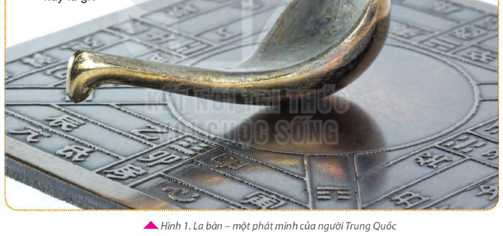
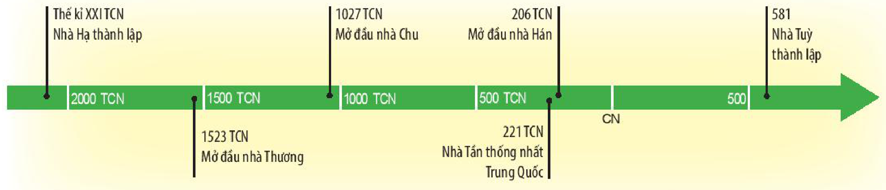
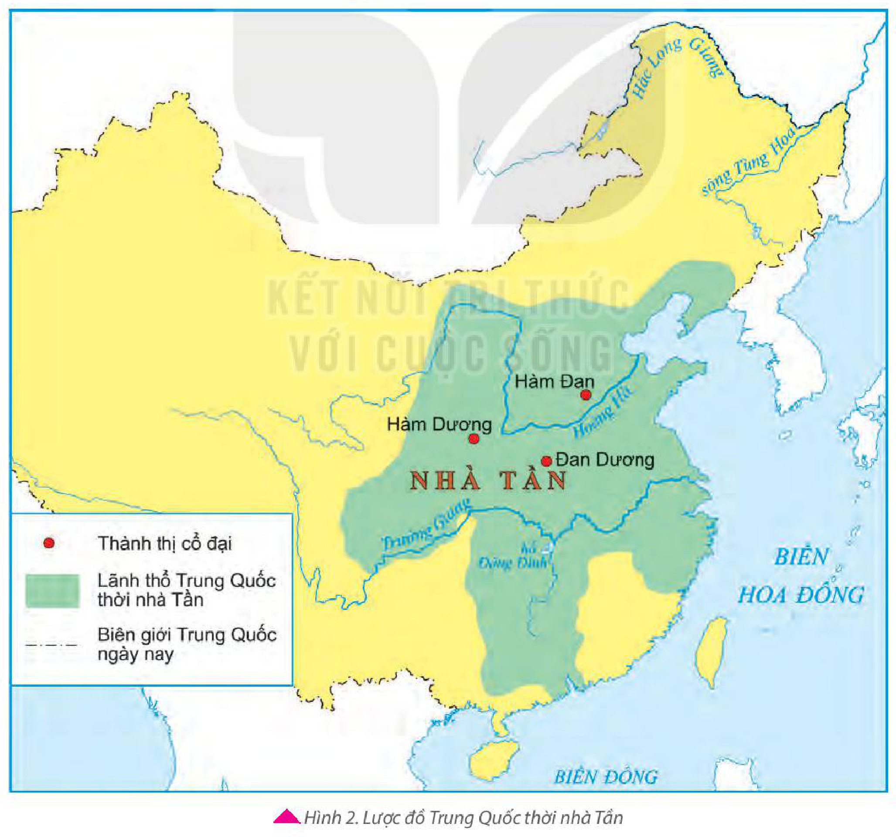
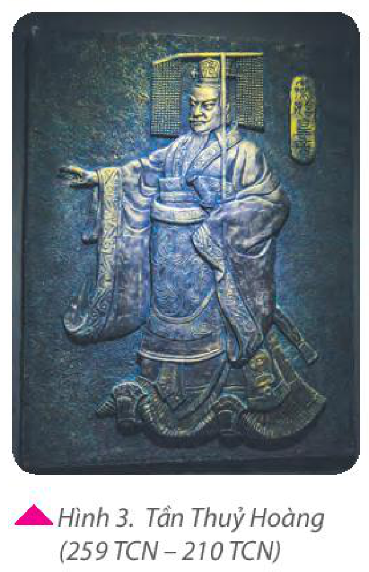
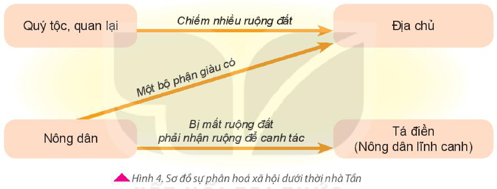
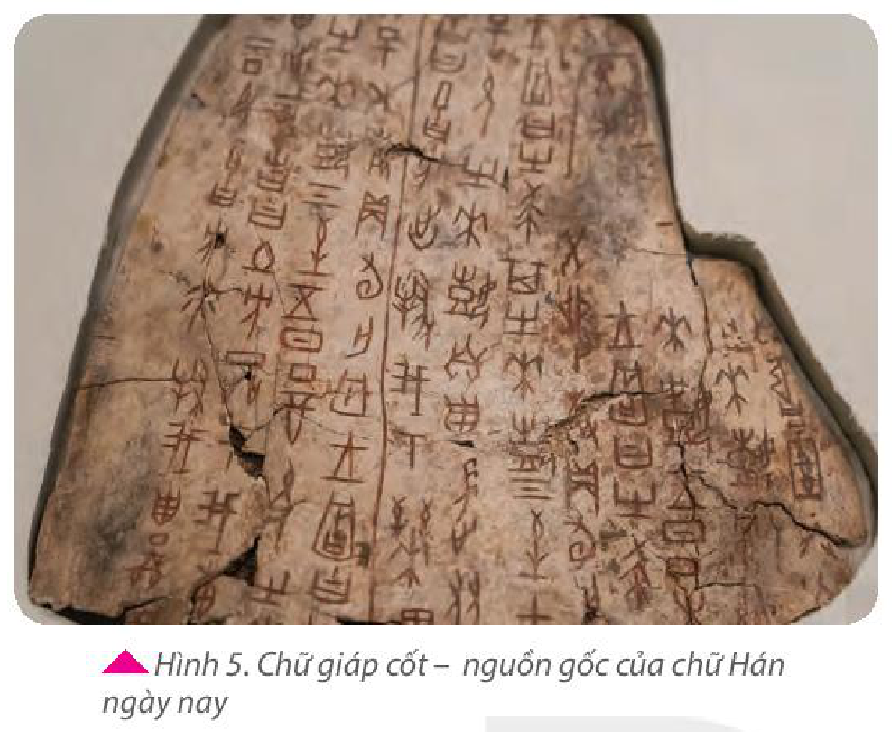
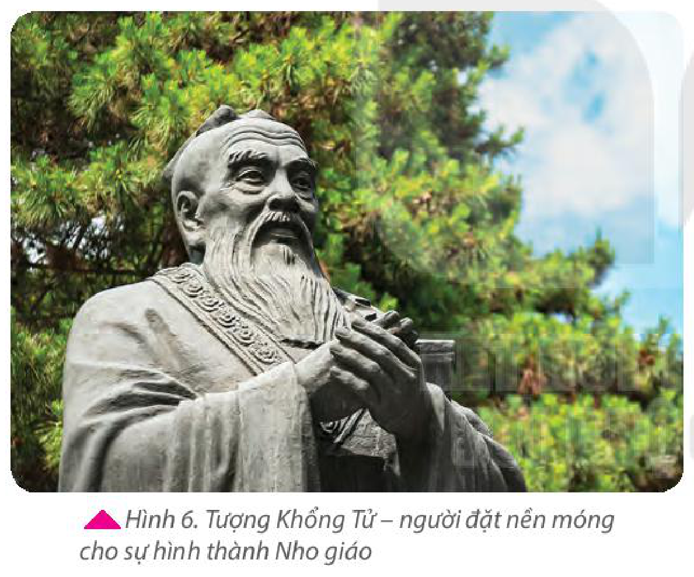
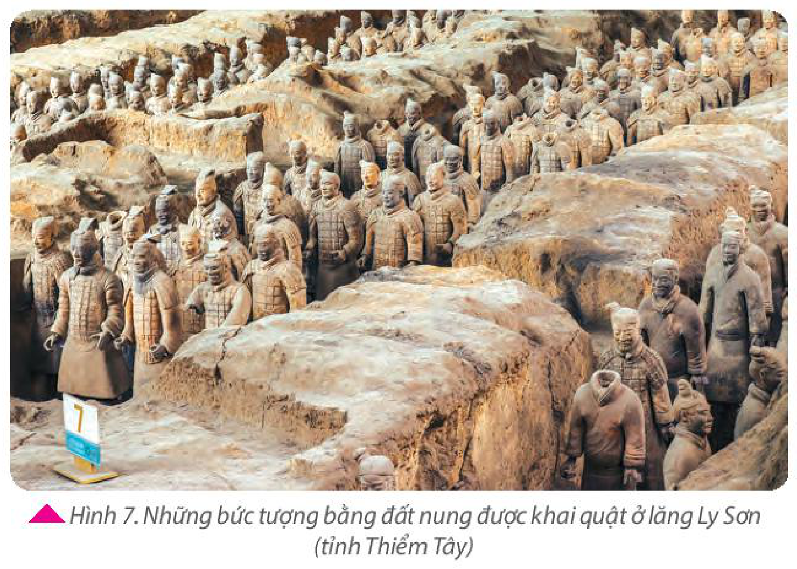
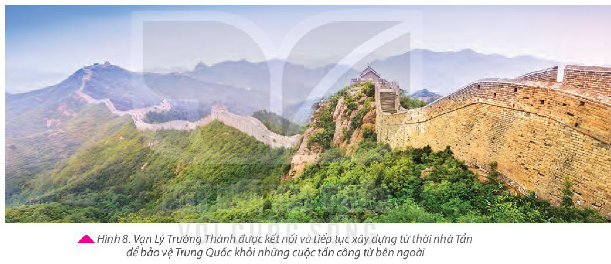

<!-- pdf:40 -->

# BÀI 9: TRUNG QUỐC TỪ THỜI CỔ ĐẠI ĐẾN THẾ KỈ VII

## 🎯 Học xong bài này, em sẽ:

- Giới thiệu được những đặc điểm về điều kiện tự nhiên của Trung Quốc thời cổ đại.
- Mô tả được sơ lược quá trình thống nhất và sự xác lập chế độ phong kiến ở Trung Quốc dưới thời Tần Thuỷ Hoàng.
- Xây dựng được đường thời gian từ nhà Hán, Nam Bắc triều đến nhà Tuỳ.
- Nêu được những thành tựu cơ bản của nền văn minh Trung Quốc thời cổ đại.

## 🔴 Mở đầu

Từ thời xa xưa, người Trung Quốc đã chế tạo ra la bàn để xác định phương hướng. Họ còn là chủ nhân của một nền văn minh phát triển với nhiều thành tựu mà cho đến ngày nay nhân loại vẫn đang được thừa hưởng. Vậy, điều kiện nào đã giúp người Trung Quốc cổ đại tạo dựng được nền văn minh rực rỡ như thế? Những giá trị to lớn mà họ truyền lại đến ngày nay là gì?

Hình 1. La bàn – một phát minh của người Trung Quốc

> **Trục thời gian:**
> - Thế kỉ XXI TCN: Nhà Hạ thành lập
> - 1523 TCN: Mở đầu nhà Thương
> - 1027 TCN: Mở đầu nhà Chu
> - 221 TCN: Nhà Tần thống nhất Trung Quốc
> - 206 TCN: Mở đầu nhà Hán
> - 581: Nhà Tuỳ thành lập
<!-- ocr-ok: đã đối chiếu ảnh trang gốc p040, chữ trên trục thời gian chia trên và dưới trục nên OCR đọc tách dòng -->

<!-- pdf:41 -->

## 1. Điều kiện tự nhiên của Trung Quốc cổ đại

Người Trung Quốc đã xây dựng nền văn minh đầu tiên ở lưu vực Hoàng Hà, sau đó mở rộng đến lưu vực Trường Giang (Dương Tử). Phù sa của hai dòng sông này đã tạo nên đồng bằng Hoa Bắc, Hoa Trung và Hoa Nam rộng lớn, phì nhiêu, thuận lợi cho phát triển nông nghiệp. Tuy nhiên, lũ lụt do hai con sông cũng đã gây ra nhiều khó khăn cho đời sống của người dân.

Thượng nguồn các dòng sông là vùng đất cao, có nhiều đồng cỏ nên chăn nuôi đã phát triển từ sớm.

> **Kết nối với địa lí**
>
> Hoàng Hà là sông dài thứ hai Trung Quốc và thứ sáu thế giới (5 464km), Trường Giang là sông dài nhất Trung Quốc và thứ ba thế giới (6 300km).
<!-- ocr-ok: đã đối chiếu ảnh trang gốc p041, hộp Kết nối với địa lí ở cột trái hẹp bị OCR trộn dòng với cột phải -->

> ❓ Theo em, Hoàng Hà và Trường Giang đã tác động như thế nào đến cuộc sống của cư dân Trung Quốc thời cổ đại?

## 2. Nhà Tần thống nhất và xác lập chế độ phong kiến ở Trung Quốc

Hình 2. Lược đồ Trung Quốc thời nhà Tần

<!-- pdf:42 -->

Từ thế kỉ XXI đến thế kỉ III TCN, lịch sử Trung Quốc trải qua các triều đại Hạ, Thương, Chu. Sau triều đại nhà Chu, Trung Quốc lại bị chia thành nhiều nước nhỏ. Trong đó, nước Tần có tiềm lực kinh tế và quân sự mạnh nhất, lần lượt tiêu diệt các đối thủ. Năm 221 TCN, Tần Thuỷ Hoàng đã thống nhất lãnh thổ, tự xưng hoàng đế. Nhà Tần chia đất nước thành các quận, huyện, đặt các chức quan cai quản, lập ra triều đại **phong kiến** đầu tiên ở Trung Quốc.

Để củng cố sự thống nhất đất nước, nhà Tần còn áp dụng chế độ đo lường, tiền tệ, chữ viết và pháp luật chung trên cả nước.

Nhiều giai cấp mới được hình thành. Quan hệ bóc lột giữa địa chủ và tá điền dần được xác lập.

Hình 3. Tần Thuỷ Hoàng (259 TCN – 210 TCN)

Hình 4. Sơ đồ sự phân hoá xã hội dưới thời nhà Tần

> **Sơ đồ sự phân hoá xã hội dưới thời nhà Tần:**
> - Quý tộc, quan lại — *(Chiếm nhiều ruộng đất)* → **Địa chủ**
> - **Nông dân** — *(Một bộ phận giàu có)* → Địa chủ
> - Nông dân — *(Bị mất ruộng đất phải nhận ruộng để canh tác)* → **Tá điền** (**Nông dân lĩnh canh**)
<!-- ocr-ok: đã đối chiếu ảnh trang gốc p042, chữ nằm trên mũi tên nghiêng của sơ đồ Hình 4 khiến OCR đọc sai -->

Nhà Tần tồn tại 15 năm, sau đó bị suy yếu. Năm 206 TCN, Lưu Bang – một địa chủ phong kiến đã lật đổ triều đại nhà Tần, lập ra nhà Hán.

> ❓ Nhà Tần đã thống nhất và xác lập chế độ phong kiến ở Trung Quốc như thế nào?

## 3. Trung Quốc từ thời nhà Hán đến thời nhà Tuỳ (206 TCN – thế kỉ VII)

Nhà Hán (206 TCN – 220) tiếp tục củng cố bộ máy cai trị và mở rộng lãnh thổ. Đây là một trong những triều đại thịnh vượng của chế độ phong kiến Trung Quốc, có ảnh hưởng lớn tới các dân tộc láng giềng.

Sau thời nhà Hán, lịch sử Trung Quốc tiếp tục trải qua các thời kì **Tam quốc** (220 – 280), nhà Tấn (280 – 420), Nam – Bắc triều (420 – 581). Đến năm 581, nhà Tuỳ mới thống nhất lại Trung Quốc.

> **Em có biết?**
>
> Các triều đại Trung Quốc liên tiếp mở những cuộc chiến tranh để mở rộng lãnh thổ. Đó cũng chính là nguyên nhân khiến nhân dân Việt Nam đã phải trải qua hơn một nghìn năm đấu tranh chống **Bắc thuộc**.
<!-- ocr-ok: đã đối chiếu ảnh trang gốc p042, hộp Em có biết? ở cột phải hẹp bị OCR trộn dòng với mục 3 bên trái -->

> ❓ Hãy xây dựng trục thời gian từ thời nhà Hán đến thời nhà Tuỳ.

<!-- pdf:43 -->

## 4. Một số thành tựu nổi bật của văn minh Trung Quốc từ thời cổ đại đến thế kỉ VII

Từ thời nhà Thương, người Trung Quốc đã khắc chữ trên mai rùa, xương thú, gọi là **giáp cốt văn**.

Hình 5. Chữ giáp cốt – nguồn gốc của chữ Hán ngày nay

**Kinh Thi** là tập thơ cổ nhất ở Trung Quốc, gồm nhiều sáng tác dân gian, được Khổng Tử sưu tập và chỉnh lí. Nhiều bài thơ trong đó là nguồn cảm hứng sáng tác thơ ca Trung Quốc giai đoạn sau, đồng thời cũng ảnh hưởng lớn đến văn học của các nước khác, trong đó có Việt Nam.

<!-- term: Nho giáo -->
Thời cổ đại, xuất hiện nhiều nhà tư tưởng nổi tiếng, tiêu biểu là Khổng Tử và Lão Tử.

<!-- term: Nho giáo -->
Hình 6. Tượng Khổng Tử – người đặt nền móng cho sự hình thành Nho giáo

Người Trung Quốc xưa rất có ý thức về việc chép sử. Những bộ sử tiêu biểu như *Sử kí* của Tư Mã Thiên, *Hán thư* của Ban Cố,...

Người Trung Quốc cũng đã phát minh ra một loại lịch dựa trên sự kết hợp giữa âm lịch và dương lịch mà cho đến ngày nay vẫn ảnh hưởng đến cách tính thời gian của nhiều nước phương Đông, trong đó có Việt Nam.

Thế kỉ II TCN, họ đã phát minh ra thiết bị đo động đất sớm nhất thế giới gọi là **địa động nghi**.

<!-- term: Tứ đại phát minh kĩ thuật của Trung Quốc cổ đại -->
Đặc biệt, người Trung Quốc cổ đại đã có bốn phát minh quan trọng về mặt kĩ thuật, đó là giấy, thuốc nổ, la bàn và kĩ thuật in.
<!-- ocr-ok: đã đối chiếu ảnh trang gốc p043, OCR đọc sai dấu tiếng Việt ở "bón / giây / thuốc nô / la bản" -->

> **Em có biết?**
>
> **Sử kí** của Tư Mã Thiên là công trình sử học lớn nhất Trung Quốc thời cổ đại và nổi tiếng toàn thế giới. Đây cũng là một trong những tác phẩm văn học tiêu biểu của nhân loại.
<!-- ocr-ok: đã đối chiếu ảnh trang gốc p043, hộp Em có biết? ở cột trái hẹp bị OCR trộn dòng với đoạn văn bên phải -->

Bộ **Hoàng đế nội kinh** của Hoa Đà (một trong “tứ đại danh y” của Trung Quốc) được coi là sách kinh điển của y học cổ truyền Trung Hoa. Hoa Đà cũng là người đầu tiên thực hiện phương pháp phẫu thuật gây mê.

Các triều đại từ Tần đến Tuỳ đều chú trọng xây dựng những công trình kiến trúc đồ sộ.

> ❓ Kể tên một số thành tựu văn minh tiêu biểu của người Trung Quốc cổ đại.

<!-- pdf:44 -->

> **Kết nối với ngày nay**
>
> Năm 1974, người ta đã tìm thấy ở lăng Ly Sơn 8 000 bức tượng binh lính bằng đất nung. Điều kì lạ là mỗi bức tượng một vẻ, sống động như người thật.
>
> Vạn Lý Trường Thành là điểm du lịch nổi tiếng ở Trung Quốc, thu hút hàng triệu khách du lịch mỗi năm.
>
> Hiện nay, hai công trình trên đều được UNESCO công nhận là Di sản văn hoá thế giới.

Hình 7. Những bức tượng bằng đất nung được khai quật ở lăng Ly Sơn (tỉnh Thiểm Tây)

Hình 8. Vạn Lý Trường Thành được kết nối và tiếp tục xây dựng từ thời nhà Tần để bảo vệ Trung Quốc khỏi những cuộc tấn công từ bên ngoài

## ✏️ Luyện tập và Vận dụng

1. Điều kiện tự nhiên của Trung Quốc cổ đại đã tác động như thế nào đến sự hình thành nền văn minh của quốc gia này?

2. Trong các thành tựu của văn minh Trung Quốc cổ đại, em ấn tượng nhất thành tựu nào? Vì sao?

## 📷 Danh sách hình trong bài

| Mã hình | Trang PDF | Vị trí trong bài | Chú thích gốc |
| --- | :---: | --- | --- |
| H6-lich_su_va_dia_ly-ls-b09-01 | 40 | Mở đầu (trang 39, chữ phần Mở đầu tràn đè lên góc trên bên trái ảnh trong khung viền nét đứt) | Hình 1. La bàn – một phát minh của người Trung Quốc |
| H6-lich_su_va_dia_ly-ls-b09-02 | 40 | Cuối trang 39 | (sách không đánh số, trục thời gian lịch sử Trung Quốc từ thời cổ đại đến năm 581) |
| H6-lich_su_va_dia_ly-ls-b09-03 | 41 | Mục 2 (trang 40) | Hình 2. Lược đồ Trung Quốc thời nhà Tần |
| H6-lich_su_va_dia_ly-ls-b09-04 | 42 | Mục 2 (trang 41) | Hình 3. Tần Thuỷ Hoàng (259 TCN – 210 TCN) |
| H6-lich_su_va_dia_ly-ls-b09-05 | 42 | Mục 2 (trang 41) | Hình 4. Sơ đồ sự phân hoá xã hội dưới thời nhà Tần |
| H6-lich_su_va_dia_ly-ls-b09-06 | 43 | Mục 4 (trang 42) | Hình 5. Chữ giáp cốt – nguồn gốc của chữ Hán ngày nay |
| H6-lich_su_va_dia_ly-ls-b09-07 | 43 | Mục 4 (trang 42) | Hình 6. Tượng Khổng Tử – người đặt nền móng cho sự hình thành Nho giáo |
| H6-lich_su_va_dia_ly-ls-b09-08 | 44 | Mục 4 (trang 43) | Hình 7. Những bức tượng bằng đất nung được khai quật ở lăng Ly Sơn (tỉnh Thiểm Tây) |
| H6-lich_su_va_dia_ly-ls-b09-09 | 44 | Mục 4 (trang 43, ảnh tràn sát mép phải trang sách) | Hình 8. Vạn Lý Trường Thành được kết nối và tiếp tục xây dựng từ thời nhà Tần để bảo vệ Trung Quốc khỏi những cuộc tấn công từ bên ngoài |
