<!-- pdf:45 -->

# BÀI 10: HY LẠP VÀ LA MÃ CỔ ĐẠI

## 🎯 Học xong bài này, em sẽ:

- Giới thiệu và nhận xét được tác động của điều kiện tự nhiên (hải cảng, biển đảo) đối với sự hình thành, phát triển của nền văn minh Hy Lạp và La Mã.
- Trình bày được tổ chức nhà nước thành bang, nhà nước đế chế ở Hy Lạp và La Mã.
- Nêu được một số thành tựu văn hoá tiêu biểu của Hy Lạp và La Mã.

## 🔴 Mở đầu

Không có cơ sở của văn minh Hy Lạp và La Mã thì không có châu Âu hiện đại (theo Ăng-ghen). Theo em, điều gì khiến cho nền văn minh cổ đại này được đánh giá cao như vậy? Văn minh Hy Lạp và La Mã thời cổ đại có điểm gì nổi bật?

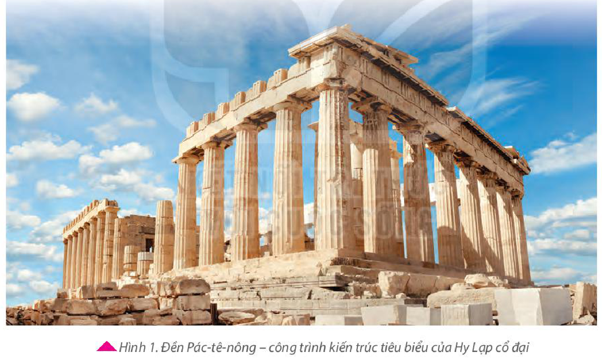

Hình 1. Đền Pác-tê-nông – công trình kiến trúc tiêu biểu của Hy Lạp cổ đại

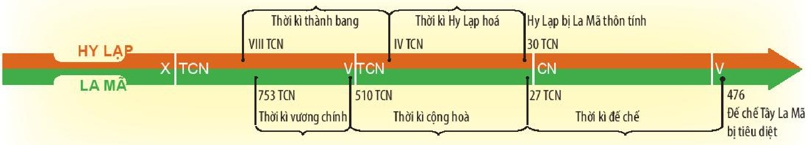

> **Trục thời gian:**
> - **HY LẠP:** Thời kì thành bang (VIII TCN – IV TCN) → **Thời kì Hy Lạp hoá** (IV TCN – 30 TCN) → 30 TCN: Hy Lạp bị La Mã thôn tính.
> - **LA MÃ:** Thời kì vương chính (753 TCN – 510 TCN) → Thời kì cộng hoà (510 TCN – 27 TCN) → Thời kì đế chế (27 TCN – 476) → 476: Đế chế Tây La Mã bị tiêu diệt.
<!-- ocr-ok: đã đối chiếu ảnh trang gốc p045, chữ trên trục thời gian hai dải màu nên OCR đọc lỗi kí tự -->

<!-- pdf:46 -->

## 1. Điều kiện tự nhiên

### a) Hy Lạp cổ đại

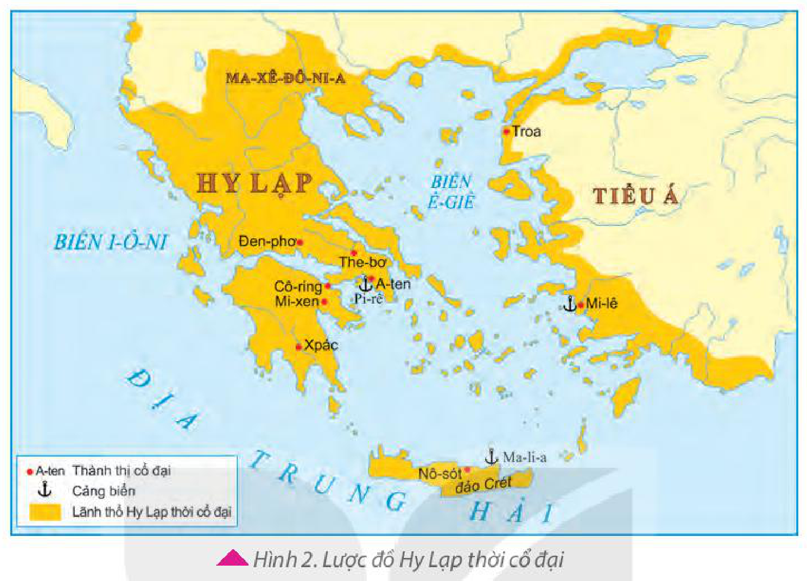

Hình 2. Lược đồ Hy Lạp thời cổ đại

Vùng đất của Hy Lạp cổ đại lớn hơn nước Hy Lạp ngày nay rất nhiều với trung tâm nằm ở phía nam bán đảo Ban-căng. Địa hình ở đây bị chia cắt thành nhiều vùng đồng bằng nhỏ hẹp bởi các dãy núi thấp chạy dài ra biển. Đất đai canh tác ít và không màu mỡ, chỉ thích hợp trồng các cây lâu năm như nho, ô liu,... Bù lại, Hy Lạp có nhiều vũng, vịnh, thuận lợi cho việc lập những hải cảng. Ở đây còn có nhiều khoáng sản như đồng, vàng, bạc,...

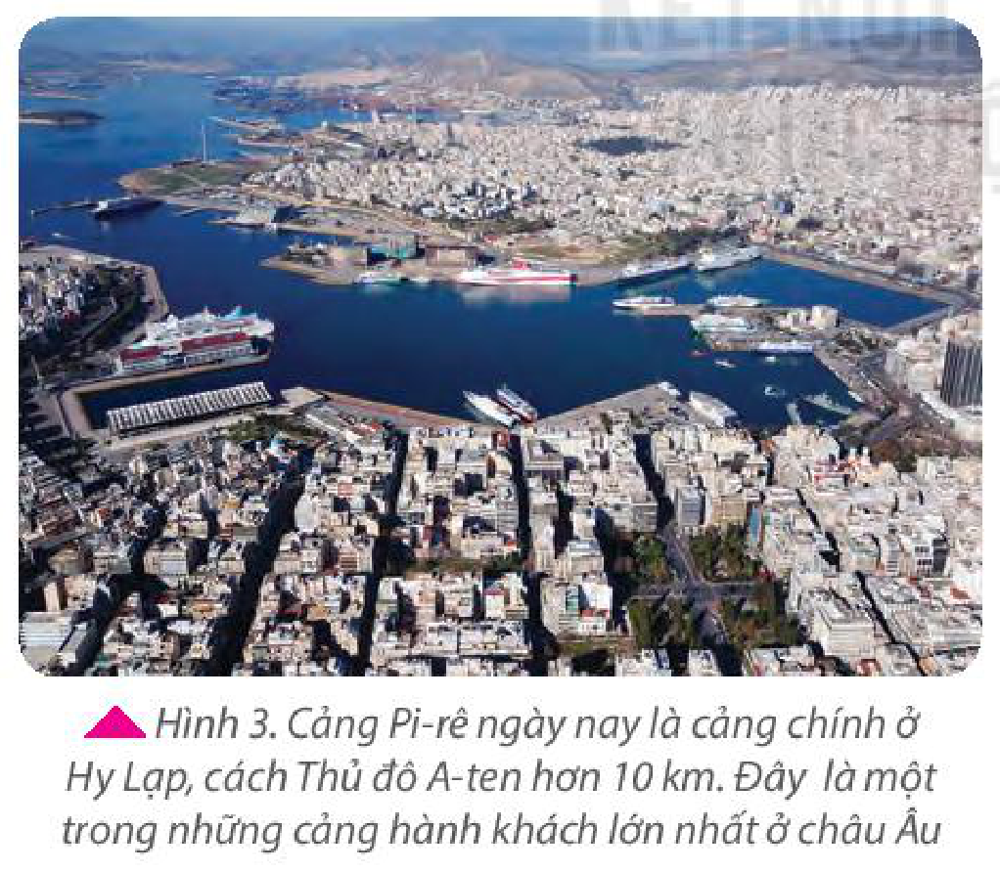

Hình 3. Cảng Pi-rê ngày nay là cảng chính ở Hy Lạp, cách Thủ đô A-ten hơn 10 km. Đây là một trong những cảng hành khách lớn nhất ở châu Âu
<!-- ocr-ok: đã đối chiếu ảnh trang gốc p046, OCR bỏ sót dòng đầu chú thích Hình 3 -->

> *Cảng Pi-rê là trung tâm xuất – nhập khẩu và buôn bán* **nô lệ** *sầm uất nhất của thế giới cổ đại. Từ cảng Pi-rê, A-ten xuất khẩu sang các quốc gia lân bang những sản phẩm nổi tiếng như rượu nho, dầu ô liu, đồ gốm màu, đá cẩm thạch, thiếc, chì, vải,... và nhập về các mặt hàng thiết yếu như ngũ cốc từ Hắc Hải, Bắc Phi, hạt tiêu từ Ấn Độ, chà là và lúa mì của vùng Lưỡng Hà,...*
>
> (Theo *Lịch sử thế giới cổ đại*, Sđd, tr.178 – 179)

> ❓ 1. Quan sát lược đồ, hãy cho biết vị trí địa lí của Hy Lạp cổ đại có điểm gì nổi bật.
>
> 2. Theo em, với điều kiện tự nhiên như trên, cư dân Hy Lạp cổ đại có ưu thế để phát triển các ngành kinh tế nào?

<!-- pdf:47 -->

### b) La Mã cổ đại

Cũng giống như Hy Lạp, bán đảo I-ta-li-a – nơi hình thành Nhà nước La Mã cổ đại, nằm ở Nam Âu, xung quanh được biển bao bọc.

Bờ biển ở phía nam có nhiều vịnh, cảng thuận tiện cho tàu bè ra vào trú đậu. Đến thời kì đế quốc La Mã, lãnh thổ được mở rộng ra cả ba châu lục với nhiều đồng bằng và đồng cỏ rộng lớn. Nhờ đó, trồng trọt và chăn nuôi có điều kiện phát triển. Lòng đất chứa nhiều khoáng sản, thuận lợi cho nghề luyện kim.

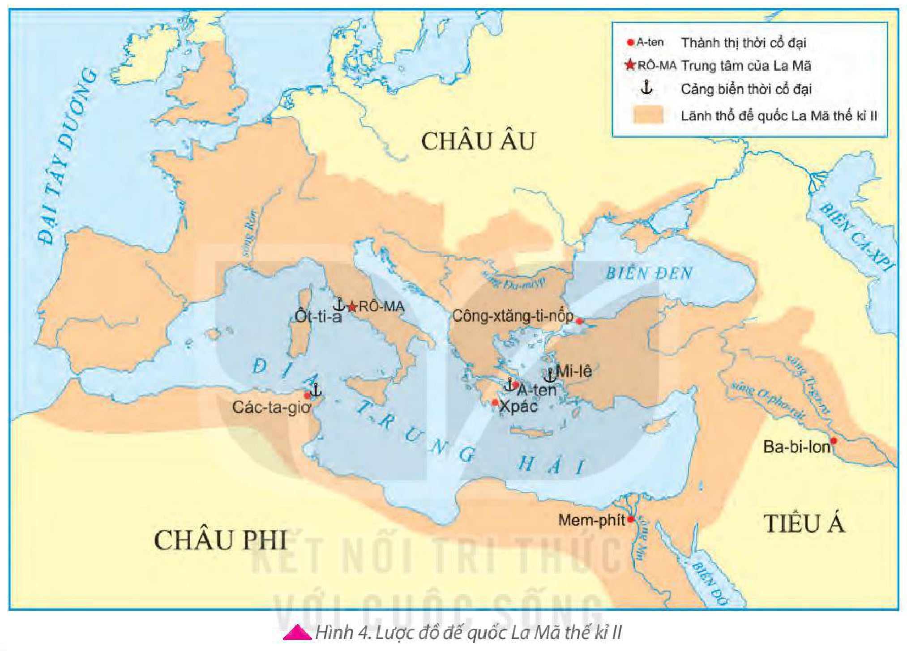

Hình 4. Lược đồ đế quốc La Mã thế kỉ II

> ❓ Dựa vào nội dung ở trên và quan sát lược đồ, em hãy cho biết vị trí địa lí và điều kiện tự nhiên nổi bật của La Mã cổ đại.

## 2. Nhà nước thành bang và nền dân chủ cổ đại ở Hy Lạp

Từ thế kỉ VIII đến thế kỉ IV TCN, ở Hy Lạp đã hình thành hàng chục nhà nước nhỏ được gọi là **nhà nước thành bang** (hay **thị quốc**).

Mỗi thành bang đều lấy một thành thị làm trung tâm, xung quanh là vùng đất trồng trọt. Thành thị có phố xá, lâu đài, đền thờ, sân vận động, nhà hát và quan trọng hơn cả là bến cảng.

A-ten là thành bang quan trọng nhất, tiêu biểu cho **chế độ dân chủ** ở Hy Lạp cổ đại. Để bảo vệ nền dân chủ và ngăn chặn những âm mưu đảo chính, “chế độ bỏ phiếu bằng vỏ sò” đã được thực hiện. Đến thế kỉ I TCN, Hy Lạp bị đế quốc La Mã thôn tính.

<!-- pdf:48 -->

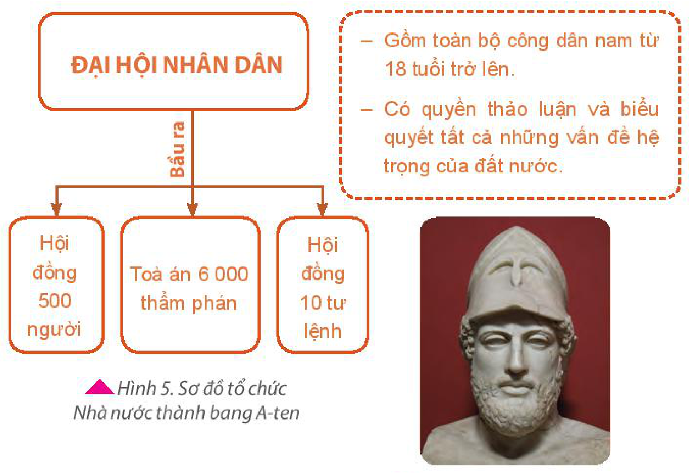

Hình 5. Sơ đồ tổ chức Nhà nước thành bang A-ten

> **Sơ đồ tổ chức Nhà nước thành bang A-ten:**
> - **ĐẠI HỘI NHÂN DÂN** *(Gồm toàn bộ công dân nam từ 18 tuổi trở lên; Có quyền thảo luận và biểu quyết tất cả những vấn đề hệ trọng của đất nước)* → **Bầu ra:** Hội đồng 500 người | Toà án 6 000 thẩm phán | Hội đồng 10 tư lệnh.
<!-- ocr-ok: đã đối chiếu ảnh trang gốc p048, sơ đồ khối Hình 5 có chữ dọc "Bầu ra" nên OCR tách rời các ô -->

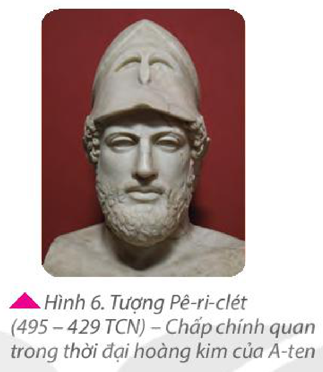

Hình 6. Tượng Pê-ri-clét (495 – 429 TCN) – Chấp chính quan trong thời đại hoàng kim của A-ten

> **Em có biết?**
>
> “**Chế độ bỏ phiếu bằng vỏ sò**” là gì? Nếu công dân nào bị nghi ngờ có âm mưu, hành vi đe doạ tới nền dân chủ thì Đại hội nhân dân sẽ tiến hành bỏ phiếu kín, bằng cách ghi tên người đó lên các mảnh vỏ sò hoặc mảnh gốm. Nếu có 6 000 phiếu cùng ghi tên một người thì người đó buộc phải rời khỏi A-ten trong thời hạn 10 năm.

> ❓ Hãy trình bày những nét chính về tổ chức nhà nước thành bang ở Hy Lạp. Những ưu điểm của tổ chức nhà nước thành bang là gì?

## 3. Nhà nước đế chế La Mã cổ đại

Từ một thành bang nhỏ bé ở miền Trung bán đảo I-ta-li-a, Nhà nước La Mã đã dần mở rộng lãnh thổ, trở thành đế quốc rộng lớn vào thế kỉ I TCN. Năm 27 TCN, Ốc-ta-vi-út được tôn lên thành Đấng tối cao, có quyền lực như hoàng đế, mở đầu thời kì **đế chế**.

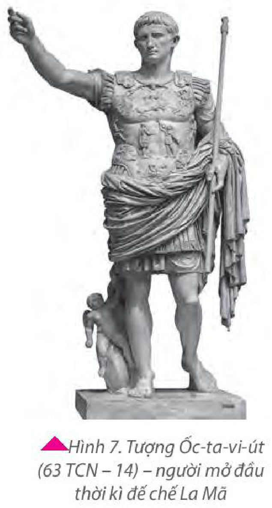

Hình 7. Tượng Ốc-ta-vi-út (63 TCN – 14) – người mở đầu thời kì đế chế La Mã

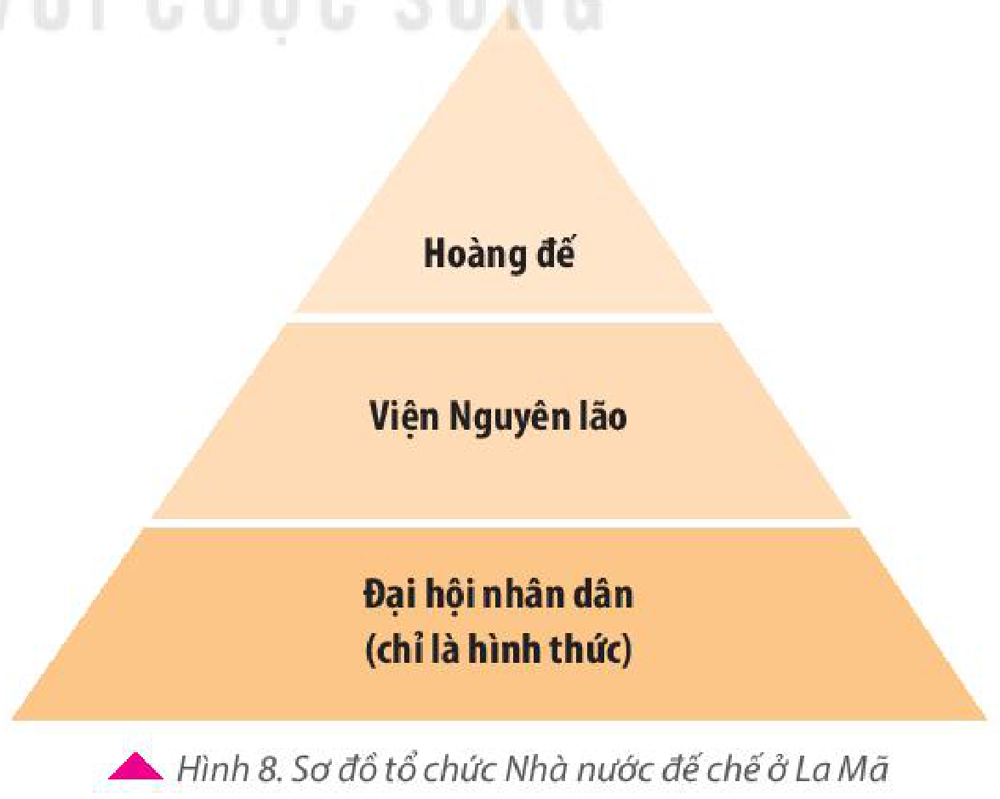

Hình 8. Sơ đồ tổ chức Nhà nước đế chế ở La Mã

> **Sơ đồ tổ chức Nhà nước đế chế ở La Mã:**
> - Hoàng đế
> - **Viện Nguyên lão**
> - Đại hội nhân dân (chỉ là hình thức)

> ❓ Dựa vào thông tin trong mục và sơ đồ trên, hãy trình bày tổ chức nhà nước đế chế ở La Mã.

<!-- pdf:49 -->

## 4. Một số thành tựu văn hoá tiêu biểu của Hy Lạp, La Mã

Người Hy Lạp và La Mã đã sáng tạo ra **hệ chữ cái La-tinh** (A, B, C,...) và **chữ số La Mã** mà ngày nay chúng ta đang sử dụng.

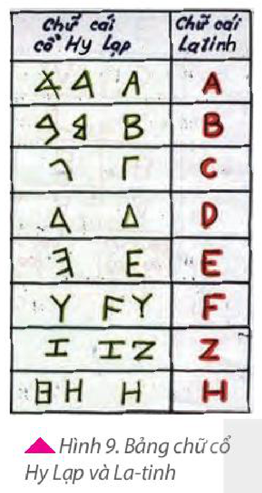

Hình 9. Bảng chữ cổ Hy Lạp và La-tinh

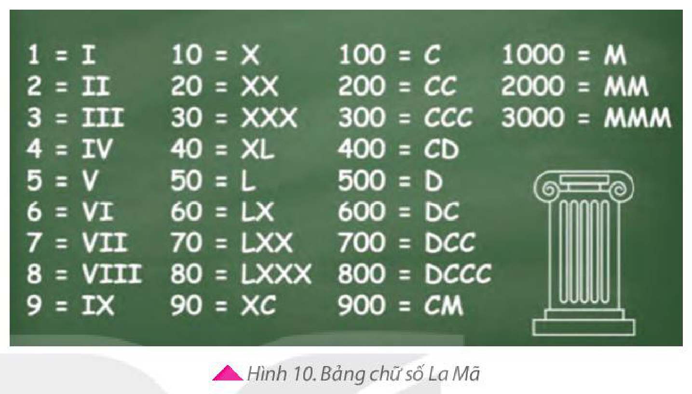

Hình 10. Bảng chữ số La Mã

Văn học Hy Lạp, La Mã cổ đại phong phú về thể loại (thần thoại, kịch và thơ). Một số tác giả tiêu biểu là Hô-me với tác phẩm *I-li-át* và *Ô-đi-xê* (Hy Lạp), nhà soạn kịch Xô-phốc với vở *Ơ-đíp làm vua* (Hy Lạp),...

Hy Lạp là quê hương của các nhà khoa học nổi tiếng như: Pi-ta-go, Ta-lét, Ác-si-mét,...

Người Hy Lạp và La Mã sáng tạo ra dương lịch.

Các nhà sử học tiêu biểu của Hy Lạp, La Mã thời cổ đại là Hê-rô-đốt, Tuy-xi-dít, Pô-li-bi-út với nhiều bộ sử đồ sộ.

Những tác phẩm điêu khắc nổi tiếng của Hy Lạp, La Mã cổ đại là các bức tượng: Thần Vệ nữ Mi-lô, Lực sĩ ném đĩa, Nữ thần A-tê-na,...

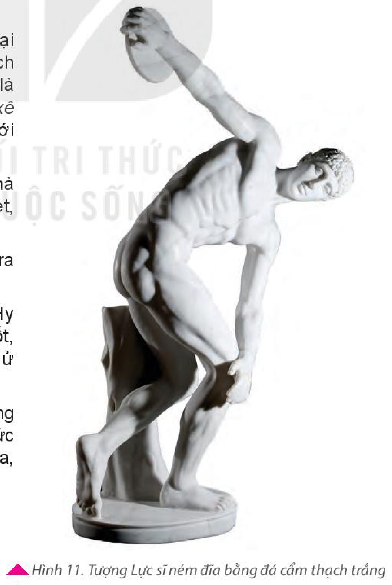

Hình 11. Tượng Lực sĩ ném đĩa bằng đá cẩm thạch trắng

<!-- pdf:50 -->

Người Hy Lạp và La Mã cổ đại đã xây dựng những công trình kiến trúc nổi tiếng. Trong đó, nhiều công trình còn được bảo tồn đến ngày nay.

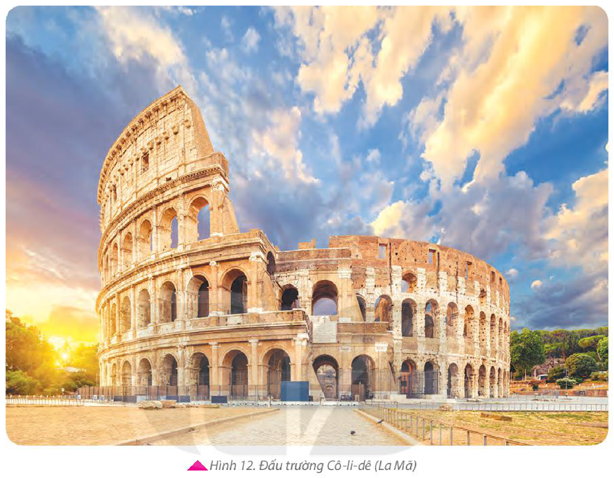

Hình 12. Đấu trường Cô-li-dê (La Mã)

> ❓ Hãy kể tên một số thành tựu văn hoá tiêu biểu của Hy Lạp và La Mã cổ đại.

## ✏️ Luyện tập và Vận dụng

1. Điều kiện tự nhiên tác động như thế nào đến sự hình thành và phát triển của văn minh Hy Lạp, La Mã?

2. Có ý kiến cho rằng: Người Hy Lạp và La Mã cổ đại đạt được những thành tựu văn hoá rực rỡ là do tiếp thu những thành tựu của người phương Đông cổ đại. Em có đồng ý với ý kiến trên không? Vì sao?

3. Theo em, thành tựu văn hoá nào của Hy Lạp, La Mã cổ đại còn được bảo tồn đến ngày nay?

## 📷 Danh sách hình trong bài

| Mã hình | Trang PDF | Vị trí trong bài | Chú thích gốc |
| --- | :---: | --- | --- |
| H6-lich_su_va_dia_ly-ls-b10-01 | 45 | Mở đầu (trang 44) | Hình 1. Đền Pác-tê-nông – công trình kiến trúc tiêu biểu của Hy Lạp cổ đại |
| H6-lich_su_va_dia_ly-ls-b10-02 | 45 | Cuối trang 44 (trục thời gian tràn sát mép trái trang sách) | (sách không đánh số, trục thời gian lịch sử Hy Lạp và La Mã cổ đại) |
| H6-lich_su_va_dia_ly-ls-b10-03 | 46 | Mục 1.a (trang 45) | Hình 2. Lược đồ Hy Lạp thời cổ đại |
| H6-lich_su_va_dia_ly-ls-b10-04 | 46 | Mục 1.a (trang 45) | Hình 3. Cảng Pi-rê ngày nay là cảng chính ở Hy Lạp, cách Thủ đô A-ten hơn 10 km. Đây là một trong những cảng hành khách lớn nhất ở châu Âu |
| H6-lich_su_va_dia_ly-ls-b10-05 | 47 | Mục 1.b (trang 46) | Hình 4. Lược đồ đế quốc La Mã thế kỉ II |
| H6-lich_su_va_dia_ly-ls-b10-06 | 48 | Mục 2 (trang 47) | Hình 5. Sơ đồ tổ chức Nhà nước thành bang A-ten |
| H6-lich_su_va_dia_ly-ls-b10-07 | 48 | Mục 2 (trang 47) | Hình 6. Tượng Pê-ri-clét (495 – 429 TCN) – Chấp chính quan trong thời đại hoàng kim của A-ten |
| H6-lich_su_va_dia_ly-ls-b10-08 | 48 | Mục 3 (trang 47) | Hình 7. Tượng Ốc-ta-vi-út (63 TCN – 14) – người mở đầu thời kì đế chế La Mã |
| H6-lich_su_va_dia_ly-ls-b10-09 | 48 | Mục 3 (trang 47) | Hình 8. Sơ đồ tổ chức Nhà nước đế chế ở La Mã |
| H6-lich_su_va_dia_ly-ls-b10-10 | 49 | Mục 4 (trang 48) | Hình 9. Bảng chữ cổ Hy Lạp và La-tinh |
| H6-lich_su_va_dia_ly-ls-b10-11 | 49 | Mục 4 (trang 48) | Hình 10. Bảng chữ số La Mã |
| H6-lich_su_va_dia_ly-ls-b10-12 | 49 | Mục 4 (trang 48, mũi tên đầu chú thích nằm sát mép phải cột chữ bên trái) | Hình 11. Tượng Lực sĩ ném đĩa bằng đá cẩm thạch trắng |
| H6-lich_su_va_dia_ly-ls-b10-13 | 50 | Mục 4 (trang 49) | Hình 12. Đấu trường Cô-li-dê (La Mã) |
