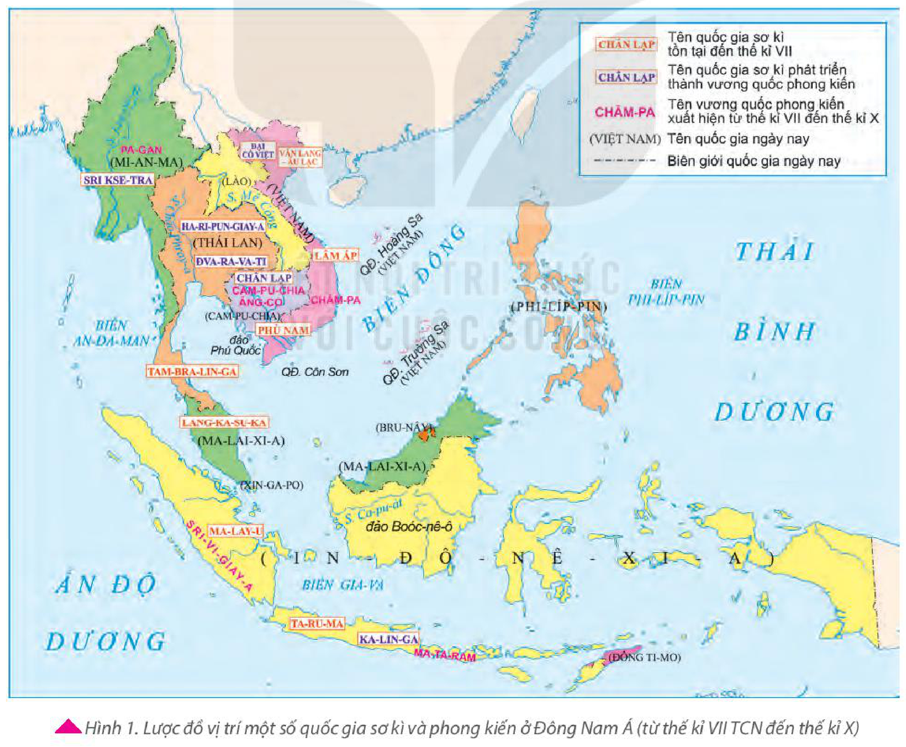
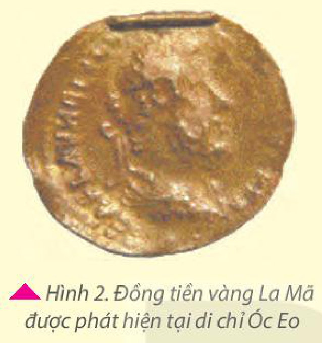
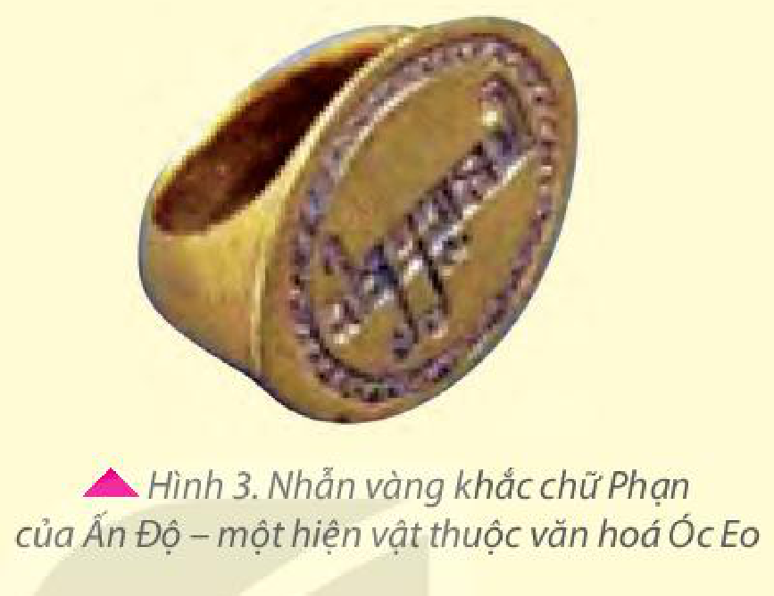

<!-- pdf:52 -->

# BÀI 11: CÁC QUỐC GIA SƠ KÌ Ở ĐÔNG NAM Á

## 🎯 Học xong bài này, em sẽ:

- Trình bày được sơ lược vị trí địa lí của khu vực Đông Nam Á.
- Trình bày được quá trình xuất hiện và sự giao lưu thương mại của các quốc gia sơ kì ở Đông Nam Á từ đầu Công nguyên đến thế kỉ VII.

## 🔴 Mở đầu

Em đã được học về Trung Quốc và Ấn Độ – những nền văn minh lớn của nhân loại. Giữa hai trung tâm văn minh này là khu vực Đông Nam Á, với vị trí rất quan trọng, là “ngã tư đường” của thế giới. Từ những thế kỉ trước đến đầu Công nguyên, ở đây đã hình thành các quốc gia đầu tiên. Quá trình đó diễn ra như thế nào? Các quốc gia đó đã phát triển ra sao đến thế kỉ VII?

## 1. "Cái nôi" của nền văn minh lúa nước

<!-- term: Vị trí địa lí của Đông Nam Á -->
Do vị trí địa lí nằm án ngữ trên con đường hàng hải nối liền giữa Ấn Độ Dương với Thái Bình Dương, từ lâu khu vực Đông Nam Á vẫn được coi là cầu nối giữa Trung Quốc, Nhật Bản với Ấn Độ, Tây Á và Địa Trung Hải.

<!-- term: Đông Nam Á lục địa và Đông Nam Á hải đảo -->
Đông Nam Á bao gồm hai khu vực riêng biệt là Đông Nam Á lục địa và Đông Nam Á hải đảo; lại nằm trong vùng nhiệt đới gió mùa, có lượng mưa lớn nên rất thích hợp cho sự phát triển của cây lúa nước và nhiều cây trồng khác. Nơi đây được biết đến là "cái nôi" của nền **văn minh lúa nước** và là quê hương của nhiều loại cây gia vị, hương liệu nổi tiếng.

> ❓ Dựa vào thông tin ở trên, kết hợp khai thác lược đồ hình 1 (tr.52), hãy mô tả vị trí địa lí của khu vực Đông Nam Á.

## 2. Quá trình hình thành các quốc gia sơ kì ở Đông Nam Á

<!-- term: Quốc gia sơ kì Đông Nam Á -->
Ngay từ những thế kỉ trước Công nguyên đến đầu Công nguyên, cư dân Đông Nam Á đã phát triển nông nghiệp trồng lúa nước và một số nghề thủ công truyền thống như đúc đồng, rèn sắt, dệt, làm gốm,... Đây chính là cơ sở cho sự ra đời của những quốc gia sơ kì trong khu vực. Sự ra đời của các quốc gia này còn gắn liền với các hoạt động giao lưu kinh tế, văn hoá với Trung Quốc, Ấn Độ.

<!-- pdf:53 -->

> *Phía đông đảo Boóc-nê-ô (Ma-lai-xi-a) đã phát hiện được bảy chiếc cột đá có khắc chữ San-xkrít (chữ Phạn)... Hiện vật gốm (Hán) trong những mộ táng ở Boóc-nê-ô cho thấy mối quan hệ buôn bán với Trung Quốc từ thời nhà Hán. Ở Thái Lan, tại di chỉ khảo cổ Pông-túc (thế kỉ III – IV) đã phát hiện được một số mảnh gốm, một số pho tượng Phật nhỏ bằng đồng, một đèn đồng kiểu La Mã.*
>
> (Theo Lương Ninh, *Đông Nam Á – Lịch sử từ nguyên thuỷ đến ngày nay*, NXB Chính trị quốc gia – Sự thật, 2011, tr.57, 59)

<!-- term: Quốc gia sơ kì Đông Nam Á -->
Khoảng thế kỉ VII TCN đến thế kỉ VII, khu vực Đông Nam Á đã lần lượt xuất hiện một số quốc gia sơ kì như Văn Lang – Âu Lạc, Chăm-pa, Phù Nam (thuộc Việt Nam), các quốc gia ở hạ lưu sông Chao Phray-a (thuộc Thái Lan) và các đảo thuộc In-đô-nê-xi-a ngày nay.

Hình 1. Lược đồ vị trí một số quốc gia sơ kì và phong kiến ở Đông Nam Á (từ thế kỉ VII TCN đến thế kỉ X)

<!-- pdf:54 -->

<!-- term: Óc Eo -->
Do vị trí thuận lợi, buôn bán bằng đường biển ở một số quốc gia ngày càng phát đạt. Một số thành thị đồng thời là những hải cảng sầm uất đã xuất hiện như Óc Eo (Việt Nam), Ta-cô-la (bán đảo Mã Lai, nay thuộc Thái Lan).

<!-- term: Óc Eo -->
Hình 2. Đồng tiền vàng La Mã được phát hiện tại di chỉ Óc Eo

<!-- term: Óc Eo -->
Hình 3. Nhẫn vàng khắc chữ Phạn của Ấn Độ – một hiện vật thuộc văn hoá Óc Eo

> ❓ 1. Hãy chỉ và kể tên một số quốc gia sơ kì ở Đông Nam Á trên lược đồ hình 1 (tr.52).
>
> 2. Tư liệu (tr.52) và hình 2, 3 chứng tỏ điều gì về giao lưu thương mại của các quốc gia sơ kì Đông Nam Á vào những thế kỉ đầu Công nguyên.

## ✏️ Luyện tập và Vận dụng

1. Tác động của việc giao lưu thương mại đối với sự ra đời của các quốc gia sơ kì Đông Nam Á như thế nào?

2. Sưu tầm thêm thông tin từ sách, báo, internet về quá trình hình thành của một quốc gia sơ kì ở Đông Nam Á mà em thích và chia sẻ với bạn.

3. Sưu tầm những câu thành ngữ, tục ngữ của người Việt liên quan đến lúa, gạo.

## 📷 Danh sách hình trong bài

| Mã hình | Trang PDF | Vị trí trong bài | Chú thích gốc |
| --- | :---: | --- | --- |
| H6-lich_su_va_dia_ly-ls-b11-01 | 53 | Mục 2 (trang 52) | Hình 1. Lược đồ vị trí một số quốc gia sơ kì và phong kiến ở Đông Nam Á (từ thế kỉ VII TCN đến thế kỉ X) |
| H6-lich_su_va_dia_ly-ls-b11-02 | 54 | Mục 2 (trang 53) | Hình 2. Đồng tiền vàng La Mã được phát hiện tại di chỉ Óc Eo |
| H6-lich_su_va_dia_ly-ls-b11-03 | 54 | Mục 2 (trang 53) | Hình 3. Nhẫn vàng khắc chữ Phạn của Ấn Độ – một hiện vật thuộc văn hoá Óc Eo |
