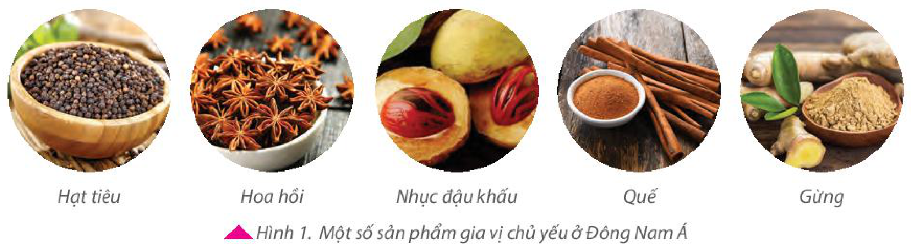

<!-- pdf:55 -->

# BÀI 12: SỰ HÌNH THÀNH VÀ BƯỚC ĐẦU PHÁT TRIỂN CỦA CÁC VƯƠNG QUỐC PHONG KIẾN Ở ĐÔNG NAM Á (TỪ THẾ KỈ VII ĐẾN THẾ KỈ X)

## 🎯 Học xong bài này, em sẽ:

- Nêu được sự hình thành và phát triển ban đầu của các vương quốc phong kiến ở Đông Nam Á (từ thế kỉ VII đến thế kỉ X).
- Phân tích được tác động chính của quá trình giao lưu thương mại ở các vương quốc phong kiến Đông Nam Á đến thế kỉ X.

## 🔴 Mở đầu

Trong quá trình phát triển, các quốc gia sơ kì ở Đông Nam Á đã dần tạo lập được những cơ sở đưa đến sự ra đời của các vương quốc phong kiến đầu tiên. Những nền tảng kinh tế đã được tạo dựng vững chắc như thế nào để tạo ra bước phát triển mới cho Đông Nam Á trong giai đoạn thịnh vượng sau này?
<!-- ocr-ok: đã đối chiếu ảnh trang gốc p055, hình nhân vật trang trí bên trái làm OCR đọc lỗi chữ đầu dòng -->

## 1. Sự hình thành các vương quốc phong kiến

Từ thế kỉ VII đến thế kỉ X, ở khu vực Đông Nam Á đã hình thành một số quốc gia, lấy một bộ tộc đông và phát triển nhất làm nòng cốt như: quốc gia Đại Cồ Việt của người Việt (ở Bắc Việt Nam), các vương quốc Sri Kse-tra của người Môn và Pa-gan của người Miến (ở lưu vực sông I-ra-oa-đi); Vương quốc Đva-ra-va-ti của người Môn (ở lưu vực sông Chao Phray-a); Vương quốc Chân Lạp của người Khơ-me (ở vùng trung lưu sông Mê Công); Vương quốc Sri Vi-giay-a của người Mã Lai (trên đảo Xu-ma-tra); Vương quốc Ka-lin-ga của người In-đô-nê-xi-a (trên đảo Gia-va).

> **Em có biết?**
>
> **Sri Vi-giay-a** là một vương quốc nằm trên vùng eo biển Sun-đa, thuộc đảo Xu-ma-tra (nổi tiếng có nhiều vàng, bạc và đồ gia vị, nên còn được gọi là đảo Vàng). Sau này, Sri Vi-giay-a trở thành một quốc gia hùng mạnh, trung tâm kinh tế, văn hoá quan trọng ở khu vực Đông Nam Á.

> ❓ Quan sát lược đồ hình 1 (tr.52) và thông tin trong bài học, em hãy nêu tên và xác định nơi hình thành các quốc gia phong kiến Đông Nam Á.

## 2. Hoạt động kinh tế ở các vương quốc phong kiến Đông Nam Á từ thế kỉ VII đến thế kỉ X

Trên nền tảng của các quốc gia sơ kì, kinh tế của các **vương quốc phong kiến** Đông Nam Á vẫn tiếp tục phát triển.

Các vương quốc lấy nông nghiệp làm ngành kinh tế chính, chủ yếu nằm ở vùng lục địa (như Chăm-pa, Chân Lạp), ở lưu vực sông Chao Phray-a (Thái Lan), lưu vực sông I-ra-oa-đi (Mi-an-ma ngày nay),...

<!-- pdf:56 -->

Một số quốc gia chủ yếu dựa vào hoạt động thương mại biển như Sri Vi-giay-a, Ka-lin-ga, Ma-ta-ram (In-đô-nê-xi-a ngày nay). Với nguồn sản vật phong phú, đặc biệt là gia vị, các vương quốc này góp nhiều mặt hàng chủ lực trên những tuyến buôn bán đường biển kết nối Á – Âu, mà sau này gọi là **Con đường Gia vị**.

Hình 1. Một số sản phẩm gia vị chủ yếu ở Đông Nam Á

> *Đế quốc của nhà vua rất đông dân cư... Nhà vua có nhiều loại dầu thơm và cây thuốc mà không một ông vua nào có được. Đất đai sản sinh ra long não, trầm hương, đinh hương, đàn hương, đậu khấu, sa nhân,... – Nhận xét của một nhà địa lí Ả Rập về Vương quốc Sri Vi-giay-a.*
>
> (Theo Lương Ninh (Chủ biên) *Đông Nam Á – Lịch sử từ nguyên thuỷ đến ngày nay*, Sđd, tr.106)

<!-- term: Thương cảng ở Đông Nam Á -->
Quá trình giao lưu thương mại với nước ngoài đã thúc đẩy sự phát triển của các vương quốc trong khu vực. Vì thế trong thời kì này, ở các vương quốc cũng xuất hiện một số thương cảng sầm uất như Đại Chiêm (Chăm-pa), Pa-lem-bang (Sri Vi-giay-a),... Những thương cảng này đã trở thành điểm kết nối kinh tế, văn hoá giữa các châu lục.

> ❓ 1. Khai thác tư liệu trên và cho biết thương nhân nước ngoài bị hấp dẫn bởi những sản vật nào của Vương quốc Sri Vi-giay-a?
>
> 2. Hãy trình bày hoạt động kinh tế chính của các vương quốc phong kiến Đông Nam Á từ thế kỉ VII đến thế kỉ X.

## ✏️ Luyện tập và Vận dụng

1. Các vương quốc phong kiến Đông Nam Á đã phát huy những lợi thế nào để phát triển kinh tế?

2. Hoạt động giao lưu thương mại đã tác động như thế nào đến sự phát triển kinh tế các quốc gia phong kiến Đông Nam Á?

3. Có một câu chuyện thú vị như sau: Vào thế kỉ X, 1 pao nghệ tây (khoảng 4 lạng) có giá ngang với 1 con ngựa, 1 pao gừng có giá ngang 1 con bò.

   Từ câu chuyện trên cùng thông tin trong bài học, hãy viết một đoạn văn ngắn (từ 3 – 5 câu) mô tả sự hấp dẫn của nguồn gia vị ở các vương quốc Đông Nam Á đối với thương nhân nước ngoài.

## 📷 Danh sách hình trong bài

| Mã hình | Trang PDF | Vị trí trong bài | Chú thích gốc |
| --- | :---: | --- | --- |
| H6-lich_su_va_dia_ly-ls-b12-01 | 56 | Mục 2 (trang 55) | Hình 1. Một số sản phẩm gia vị chủ yếu ở Đông Nam Á |
