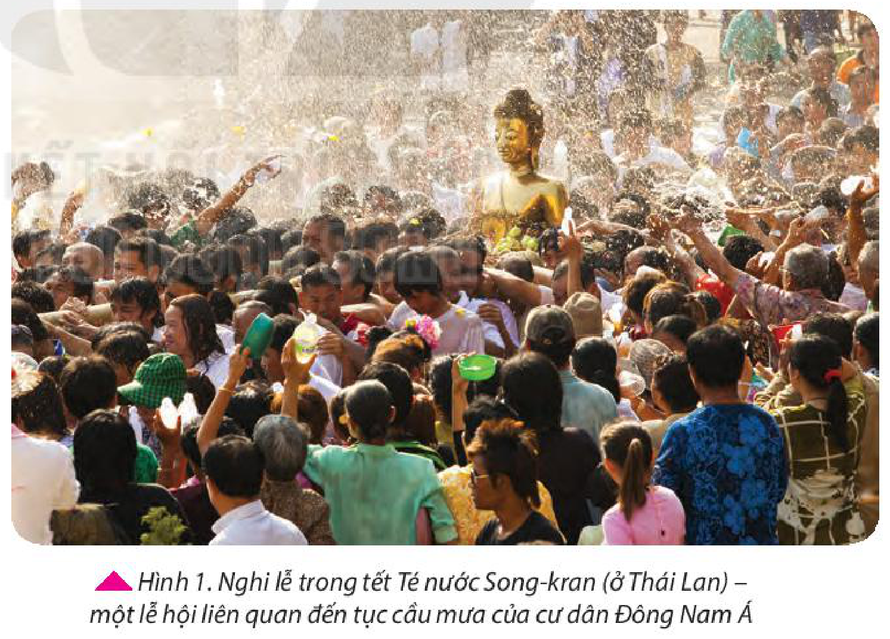
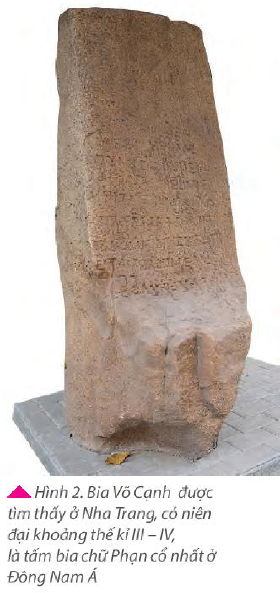
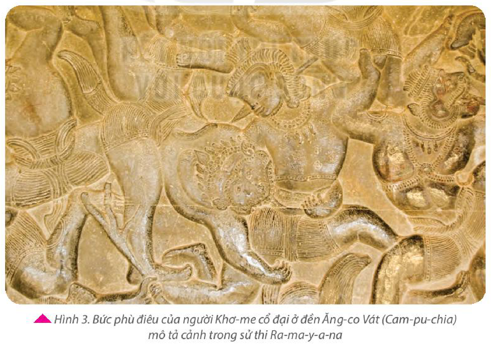
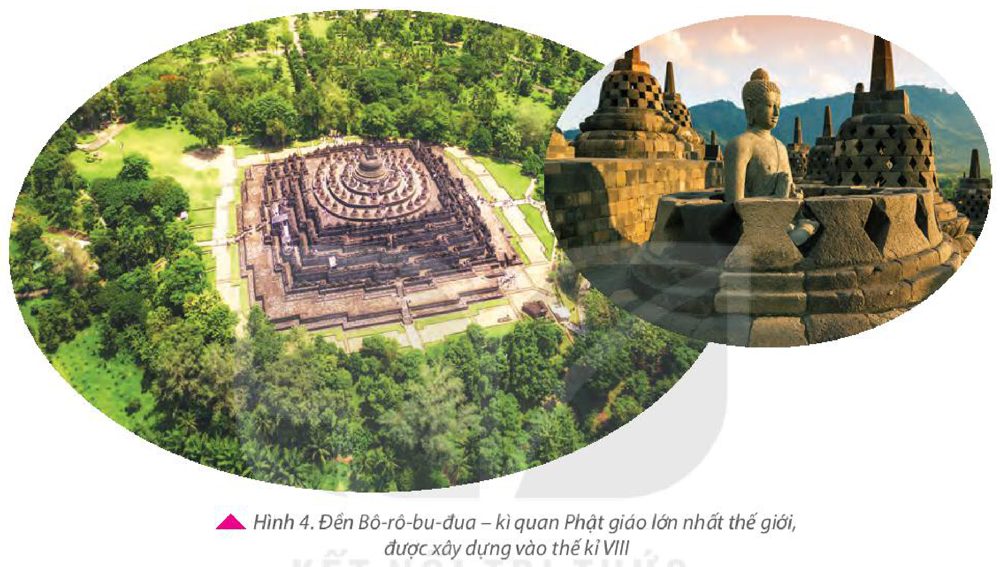
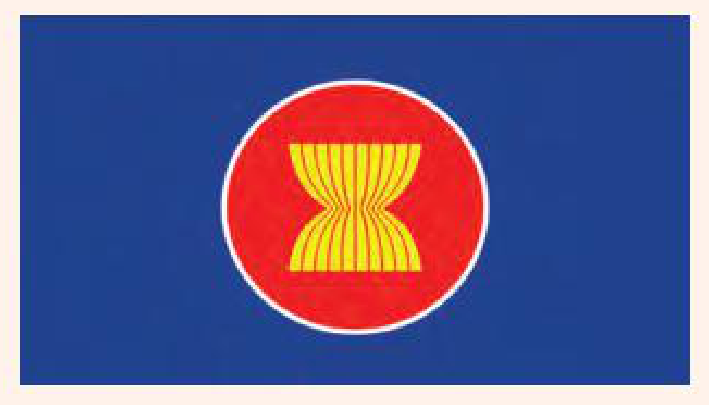

<!-- pdf:57 -->

# BÀI 13: GIAO LƯU VĂN HOÁ Ở ĐÔNG NAM Á TỪ ĐẦU CÔNG NGUYÊN ĐẾN THẾ KỈ X

## 🎯 Học xong bài này, em sẽ:

Phân tích được những tác động chính của quá trình giao lưu văn hoá ở Đông Nam Á từ đầu Công nguyên đến thế kỉ X.

## 🔴 Mở đầu

Trong hơn mười thế kỉ hình thành và phát triển, ở Đông Nam Á đã diễn ra quá trình giao lưu văn hoá với Trung Quốc và Ấn Độ. Quá trình giao lưu đó đã tác động như thế nào đến văn hoá Đông Nam Á?

## 1. Tín ngưỡng, tôn giáo

Trong quá trình lịch sử, cư dân Đông Nam Á có nhiều tín ngưỡng dân gian như: **tín ngưỡng phồn thực**, tục thờ cúng tổ tiên, tục cầu mưa,...

> **Em có biết?**
>
> Tín ngưỡng phồn thực của người Chăm xưa nhằm cầu mong vạn vật sinh sôi, nảy nở, sung túc.
>
> Sau này, khi Ấn Độ giáo được tiếp nhận, **lin-ga** (linh vật tượng trưng cho tín ngưỡng phồn thực) trở thành biểu tượng quyền lực cho nhà vua – người được đồng nhất với một vị thần, gọi là **Thần Vua**.

Hình 1. Nghi lễ trong tết Té nước Song-kran (ở Thái Lan) – một lễ hội liên quan đến tục cầu mưa của cư dân Đông Nam Á

Các tín ngưỡng bản địa đã dung hợp với Ấn Độ giáo (từ Ấn Độ), Phật giáo (từ Ấn Độ và Trung Quốc). Trong đó, các quốc gia chịu ảnh hưởng của văn hoá Ấn Độ đều có tín ngưỡng Thần – Vua (Chăm-pa, Chân Lạp,...).

> ❓ Đời sống tín ngưỡng – tôn giáo của các cư dân Đông Nam Á đã chịu ảnh hưởng từ văn hoá Ấn Độ, Trung Quốc như thế nào?

<!-- pdf:58 -->

## 2. Chữ viết – văn học

Nhiều nhóm cư dân Đông Nam Á đã tạo ra chữ viết riêng dựa trên hệ thống chữ cổ của người Ấn Độ.

> *Tấm bia đầu tiên của người Khơ-me bằng chữ Phạn và chữ Khơ-me cổ là bia Ăng-co Bo-rây (Cam-pu-chia).*
>
> *Trên cơ sở chữ Pa-li, người Môn (người Mi-an-ma) đã sáng tạo ra chữ Môn cổ.*
>
> *Người Mã Lai đã sáng tạo ra chữ Mã Lai cổ, được tìm thấy trên tấm bia ở đảo Xu-ma-tra.*
>
> (Theo Vũ Dương Ninh, *Lịch sử văn minh thế giới*, NXB Giáo dục, Hà Nội, 2000, tr.172 – 173)

Riêng người Việt thì kế thừa hệ thống chữ Hán của người Trung Quốc.

Bên cạnh kho tàng văn học dân gian (ca dao, tục ngữ, hò vè,...), người Đông Nam Á cũng tiếp thu văn học của người Ấn Độ, tiêu biểu nhất là sử thi *Ma-ha-bha-ra-ta*, *Ra-ma-y-a-na* để sáng tạo bộ sử thi của dân tộc mình như: *Phạ lắc – Phạ Lam* (Lào), *Ra-ma-kien* (Thái Lan), *Ra-ma-y-a-na* (In-đô-nê-xi-a), *Riêm Kê* (Cam-pu-chia),...
<!-- ocr-ok: đã đối chiếu ảnh trang gốc p058, chú thích Hình 2 ở cột phải khiến OCR cắt mất hai dòng giữa đoạn văn cột trái -->

Hình 2. **Bia Võ Cạnh** được tìm thấy ở Nha Trang, có niên đại khoảng thế kỉ III – IV, là tấm bia chữ Phạn cổ nhất ở Đông Nam Á
<!-- ocr-ok: đã đối chiếu ảnh trang gốc p058, OCR trộn dòng chú thích Hình 2 với đoạn văn bên trái -->

Hình 3. Bức phù điêu của người Khơ-me cổ đại ở đền Ăng-co Vát (Cam-pu-chia) mô tả cảnh trong sử thi Ra-ma-y-a-na

> ❓ Những bằng chứng nào chứng tỏ chữ viết, văn học Đông Nam Á chịu ảnh hưởng của văn hoá Ấn Độ, Trung Quốc?

<!-- pdf:59 -->

## 3. Kiến trúc – điêu khắc

Nghệ thuật kiến trúc và điêu khắc Đông Nam Á đều chịu ảnh hưởng đậm nét của các tôn giáo như Ấn Độ giáo, Phật giáo.

Kiểu kiến trúc Ấn Độ giáo tiêu biểu ở Đông Nam Á là **kiến trúc đền – núi**, như đền Bô-rô-bu-đua, La-ra Giong-grang (In-đô-nê-xi-a), khu di tích Mỹ Sơn (Việt Nam),...

Nghệ thuật điêu khắc Đông Nam Á cũng chịu ảnh hưởng rõ rệt của Ấn Độ với các loại hình chủ yếu là phù điêu, các bức chạm nổi, tượng thần, Phật,...

Hình 4. **Đền Bô-rô-bu-đua** – kì quan Phật giáo lớn nhất thế giới, được xây dựng vào thế kỉ VIII

> ❓ Kiến trúc và điêu khắc Đông Nam Á từ đầu Công nguyên đến thế kỉ X có điểm gì nổi bật?

## ✏️ Luyện tập và Vận dụng

1. Văn hoá Ấn Độ, Trung Quốc đã ảnh hưởng đến văn hoá Đông Nam Á như thế nào trong những thế kỉ đầu Công nguyên?

2. Tìm thêm thông tin và chia sẻ với bạn về một thành tựu văn hoá Đông Nam Á chịu ảnh hưởng của văn hoá Ấn Độ, Trung Quốc.

3. Biểu tượng trên lá cờ của Hiệp hội các quốc gia Đông Nam Á (ASEAN) ngày nay thể hiện điều gì?

## 📷 Danh sách hình trong bài

| Mã hình | Trang PDF | Vị trí trong bài | Chú thích gốc |
| --- | :---: | --- | --- |
| H6-lich_su_va_dia_ly-ls-b13-01 | 57 | Mục 1 (trang 56) | Hình 1. Nghi lễ trong tết Té nước Song-kran (ở Thái Lan) – một lễ hội liên quan đến tục cầu mưa của cư dân Đông Nam Á |
| H6-lich_su_va_dia_ly-ls-b13-02 | 58 | Mục 2 (trang 57, ảnh tràn sát mép phải trang sách) | Hình 2. Bia Võ Cạnh được tìm thấy ở Nha Trang, có niên đại khoảng thế kỉ III – IV, là tấm bia chữ Phạn cổ nhất ở Đông Nam Á |
| H6-lich_su_va_dia_ly-ls-b13-03 | 58 | Mục 2 (trang 57) | Hình 3. Bức phù điêu của người Khơ-me cổ đại ở đền Ăng-co Vát (Cam-pu-chia) mô tả cảnh trong sử thi Ra-ma-y-a-na |
| H6-lich_su_va_dia_ly-ls-b13-04 | 59 | Mục 3 (trang 58) | Hình 4. Đền Bô-rô-bu-đua – kì quan Phật giáo lớn nhất thế giới, được xây dựng vào thế kỉ VIII |
| H6-lich_su_va_dia_ly-ls-b13-05 | 59 | Luyện tập và Vận dụng, câu 3 (trang 58) | (sách không đánh số, lá cờ của Hiệp hội các quốc gia Đông Nam Á – ASEAN) |
