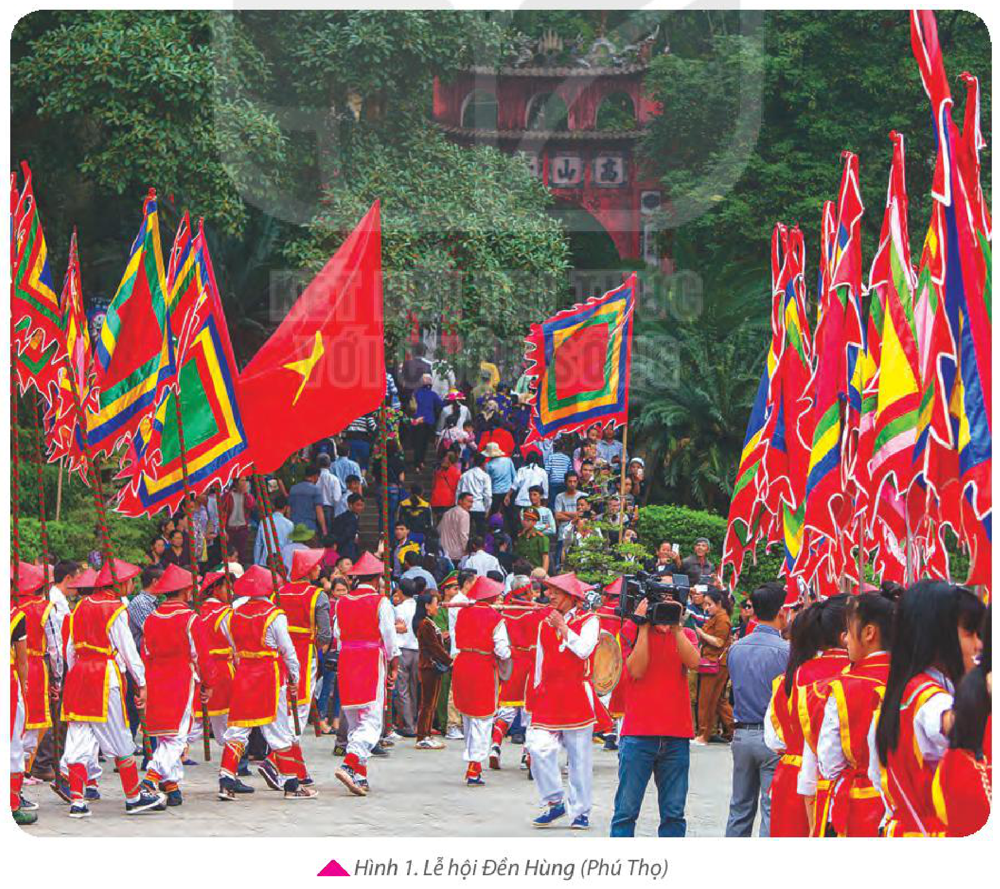
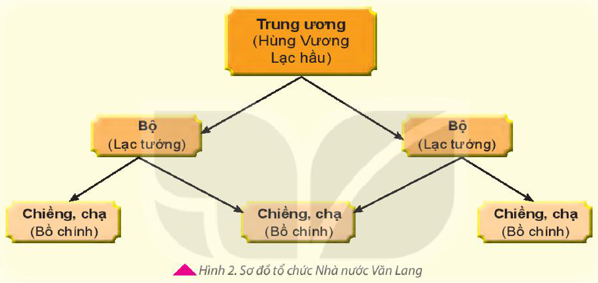
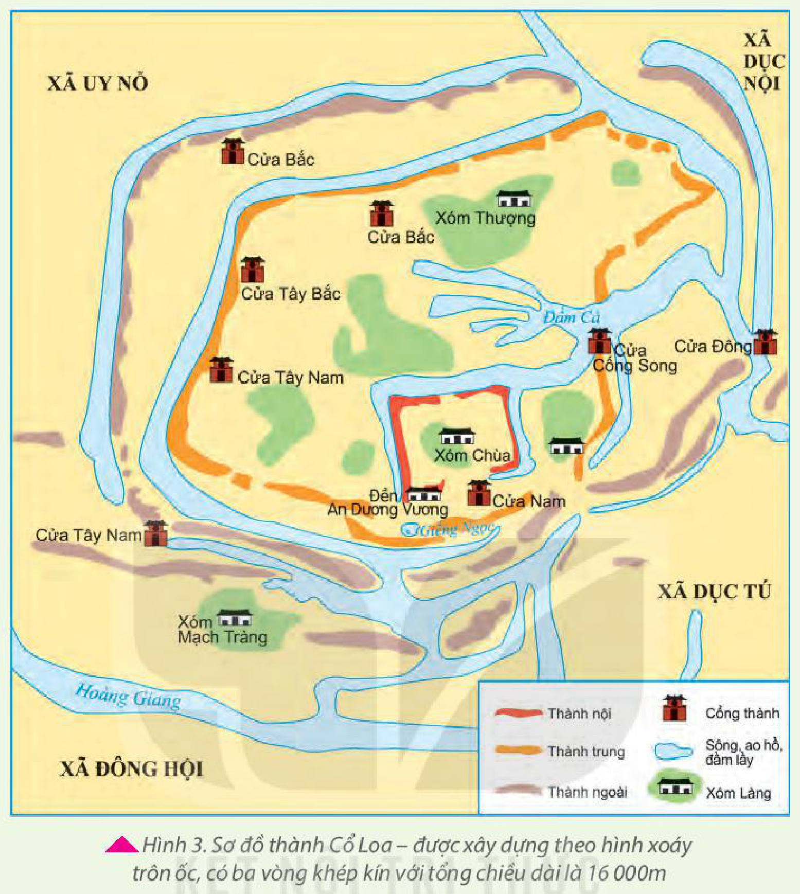
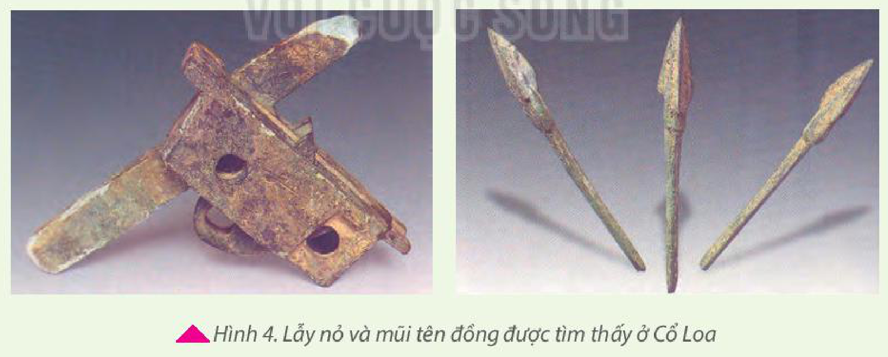
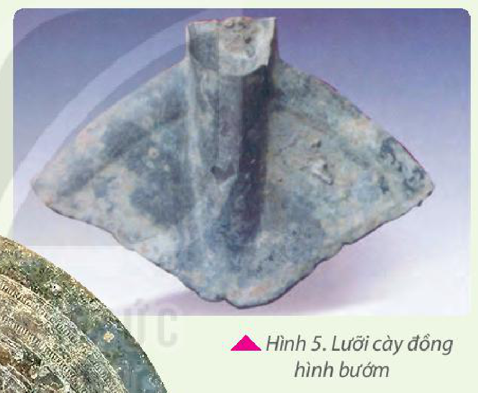
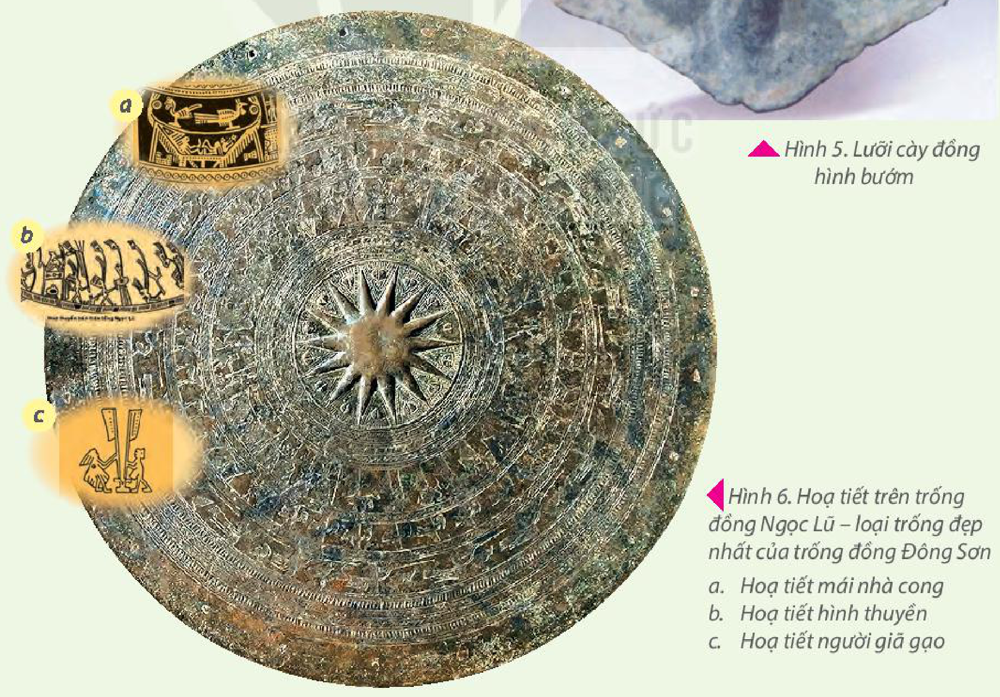
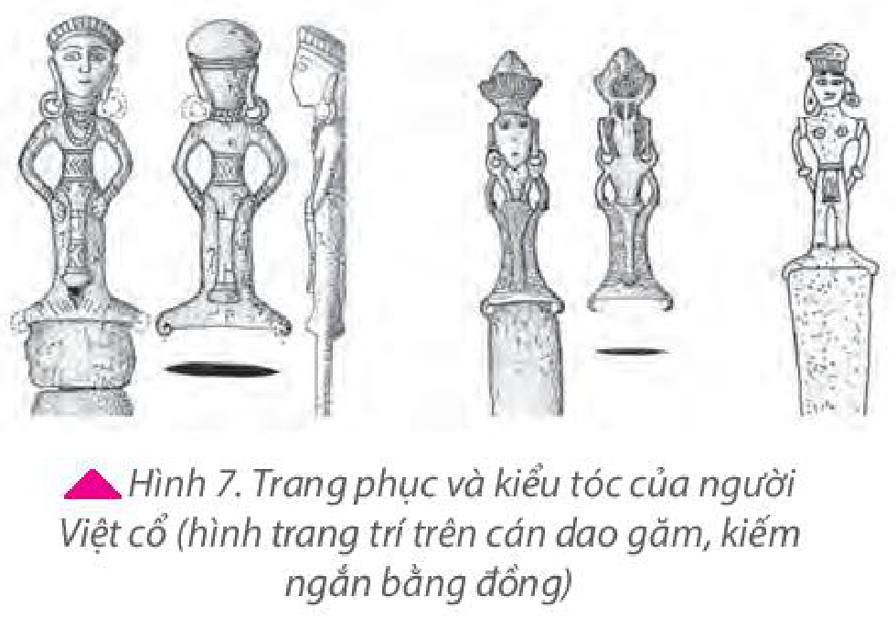
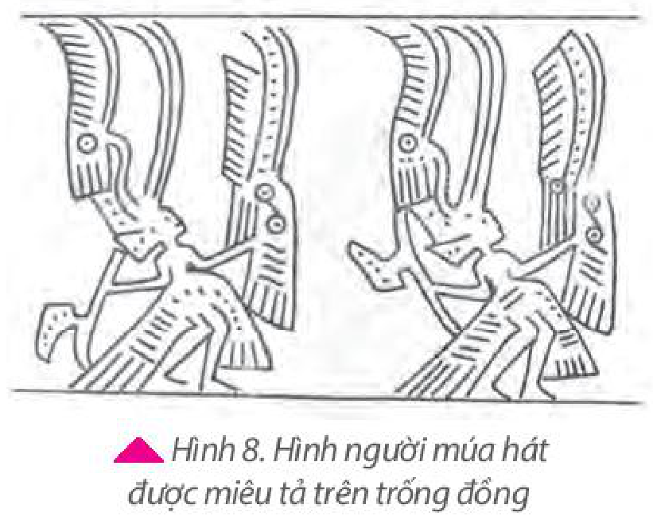

<!-- pdf:61 -->

# BÀI 14: NHÀ NƯỚC VĂN LANG – ÂU LẠC

## 🎯 Học xong bài này, em sẽ:

- Nêu được khoảng thời gian thành lập và xác định được phạm vi không gian của nước Văn Lang – Âu Lạc trên lược đồ.
- Trình bày được tổ chức nhà nước của Văn Lang – Âu Lạc.
- Mô tả được đời sống vật chất và tinh thần của cư dân Văn Lang – Âu Lạc.

## 🔴 Mở đầu

*Dù ai đi ngược về xuôi*
*Nhớ ngày giỗ Tổ mùng Mười tháng Ba.*

Từ lâu đời, tín ngưỡng thờ cúng Hùng Vương đã ăn sâu vào tâm thức, tình cảm của những người dân Việt và trở thành truyền thống đặc biệt của dân tộc ta. Hình ảnh dưới đây đã phản ánh phần nào không khí của ngày giỗ Tổ. Đã bao giờ em tự hỏi: Điều gì đã thôi thúc nhân dân ta luôn hướng về mảnh đất cội nguồn?

*Hình 1. Lễ hội Đền Hùng (Phú Thọ)*

<!-- pdf:62 -->

## 1. Nhà nước đầu tiên của người Việt cổ

<!-- term: Nhà nước Văn Lang -->
Vào khoảng thế kỉ VII TCN, nhờ sự phát triển của công cụ bằng đồng và sắt, đời sống sản xuất của người Việt cổ đã có sự chuyển biến rõ rệt. Nhu cầu chung sống, cùng làm thuỷ lợi và chống ngoại xâm đã thúc đẩy sự ra đời của nhà nước đầu tiên ở Việt Nam – Nhà nước Văn Lang. Địa bàn chủ yếu của nước Văn Lang gắn liền với lưu vực các dòng sông lớn ở Bắc Bộ và Bắc Trung Bộ ngày nay.

<!-- term: Nhà nước Văn Lang -->
<!-- term: Hùng Vương -->
Nước Văn Lang chia làm 15 bộ, đứng đầu liên minh 15 bộ là Hùng Vương, tương truyền trải qua 18 đời, cha truyền con nối.

> **Trung ương** (Hùng Vương, Lạc hầu) → **Bộ** (Lạc tướng) → **Chiềng, chạ** (Bồ chính)
<!-- ocr-ok: nội dung sơ đồ Hình 2 đối chiếu trực tiếp p062.png -->

*Hình 2. Sơ đồ tổ chức Nhà nước Văn Lang*

<!-- term: Nhà nước Văn Lang -->
Tuy còn sơ khai, chưa có pháp luật thành văn và chữ viết,... nhưng sự ra đời của Nhà nước Văn Lang đã mở ra thời kì dựng nước đầu tiên trong lịch sử dân tộc.

> ❓ 1. Dựa vào thông tin trong mục 1 và sử dụng bản đồ hành chính Việt Nam, hãy xác định phạm vi không gian chủ yếu của nước Văn Lang trên bản đồ.
>
> 2. Nhà nước Văn Lang ra đời vào thời gian nào? Hãy nêu ý nghĩa sự ra đời của Nhà nước Văn Lang.

## 2. Sự ra đời nước Âu Lạc

<!-- term: Nhà nước Âu Lạc -->
<!-- term: An Dương Vương -->
Cuối thế kỉ III TCN, nhà Tần đem quân đánh xuống phía nam. Người Lạc Việt và người Âu Việt đã đoàn kết với nhau cùng chống quân xâm lược. Họ đã cử ra “người tuấn kiệt” là Thục Phán lãnh đạo cuộc kháng chiến. Thục Phán lên làm vua, xưng là An Dương Vương, lập ra nước Âu Lạc (khoảng năm 208 TCN).

<!-- term: Nhà nước Âu Lạc -->
<!-- term: Thành Cổ Loa -->
Tổ chức Nhà nước Âu Lạc không có nhiều thay đổi so với Nhà nước Văn Lang, nhưng vua có quyền thế cao hơn trong việc trị nước. Lãnh thổ đất nước được mở rộng hơn; có quân đội mạnh, vũ khí tốt, đặc biệt có thành Cổ Loa kiên cố, vững chắc. Kinh đô của Âu Lạc đã chuyển từ miền trung du Phong Châu xuống vùng đồng bằng ở Cổ Loa (Đông Anh, Hà Nội ngày nay).

<!-- pdf:63 -->

<!-- term: Thành Cổ Loa -->
*Hình 3. Sơ đồ thành Cổ Loa – được xây dựng theo hình xoáy trôn ốc, có ba vòng khép kín với tổng chiều dài là 16 000m*

*Hình 4. Lẫy nỏ và mũi tên đồng được tìm thấy ở Cổ Loa*

> ❓ 1. Dựa vào thông tin trong mục 2 và sử dụng bản đồ hành chính Việt Nam, hãy xác định phạm vi không gian chủ yếu của nước Âu Lạc trên bản đồ.
>
> 2. Nước Âu Lạc ra đời trong bối cảnh nào? Nhà nước Âu Lạc có điểm gì giống và khác so với Nhà nước Văn Lang?

<!-- pdf:64 -->

## 3. Đời sống vật chất và tinh thần của cư dân Văn Lang, Âu Lạc

### a) Đời sống vật chất

<!-- term: Đời sống vật chất của cư dân Văn Lang – Âu Lạc -->
Cư dân Việt cổ đã biết đến nền “nông nghiệp dùng cày” và sớm lấy nghề nông trồng lúa nước làm nghề chính. Ngoài ra, họ còn trồng các loại cây hoa màu và trồng dâu, nuôi tằm.

<!-- term: Đời sống vật chất của cư dân Văn Lang – Âu Lạc -->
<!-- term: Trống đồng Đông Sơn -->
Nghề luyện kim của người Việt cổ dần được chuyên môn hoá. Kĩ thuật đúc đồng phát triển với những hiện vật tiêu biểu là trống đồng Ngọc Lũ, thạp đồng Đào Thịnh. Bên cạnh đó, họ đã bước đầu biết rèn sắt.

<!-- term: Đời sống vật chất của cư dân Văn Lang – Âu Lạc -->
Cư dân chủ yếu ở nhà sàn được làm bằng tre, nứa, lá, gỗ,... Thức ăn chính là gạo nếp, gạo tẻ, muối, mắm cá,...

<!-- term: Đời sống vật chất của cư dân Văn Lang – Âu Lạc -->
Người Việt cổ ngày thường để tóc ngang vai, búi tó hoặc tết tóc kiểu đuôi sam. Nam đóng khố, cởi trần, đi chân đất, nữ mặc váy, mặc yếm. Vào dịp lễ hội, họ có thể đội thêm mũ lông chim, đeo trang sức (vòng tay, hạt chuỗi, khuyên tai,...).

*Hình 5. Lưỡi cày đồng hình bướm*

<!-- term: Trống đồng Đông Sơn -->
*Hình 6. Hoạ tiết trên trống đồng Ngọc Lũ – loại trống đẹp nhất của trống đồng Đông Sơn (a. Hoạ tiết mái nhà cong; b. Hoạ tiết hình thuyền; c. Hoạ tiết người giã gạo)*

<!-- pdf:65 -->

*Hình 7. Trang phục và kiểu tóc của người Việt cổ (hình trang trí trên cán dao găm, kiếm ngắn bằng đồng)*

*Hình 8. Hình người múa hát được miêu tả trên trống đồng*

> ❓ 1. Quan sát hình 6, 7, 8 và dựa vào thông tin trong mục a, em hãy mô tả đời sống vật chất (nguồn lương thực, nơi ở, phương tiện đi lại, trang phục, đồ trang sức,...) của người Việt cổ.
>
> 2. Những nghề sản xuất chính của cư dân Văn Lang – Âu Lạc là gì?

### b) Đời sống tinh thần

<!-- term: Đời sống tinh thần của cư dân Văn Lang – Âu Lạc -->
Về mặt tín ngưỡng, cư dân Văn Lang – Âu Lạc có tục thờ cúng tổ tiên và thờ các vị thần trong tự nhiên như thần Sông, thần Núi, thần Mặt Trời,...

<!-- term: Đời sống tinh thần của cư dân Văn Lang – Âu Lạc -->
Người Việt cổ có tục xăm mình, nhuộm răng đen, ăn trầu, làm bánh chưng, bánh giầy. Các lễ hội gắn với nền nông nghiệp trồng lúa nước cũng được tổ chức thường xuyên.

Những thành tựu về đời sống vật chất và tinh thần của cư dân Văn Lang – Âu Lạc đã tạo nên nền văn minh đầu tiên trong lịch sử Việt Nam, góp phần tạo dựng nền tảng cốt lõi của bản sắc văn hoá dân tộc.

> ❓ Trình bày những nét chính về đời sống tinh thần của cư dân Văn Lang, Âu Lạc.

## ✏️ Luyện tập và Vận dụng

1. Hãy ghi lại những thông tin cơ bản nhất về hai nhà nước Văn Lang và Âu Lạc theo các gợi ý sau: thời gian thành lập – kết thúc; kinh đô; tổ chức bộ máy nhà nước.

2. Nêu một số thành tựu tiêu biểu của thời kì Văn Lang – Âu Lạc. Viết một đoạn văn ngắn giới thiệu về một thành tựu mà em thích nhất.

3. Lễ hội Đền Hùng được tổ chức vào ngày 10 – 3 âm lịch hằng năm có ý nghĩa như thế nào?

## 📷 Danh sách hình trong bài

| Mã hình | Trang PDF | Vị trí trong bài | Chú thích gốc |
| --- | :---: | --- | --- |
| H6-lich_su_va_dia_ly-ls-b14-01 | 61 | Mở đầu | Hình 1. Lễ hội Đền Hùng (Phú Thọ) |
| H6-lich_su_va_dia_ly-ls-b14-02 | 62 | Mục 1 | Hình 2. Sơ đồ tổ chức Nhà nước Văn Lang |
| H6-lich_su_va_dia_ly-ls-b14-03 | 63 | Mục 2 | Hình 3. Sơ đồ thành Cổ Loa – được xây dựng theo hình xoáy trôn ốc, có ba vòng khép kín với tổng chiều dài là 16 000m |
| H6-lich_su_va_dia_ly-ls-b14-04 | 63 | Mục 2 | Hình 4. Lẫy nỏ và mũi tên đồng được tìm thấy ở Cổ Loa |
| H6-lich_su_va_dia_ly-ls-b14-05 | 64 | Mục 3.a | Hình 5. Lưỡi cày đồng hình bướm |
| H6-lich_su_va_dia_ly-ls-b14-06 | 64 | Mục 3.a | Hình 6. Hoạ tiết trên trống đồng Ngọc Lũ – loại trống đẹp nhất của trống đồng Đông Sơn |
| H6-lich_su_va_dia_ly-ls-b14-07 | 65 | Mục 3.a | Hình 7. Trang phục và kiểu tóc của người Việt cổ (hình trang trí trên cán dao găm, kiếm ngắn bằng đồng) |
| H6-lich_su_va_dia_ly-ls-b14-08 | 65 | Mục 3.a | Hình 8. Hình người múa hát được miêu tả trên trống đồng |
