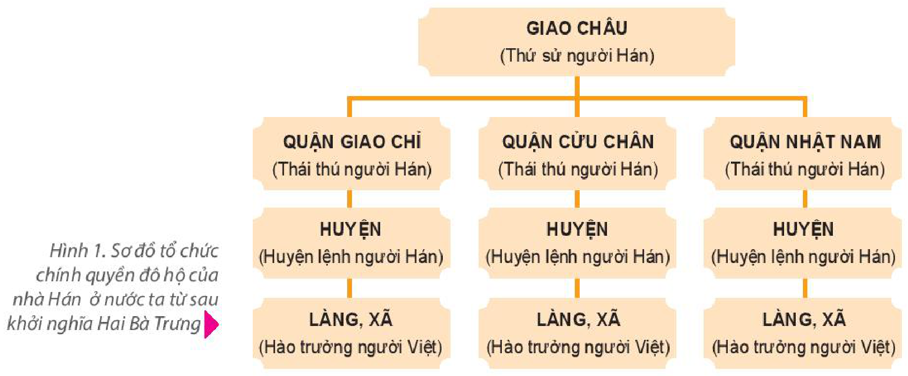
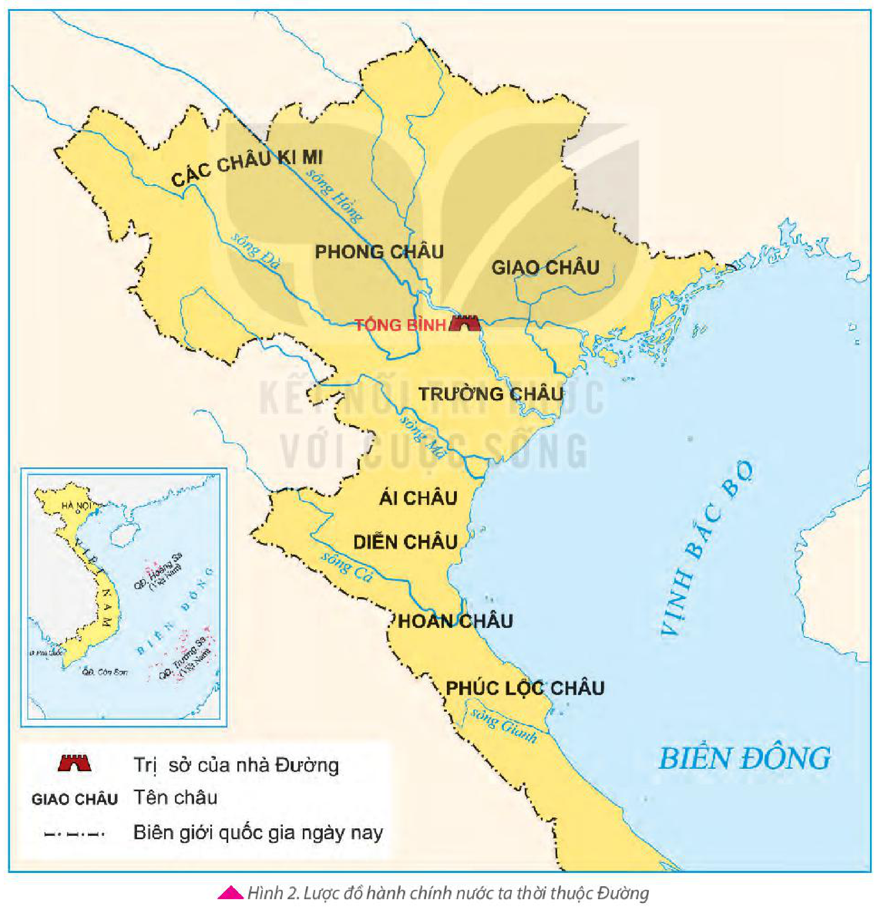
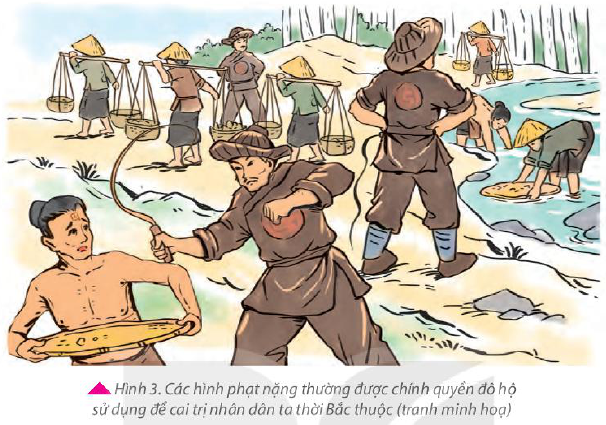
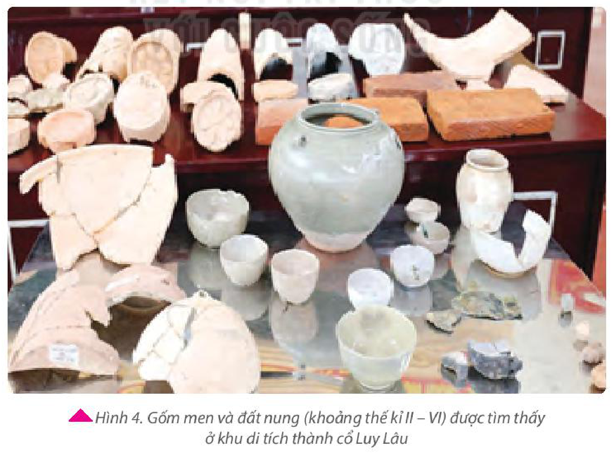

<!-- pdf:66 -->

# BÀI 15: CHÍNH SÁCH CAI TRỊ CỦA CÁC TRIỀU ĐẠI PHONG KIẾN PHƯƠNG BẮC VÀ SỰ CHUYỂN BIẾN CỦA XÃ HỘI ÂU LẠC

## 🎯 Học xong bài này, em sẽ:

- Nêu được một số chính sách cai trị của các triều đại phong kiến phương Bắc trong thời kì Bắc thuộc.
- Nhận biết được một số chuyển biến cơ bản về kinh tế và xã hội của người Việt cổ dưới ách cai trị, đô hộ của các triều đại phong kiến phương Bắc.

## 🔴 Mở đầu

Thành cổ Luy Lâu (nay thuộc huyện Thuận Thành, tỉnh Bắc Ninh) từ thời Hán đã là trị sở của chính quyền đô hộ. Đây cũng là nơi lưu lại dấu tích liên quan đến chính sách cai trị và sự chuyển biến trong đời sống kinh tế, xã hội, văn hoá của người Việt thời Bắc thuộc. Sự hiện diện của những dấu tích ấy gợi cho em suy nghĩ gì về giai đoạn lịch sử đặc biệt này?

## 1. Chính sách cai trị của các triều đại phong kiến phương Bắc

### a) Về bộ máy cai trị

<!-- term: Chính sách cai trị của các triều đại phong kiến phương Bắc -->
Năm 179 TCN, Triệu Đà chiếm được Âu Lạc. Từ đó các triều đại phong kiến phương Bắc đều sáp nhập nước ta vào lãnh thổ Trung Quốc, chia thành các đơn vị hành chính như châu – quận, dưới châu – quận là huyện.

Từ sau khởi nghĩa Hai Bà Trưng (40 – 43), chính quyền từ cấp huyện trở lên đều do người Hán nắm giữ.

Chính quyền đô hộ cho xây đắp các thành luỹ lớn ở trị sở các châu – quận như thành Luy Lâu (Bắc Ninh), thành Tống Bình – Đại La (Hà Nội),... và bố trí lực lượng quân đồn trú để bảo vệ chính quyền.

<!-- term: Thành cổ Luy Lâu -->
> 💡 **Em có biết?**
>
> Luy Lâu là một thành cổ có lịch sử trên 2 000 năm, được xây dựng từ thời Đông Hán. Từ thế kỉ II đến đầu thế kỉ IX, Luy Lâu vừa là trị sở của chính quyền đô hộ phương Bắc, vừa là một trung tâm kinh tế, văn hoá, tôn giáo quan trọng của Giao Chỉ. Từ thế kỉ IX, trị sở của chính quyền An Nam đô hộ chuyển về Tống Bình – Đại La.

<!-- pdf:67 -->

> **GIAO CHÂU** (Thứ sử người Hán) → **QUẬN GIAO CHỈ**, **QUẬN CỬU CHÂN**, **QUẬN NHẬT NAM** (Thái thú người Hán) → **HUYỆN** (Huyện lệnh người Hán) → **LÀNG, XÃ** (Hào trưởng người Việt).
<!-- ocr-ok: nội dung sơ đồ Hình 1 đối chiếu trực tiếp p067.png -->

*Hình 1. Sơ đồ tổ chức chính quyền đô hộ của nhà Hán ở nước ta từ sau khởi nghĩa Hai Bà Trưng*

*Hình 2. Lược đồ hành chính nước ta thời thuộc Đường*

<!-- pdf:68 -->

<!-- term: Chính sách cai trị của các triều đại phong kiến phương Bắc -->
Từ nhà Hán, các triều đại đều áp dụng luật pháp hà khắc và thẳng tay đàn áp các cuộc đấu tranh của nhân dân ta.

*Hình 3. Các hình phạt nặng thường được chính quyền đô hộ sử dụng để cai trị nhân dân ta thời Bắc thuộc (tranh minh hoạ)*

> ❓ Hãy cho biết một số chính sách để áp đặt bộ máy cai trị của phong kiến phương Bắc ở nước ta.

### b) Về kinh tế

<!-- term: Chính sách cai trị của các triều đại phong kiến phương Bắc -->
Các quan cai trị phương Bắc chiếm ruộng đất của nhân dân Âu Lạc, lập thành ấp, trại và bắt dân ta cày cấy. Chúng cũng áp đặt chính sách tô thuế nặng nề, đặc biệt là dưới thời Đường.

<!-- term: Chính sách cai trị của các triều đại phong kiến phương Bắc -->
Ngoài ra, chính quyền đô hộ còn nắm độc quyền về sắt và muối, bắt nhân dân ta cống nạp nhiều loại vải vóc, hương liệu, sản vật quý để đưa về Trung Quốc.

> 1. “Trước đây những người làm thứ sử thấy đất châu (Giao Chỉ) có các thứ ngọc trai, lông (chim) trả, tê, voi, đồi mồi, hương lạ, gỗ tốt, nhiều người không liêm khiết, vơ vét của cải cho đầy, rồi lại xin đổi đi.”
>
> (Theo *Đại Việt sử kí toàn thư* (bản dịch), Tập 1, NXB Khoa học xã hội, tr.160)

> ❓ Đoạn tư liệu 1 và thông tin ở trên cho em biết điều gì về chính sách bóc lột kinh tế của các triều đại phong kiến phương Bắc.

### c) Về văn hoá – xã hội

<!-- term: Chính sách đồng hoá -->
Trong suốt thời Bắc thuộc, chính quyền phong kiến phương Bắc đều thực hiện chính sách đồng hoá dân tộc Việt như: đưa người Hán sang ở cùng với dân Việt, bắt nhân dân ta phải theo phong tục, luật pháp của người Hán và tìm mọi cách xoá bỏ những tập quán lâu đời của người Việt.

<!-- pdf:69 -->

> 2. “Nhà Hán mở 9 quận, đặt chức thứ sử ở Giao Chỉ, dời những người phạm tội ở Trung Quốc sang ở lẫn vào các nơi ấy, cho học sách ít nhiều, hơi thông hiểu lễ hoá.
>
> (Theo *Đại Việt sử kí toàn thư*, Tập 1, Sđd, tr.166)

> ❓ Chính quyền phong kiến phương Bắc đã thực hiện chính sách cai trị về văn hoá đối với nước ta như thế nào?

## 2. Những chuyển biến về kinh tế – xã hội trong thời kì Bắc thuộc

Mặc dù bị kìm hãm bởi chính sách cai trị và bóc lột của các triều đại phong kiến phương Bắc nhưng trong hơn một nghìn năm Bắc thuộc, kinh tế, xã hội và văn hoá của người Việt vẫn có sự chuyển biến đáng kể.

### a) Chuyển biến về kinh tế

<!-- term: Chuyển biến kinh tế – xã hội thời Bắc thuộc -->
Trồng lúa nước vẫn là nghề chính bên cạnh trồng cây ăn quả, hoa màu và chăn nuôi. Sự phát triển của công cụ sản xuất và kĩ thuật đắp đê, làm thuỷ lợi đã tạo nên những vùng trồng lúa nước rộng lớn. Các nghề rèn sắt, đúc đồng, làm gốm, làm mộc, làm đồ trang sức (vàng, bạc) vẫn tiếp tục được duy trì với kĩ thuật sản xuất cao hơn. Một số nghề mới xuất hiện như làm giấy, thuỷ tinh.

Một số đường giao thông thuỷ, bộ được hình thành. Hoạt động buôn bán trong nước và với các nước khác được đẩy mạnh hơn trước.

> 💡 **Em có biết?**
>
> Người Việt đã tiếp thu kĩ thuật làm giấy từ Trung Quốc để làm ra các loại giấy có chất lượng tốt. Trong đó, có loại giấy được làm từ cây mật hương “giấy màu trắng, có vân như mắt cá lớn, rất thơm, bền chắc, cho xuống nước không hỏng”.
<!-- ocr-ok: hộp Em có biết? cột hẹp trang 68 (PDF 69) bị OCR mất dấu thanh, đã đối chiếu p069.png -->

*Hình 4. Gốm men và đất nung (khoảng thế kỉ II – VI) được tìm thấy ở khu di tích thành cổ Luy Lâu*

<!-- pdf:70 -->

### b) Chuyển biến về xã hội

Với chính sách cai trị của các triều đại phong kiến phương Bắc, các tầng lớp trong xã hội đều có sự biến đổi.

<!-- term: Chuyển biến kinh tế – xã hội thời Bắc thuộc -->
Một số quan lại, địa chủ người Hán bị Việt hoá. Tầng lớp hào trưởng bản địa hình thành từ bộ phận quý tộc trong xã hội Âu Lạc cũ, có uy tín và vị thế quan trọng trong đời sống xã hội.

<!-- term: Chuyển biến kinh tế – xã hội thời Bắc thuộc -->
Bao trùm trong xã hội bấy giờ là mâu thuẫn giữa nhân dân Âu Lạc với chính quyền đô hộ phương Bắc. Đó là nguyên nhân làm bùng lên các cuộc đấu tranh giành độc lập liên tục trong suốt thời kì Bắc thuộc.

> ❓ 1. Hãy nêu sự chuyển biến về kinh tế và xã hội ở nước ta dưới thời Bắc thuộc.
>
> 2. Theo em, tầng lớp nào trong xã hội sẽ là thủ lĩnh của những cuộc đấu tranh giành độc lập cho người Việt? Vì sao?

## ✏️ Luyện tập và Vận dụng

1. Tại sao chính quyền phong kiến phương Bắc thực hiện chính sách đồng hoá dân tộc Việt?

2. Em hãy cho biết hậu quả chính sách bóc lột kinh tế của các triều đại phong kiến phương Bắc đối với nước ta (theo bảng dưới đây).

| Lĩnh vực | Thông tin phản ánh | Hậu quả |
| --- | --- | --- |
| Đất đai | Chiếm ruộng đất, lập thành ấp trại để bắt dân ta cày cấy. | Người Việt mất ruộng, bị biến thành nông nô của chính quyền đô hộ. |
| Thuế khoá – Cống nạp | – Áp đặt chính sách tô thuế nặng nề. – Bắt cống nạp nhiều vải vóc, hương liệu và sản vật quý để đưa về Trung Quốc. | ? |
| Thủ công nghiệp | Nắm độc quyền về sắt và muối. | ? |
<!-- ocr-ok: bảng bài tập 2 trang 69 (PDF 70) có chữ chìm logo đè lên giữa bảng làm OCR lỗi chữ -->

## 📷 Danh sách hình trong bài

| Mã hình | Trang PDF | Vị trí trong bài | Chú thích gốc |
| --- | :---: | --- | --- |
| H6-lich_su_va_dia_ly-ls-b15-01 | 67 | Mục 1.a | Hình 1. Sơ đồ tổ chức chính quyền đô hộ của nhà Hán ở nước ta từ sau khởi nghĩa Hai Bà Trưng |
| H6-lich_su_va_dia_ly-ls-b15-02 | 67 | Mục 1.a | Hình 2. Lược đồ hành chính nước ta thời thuộc Đường |
| H6-lich_su_va_dia_ly-ls-b15-03 | 68 | Mục 1.a | Hình 3. Các hình phạt nặng thường được chính quyền đô hộ sử dụng để cai trị nhân dân ta thời Bắc thuộc (tranh minh hoạ) |
| H6-lich_su_va_dia_ly-ls-b15-04 | 69 | Mục 2.a | Hình 4. Gốm men và đất nung (khoảng thế kỉ II – VI) được tìm thấy ở khu di tích thành cổ Luy Lâu |
