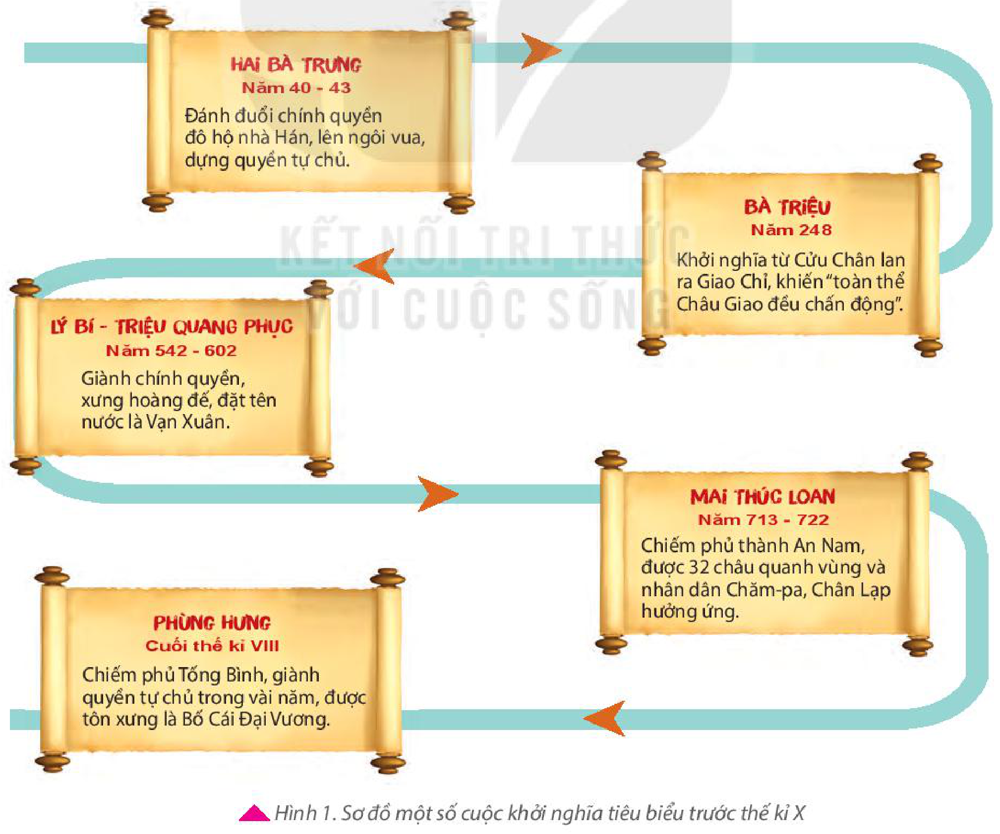
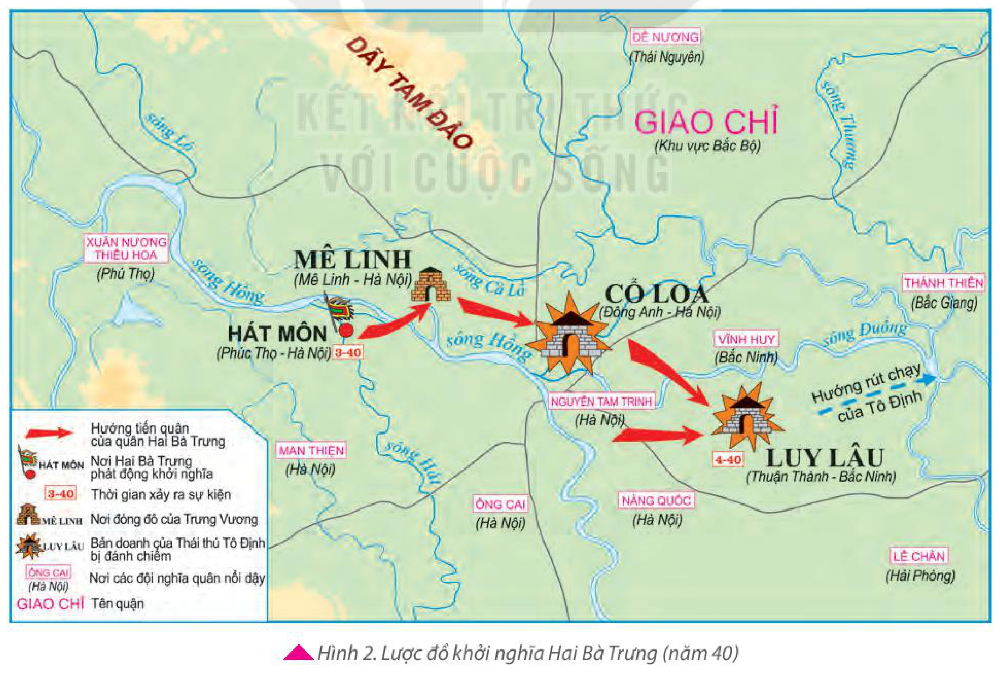
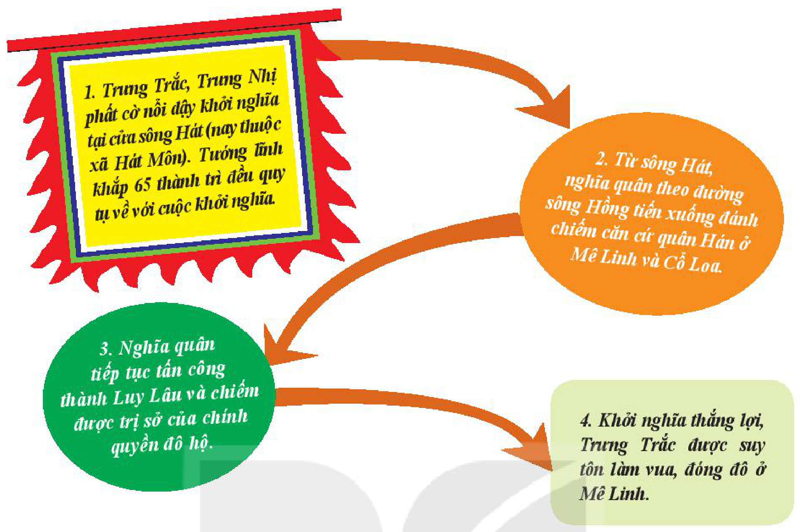
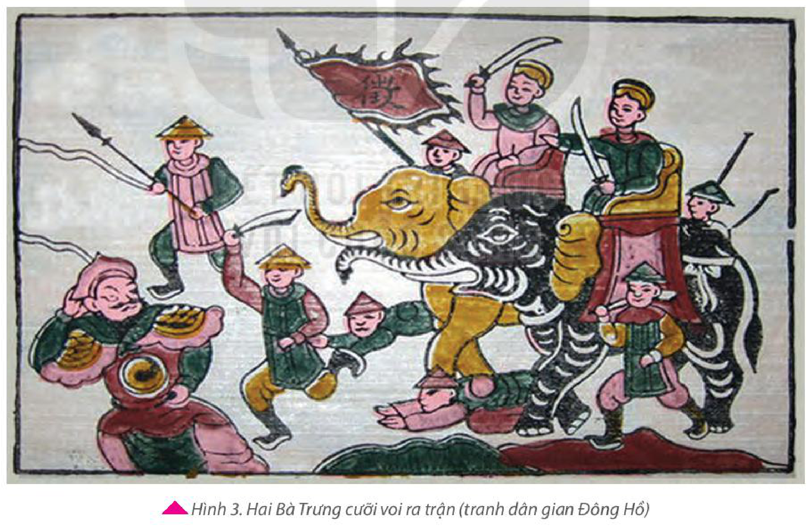
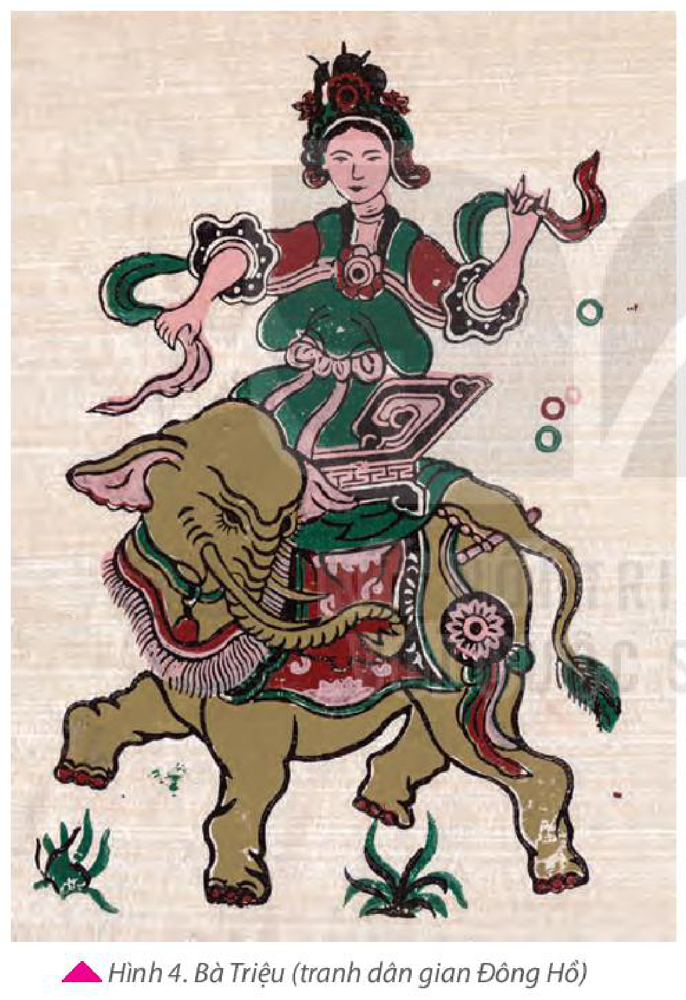
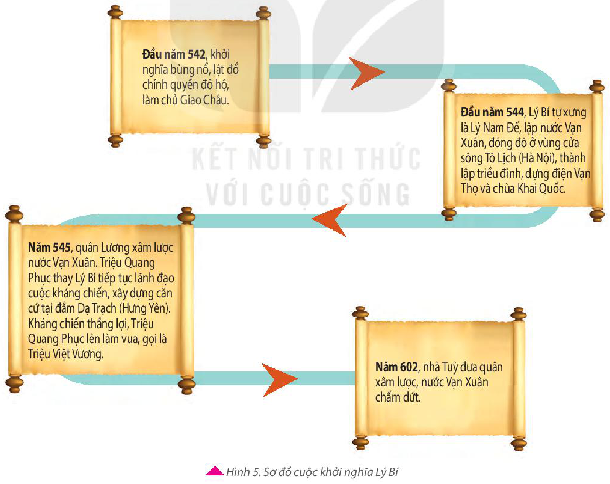
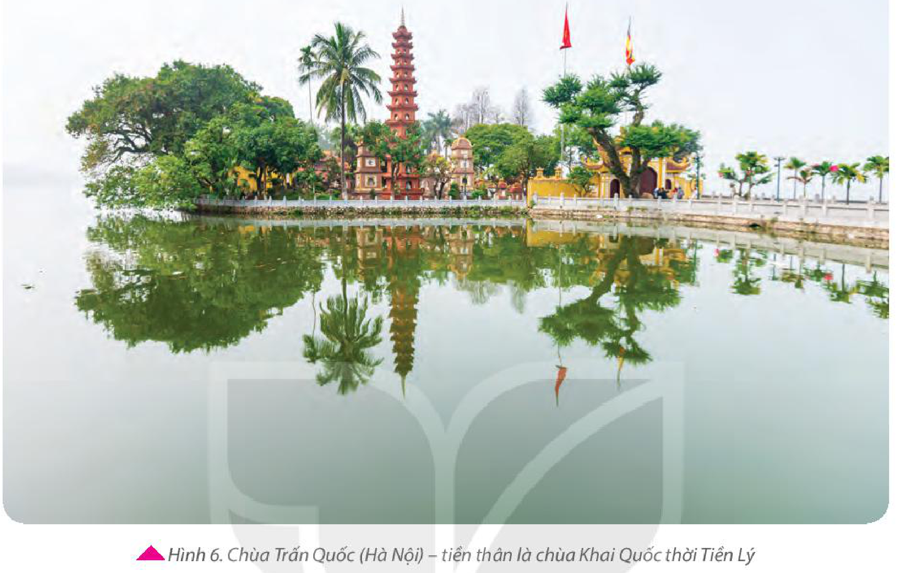
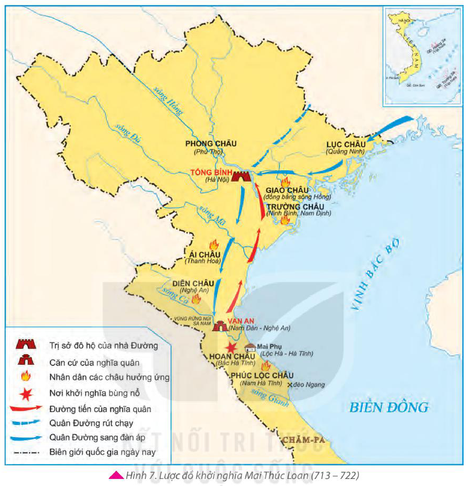
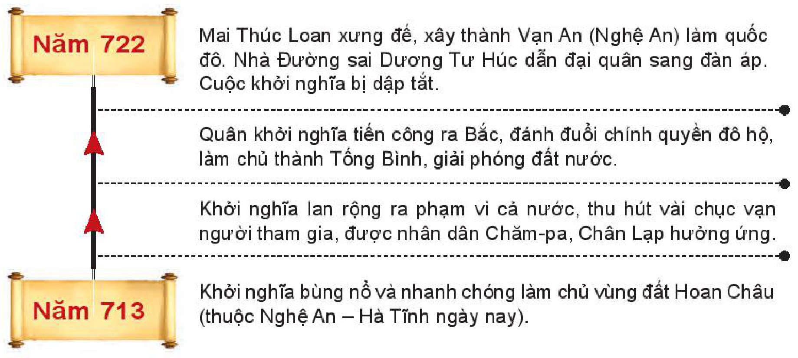
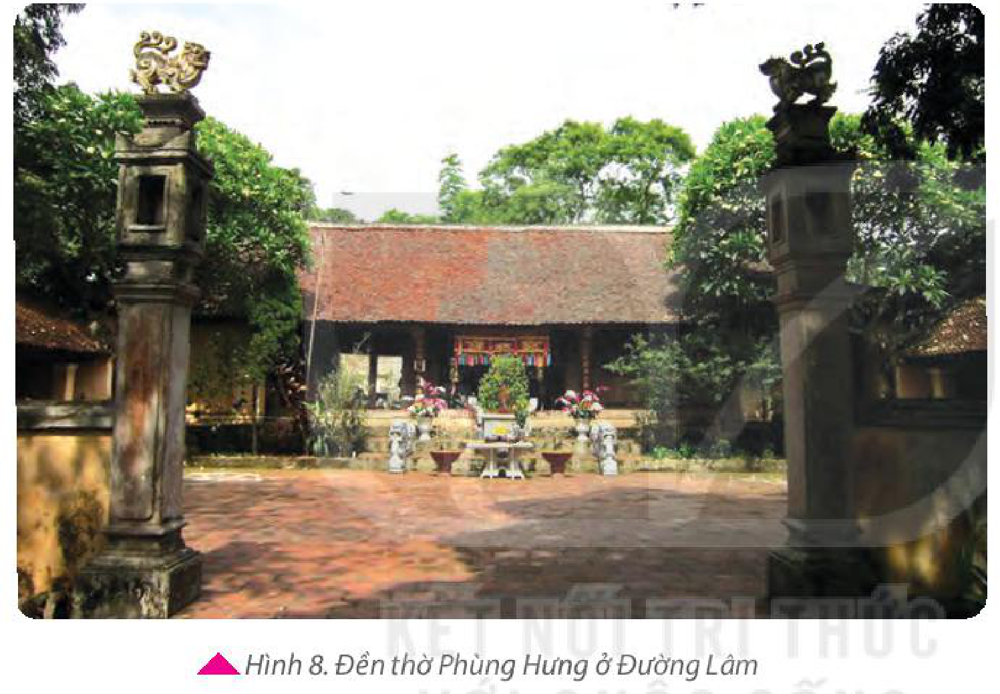

<!-- pdf:71 -->

# BÀI 16: CÁC CUỘC KHỞI NGHĨA TIÊU BIỂU GIÀNH ĐỘC LẬP TRƯỚC THẾ KỈ X

## 🎯 Học xong bài này, em sẽ:

- Lập được sơ đồ về các cuộc khởi nghĩa tiêu biểu giành độc lập thời kì Bắc thuộc trước thế kỉ X.
- Trình bày được những nét chính, giải thích được nguyên nhân của các cuộc khởi nghĩa tiêu biểu (khởi nghĩa Hai Bà Trưng, Bà Triệu, Lý Bí, Mai Thúc Loan, Phùng Hưng).
- Nêu được kết quả và ý nghĩa lịch sử của các cuộc khởi nghĩa tiêu biểu trong thời kì Bắc thuộc trước thế kỉ X.

## 🔴 Mở đầu

Em đã biết, sau khi chiếm được Âu Lạc, các triều đại phương Bắc đã tìm “trăm phương nghìn kế” để áp đặt ách cai trị đối với nước ta. Nhưng thực tế lịch sử có thuận theo ý đồ của họ không? Em suy nghĩ gì về lời “phàn nàn” của viên Thái thú người Hán: *Dân xứ ấy rất khó cai trị*?
<!-- ocr-ok: đối chiếu trực tiếp p071.png, OCR bỏ sót hai dòng đầu của hộp Mở đầu -->

> - **HAI BÀ TRƯNG (Năm 40 – 43):** Đánh đuổi chính quyền đô hộ nhà Hán, lên ngôi vua, dựng quyền tự chủ.
> - **BÀ TRIỆU (Năm 248):** Khởi nghĩa từ Cửu Chân lan ra Giao Chỉ, khiến “toàn thể Châu Giao đều chấn động”.
> - **LÝ BÍ – TRIỆU QUANG PHỤC (Năm 542 – 602):** Giành chính quyền, xưng hoàng đế, đặt tên nước là Vạn Xuân.
> - **MAI THÚC LOAN (Năm 713 – 722):** Chiếm phủ thành An Nam, được 32 châu quanh vùng và nhân dân Chăm-pa, Chân Lạp hưởng ứng.
> - **PHÙNG HƯNG (Cuối thế kỉ VIII):** Chiếm phủ Tống Bình, giành quyền tự chủ trong vài năm, được tôn xưng là Bố Cái Đại Vương.
<!-- ocr-ok: nội dung sơ đồ Hình 1 đối chiếu trực tiếp p071.png -->

*Hình 1. Sơ đồ một số cuộc khởi nghĩa tiêu biểu trước thế kỉ X*

<!-- pdf:72 -->

## 1. Khởi nghĩa Hai Bà Trưng

<!-- term: Khởi nghĩa Hai Bà Trưng -->
Mùa xuân năm 40, bất bình với chính sách cai trị hà khắc của chính quyền đô hộ nhà Hán, con gái Lạc tướng huyện Mê Linh là Trưng Trắc cùng với em là Trưng Nhị đã dựng cờ khởi nghĩa để giành lại quyền tự chủ.

> 1. “Trưng Trắc... bèn cùng em gái là Trưng Nhị khởi binh, đánh hãm trị sở của châu. Tô Định bỏ chạy về. Trưng Trắc thực là hùng dũng, đến đâu đều như có gió cuốn”.
>
> (Ngô Thì Sỹ, *Đại Việt sử kí tiền biên* (bản dịch), NXB Văn hoá Thông tin, Hà Nội, 2011, tr.87)

> “Thiếp là cháu gái các Vua Hùng đời trước, hôm nay đau lòng thương dân vô tội, dấy nghĩa trừ tà, nguyện xin các vị thần linh hội họp tại đàn này chứng giám và phù hộ cho thiếp. Thiếp là Trưng Nữ dấy binh dẹp giặc, che chở dân lành, thu phục lại muôn vật cũ của tổ tông, không phụ ý trời, thoả nguyện nơi đền miếu của các bậc đế vương các đời, không phụ sự trông đợi của tổ phụ nơi chín suối.”
>
> (Trích Lời thề khắc trên bia đá ở đền thờ Hai Bà Trưng tại Mê Linh, Hà Nội)
<!-- ocr-ok: chữ đặt trên nền ảnh bia đá trang 71 (PDF 72), đối chiếu trực tiếp p072.png -->

*Hình 2. Lược đồ khởi nghĩa Hai Bà Trưng (năm 40)*

<!-- pdf:73 -->

<!-- term: Khởi nghĩa Hai Bà Trưng -->
> 1. Trưng Trắc, Trưng Nhị phất cờ nổi dậy khởi nghĩa tại cửa sông Hát (nay thuộc xã Hát Môn). Tướng lĩnh khắp 65 thành trì đều quy tụ về với cuộc khởi nghĩa.
> 2. Từ sông Hát, nghĩa quân theo đường sông Hồng tiến xuống đánh chiếm căn cứ quân Hán ở Mê Linh và Cổ Loa.
> 3. Nghĩa quân tiếp tục tấn công thành Luy Lâu và chiếm được trị sở của chính quyền đô hộ.
> 4. Khởi nghĩa thắng lợi, Trưng Trắc được suy tôn làm vua, đóng đô ở Mê Linh.
<!-- ocr-ok: chữ nghiêng màu trắng trên nền màu trong sơ đồ trang 72 (PDF 73), đối chiếu p073.png -->

*Hình 3. Hai Bà Trưng cưỡi voi ra trận (tranh dân gian Đông Hồ)*

Năm 43, trước sự tấn công của quân Hán do Mã Viện chỉ huy, cuộc khởi nghĩa Hai Bà Trưng bị đàn áp. Nhân dân ghi nhớ công ơn và lập đền thờ Hai Bà để đời đời thờ cúng.

<!-- term: Khởi nghĩa Hai Bà Trưng -->
Cuộc khởi nghĩa Hai Bà Trưng đã chứng tỏ tinh thần đấu tranh bất khuất của người Việt, tạo tiền đề cho việc khôi phục nền độc lập, tự chủ của dân tộc sau này.

<!-- pdf:74 -->

> ❓ 1. Hãy cho biết nguyên nhân và mục đích của cuộc khởi nghĩa của Hai Bà Trưng.
>
> 2. Trình bày diễn biến chính của khởi nghĩa Hai Bà Trưng trên lược đồ hình 2 (tr.71).
>
> 3. Đoạn tư liệu 1 và hình 3 cho em biết điều gì về khí thế của cuộc khởi nghĩa Hai Bà Trưng và tình thế của chính quyền đô hộ?
>
> 4. Hãy cho biết kết quả và ý nghĩa của cuộc khởi nghĩa Hai Bà Trưng.

## 2. Khởi nghĩa Bà Triệu

<!-- term: Khởi nghĩa Bà Triệu -->
Đầu thế kỉ III, do chính sách cai trị hà khắc của chính quyền đô hộ nhà Ngô, phong trào đấu tranh của người Việt tiếp tục bùng nổ, tiêu biểu nhất là cuộc khởi nghĩa Bà Triệu.

*Hình 4. Bà Triệu (tranh dân gian Đông Hồ)*

<!-- term: Khởi nghĩa Bà Triệu -->
> 💡 **Em có biết?**
>
> Bà Triệu (còn gọi là Triệu Thị Trinh) quê ở huyện Yên Định, tỉnh Thanh Hoá ngày nay. Năm 23 tuổi, bà lãnh đạo nhân dân khởi nghĩa. Khi ra trận, bà thường cưỡi voi, khí thế rất oai phong, lẫm liệt. Quân Ngô từng gọi bà là “Lệ Hải Bà Vương” và truyền nhau câu nói:
>
> *Vung tay đánh cọp xem còn dễ*
> *Đối diện Bà Vương mới khó sao.*

> 2. “Tôi muốn cưỡi cơn gió mạnh, đạp luồng sóng dữ, chém cá trường kình ở Biển Đông, lấy lại giang sơn, dựng nền độc lập, cởi ách nô lệ, chứ không chịu khom lưng làm tì thiếp cho người!”
>
> (Theo Phan Huy Lê (Chủ biên), *Lịch sử Việt Nam*, Tập 1, Sđd, tr.338)

<!-- pdf:75 -->

<!-- term: Khởi nghĩa Bà Triệu -->
Năm 248, từ căn cứ ở núi Nưa (Triệu Sơn, Thanh Hoá), khởi nghĩa bùng nổ. Lực lượng nghĩa quân đã đánh hạ nhiều huyện lị, thành ấp ở Cửu Chân, Cửu Đức, Nhật Nam. Quan lại nhà Ngô từ thái thú đến huyện lệnh, huyện trưởng hoặc bị giết, hoặc bỏ trốn. Cuộc khởi nghĩa khiến cho toàn thể Giao Châu đều chấn động.

Trước tình hình đó, nhà Ngô đã cử 8 000 quân sang đàn áp. Do lực lượng quân Ngô quá mạnh, khởi nghĩa đã bị đàn áp, Bà Triệu anh dũng hi sinh tại khu vực núi Tùng (Thanh Hoá).

<!-- term: Khởi nghĩa Bà Triệu -->
Cuộc khởi nghĩa Bà Triệu không chỉ làm rung chuyển chính quyền đô hộ mà còn góp phần thức tỉnh ý thức dân tộc, tạo đà cho cuộc khởi nghĩa của Lý Bí sau này.

> ❓ 1. Nêu nguyên nhân và mục đích của cuộc khởi nghĩa Bà Triệu.
>
> 2. Hãy trình bày diễn biến chính và ý nghĩa của cuộc khởi nghĩa Bà Triệu.

## 3. Khởi nghĩa Lý Bí và sự thành lập nước Vạn Xuân

<!-- term: Khởi nghĩa Lý Bí -->
Vào nửa đầu thế kỉ VI, Lý Bí – một hào trưởng địa phương (quê ở Phổ Yên, Thái Nguyên) đã lãnh đạo cuộc khởi nghĩa nhằm chống lại chế độ cai trị khắc nghiệt của nhà Lương.

<!-- term: Khởi nghĩa Lý Bí -->
<!-- term: Nhà nước Vạn Xuân -->
<!-- term: Triệu Quang Phục -->
> - **Đầu năm 542**, khởi nghĩa bùng nổ, lật đổ chính quyền đô hộ, làm chủ Giao Châu.
> - **Đầu năm 544**, Lý Bí tự xưng là Lý Nam Đế, lập nước Vạn Xuân, đóng đô ở vùng cửa sông Tô Lịch (Hà Nội), thành lập triều đình, dựng điện Vạn Thọ và chùa Khai Quốc.
> - **Năm 545**, quân Lương xâm lược nước Vạn Xuân. Triệu Quang Phục thay Lý Bí tiếp tục lãnh đạo cuộc kháng chiến, xây dựng căn cứ tại đầm Dạ Trạch (Hưng Yên). Kháng chiến thắng lợi, Triệu Quang Phục lên làm vua, gọi là Triệu Việt Vương.
> - **Năm 602**, nhà Tuỳ đưa quân xâm lược, nước Vạn Xuân chấm dứt.
<!-- ocr-ok: nội dung sơ đồ Hình 5 đối chiếu trực tiếp p075.png -->

*Hình 5. Sơ đồ cuộc khởi nghĩa Lý Bí*

<!-- pdf:76 -->

*Hình 6. Chùa Trấn Quốc (Hà Nội) – tiền thân là chùa Khai Quốc thời Tiền Lý*

> 3. “Nam đế nhà Tiền Lý đã biết nhân thời cơ vùng dậy, tự làm chủ lấy nước mình, đủ làm thanh thế mở đường cho nhà Đinh, nhà Lý sau này”.
>
> (Quốc sử quán triều Nguyễn, *Khâm định Việt sử thông giám cương mục*, NXB Giáo dục, Hà Nội, 1998, tr.164)

> ❓ 1. Dựa vào sơ đồ hình 5, hãy trình bày diễn biến chính của cuộc khởi nghĩa Lý Bí và công cuộc bảo vệ nước Vạn Xuân.
>
> 2. Khai thác sơ đồ hình 5 và tư liệu trên, hãy cho biết kết quả và ý nghĩa của cuộc khởi nghĩa Lý Bí.

## 4. Khởi nghĩa Mai Thúc Loan

<!-- term: Khởi nghĩa Mai Thúc Loan -->
Đầu thế kỉ VIII, bất bình trước chính sách tô thuế nặng nề của chính quyền đô hộ nhà Đường, một thủ lĩnh tên là Mai Thúc Loan (quê ở Lộc Hà, Hà Tĩnh) đã phát động nhân dân nổi dậy khởi nghĩa.

<!-- term: Khởi nghĩa Mai Thúc Loan -->
Khởi nghĩa Mai Thúc Loan đã giành và giữ chính quyền độc lập trong khoảng gần 10 năm (713 – 722). Đó là một trong những cuộc khởi nghĩa lớn nhất, đánh dấu mốc quan trọng trên con đường đấu tranh để giải phóng dân tộc thời kì Bắc thuộc.

<!-- pdf:77 -->

*Hình 7. Lược đồ khởi nghĩa Mai Thúc Loan (713 – 722)*

<!-- term: Khởi nghĩa Mai Thúc Loan -->
> - **Năm 713:** Khởi nghĩa bùng nổ và nhanh chóng làm chủ vùng đất Hoan Châu (thuộc Nghệ An – Hà Tĩnh ngày nay).
> - Khởi nghĩa lan rộng ra phạm vi cả nước, thu hút vài chục vạn người tham gia, được nhân dân Chăm-pa, Chân Lạp hưởng ứng.
> - Quân khởi nghĩa tiến công ra Bắc, đánh đuổi chính quyền đô hộ, làm chủ thành Tống Bình, giải phóng đất nước.
> - **Năm 722:** Mai Thúc Loan xưng đế, xây thành Vạn An (Nghệ An) làm quốc đô. Nhà Đường sai Dương Tư Húc dẫn đại quân sang đàn áp. Cuộc khởi nghĩa bị dập tắt.
<!-- ocr-ok: trục thời gian từ dưới lên trang 76 (PDF 77), chép theo trình tự thời gian 713 đến 722 đối chiếu p077.png -->

> ❓ 1. Hãy trình bày diễn biến chính của cuộc khởi nghĩa Mai Thúc Loan trên lược đồ.
>
> 2. Cuộc khởi nghĩa Mai Thúc Loan có ý nghĩa gì đối với lịch sử dân tộc?

<!-- pdf:78 -->

## 5. Khởi nghĩa Phùng Hưng

<!-- term: Khởi nghĩa Phùng Hưng -->
Cuối thế kỉ VIII, chính quyền đô hộ của nhà Đường ngày càng ra sức vơ vét, bòn rút của cải của nhân dân ta. Không cam chịu, Phùng Hưng đã lãnh đạo nhân dân nổi dậy khởi nghĩa.

<!-- term: Khởi nghĩa Phùng Hưng -->
Nghĩa quân đã làm chủ được vùng đất Đường Lâm (Sơn Tây, Hà Nội); sau đó tiếp tục kéo xuống bao vây và chiếm thành Tống Bình; tự sắp đặt việc cai trị trong vòng 9 năm thì bị quân Đường đàn áp và chiếm lại.

<!-- term: Khởi nghĩa Phùng Hưng -->
Cuộc khởi nghĩa Phùng Hưng tiếp tục khẳng định quyết tâm giành lại độc lập, tự chủ của người Việt, mở đường cho những thắng lợi to lớn về sau.

<!-- term: Khởi nghĩa Phùng Hưng -->
> 💡 **Em có biết?**
>
> Phùng Hưng là hào trưởng đất Đường Lâm (Hà Nội). Ông xuất thân trong gia đình giàu có, có uy tín lớn đối với nhân dân trong vùng. Ông có sức khoẻ phi thường, sức có thể xô ngã trâu, đánh được hổ. Về sau, Phùng Hưng được nhân dân suy tôn làm “Bố Cái đại vương”.

*Hình 8. Đền thờ Phùng Hưng ở Đường Lâm*

> ❓ Trình bày nguyên nhân, kết quả và ý nghĩa của cuộc khởi nghĩa Phùng Hưng.

## ✏️ Luyện tập và Vận dụng

1. Hãy lập bảng hệ thống về các cuộc khởi nghĩa: Hai Bà Trưng, Bà Triệu, Lý Bí, Mai Thúc Loan và Phùng Hưng theo gợi ý sau: thời gian bùng nổ, nơi đóng đô của chính quyền tự chủ (nếu có), kết quả, ý nghĩa.

2. Từ kết quả của bài tập 1 và dựa vào kiến thức đã học, em có nhận xét gì về tinh thần đấu tranh chống xâm lược của nhân dân ta?

3. Em hãy tìm hiểu thêm thông tin từ sách, báo và internet để biết hiện nay có những con đường, trường học, di tích lịch sử nào,... mang tên hay là nơi thờ phụng Hai Bà Trưng, Lý Bí và Mai Thúc Loan. Điều này gợi cho em suy nghĩ gì?

## 📷 Danh sách hình trong bài

| Mã hình | Trang PDF | Vị trí trong bài | Chú thích gốc |
| --- | :---: | --- | --- |
| H6-lich_su_va_dia_ly-ls-b16-01 | 71 | Mở đầu | Hình 1. Sơ đồ một số cuộc khởi nghĩa tiêu biểu trước thế kỉ X |
| H6-lich_su_va_dia_ly-ls-b16-02 | 72 | Mục 1 | Hình 2. Lược đồ khởi nghĩa Hai Bà Trưng (năm 40) |
| H6-lich_su_va_dia_ly-ls-b16-03 | 73 | Mục 1 | (sách không đánh số, sơ đồ diễn biến cuộc khởi nghĩa Hai Bà Trưng) |
| H6-lich_su_va_dia_ly-ls-b16-04 | 73 | Mục 1 | Hình 3. Hai Bà Trưng cưỡi voi ra trận (tranh dân gian Đông Hồ) |
| H6-lich_su_va_dia_ly-ls-b16-05 | 74 | Mục 2 | Hình 4. Bà Triệu (tranh dân gian Đông Hồ) |
| H6-lich_su_va_dia_ly-ls-b16-06 | 75 | Mục 3 | Hình 5. Sơ đồ cuộc khởi nghĩa Lý Bí |
| H6-lich_su_va_dia_ly-ls-b16-07 | 76 | Mục 3 | Hình 6. Chùa Trấn Quốc (Hà Nội) – tiền thân là chùa Khai Quốc thời Tiền Lý |
| H6-lich_su_va_dia_ly-ls-b16-08 | 77 | Mục 4 | Hình 7. Lược đồ khởi nghĩa Mai Thúc Loan (713 – 722) |
| H6-lich_su_va_dia_ly-ls-b16-09 | 77 | Mục 4 | (sách không đánh số, trục thời gian diễn biến cuộc khởi nghĩa Mai Thúc Loan 713 – 722) |
| H6-lich_su_va_dia_ly-ls-b16-10 | 78 | Mục 5 | Hình 8. Đền thờ Phùng Hưng ở Đường Lâm |
