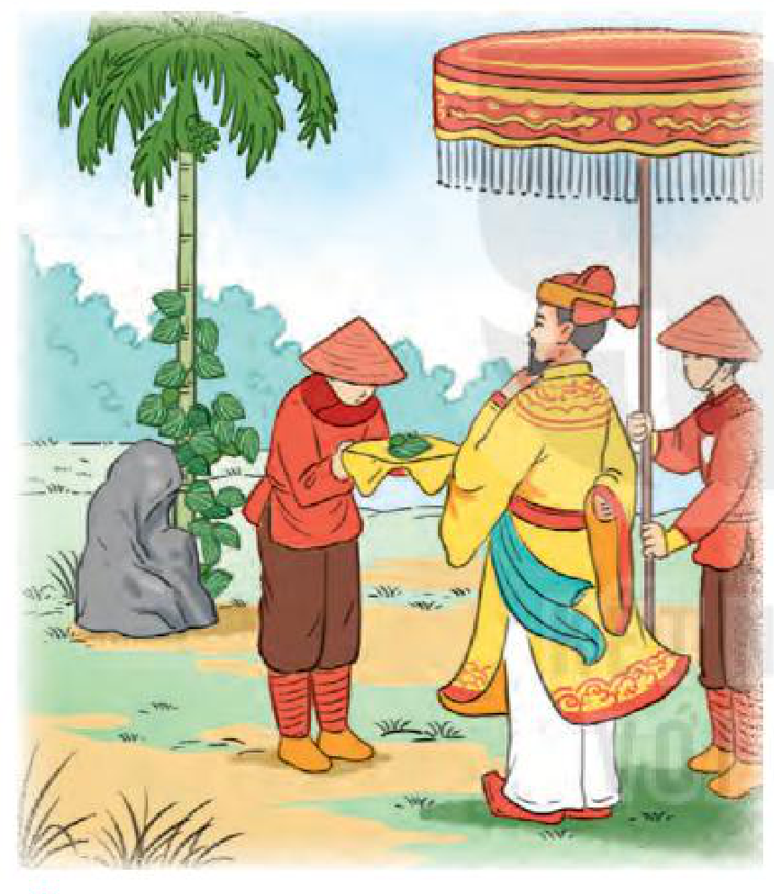
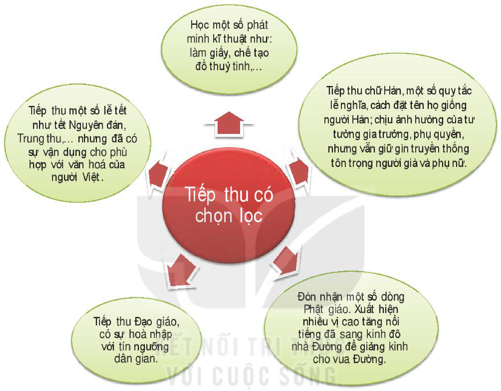

<!-- pdf:79 -->

# BÀI 17: CUỘC ĐẤU TRANH BẢO TỒN VÀ PHÁT TRIỂN VĂN HOÁ DÂN TỘC CỦA NGƯỜI VIỆT

## 🎯 Học xong bài này, em sẽ:

- Trình bày được những biểu hiện trong việc giữ gìn văn hoá của người Việt trong thời kì Bắc thuộc.
- Nhận biết được sự phát triển của văn hoá dân tộc trên cơ sở tiếp thu có chọn lọc văn hoá Trung Hoa trong thời kì Bắc thuộc.

## 🔴 Mở đầu

Sau khi chiếm được Âu Lạc, các triều đại phong kiến phương Bắc đã thực hiện nhiều biện pháp nhằm thủ tiêu văn hoá của người Việt nhưng sau hàng nghìn năm vẫn không đạt được mục đích. Điều gì đã tạo nên sự kì diệu đó? Trong cuộc đấu tranh sinh tồn, em có biết, người Việt đã làm gì để bảo vệ những giá trị văn hoá truyền thống của mình?

## 1. Sức sống của nền văn hoá bản địa
<!-- ocr-ok: tiêu đề mục 1 trang 78 (PDF 79) bị OCR nhầm dấu ("Sức sóng của nên"), đã đối chiếu p079.png -->

<!-- term: Văn hoá bản địa của người Việt thời Bắc thuộc -->
Người Việt luôn có ý thức giữ gìn nền văn hoá bản địa của mình.

<!-- term: Văn hoá bản địa của người Việt thời Bắc thuộc -->
Tiếng Việt vẫn được người dân truyền dạy cho con cháu. Người Việt vẫn nghe và nói hoàn toàn bằng tiếng mẹ đẻ.

<!-- term: Văn hoá bản địa của người Việt thời Bắc thuộc -->
Những tín ngưỡng truyền thống tiếp tục được duy trì như: thờ cúng tổ tiên, thờ các vị thần tự nhiên,...

<!-- term: Văn hoá bản địa của người Việt thời Bắc thuộc -->
Trong các làng xã, những phong tục tập quán như búi tóc, xăm mình, nhuộm răng đen, ăn trầu, làm bánh chưng, bánh giầy,... vẫn được lưu truyền từ đời này qua đời khác.

*Hình 1. Sự tích trầu cau – lí giải tục ăn trầu của người Việt (tranh minh hoạ)*

<!-- term: Tục xăm mình -->
> 💡 **Em có biết?**
>
> Tục xăm mình có từ thời dựng nước. Người Việt cổ sống nhiều trong môi trường sông nước nên tin rằng nếu xăm mình sẽ không bị thuỷ quái làm hại. Tục này tồn tại đến đời vua Trần Anh Tông mới bỏ.

> “Dân hay vẽ mình... ưa tắm sông nên họ chèo đò và lội nước rất giỏi; ngày thường không đội mũ, đứng thì vòng hai tay, ngồi thì xếp bằng hai chân,... Tiếp khách thì đãi trầu cau.”
>
> (Lê Tắc, *An Nam chí lược* (bản dịch), NXB Thuận Hoá và Trung tâm Văn hoá Ngôn ngữ Đông Tây, Huế, 2002, tr.70)

> ❓ 1. Hãy chỉ ra những phong tục của người Việt được nhắc đến trong tư liệu trên.
>
> 2. Hãy cho biết một số nét văn hoá của người Việt cổ vẫn được duy trì trong thời Bắc thuộc.

<!-- pdf:80 -->

## 2. Tiếp thu có chọn lọc văn hoá Trung Hoa

<!-- term: Tiếp thu có chọn lọc văn hoá Trung Hoa -->
Trong suốt thời Bắc thuộc, nhân dân ta đã tiếp thu có chọn lọc những yếu tố văn hoá Trung Hoa để phát triển văn hoá dân tộc.

<!-- term: Tiếp thu có chọn lọc văn hoá Trung Hoa -->
> **Tiếp thu có chọn lọc:**
> - Học một số phát minh kĩ thuật như: làm giấy, chế tạo đồ thuỷ tinh,...
> - Tiếp thu chữ Hán, một số quy tắc lễ nghĩa, cách đặt tên họ giống người Hán; chịu ảnh hưởng của tư tưởng gia trưởng, phụ quyền, nhưng vẫn giữ gìn truyền thống tôn trọng người già và phụ nữ.
> - Đón nhận một số dòng Phật giáo. Xuất hiện nhiều vị cao tăng nổi tiếng đã sang kinh đô nhà Đường để giảng kinh cho vua Đường.
> - Tiếp thu Đạo giáo, có sự hoà nhập với tín ngưỡng dân gian.
> - Tiếp thu một số lễ tết như tết Nguyên đán, Trung thu,... nhưng đã có sự vận dụng cho phù hợp với văn hoá của người Việt.
<!-- ocr-ok: nội dung sơ đồ 5 nhánh trang 79 (PDF 80), đối chiếu trực tiếp p080.png -->

> ❓ Trong thời kì Bắc thuộc, nhân dân ta đã tiếp thu có chọn lọc văn hoá Trung Hoa như thế nào?

## ✏️ Luyện tập và Vận dụng

1. Nhân dân ta đã làm gì để bảo vệ và phát triển văn hoá dân tộc trong hàng nghìn năm Bắc thuộc?

2. Hãy chỉ ra những phong tục của người Việt trong thời kì Bắc thuộc vẫn được duy trì đến ngày nay.

## 📷 Danh sách hình trong bài

| Mã hình | Trang PDF | Vị trí trong bài | Chú thích gốc |
| --- | :---: | --- | --- |
| H6-lich_su_va_dia_ly-ls-b17-01 | 79 | Mục 1 | Hình 1. Sự tích trầu cau – lí giải tục ăn trầu của người Việt (tranh minh hoạ) |
| H6-lich_su_va_dia_ly-ls-b17-02 | 80 | Mục 2 | (sách không đánh số, sơ đồ tiếp thu có chọn lọc văn hoá Trung Hoa) |
