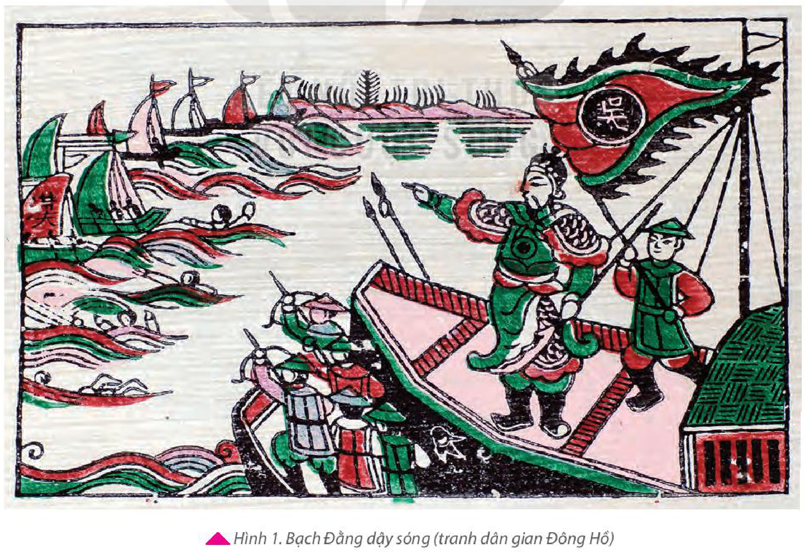
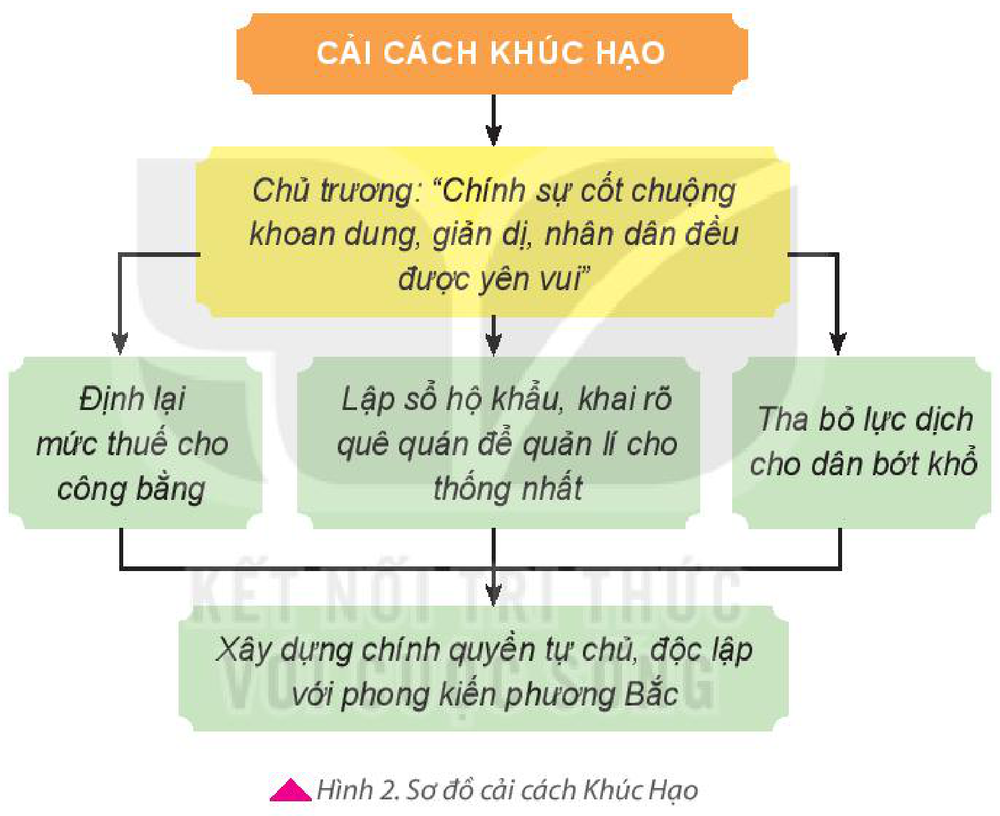
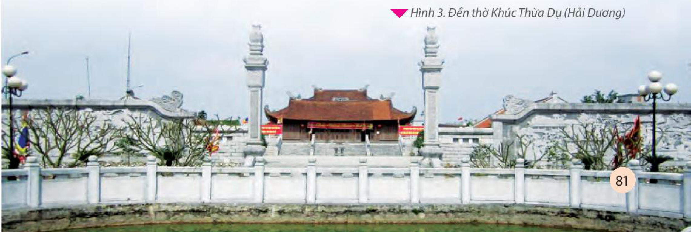
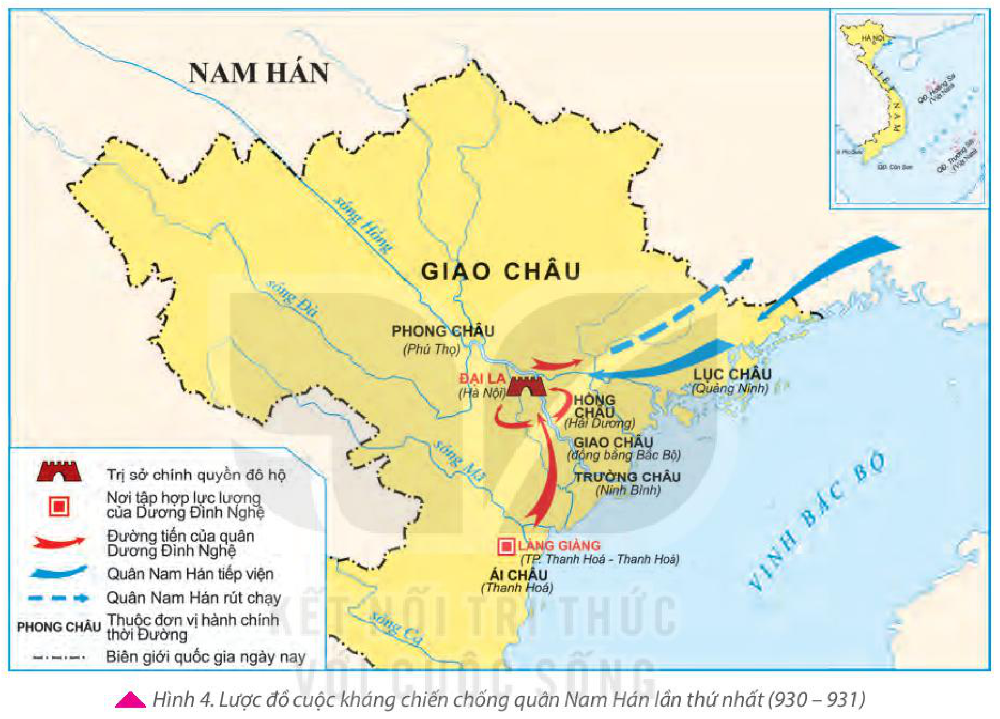
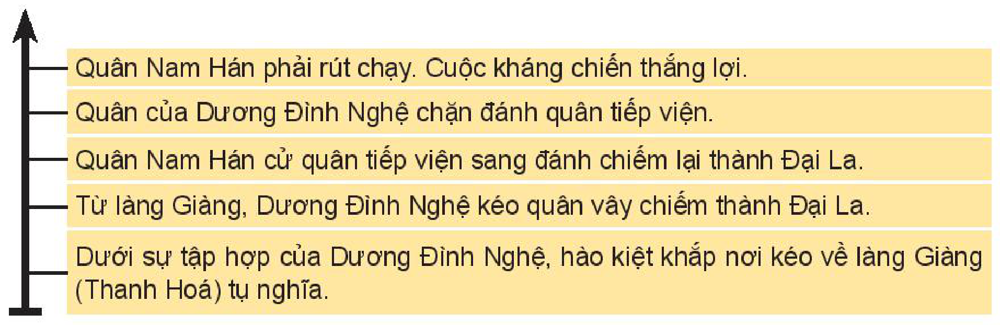
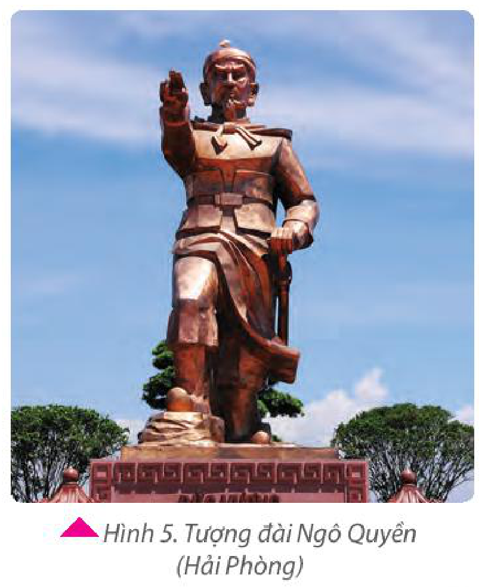
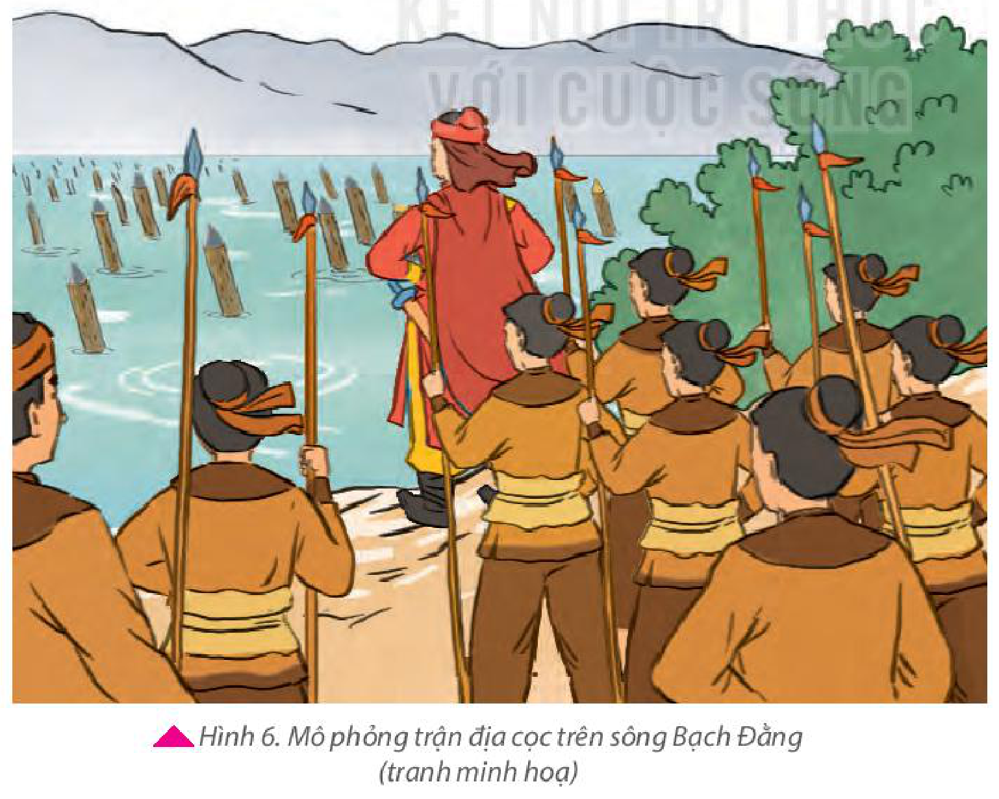
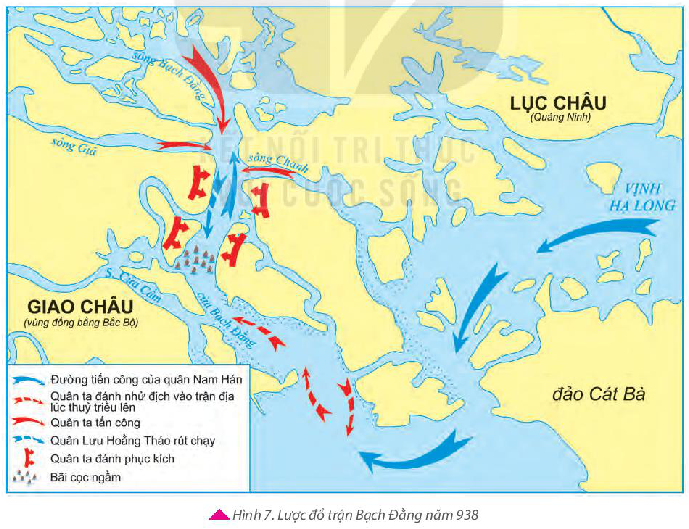

<!-- pdf:81 -->

# BÀI 18: BƯỚC NGOẶT LỊCH SỬ ĐẦU THẾ KỈ X

## 🎯 Học xong bài này, em sẽ:

- Trình bày được những nét chính (nội dung, kết quả) về các cuộc vận động giành quyền tự chủ của nhân dân Việt Nam dưới sự lãnh đạo của họ Khúc và họ Dương.
- Mô tả được những nét chính trận chiến Bạch Đằng lịch sử năm 938 và những điểm độc đáo trong tổ chức đánh giặc của Ngô Quyền.
- Nêu được ý nghĩa lịch sử của chiến thắng Bạch Đằng năm 938.

## 🔴 Mở đầu

Mùa xuân năm 40 từng vang lên lời thề bất hủ của Hai Bà Trưng: “Một xin rửa sạch nước thù; Hai xin đem lại nghiệp xưa họ Hùng”. Nhưng trong khoảng gần 900 năm, từ Hai Bà Trưng, Bà Triệu đến Lý Bí, Mai Thúc Loan,... đều chưa thực hiện được trọn vẹn lời thề. Cuối cùng, ai là người đã hoàn thành trọn vẹn được ước nguyện độc lập thiêng liêng ấy và thực hiện thông qua sự kiện nào?

*Hình 1. Bạch Đằng dậy sóng (tranh dân gian Đông Hồ)*

<!-- pdf:82 -->

## 1. Họ Khúc và họ Dương dựng quyền tự chủ

### a) Cuộc nổi dậy của Khúc Thừa Dụ và cải cách của Khúc Hạo

Từ cuối thế kỉ IX, nhà Đường suy yếu nên khó kiểm soát được tình hình ở An Nam. Viên tiết độ sứ được nhà Đường giao nhiệm vụ cai trị nước ta bị giáng chức.

<!-- term: Họ Khúc dựng quyền tự chủ -->
Nhân cơ hội đó, giữa năm 905, một hào trưởng địa phương ở Hải Dương là Khúc Thừa Dụ đã nổi dậy đánh chiếm thành Đại La, lật đổ chính quyền đô hộ rồi tự xưng là tiết độ sứ, xây dựng chính quyền tự chủ của người Việt.

<!-- term: Họ Khúc dựng quyền tự chủ -->
Năm 907, con của Khúc Thừa Dụ là Khúc Hạo đã lên thay cha nắm quyền tiết độ sứ và tiến hành cải cách.

> 💡 **Em có biết?**
>
> Khúc Thừa Dụ quê ở Hồng Châu (nay thuộc huyện Ninh Giang, tỉnh Hải Dương). Ông xuất thân là hào trưởng, gia thế giàu có song tính tình khoan hoà, hay thương người, được nhiều người kính phục.
<!-- ocr-ok: cột phải trang 81 (PDF 82) ghép sát cột chính khiến OCR gộp dòng, đối chiếu p082.png -->

<!-- term: Họ Khúc dựng quyền tự chủ -->
> **CẢI CÁCH KHÚC HẠO**
> - Chủ trương: “Chính sự cốt chuộng khoan dung, giản dị, nhân dân đều được yên vui”
> - Định lại mức thuế cho công bằng
> - Lập sổ hộ khẩu, khai rõ quê quán để quản lí cho thống nhất
> - Tha bỏ lực dịch cho dân bớt khổ
> - Xây dựng chính quyền tự chủ, độc lập với phong kiến phương Bắc
<!-- ocr-ok: nội dung sơ đồ Hình 2 trang 81 (PDF 82), đối chiếu trực tiếp p082.png -->

*Hình 2. Sơ đồ cải cách Khúc Hạo*

> ❓ 1. Hãy cho biết những việc làm của Khúc Thừa Dụ và Khúc Hạo để gây dựng nền tự chủ cho dân tộc.
>
> 2. Theo em, những việc làm của cha con Khúc Thừa Dụ có ý nghĩa như thế nào?

*Hình 3. Đền thờ Khúc Thừa Dụ (Hải Dương)*

<!-- pdf:83 -->

### b) Dương Đình Nghệ chống quân Nam Hán, củng cố nền tự chủ

<!-- term: Dương Đình Nghệ chống quân Nam Hán -->
Mùa thu năm 930, quân Nam Hán đánh sang nước ta, lập lại quyền cai trị.

<!-- term: Dương Đình Nghệ chống quân Nam Hán -->
Năm 931, thuộc tướng cũ của họ Khúc là Dương Đình Nghệ kéo quân từ Thanh Hoá ra Bắc đánh đuổi quân Nam Hán.

> 🔗 **Kết nối với địa lí**
>
> Nam Hán là một nước nhỏ ở Trung Quốc, cai trị vùng đất sát biên giới nước ta (nay là Quảng Đông, Quảng Tây và đảo Hải Nam).

*Hình 4. Lược đồ cuộc kháng chiến chống quân Nam Hán lần thứ nhất (930 – 931)*

<!-- term: Dương Đình Nghệ chống quân Nam Hán -->
> - Dưới sự tập hợp của Dương Đình Nghệ, hào kiệt khắp nơi kéo về làng Giàng (Thanh Hoá) tụ nghĩa.
> - Từ làng Giàng, Dương Đình Nghệ kéo quân vây chiếm thành Đại La.
> - Quân Nam Hán cử quân tiếp viện sang đánh chiếm lại thành Đại La.
> - Quân của Dương Đình Nghệ chặn đánh quân tiếp viện.
> - Quân Nam Hán phải rút chạy. Cuộc kháng chiến thắng lợi.
<!-- ocr-ok: trục diễn biến theo mũi tên từ dưới lên trên trang 82 (PDF 83), đối chiếu p083.png -->

<!-- term: Dương Đình Nghệ chống quân Nam Hán -->
Cuộc kháng chiến thắng lợi, Dương Đình Nghệ tự xưng là Tiết độ sứ, tiếp tục xây dựng nền tự chủ nước nhà.

> ❓ Dựa vào thông tin kết hợp với khai thác lược đồ, em hãy trình bày ngắn gọn về diễn biến, kết quả cuộc kháng chiến chống quân Nam Hán của Dương Đình Nghệ.

<!-- pdf:84 -->

## 2. Ngô Quyền và chiến thắng Bạch Đằng năm 938

### a) Kế hoạch đánh giặc

<!-- term: Chiến thắng Bạch Đằng năm 938 -->
Năm 938, quân Nam Hán do Hoằng Tháo làm chủ tướng từ Quảng Đông theo đường biển ồ ạt tiến sang xâm lược nước ta.

<!-- term: Chiến thắng Bạch Đằng năm 938 -->
Trước vận nước lâm nguy, Ngô Quyền đã gấp rút chuẩn bị kế hoạch đối phó với quân Nam Hán. Vùng cửa sông Bạch Đằng được lựa chọn để bố trí trận địa đánh giặc.

*Hình 5. Tượng đài Ngô Quyền (Hải Phòng)*

> 💡 **Em có biết?**
>
> Ngô Quyền quê ở Đường Lâm (Sơn Tây – Hà Nội), xuất thân trong một gia đình quý tộc. Thuở nhỏ đã có “dáng vẻ khôi ngô, mắt sáng như chớp, có trí dũng”. Lớn lên, ông là người dũng lược, có sức khoẻ phi thường “dáng đi như hổ, sức có thể nâng được vạc”. Ông là thuộc tướng tài năng và cũng là con rể của Dương Đình Nghệ.

<!-- term: Chiến thắng Bạch Đằng năm 938 -->
> 1. “Nếu sai người đem cọc lớn vạt nhọn đầu bịt sắt đóng ngầm ở trước cửa biển, thuyền của bọn chúng theo nước triều lên vào trong hàng cọc thì sau đó ta dễ bề chế ngự, không cho chiếc nào ra thoát.”
>
> (*Đại Việt sử kí toàn thư*, Tập 1, Sđd, tr.203)

*Hình 6. Mô phỏng trận địa cọc trên sông Bạch Đằng (tranh minh hoạ)*

> 🔗 **Kết nối với địa lí**
>
> Sông Bạch Đằng chảy giữa thị xã Quảng Yên (Quảng Ninh) và huyện Thuỷ Nguyên (Hải Phòng). Đây là con đường thuỷ tốt nhất để đi vào nước ta. Mực nước vùng cửa sông lúc thuỷ triều cao nhất và thấp nhất chênh nhau tới 2 – 3m. Địa hình xung quanh có nhiều cồn gò, bãi, đầm lầy,... giúp bố trí lực lượng quân thuỷ, bộ cùng chiến đấu chặn giặc.

<!-- pdf:85 -->

> ❓ 1. Quan sát hình 6 và khai thác đoạn tư liệu 1, em hãy cho biết Ngô Quyền đã chuẩn bị kế hoạch cho trận thuỷ chiến chặn giặc như thế nào.
>
> 2. Theo em, trận địa cọc Bạch Đằng sẽ gây khó khăn gì cho quân giặc?

### b) Trận chiến Bạch Đằng

<!-- term: Chiến thắng Bạch Đằng năm 938 -->
> 2. “Khi nước triều lên, Quyền sai người đem thuyền nhẹ ra khiêu chiến, giả thua chạy để dụ địch đuổi theo. Hoằng Tháo quả nhiên tiến quân vào. Khi binh thuyền đã vào trong vùng cắm cọc, nước triều rút, cọc nhô lên, Quyền bèn tiến quân ra đánh, ai nấy đều liều chết chiến đấu. Quân Hoằng Tháo không kịp sửa thuyền mà nước triều rút xuống rất gấp, thuyền đều mắc vào cọc mà lật úp, rối loạn tan vỡ, quân lính chết đuối quá nửa. Quyền thừa thắng đuổi đánh, bắt được Hoằng Tháo giết đi... Lưu Cung (vua Nam Hán), chỉ còn biết thương khóc, thu nhặt quân lính còn sót rút về.”
>
> (*Đại Việt sử kí toàn thư*, Tập 1, Sđd, tr.203 – 204)

*Hình 7. Lược đồ trận Bạch Đằng năm 938*

<!-- pdf:86 -->

<!-- term: Chiến thắng Bạch Đằng năm 938 -->
Chiến thắng Bạch Đằng năm 938 đã chấm dứt vĩnh viễn thời kì Bắc thuộc và mở ra kỉ nguyên độc lập tự chủ lâu dài cho dân tộc.

> 3. “Trận thắng trên sông Bạch Đằng là cơ sở sau này cho việc khôi phục quốc thống. Những chiến công đời Đinh, Lê, Lý, Trần vẫn còn nhờ vào uy thanh lẫm liệt để lại ấy. Trận Bạch Đằng này là vũ công cao cả, vang dội đến nghìn thu, há phải chỉ lẫy lừng ở một thời bấy giờ mà thôi đâu?”
>
> (Theo *Khâm định Việt sử thông giám cương mục*, Tập 1, Sđd, tr.211)

> ❓ 1. Dựa vào lược đồ hình 7 và tư liệu 2, hãy thuật lại ngắn gọn diễn biến trận chiến trên sông Bạch Đằng năm 938.
>
> 2. Theo em, nét độc đáo trong cách tổ chức đánh giặc của Ngô Quyền thể hiện ở những điểm nào?
>
> 3. Dựa vào tư liệu 3, em hãy cho biết ý nghĩa chiến thắng Bạch Đằng năm 938.

## ✏️ Luyện tập và Vận dụng

1. Khúc Thừa Dụ, Dương Đình Nghệ và Ngô Quyền đã có công lao gì đối với lịch sử dân tộc?

2. Tại sao Ngô Quyền chọn sông Bạch Đằng làm trận địa chống quân Nam Hán?

3. Lựa chọn một trong hai yêu cầu dưới đây và thực hiện:
   - Viết (khoảng 7 – 10 câu) giới thiệu về một nhân vật lịch sử trong thế kỉ X mà em yêu thích nhất và chia sẻ với bạn.
   - Sưu tầm thêm thông tin, hình ảnh có liên quan đến một vấn đề mà em tâm đắc nhất của bài học từ sách, báo hoặc internet và tập trình bày theo cách của mình.

## 📷 Danh sách hình trong bài

| Mã hình | Trang PDF | Vị trí trong bài | Chú thích gốc |
| --- | :---: | --- | --- |
| H6-lich_su_va_dia_ly-ls-b18-01 | 81 | Mở đầu | Hình 1. Bạch Đằng dậy sóng (tranh dân gian Đông Hồ) |
| H6-lich_su_va_dia_ly-ls-b18-02 | 82 | Mục 1.a | Hình 2. Sơ đồ cải cách Khúc Hạo |
| H6-lich_su_va_dia_ly-ls-b18-03 | 82 | Mục 1.a | Hình 3. Đền thờ Khúc Thừa Dụ (Hải Dương) |
| H6-lich_su_va_dia_ly-ls-b18-04 | 83 | Mục 1.b | Hình 4. Lược đồ cuộc kháng chiến chống quân Nam Hán lần thứ nhất (930 – 931) |
| H6-lich_su_va_dia_ly-ls-b18-05 | 83 | Mục 1.b | (sách không đánh số, sơ đồ diễn biến cuộc kháng chiến chống quân Nam Hán của Dương Đình Nghệ) |
| H6-lich_su_va_dia_ly-ls-b18-06 | 84 | Mục 2.a | Hình 5. Tượng đài Ngô Quyền (Hải Phòng) |
| H6-lich_su_va_dia_ly-ls-b18-07 | 84 | Mục 2.a | Hình 6. Mô phỏng trận địa cọc trên sông Bạch Đằng (tranh minh hoạ) |
| H6-lich_su_va_dia_ly-ls-b18-08 | 85 | Mục 2.b | Hình 7. Lược đồ trận Bạch Đằng năm 938 |
