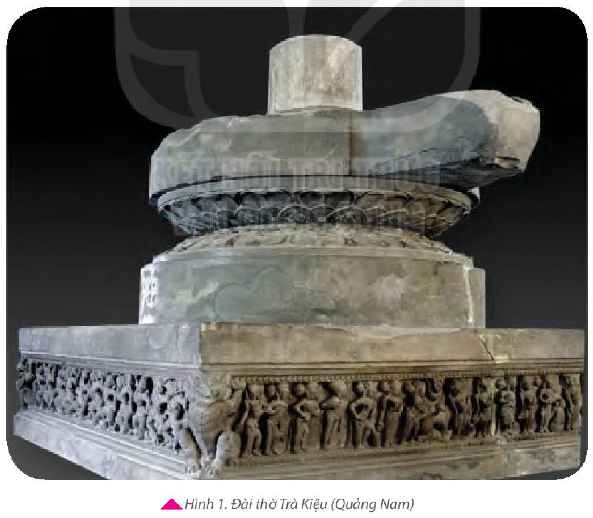
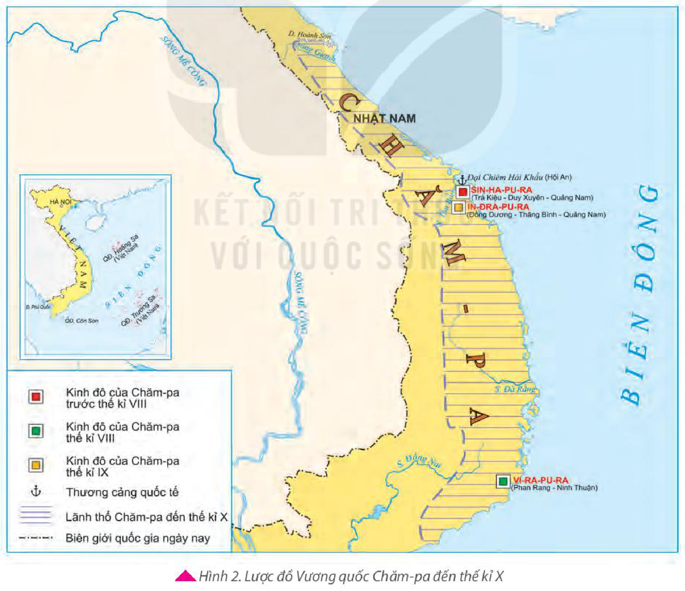
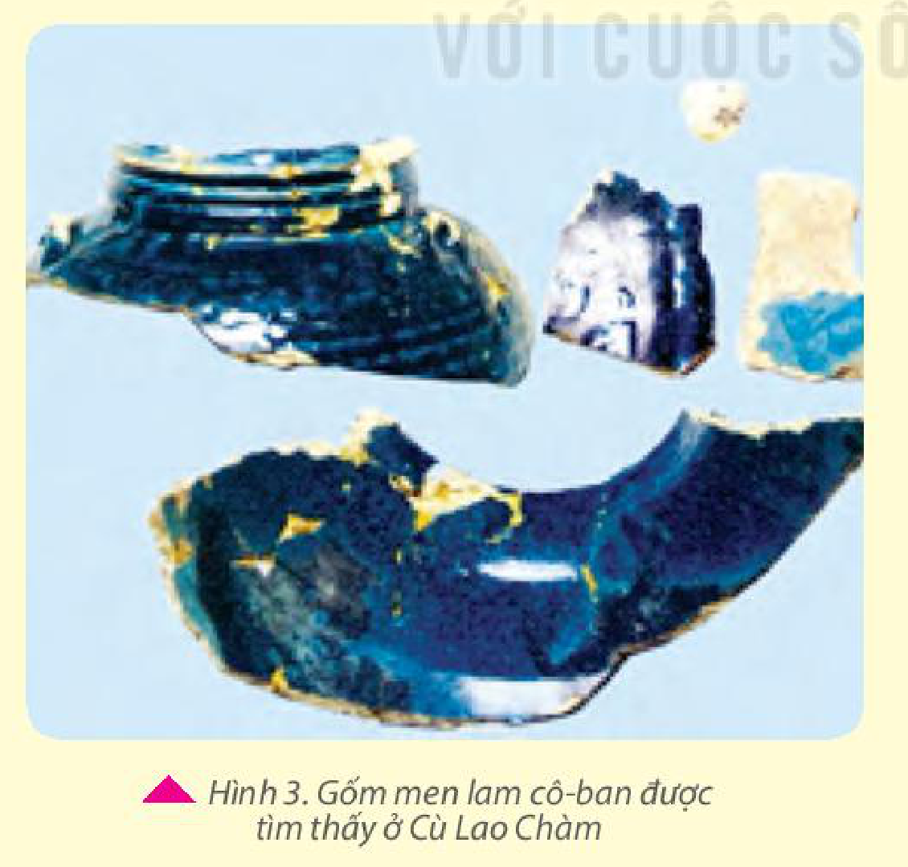
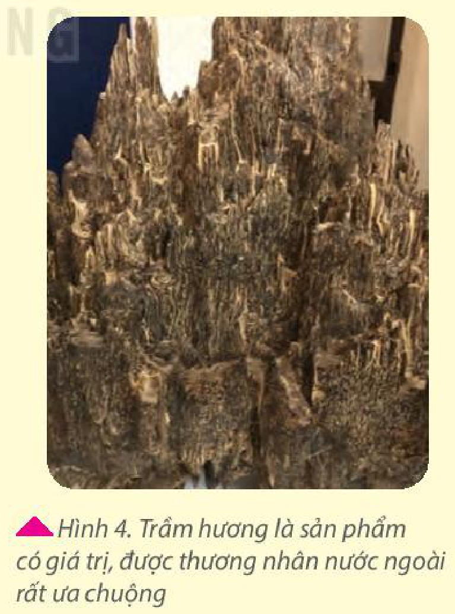
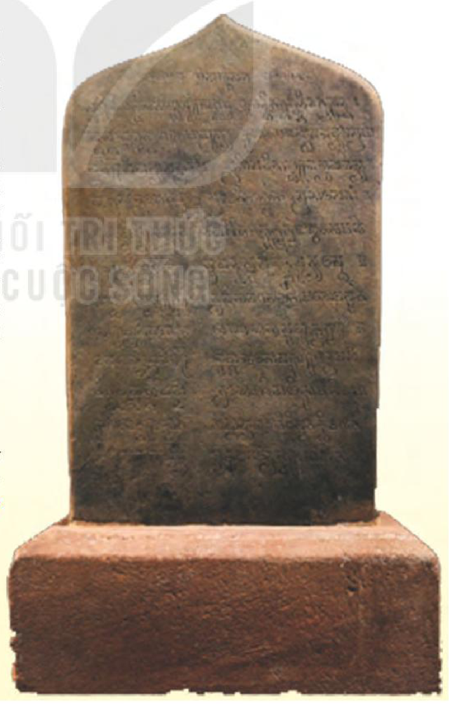
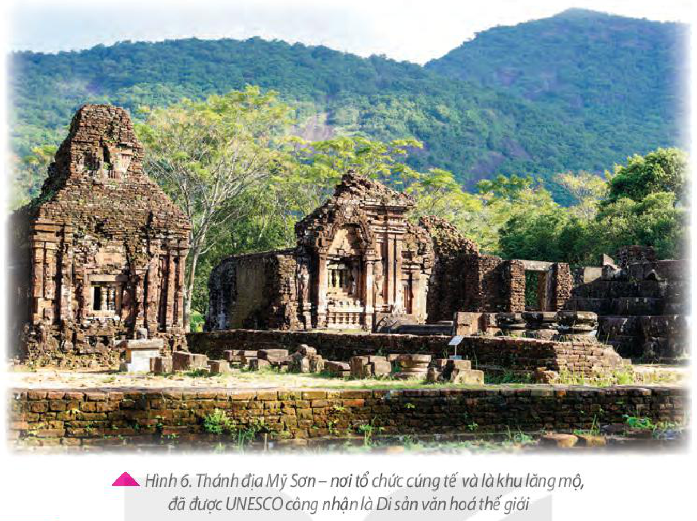

<!-- pdf:87 -->

# BÀI 19: VƯƠNG QUỐC CHĂM-PA TỪ THẾ KỈ II ĐẾN THẾ KỈ X

## 🎯 Học xong bài này, em sẽ:

- Mô tả được sự thành lập, quá trình phát triển của Vương quốc Chăm-pa.
- Trình bày được những nét chính về tổ chức xã hội và kinh tế của Chăm-pa.
- Nhận biết được một số thành tựu văn hoá của Vương quốc Chăm-pa.

## 🔴 Mở đầu

Dưới đây là đài thờ Trà Kiệu, một kiệt tác điêu khắc Chăm-pa (thế kỉ IX). Hình ảnh này gợi cho em suy nghĩ gì về trình độ kĩ thuật cũng như đời sống văn hoá của cư dân Chăm-pa xưa?

*Hình 1. Đài thờ Trà Kiệu (Quảng Nam)*

<!-- pdf:88 -->

## 1. Quá trình hình thành và bước đầu phát triển của Vương quốc Chăm-pa

### a) Vương quốc Chăm-pa ra đời

<!-- term: Vương quốc Chăm-pa -->
Trong thời kì Bắc thuộc, nhà Hán đã thiết lập ách cai trị đối với vùng đất ở phía Nam dãy Hoành Sơn nước ta, đặt tên gọi là quận Nhật Nam. Năm 192, dưới sự lãnh đạo của Khu Liên, người dân Tượng Lâm (huyện xa nhất của quận Nhật Nam) đã nổi dậy lật đổ ách cai trị ngoại bang, lập ra nước Lâm Ấp (tên gọi ban đầu của Vương quốc Chăm-pa).

<!-- term: Văn hoá Sa Huỳnh -->
> 💡 **Em có biết?**
>
> Cách ngày nay hơn 2 000 năm, những cư dân là chủ nhân của nền văn hoá Sa Huỳnh thuộc thời đại đồ sắt đã sinh sống trên dải đất miền Trung Việt Nam. Về sau, người Sa Huỳnh trở thành một bộ phận của cư dân Chăm-pa.
>
> Tượng Lâm là một huyện nằm ở phía nam của quận Nhật Nam (ngày nay là các tỉnh Quảng Nam, Quảng Ngãi, Bình Định).

### b) Chặng đường hơn 8 thế kỉ đầu tiên

Vương quốc Chăm-pa phát triển qua nhiều giai đoạn, gắn liền với vai trò của những vùng đất khác nhau.

*Hình 2. Lược đồ Vương quốc Chăm-pa đến thế kỉ X*

<!-- pdf:89 -->

<!-- term: Vương quốc Chăm-pa -->
Trước thế kỉ VIII, người Chăm đã xây dựng một vương quốc khá hùng mạnh ở ven sông Thu Bồn, với kinh đô là Sin-ha-pu-ra (ở Trà Kiệu, huyện Duy Xuyên, tỉnh Quảng Nam ngày nay).

<!-- term: Vương quốc Chăm-pa -->
Thế kỉ VIII, kinh đô của Chăm-pa dịch chuyển về phía nam với tên gọi Vi-ra-pu-ra (ở Phan Rang, tỉnh Ninh Thuận ngày nay).

<!-- term: Vương quốc Chăm-pa -->
Thế kỉ IX, người Chăm lại chuyển kinh đô về Đồng Dương (huyện Thăng Bình, tỉnh Quảng Nam ngày nay), có tên là In-đra-pu-ra.

> ❓ 1. Vương quốc Chăm-pa được hình thành ở đâu và từ khi nào?
>
> 2. Hãy giới thiệu khái quát các giai đoạn phát triển của Vương quốc Chăm-pa từ thế kỉ II đến thế kỉ X.

## 2. Hoạt động kinh tế và tổ chức xã hội

### a) Hoạt động kinh tế

Hoạt động kinh tế của người Chăm rất đa dạng: trồng lúa nước ở các cánh đồng dọc theo lưu vực những con sông; chăn nuôi gia súc, gia cầm; sản xuất các mặt hàng thủ công (đồ gốm, trang sức, dụng cụ sản xuất); khai thác các nguồn lợi tự nhiên trên rừng (trầm hương, kì nam,...) và dưới biển (cá, tôm, ngọc trai,...). Sản phẩm làm ra không chỉ phục vụ đời sống hằng ngày mà còn được dùng để trao đổi, buôn bán trong nước và với các nước khác.

Đặc biệt, người Chăm giỏi nghề đi biển. Vương quốc Chăm-pa là một trung tâm buôn bán quốc tế thời bấy giờ, kết nối với Trung Hoa, Ấn Độ và các nước Ả Rập.

Người Chăm-pa bán những sản phẩm nổi tiếng của miền nhiệt đới như trầm hương, kì nam, ngọc trai, ngà voi,... để đổi lấy các mặt hàng như thuỷ tinh (từ Ấn Độ), mã não (từ Thái Lan), gương đồng (từ Trung Quốc), đồ gốm men lam cô-ban (từ các nước Ả Rập),...

*Hình 3. Gốm men lam cô-ban được tìm thấy ở Cù Lao Chàm*

*Hình 4. Trầm hương là sản phẩm có giá trị, được thương nhân nước ngoài rất ưa chuộng*

<!-- pdf:90 -->

### b) Tổ chức xã hội

Trong xã hội Chăm-pa, vua thường được đồng nhất với một vị thần, có quyền lực tối cao. Dưới vua là tể tướng và hai quan đại thần: một văn, một võ. Dưới đại thần là các quan đứng đầu ba cấp: châu – huyện – làng.

Xã hội Chăm-pa bao gồm các tầng lớp: tăng lữ, quý tộc, dân tự do và một bộ phận nhỏ nô lệ.

> ❓ 1. Nêu những hoạt động kinh tế chính của cư dân Chăm-pa.
>
> 2. Hãy vẽ sơ đồ mô tả các thành phần trong xã hội Chăm-pa và nêu nhận xét.

## 3. Một số thành tựu văn hoá tiêu biểu

### a) Chữ viết

<!-- term: Chữ Chăm cổ -->
Sáng tạo ra chữ viết riêng cho dân tộc mình là thành tựu văn hoá nổi bật của người Chăm. Sau một thời gian dùng chữ Phạn để ghi chép, từ thế kỉ thứ IV, người Chăm đã cải biên chữ viết của người Ấn Độ để tạo thành hệ thống chữ Chăm cổ.

### b) Tín ngưỡng và tôn giáo

Người Chăm xưa theo nhiều tín ngưỡng (thờ thần Mặt Trời, thần Núi, thần Nước, thần Lúa,...) và du nhập một số tôn giáo lớn từ bên ngoài (Phật giáo và Ấn Độ giáo,...).

<!-- term: Thánh địa Mỹ Sơn -->
Sự đa dạng về tín ngưỡng và tôn giáo góp phần tạo ra những thành tựu đặc sắc về kiến trúc và điêu khắc Chăm-pa. Nhiều di sản tiêu biểu còn tồn tại đến ngày nay như Thánh địa Mỹ Sơn, Phật viện Đồng Dương (Quảng Nam) và nhiều đền tháp Chăm khác ở ven biển miền Trung nước ta.

*Hình 5. Bia khắc chữ Chăm cổ (thế kỉ VII), được trưng bày tại Bảo tàng Điêu khắc Chăm Đà Nẵng*

<!-- pdf:91 -->

<!-- term: Thánh địa Mỹ Sơn -->
*Hình 6. Thánh địa Mỹ Sơn – nơi tổ chức cúng tế và là khu lăng mộ, đã được UNESCO công nhận là Di sản văn hoá thế giới*

### c) Lễ hội

Nhiều lễ hội được tổ chức trong năm đã minh chứng cho sự phong phú về đời sống văn hoá tinh thần của người Chăm xưa. Các lễ hội thường mang ý nghĩa nguyện cầu cho cuộc sống tốt đẹp, mùa màng bội thu, xã hội yên bình và hưng thịnh... tiêu biểu nhất là lễ hội Ka-tê.

<!-- term: Lễ hội Ka-tê -->
> 💡 **Em có biết?**
>
> Ka-tê là lễ hội dân gian đặc sắc nhất của dân tộc Chăm. Đây là dịp người Chăm dâng lễ vật tri ân các vị thần và tưởng nhớ tổ tiên của mình. Lễ hội này được tổ chức vào tháng 9 – đầu tháng 10 dương lịch tại cụm di tích tháp Chăm nổi tiếng ở Ninh Thuận, Bình Thuận,...
<!-- ocr-ok: hộp Em có biết? cột trái trang 90 (PDF 91) bị OCR đọc trộn với cột phải, đối chiếu p091.png -->

> ❓ 1. Kể tên một số thành tựu văn hoá tiêu biểu của người Chăm trong 10 thế kỉ đầu Công nguyên.
>
> 2. Dựa vào hình 6, em có nhận xét gì về những công trình kiến trúc tiêu biểu của người Chăm xưa?

## ✏️ Luyện tập và Vận dụng

1. Lập bảng tóm tắt những nét chính về hoạt động kinh tế, tổ chức xã hội và thành tựu văn hoá của Chăm-pa.

2. Liên hệ với kiến thức đã học ở những bài trước, em hãy so sánh những điểm giống và khác nhau trong hoạt động kinh tế của cư dân Chăm-pa và cư dân Văn Lang – Âu Lạc.

3. Hãy sưu tầm tư liệu và viết một đoạn giới thiệu về một di tích văn hoá Chăm ở nước ta. Theo em, cần phải làm gì để bảo tồn và phát huy giá trị của di tích?

## 📷 Danh sách hình trong bài

| Mã hình | Trang PDF | Vị trí trong bài | Chú thích gốc |
| --- | :---: | --- | --- |
| H6-lich_su_va_dia_ly-ls-b19-01 | 87 | Mở đầu | Hình 1. Đài thờ Trà Kiệu (Quảng Nam) |
| H6-lich_su_va_dia_ly-ls-b19-02 | 88 | Mục 1.b | Hình 2. Lược đồ Vương quốc Chăm-pa đến thế kỉ X |
| H6-lich_su_va_dia_ly-ls-b19-03 | 89 | Mục 2.a | Hình 3. Gốm men lam cô-ban được tìm thấy ở Cù Lao Chàm |
| H6-lich_su_va_dia_ly-ls-b19-04 | 89 | Mục 2.a | Hình 4. Trầm hương là sản phẩm có giá trị, được thương nhân nước ngoài rất ưa chuộng |
| H6-lich_su_va_dia_ly-ls-b19-05 | 90 | Mục 3.b | Hình 5. Bia khắc chữ Chăm cổ (thế kỉ VII), được trưng bày tại Bảo tàng Điêu khắc Chăm Đà Nẵng |
| H6-lich_su_va_dia_ly-ls-b19-06 | 91 | Mục 3.b | Hình 6. Thánh địa Mỹ Sơn – nơi tổ chức cúng tế và là khu lăng mộ, đã được UNESCO công nhận là Di sản văn hoá thế giới |
