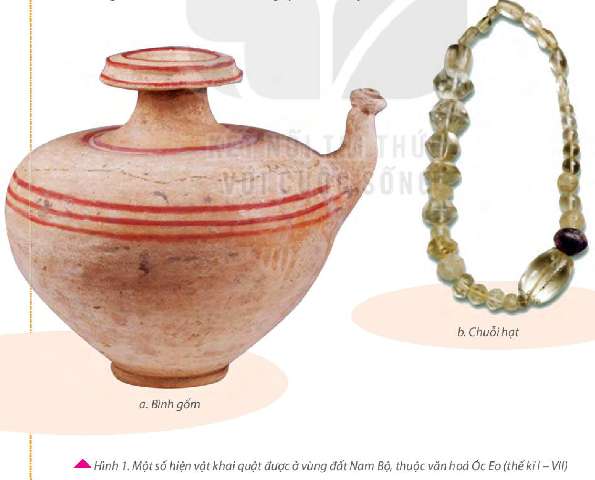
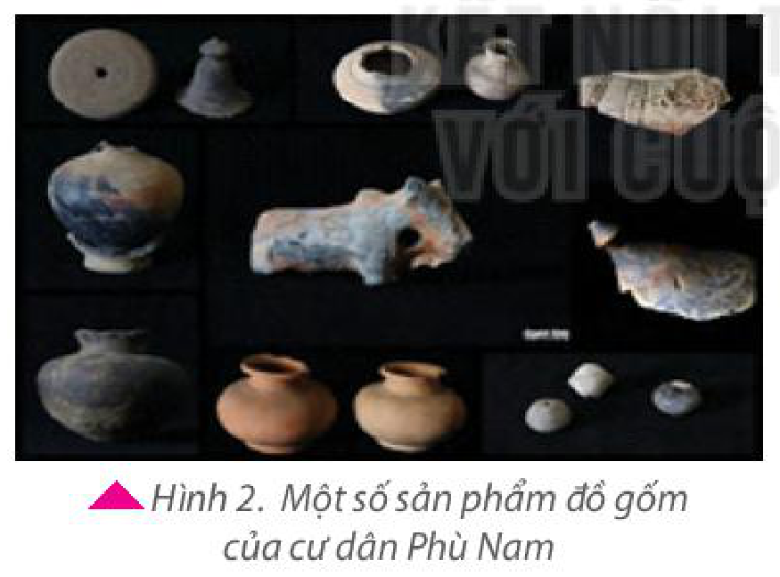
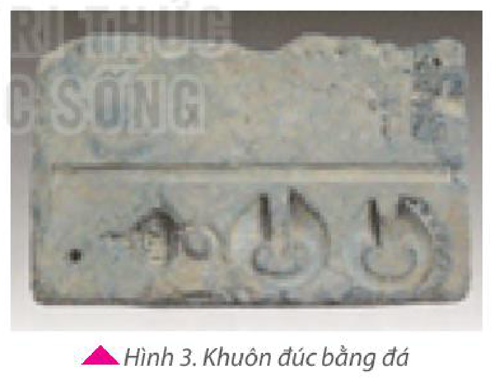
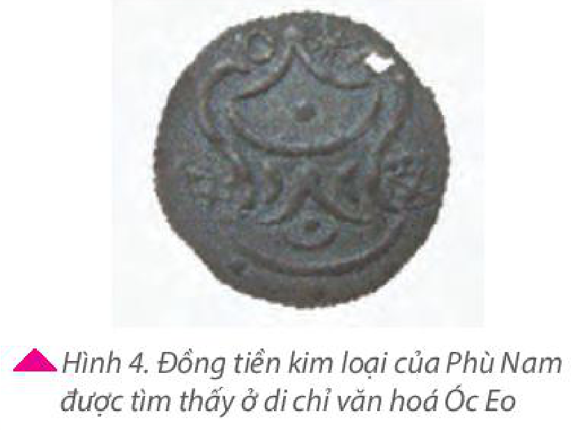
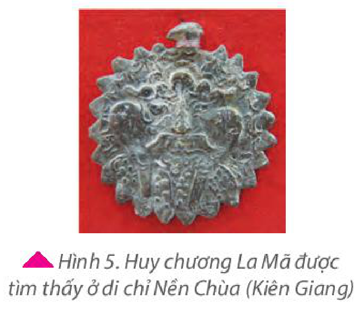
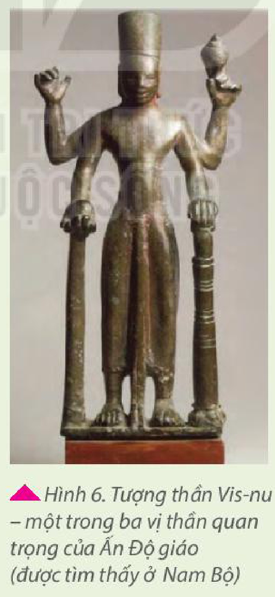
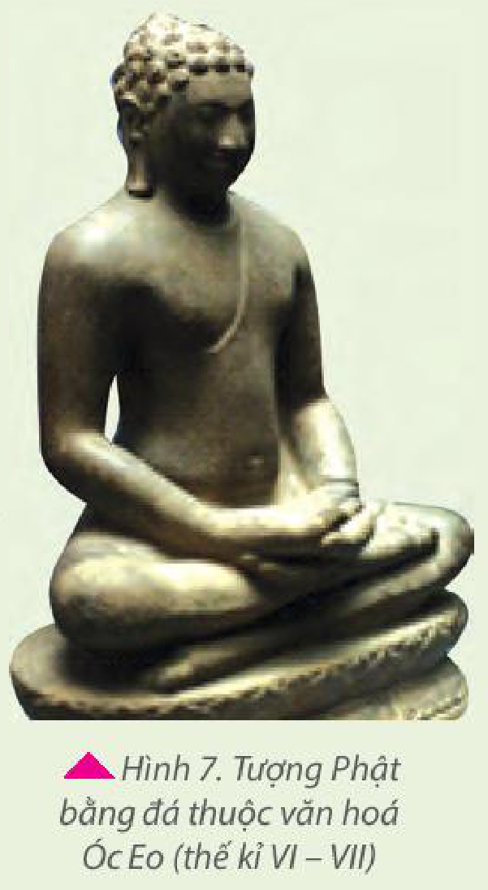
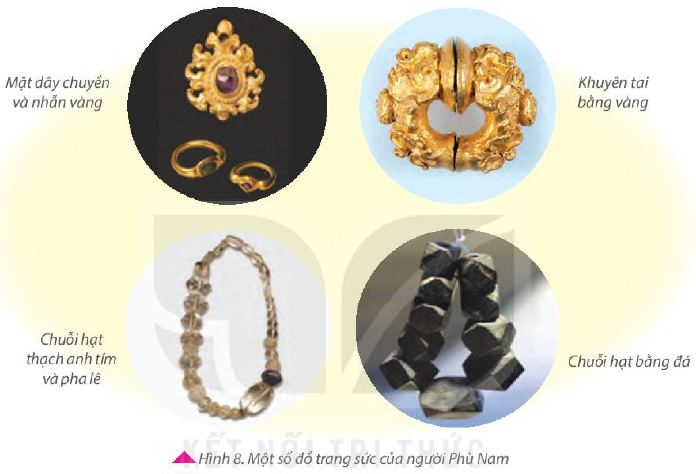

<!-- pdf:92 -->

# BÀI 20: VƯƠNG QUỐC PHÙ NAM

## 🎯 Học xong bài này, em sẽ:

- Mô tả được sự thành lập, quá trình phát triển và suy vong của Vương quốc Phù Nam xưa.
- Trình bày được nét chính về tổ chức xã hội và kinh tế của Phù Nam.
- Nhận biết được một số thành tựu văn hoá của Vương quốc Phù Nam.

## 🔴 Mở đầu

<!-- term: Văn hoá Óc Eo -->
Cách đây hơn 2 000 năm, ở vùng châu thổ sông Cửu Long nước ta đã xuất hiện một nền văn hoá rất đặc sắc – văn hoá Óc Eo. Trên cơ sở đó, một vương quốc cổ đã được hình thành với tên gọi Phù Nam. Hình dưới đây là những hiện vật liên quan đến Vương quốc Phù Nam. Theo em, những hiện vật này chứng tỏ điều gì về chủ nhân của vương quốc cổ này?

<!-- term: Văn hoá Óc Eo -->
*Hình 1. Một số hiện vật khai quật được ở vùng đất Nam Bộ, thuộc văn hoá Óc Eo (thế kỉ I – VII) (a. Bình gốm; b. Chuỗi hạt)*

<!-- pdf:93 -->

## 1. Sự hình thành, phát triển và suy vong của Vương quốc Phù Nam

<!-- term: Vương quốc Phù Nam -->
Vào khoảng thế kỉ I, Vương quốc Phù Nam ra đời. Địa bàn chủ yếu của Vương quốc Phù Nam là khu vực Nam Bộ nước ta hiện nay. Thời kì đỉnh cao, phạm vi của Phù Nam được mở rộng, có thể bao gồm nhiều vùng đất thuộc một số nước Đông Nam Á ngày nay.

<!-- term: Vương quốc Phù Nam -->
Trong khoảng các thế kỉ III – V, Vương quốc Phù Nam phát triển thành đế chế hùng mạnh ở khu vực Đông Nam Á.

<!-- term: Vương quốc Phù Nam -->
Óc Eo (thuộc An Giang, Việt Nam) và Ăng-co Bo-rây (thuộc Cam-pu-chia) là những trung tâm chính trị, kinh tế quan trọng của Vương quốc Phù Nam.

<!-- term: Vương quốc Phù Nam -->
Vào đầu thế kỉ VI, Phù Nam dần suy yếu do nhiều nguyên nhân và cuối cùng bị xâm chiếm bởi người Chân Lạp vào đầu thế kỉ VII.

> ❓ 1. Vương quốc Phù Nam ra đời ở đâu và vào thời gian nào?
>
> 2. Lập trục thời gian thể hiện các mốc hình thành, phát triển và suy vong của Vương quốc Phù Nam.

## 2. Hoạt động kinh tế và tổ chức xã hội

### a) Hoạt động kinh tế

Người Phù Nam làm nhiều nghề khác nhau như: trồng lúa nước, chăn nuôi gà, lợn, đánh bắt thuỷ – hải sản, làm đồ thủ công như đồ gốm, trang sức, đồ đựng bằng thuỷ tinh, luyện đồng và rèn sắt, chế tạo công cụ sản xuất, vũ khí,...

<!-- term: Cảng thị Óc Eo -->
Đặc biệt, người Phù Nam rất giỏi nghề buôn bán. Không chỉ trao đổi hàng hoá để tiêu dùng trong nước, người Phù Nam còn buôn bán với các thương nhân nước ngoài đến từ Trung Quốc, Chăm-pa, Mã Lai, Ấn Độ,... thông qua các cảng thị, tiêu biểu là Óc Eo.

*Hình 2. Một số sản phẩm đồ gốm của cư dân Phù Nam*

*Hình 3. Khuôn đúc bằng đá*
<!-- ocr-ok: chú thích Hình 3 ngắn trên nền ảnh trang 92 (PDF 93), đối chiếu p093.png -->

*Hình 4. Đồng tiền kim loại của Phù Nam được tìm thấy ở di chỉ văn hoá Óc Eo*

*Hình 5. Huy chương La Mã được tìm thấy ở di chỉ Nền Chùa (Kiên Giang)*

<!-- pdf:94 -->

> Sử kí Trung Quốc chép về Vương quốc Phù Nam như sau: “Dân Phù Nam mưu lược, nhưng tốt bụng và thật thà, chuyên nghề buôn bán... Hàng hoá bán thường ngày là vàng, bạc, lụa,...”.
>
> (Theo Lê Hương, *Sử liệu Phù Nam*, NXB Nguyên Nhiều, Sài Gòn 1974, tr.81)

### b) Tổ chức xã hội

Tổ chức nhà nước ở Phù Nam trong khoảng hai thế kỉ đầu sau khi thành lập còn đơn giản nhưng từ thế kỉ III dần được hoàn thiện. Vua là người đứng đầu và có quyền lực cao nhất; dưới đó là hệ thống quan lại giúp việc cho vua với nhiều cấp bậc.

Xã hội Phù Nam được phân chia thành năm thành phần chính: quý tộc, tăng lữ, thương nhân, thợ thủ công và nông dân.

> ❓ 1. Hình 4, 5 và đoạn tư liệu trên cho em biết điều gì về cư dân Phù Nam?
>
> 2. Hãy cho biết những hoạt động kinh tế của cư dân Phù Nam.
>
> 3. Xã hội Phù Nam gồm những tầng lớp nào và có những nét tương đồng nào so với xã hội Chăm-pa?

## 3. Một số thành tựu văn hoá

Người Phù Nam có tín ngưỡng thờ đa thần, tiêu biểu là thờ thần Mặt Trời. Trong quá trình giao lưu buôn bán quốc tế, họ đã chủ động tiếp nhận các tôn giáo từ Ấn Độ như Phật giáo và Ấn Độ giáo. Đặc biệt, từ Vương quốc Phù Nam, các tôn giáo này lại tiếp tục được truyền bá đến nhiều vùng đất khác ở Đông Nam Á.

<!-- term: Phong cách Phù Nam -->
Để phục vụ cho việc thờ cúng, nghề tạc tượng các vị thần Ấn Độ giáo và tượng Phật bằng đá và gỗ ở Phù Nam đã khá phát triển từ đầu Công nguyên, tạo nên một phong cách riêng – phong cách Phù Nam.

*Hình 6. Tượng thần Vis-nu – một trong ba vị thần quan trọng của Ấn Độ giáo (được tìm thấy ở Nam Bộ)*

*Hình 7. Tượng Phật bằng đá thuộc văn hoá Óc Eo (thế kỉ VI – VII)*

<!-- pdf:95 -->

Họ sử dụng ghe, thuyền để đi lại thuận tiện trên kênh rạch; dùng ngựa, trâu, bò,... để kéo xe.

Đặc biệt, người Phù Nam dựng những ngôi nhà sàn rộng bằng gỗ trên mặt nước và lợp mái lá để chung sống hài hoà trong môi trường sông nước và khí hậu nóng ẩm ở đây.

<!-- term: Văn hoá Óc Eo -->
> 💡 **Em có biết?**
>
> Các nhà khảo cổ khi khai quật di chỉ Óc Eo đã tìm thấy dấu tích các cọc nhà sàn san sát nhau trên một phạm vi rộng lớn, chứng tỏ mật độ dân cư đông đúc ở nơi đây.

*Hình 8. Một số đồ trang sức của người Phù Nam (Mặt dây chuyền và nhẫn vàng; Khuyên tai bằng vàng; Chuỗi hạt thạch anh tím và pha lê; Chuỗi hạt bằng đá)*

> ❓ Hãy cho biết một số thành tựu văn hoá nổi bật của cư dân Phù Nam.

## ✏️ Luyện tập và Vận dụng

1. Hãy so sánh về hoạt động kinh tế và tổ chức xã hội giữa cư dân Phù Nam và cư dân Chăm-pa.

2. Theo em, nét văn hoá nào của cư dân Phù Nam xưa còn được lưu giữ trong đời sống của cư dân Nam Bộ hiện nay?

## 📷 Danh sách hình trong bài

| Mã hình | Trang PDF | Vị trí trong bài | Chú thích gốc |
| --- | :---: | --- | --- |
| H6-lich_su_va_dia_ly-ls-b20-01 | 92 | Mở đầu | Hình 1. Một số hiện vật khai quật được ở vùng đất Nam Bộ, thuộc văn hoá Óc Eo (thế kỉ I – VII) |
| H6-lich_su_va_dia_ly-ls-b20-02 | 93 | Mục 2.a | Hình 2. Một số sản phẩm đồ gốm của cư dân Phù Nam |
| H6-lich_su_va_dia_ly-ls-b20-03 | 93 | Mục 2.a | Hình 3. Khuôn đúc bằng đá |
| H6-lich_su_va_dia_ly-ls-b20-04 | 93 | Mục 2.a | Hình 4. Đồng tiền kim loại của Phù Nam được tìm thấy ở di chỉ văn hoá Óc Eo |
| H6-lich_su_va_dia_ly-ls-b20-05 | 93 | Mục 2.a | Hình 5. Huy chương La Mã được tìm thấy ở di chỉ Nền Chùa (Kiên Giang) |
| H6-lich_su_va_dia_ly-ls-b20-06 | 94 | Mục 3 | Hình 6. Tượng thần Vis-nu – một trong ba vị thần quan trọng của Ấn Độ giáo (được tìm thấy ở Nam Bộ) |
| H6-lich_su_va_dia_ly-ls-b20-07 | 94 | Mục 3 | Hình 7. Tượng Phật bằng đá thuộc văn hoá Óc Eo (thế kỉ VI – VII) |
| H6-lich_su_va_dia_ly-ls-b20-08 | 95 | Mục 3 | Hình 8. Một số đồ trang sức của người Phù Nam |
