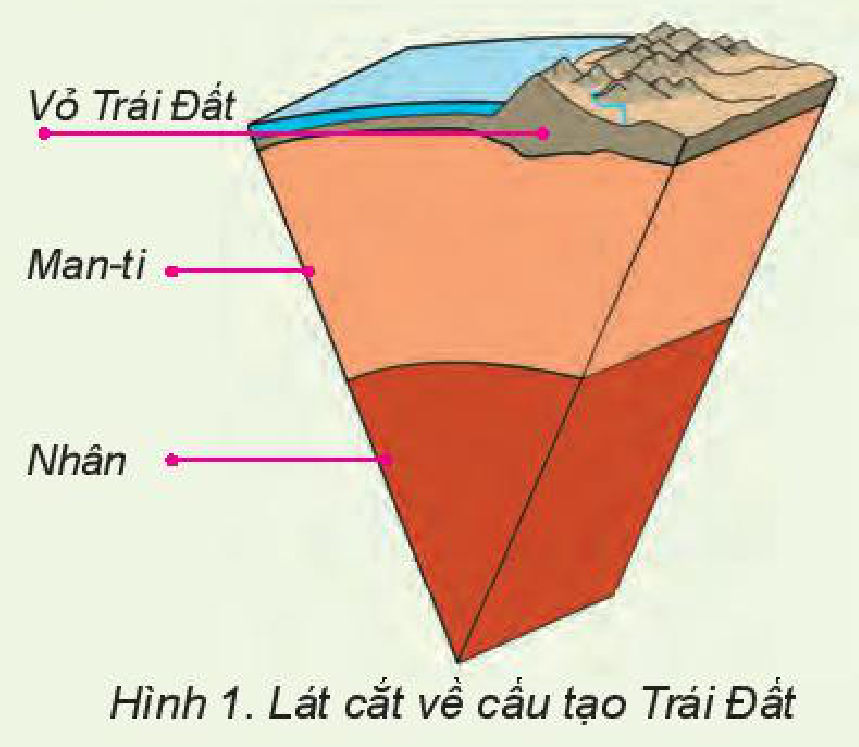
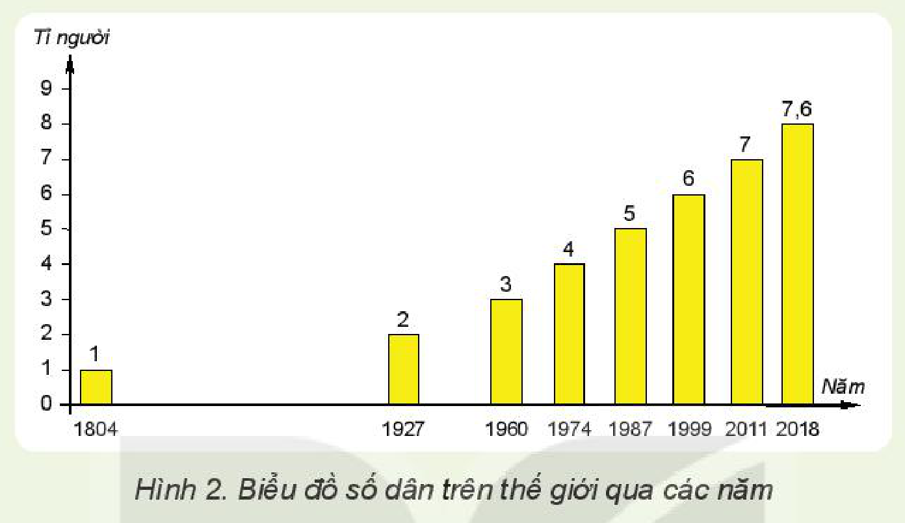
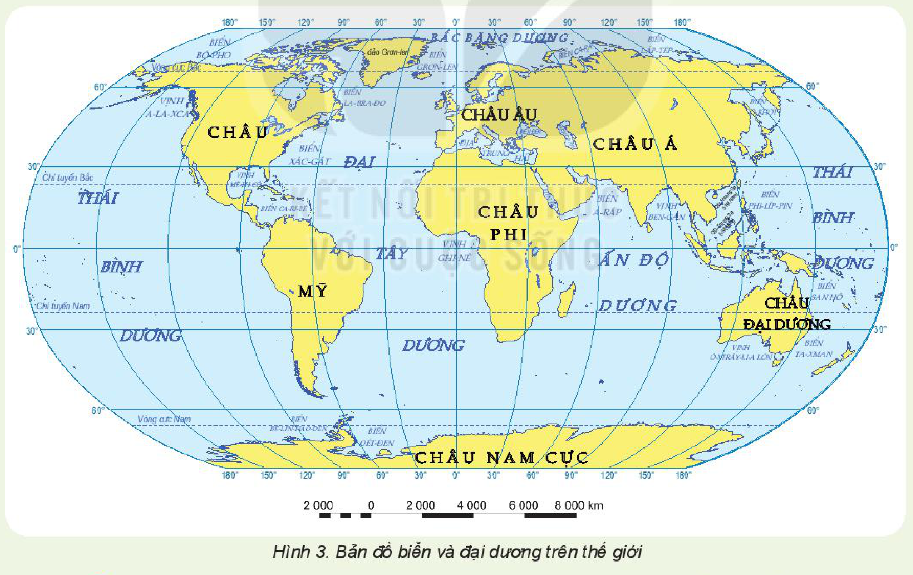
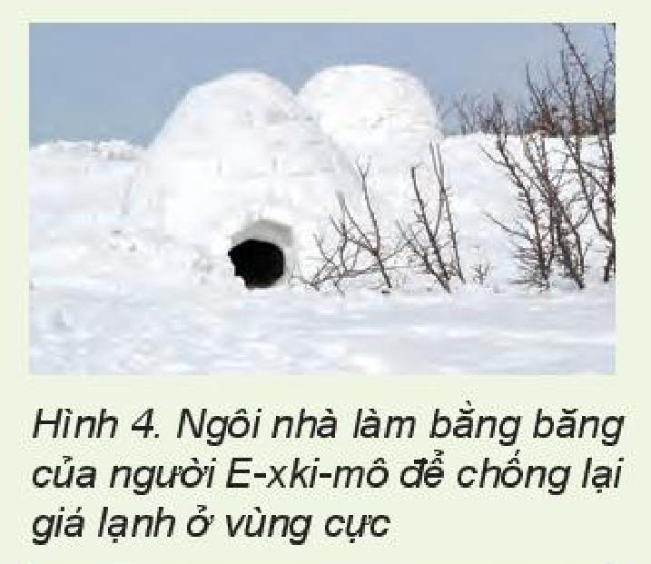
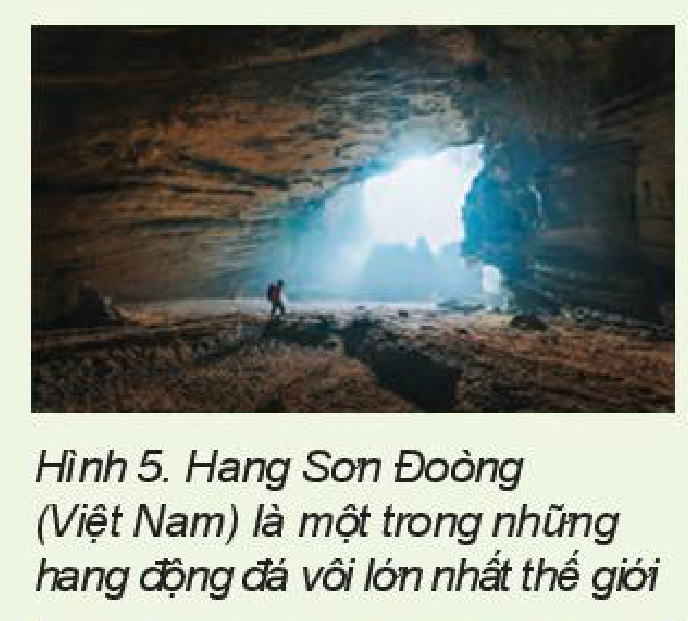
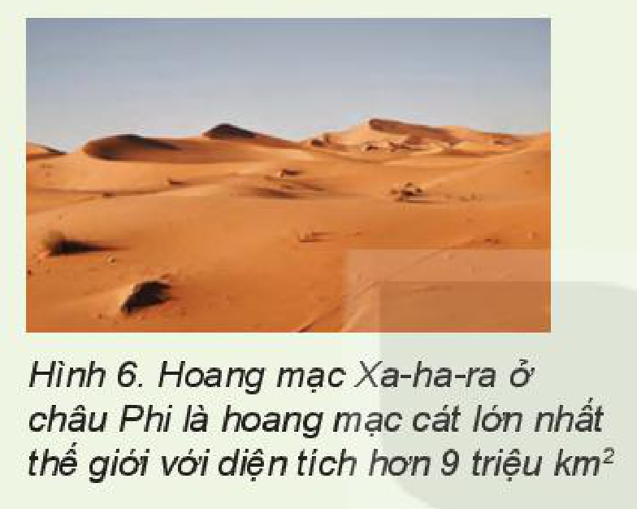
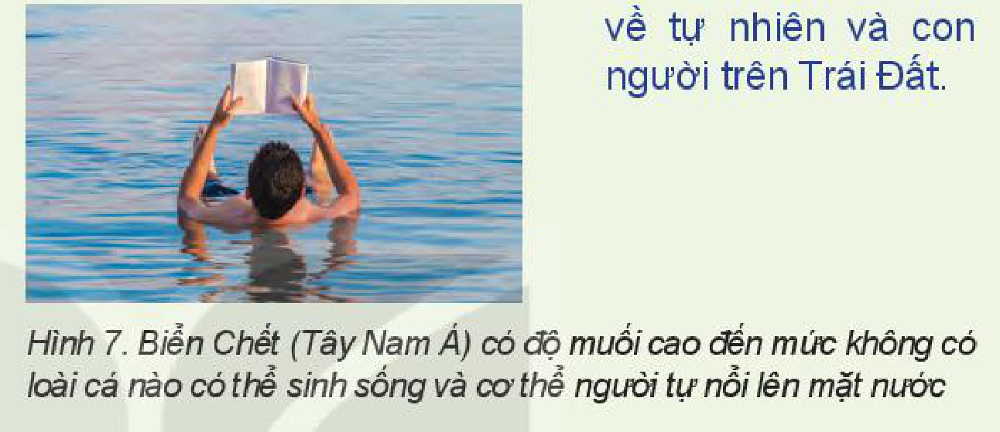

<!-- pdf:99 -->

# BÀI MỞ ĐẦU

## 🎯 Học xong bài này, em sẽ:

- Hiểu được tầm quan trọng của việc nắm vững các khái niệm cơ bản, các kĩ năng địa lí trong học tập và trong sinh hoạt.
- Hiểu được ý nghĩa và sự lí thú của việc học môn Địa lí.
- Nêu được vai trò của Địa lí trong cuộc sống.
- Yêu thích môn học, thích tìm hiểu các sự vật, hiện tượng địa lí.

## 🔴 Mở đầu

Ở Tiểu học, các em bước đầu được làm quen với một số kiến thức địa lí. Từ năm học này, các kiến thức địa lí sẽ ngày càng phong phú, đa dạng hơn, gắn với thiên nhiên và con người ở các khu vực, các vùng khác nhau trên Trái Đất.

## 1. Những khái niệm cơ bản và kĩ năng chủ yếu của môn Địa lí

Để học tốt môn Địa lí, các em cần nắm vững các khái niệm cơ bản và kĩ năng chủ yếu của môn học.

<!-- term: Khái niệm địa lí cơ bản ở lớp 6 -->
Ở lớp 6, các em sẽ được tìm hiểu một số khái niệm địa lí cơ bản về Trái Đất, các thành phần tự nhiên của Trái Đất (địa hình, khí hậu, nước, đất, sinh vật) và mối quan hệ giữa con người với thiên nhiên.

<!-- term: Khái niệm địa lí cơ bản ở lớp 6 -->
Việc nắm vững các khái niệm cơ bản sẽ giúp các em có khả năng giải thích và ứng xử khi gặp các hiện tượng thiên nhiên diễn ra trong cuộc sống hằng ngày.

<!-- term: Kĩ năng địa lí -->
Môn Địa lí có một hệ thống tư liệu như thông tin, bản đồ, bảng số liệu, biểu đồ, sơ đồ, hình ảnh,... là những công cụ hữu ích giúp các em khai thác, phân tích để hiểu về sự vật, hiện tượng mà nhiều khi chúng ta không thể quan sát trực tiếp. Qua đó, các em không chỉ có được kiến thức mà còn rèn luyện được các kĩ năng địa lí như: sử dụng bản đồ, sơ đồ, hình ảnh, bảng số liệu, biểu đồ,...

*Hình 1. Lát cắt về cấu tạo Trái Đất*

<!-- pdf:100 -->

Internet là một công cụ học tập rất hữu ích, cho phép các em tìm hiểu kiến thức địa lí về mọi nơi trên thế giới, về mọi vấn đề mà các em quan tâm. Đó là một kho dữ liệu có cả hình ảnh, video, kiến thức phong phú.

Có những bài học, câu hỏi thiết kế dưới dạng học tập tại thực địa để gắn các kiến thức đã học với thực tế. Đây là điều kiện cho các em trải nghiệm, bước đầu làm quen với công việc nghiên cứu khoa học địa lí.

*Hình 2. Biểu đồ số dân trên thế giới qua các năm*

*Hình 3. Bản đồ biển và đại dương trên thế giới*

> ❓
> 1. Đọc thông tin trong mục 1 và quan sát hình 1, 2, 3, hãy cho biết một số kĩ năng được rèn luyện khi học môn Địa lí.
> 2. Việc nắm các khái niệm cơ bản và kĩ năng chủ yếu của môn Địa lí có ý nghĩa gì trong học tập và đời sống?

<!-- pdf:101 -->

## 2. Môn Địa lí và những điều lí thú

Muốn học Địa lí đạt hiệu quả cao, các em cần phải có hứng thú trong học tập.

*Hình 4. Ngôi nhà làm bằng băng của người E-xki-mô để chống lại giá lạnh ở vùng cực*
<!-- ocr-ok: đã đối chiếu ảnh trang gốc 100 (PDF 101), chú thích Hình 4 trình bày hai cột -->

*Hình 5. Hang Sơn Đoòng (Việt Nam) là một trong những hang động đá vôi lớn nhất thế giới*
<!-- ocr-ok: đã đối chiếu ảnh trang gốc 100 (PDF 101), chú thích Hình 5 trình bày hai cột -->

*Hình 6. Hoang mạc Xa-ha-ra ở châu Phi là hoang mạc cát lớn nhất thế giới với diện tích hơn 9 triệu km²*
<!-- ocr-ok: đã đối chiếu ảnh trang gốc 100 (PDF 101), chú thích Hình 6 trình bày hai cột -->

*Hình 7. Biển Chết (Tây Nam Á) có độ muối cao đến mức không có loài cá nào có thể sinh sống và cơ thể người tự nổi lên mặt nước*

> ❓
> 1. Em hãy nêu những điều lí thú được thể hiện qua các hình ảnh bên.
> 2. Hãy kể thêm một số điều lí thú mà em biết về tự nhiên và con người trên Trái Đất.

Cũng sẽ rất lí thú khi các em tìm hiểu về mối quan hệ giữa các sự vật, hiện tượng địa lí như: quan hệ giữa chuyển động của Trái Đất với hiện tượng ngày – đêm, hiện tượng mùa, mối quan hệ giữa khí áp và gió,...

## 3. Địa lí và cuộc sống

<!-- term: Vai trò của Địa lí trong cuộc sống -->
Trong quá trình học tập Địa lí, việc gắn kiến thức với đời sống cũng giúp các em đạt kết quả cao hơn. Học môn Địa lí ở lớp 6, các em sẽ có hiểu biết về các hiện tượng trong tự nhiên và thấy được mối quan hệ giữa con người với thiên nhiên.

<!-- term: Vai trò của Địa lí trong cuộc sống -->
Từ việc có hiểu biết về các hiện tượng địa lí, các em có thể vận dụng để giải quyết các vấn đề trong cuộc sống hằng ngày. Chẳng hạn như, khi các em có hiểu biết về mùa trên Trái Đất, hiện tượng mùa do đâu mà có; các em sẽ biết các mùa ở nơi mình sinh sống diễn ra như thế nào, có tác động đến đời sống sinh hoạt và sản xuất của con người ra sao? Biết được quy luật mùa và tác động của nó, các em sẽ có cách ứng xử phù hợp để thích nghi với nhịp điệu mùa ở địa phương,...

> ❓ Hãy nêu một số ví dụ để thấy được vai trò của môn Địa lí đối với cuộc sống.

## ✏️ Luyện tập và Vận dụng

1. Quan sát hình 1, 2, 3, cho biết những nội dung được thể hiện qua các hình đó.
2. Sưu tầm một số câu ca dao, tục ngữ nói về mối quan hệ giữa thiên nhiên và con người.

## 📷 Danh sách hình trong bài

| Mã hình | Trang PDF | Trang sách | Chú thích |
| --- | :---: | :---: | --- |
| H6-lich_su_va_dia_ly-dl-b00-01 | 99 | 98 | Hình 1. Lát cắt về cấu tạo Trái Đất |
| H6-lich_su_va_dia_ly-dl-b00-02 | 100 | 99 | Hình 2. Biểu đồ số dân trên thế giới qua các năm |
| H6-lich_su_va_dia_ly-dl-b00-03 | 100 | 99 | Hình 3. Bản đồ biển và đại dương trên thế giới |
| H6-lich_su_va_dia_ly-dl-b00-04 | 101 | 100 | Hình 4. Ngôi nhà làm bằng băng của người E-xki-mô để chống lại giá lạnh ở vùng cực |
| H6-lich_su_va_dia_ly-dl-b00-05 | 101 | 100 | Hình 5. Hang Sơn Đoòng (Việt Nam) là một trong những hang động đá vôi lớn nhất thế giới |
| H6-lich_su_va_dia_ly-dl-b00-06 | 101 | 100 | Hình 6. Hoang mạc Xa-ha-ra ở châu Phi là hoang mạc cát lớn nhất thế giới với diện tích hơn 9 triệu km² |
| H6-lich_su_va_dia_ly-dl-b00-07 | 101 | 100 | Hình 7. Biển Chết (Tây Nam Á) có độ muối cao đến mức không có loài cá nào có thể sinh sống và cơ thể người tự nổi lên mặt nước |
