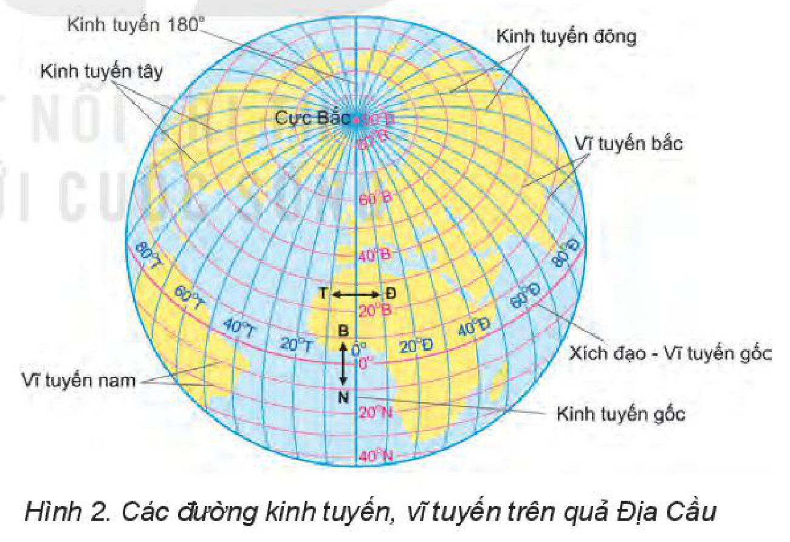
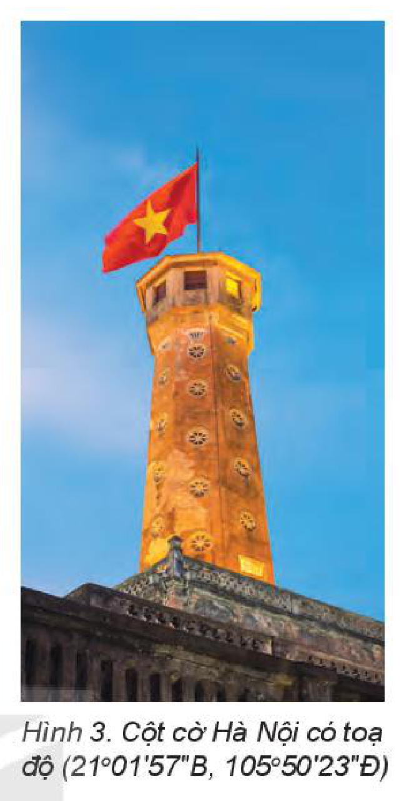
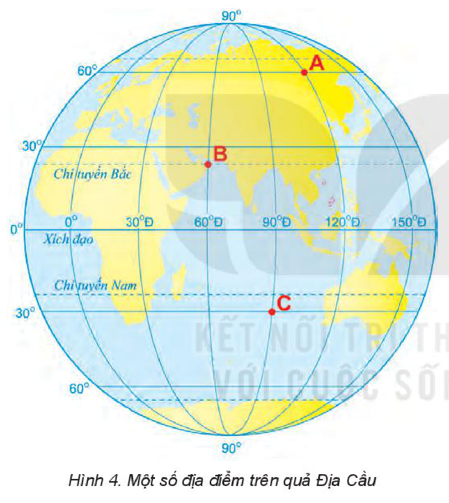

<!-- pdf:103 -->

# BÀI 1: HỆ THỐNG KINH, VĨ TUYẾN. TOẠ ĐỘ ĐỊA LÍ

## 🎯 Học xong bài này, em sẽ:

- Biết được thế nào là: kinh tuyến, vĩ tuyến, kinh tuyến gốc, vĩ tuyến gốc (Xích đạo), các bán cầu, toạ độ địa lí.
- Xác định được trên bản đồ và trên quả Địa Cầu: kinh tuyến gốc, Xích đạo, các bán cầu. Ghi được toạ độ địa lí của một địa điểm trên bản đồ.

## 🔴 Mở đầu

Ngày nay, các con tàu ra khơi đều có gắn các thiết bị định vị để thông báo vị trí của tàu. Vậy dựa vào đâu để người ta xác định được vị trí của con tàu khi đang lênh đênh trên biển?

## 1. Hệ thống kinh, vĩ tuyến

<!-- term: Quả Địa Cầu -->
<!-- term: Kinh tuyến -->
<!-- term: Vĩ tuyến -->
Quả Địa Cầu là mô hình thu nhỏ của Trái Đất. Trên quả Địa Cầu, có thể hiện cực Bắc, cực Nam và hệ thống kinh, vĩ tuyến. Kinh tuyến là nửa đường tròn nối hai cực trên bề mặt quả Địa Cầu. Vĩ tuyến là vòng tròn bao quanh quả Địa Cầu và vuông góc với các kinh tuyến. Để đánh số các kinh tuyến và vĩ tuyến, người ta chọn một kinh tuyến, một vĩ tuyến làm gốc và ghi 0°. Các kinh tuyến và vĩ tuyến khác được xác định dựa vào kinh tuyến gốc và vĩ tuyến gốc.

*Hình 1. Quả Địa Cầu*
<!-- ocr-ok: đã đối chiếu ảnh trang gốc 102 (PDF 103), chú thích Hình 1 ở cột lề trái -->

> 💡 **Em có biết?**

<!-- term: Kinh tuyến gốc -->
> Kinh tuyến gốc được quy ước là kinh tuyến đi qua Đài thiên văn Grin-uých (nằm ở ngoại ô thành phố Luân Đôn, thủ đô nước Anh).

<!-- term: Bán cầu Đông -->
<!-- term: Bán cầu Tây -->
> Kinh tuyến gốc cùng với kinh tuyến 180° chia quả Địa Cầu thành hai bán cầu: bán cầu Đông và bán cầu Tây.

<!-- term: Vĩ tuyến gốc -->
<!-- term: Bán cầu Bắc -->
<!-- term: Bán cầu Nam -->
> Vĩ tuyến gốc là Xích đạo chia quả Địa Cầu thành hai bán cầu: bán cầu Bắc và bán cầu Nam.

<!-- term: Chí tuyến -->
<!-- term: Vòng cực -->
> Vĩ tuyến 23°27' được gọi là chí tuyến, vĩ tuyến 66°33' được gọi là vòng cực.

*Hình 2. Các đường kinh tuyến, vĩ tuyến trên quả Địa Cầu*

> ❓ Dựa vào hình 2 và đọc thông tin trong mục 1, em hãy:
> 1. Xác định đường kinh tuyến gốc và vĩ tuyến gốc. Cho biết thế nào là kinh tuyến tây, kinh tuyến đông, vĩ tuyến bắc, vĩ tuyến nam.
> 2. So sánh độ dài giữa các kinh tuyến với nhau và độ dài giữa các vĩ tuyến với nhau.

<!-- pdf:104 -->

## 2. Kinh độ, vĩ độ và toạ độ địa lí

Muốn xác định vị trí của bất cứ địa điểm nào trên quả Địa Cầu hay trên bản đồ, ta phải xác định được kinh độ và vĩ độ của điểm đó.

<!-- term: Toạ độ địa lí -->
Kinh độ và vĩ độ của một địa điểm được gọi chung là toạ độ địa lí của điểm đó. Ví dụ: Cột cờ Hà Nội có vĩ độ là 21°01'57"B, kinh độ là 105°50'23"Đ, toạ độ địa lí của Cột cờ Hà Nội được ghi là (21°01'57"B, 105°50'23"Đ). Khi biết toạ độ địa lí, ta có thể xác định được vị trí của bất kì điểm nào trên quả Địa Cầu và bản đồ.

*Hình 3. Cột cờ Hà Nội có toạ độ (21°01'57"B, 105°50'23"Đ)*

> ❓ Xác định toạ độ địa lí của các điểm A, B, C trên hình 4.

*Hình 4. Một số địa điểm trên quả Địa Cầu*

> 💡 **Em có biết?**

<!-- term: Kinh độ -->
<!-- term: Vĩ độ -->
> Kinh độ của một điểm là khoảng cách tính bằng độ từ kinh tuyến gốc đến kinh tuyến đi qua điểm đó. Vĩ độ của một điểm là khoảng cách tính bằng độ từ Xích đạo đến vĩ tuyến đi qua điểm đó.

## ✏️ Luyện tập và Vận dụng

1. Cho biết nếu vẽ các đường kinh tuyến, vĩ tuyến cách nhau 1° thì trên quả Địa Cầu có bao nhiêu kinh tuyến, vĩ tuyến.
2. Tra cứu thông tin, ghi toạ độ địa lí các điểm cực (Bắc, Nam, Đông, Tây) trên phần đất liền của nước ta.

## 📷 Danh sách hình trong bài

| Mã hình | Trang PDF | Trang sách | Chú thích |
| --- | :---: | :---: | --- |
| H6-lich_su_va_dia_ly-dl-b01-01 | 103 | 102 | Hình 1. Quả Địa Cầu |
| H6-lich_su_va_dia_ly-dl-b01-02 | 103 | 102 | Hình 2. Các đường kinh tuyến, vĩ tuyến trên quả Địa Cầu |
| H6-lich_su_va_dia_ly-dl-b01-03 | 104 | 103 | Hình 3. Cột cờ Hà Nội có toạ độ (21°01'57"B, 105°50'23"Đ) |
| H6-lich_su_va_dia_ly-dl-b01-04 | 104 | 103 | Hình 4. Một số địa điểm trên quả Địa Cầu |
