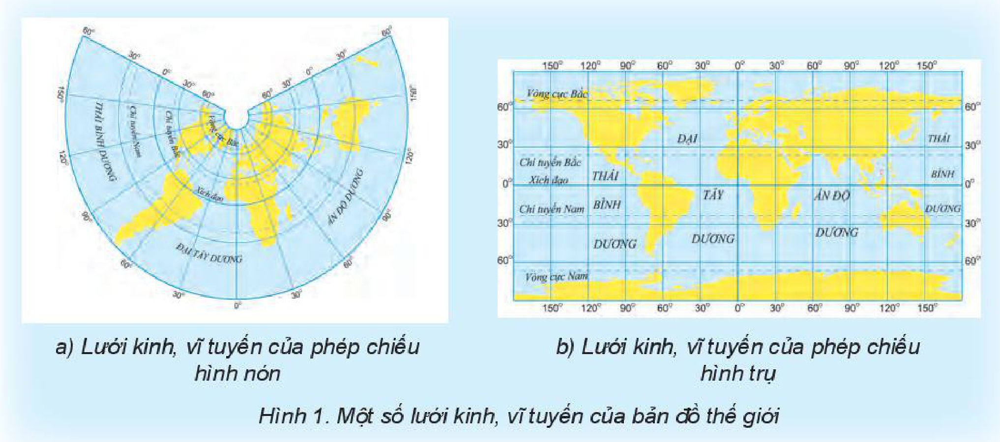
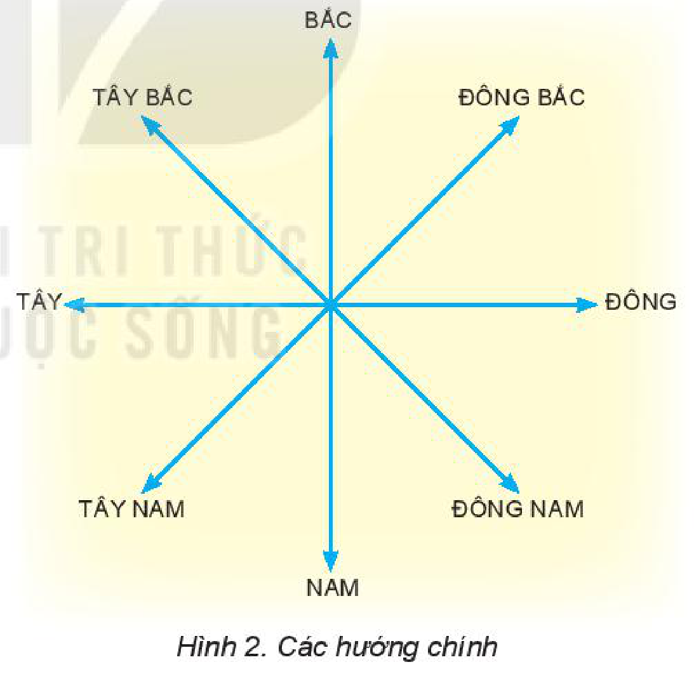

<!-- pdf:105 -->

# BÀI 2: BẢN ĐỒ. MỘT SỐ LƯỚI KINH, VĨ TUYẾN. PHƯƠNG HƯỚNG TRÊN BẢN ĐỒ

## 🎯 Học xong bài này, em sẽ:

- Nêu được khái niệm bản đồ.
- Nhận biết được một số lưới kinh, vĩ tuyến của bản đồ thế giới.
- Xác định được phương hướng trên bản đồ.

## 🔴 Mở đầu

- Quả Địa Cầu không phải là bản đồ.
- Đây là bản đồ đấy.

Theo em, bạn nào nói đúng?
<!-- ocr-ok: đã đối chiếu ảnh trang gốc 104 (PDF 105), chữ trong bóng thoại và nhãn nghiêng hình mở đầu -->

## 1. Khái niệm bản đồ

<!-- term: Bản đồ -->
Bản đồ là hình vẽ thu nhỏ một phần hay toàn bộ bề mặt Trái Đất lên mặt phẳng trên cơ sở toán học, trên đó các đối tượng địa lí được thể hiện bằng các kí hiệu bản đồ. Bản đồ có vai trò quan trọng trong học tập và đời sống.

> ❓
> 1. Em hãy cho biết quả Địa Cầu và bản đồ có điểm gì giống và khác nhau.
> 2. Hãy nêu một số ví dụ cụ thể về vai trò của bản đồ trong học tập và đời sống.

> 💡 **Em có biết?**
>
> Khi chuyển từ mặt cong ra mặt phẳng, các vùng đất biểu hiện trên bản đồ đều có sự biến dạng nhất định so với hình dạng thực trên bề mặt Trái Đất. Vì vậy, người sử dụng bản đồ phải biết ưu điểm và hạn chế của từng loại lưới kinh, vĩ tuyến để lựa chọn bản đồ phù hợp với mục đích của mình.

## 2. Một số lưới kinh, vĩ tuyến của bản đồ thế giới

<!-- term: Lưới kinh, vĩ tuyến -->
Muốn vẽ được bản đồ, người ta phải chuyển bề mặt cong của Trái Đất lên mặt phẳng thông qua các phép chiếu. Các phép chiếu sẽ cho ra các lưới kinh, vĩ tuyến có hình dạng khác nhau.

<!-- pdf:106 -->

*Hình 1. Một số lưới kinh, vĩ tuyến của bản đồ thế giới (a. Lưới kinh, vĩ tuyến của phép chiếu hình nón; b. Lưới kinh, vĩ tuyến của phép chiếu hình trụ)*

> ❓ Quan sát hình 1, em hãy mô tả hình dạng lưới kinh, vĩ tuyến ở mỗi bản đồ.

## 3. Phương hướng trên bản đồ

<!-- term: Phương hướng trên bản đồ -->
Muốn xác định phương hướng trên bản đồ, chúng ta dựa vào các đường kinh tuyến và vĩ tuyến. Đầu trên của các kinh tuyến chỉ hướng bắc, đầu dưới chỉ hướng nam. Đầu bên trái của các vĩ tuyến chỉ hướng tây, đầu bên phải chỉ hướng đông. Trên một số bản đồ không có hệ thống kinh, vĩ tuyến, người ta sẽ vẽ mũi tên chỉ hướng bắc; dựa vào đó để xác định phương hướng trên bản đồ. Các hướng trên bản đồ được quy định như hình 2.

*Hình 2. Các hướng chính*

> ❓ Dựa vào bản đồ Việt Nam trong Đông Nam Á ở trang 101, em hãy xác định hướng đi từ Hà Nội đến các địa điểm: Băng Cốc, Ma-ni-la, Xin-ga-po.

## ✏️ Luyện tập và Vận dụng

1. Dựa vào bản đồ ở trang 101, cho biết phần đất liền của nước ta tiếp giáp với biển ở những hướng nào.
2. Sưu tầm một số bản đồ và giới thiệu với các bạn trong lớp về các bản đồ đó.

## 📷 Danh sách hình trong bài

| Mã hình | Trang PDF | Trang sách | Chú thích |
| --- | :---: | :---: | --- |
| H6-lich_su_va_dia_ly-dl-b02-01 | 106 | 105 | Hình 1. Một số lưới kinh, vĩ tuyến của bản đồ thế giới (a. Lưới kinh, vĩ tuyến của phép chiếu hình nón; b. Lưới kinh, vĩ tuyến của phép chiếu hình trụ) |
| H6-lich_su_va_dia_ly-dl-b02-02 | 106 | 105 | Hình 2. Các hướng chính |
