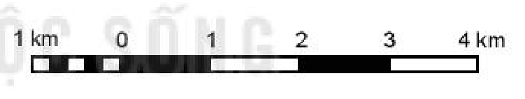
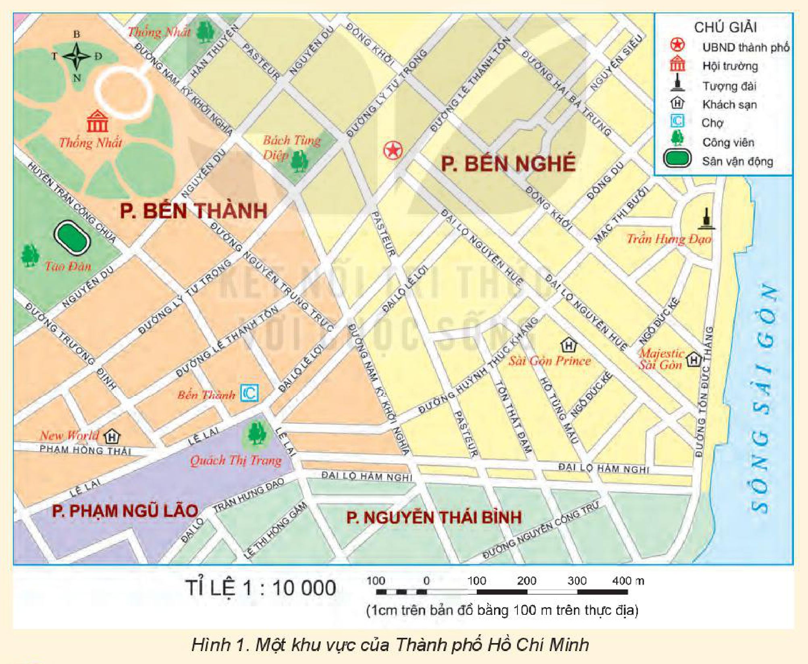

<!-- pdf:107 -->

# BÀI 3: TỈ LỆ BẢN ĐỒ. TÍNH KHOẢNG CÁCH THỰC TẾ DỰA VÀO TỈ LỆ BẢN ĐỒ

## 🎯 Học xong bài này, em sẽ:

- Biết được tỉ lệ bản đồ.
- Tính được khoảng cách thực tế giữa hai địa điểm trên bản đồ theo tỉ lệ bản đồ.

## 🔴 Mở đầu

Bạn A: Không biết Hải Phòng cách Hà Nội bao nhiêu ki-lô-mét nhỉ?

Bạn B: Đưa bản đồ đây mình tính cho.

Theo em, tại sao dựa vào bản đồ lại tính được khoảng cách từ Hải Phòng đến Hà Nội?

## 1. Tỉ lệ bản đồ

<!-- term: Tỉ lệ bản đồ -->
Tỉ lệ bản đồ cho biết mức độ thu nhỏ độ dài giữa các đối tượng trên bản đồ so với thực tế là bao nhiêu.

Tỉ lệ bản đồ được biểu hiện ở hai dạng:

<!-- term: Tỉ lệ số -->
- Tỉ lệ số là một phân số luôn có tử số là 1. Mẫu số càng lớn thì tỉ lệ càng nhỏ và ngược lại.

Ví dụ, tỉ lệ 1 : 1 000 000 có nghĩa là 1 cm trên bản đồ bằng 1 000 000 cm hay 10 km trên thực tế.

<!-- term: Tỉ lệ thước -->
- Tỉ lệ thước được vẽ dưới dạng một thước đo đã tính sẵn, mỗi đoạn đều ghi số đo độ dài tương ứng trên thực tế.

Ở thước tỉ lệ trên, mỗi đoạn 1 cm tương ứng với 1 km trên thực tế.

> 💡 **Em có biết?**
>
> Tỉ lệ bản đồ có liên quan đến mức độ thể hiện các đối tượng địa lí trên bản đồ. Bản đồ tỉ lệ càng lớn thì càng thể hiện được nhiều nội dung.
>
> Để biết khoảng cách thực tế giữa hai đối tượng không nằm trên một đường thẳng trên bản đồ, ta có thể dùng sợi chỉ uốn theo đường nối giữa hai địa điểm, sau đó dựa vào chiều dài của đoạn chỉ và tỉ lệ để tính ra khoảng cách thực tế.

> ❓
> 1. Cho biết ý nghĩa của tỉ lệ bản đồ.
> 2. Tỉ lệ số và tỉ lệ thước khác nhau như thế nào?

## 2. Tính khoảng cách thực tế dựa vào tỉ lệ bản đồ

<!-- term: Tính khoảng cách thực tế dựa vào tỉ lệ bản đồ -->
Muốn biết khoảng cách thực tế của hai điểm A và B, ta dùng thước đo khoảng cách từ A đến B trên bản đồ rồi dựa vào tỉ lệ bản đồ để tính.

<!-- term: Tính khoảng cách thực tế dựa vào tỉ lệ bản đồ -->
Nếu trên bản đồ có tỉ lệ thước, ta đem khoảng cách AB trên bản đồ áp vào thước tỉ lệ sẽ biết được khoảng cách AB trên thực tế.

<!-- pdf:108 -->

> ❓
> 1. Trên bản đồ hành chính có tỉ lệ 1 : 6 000 000, khoảng cách giữa Thủ đô Hà Nội tới thành phố Hải Phòng và thành phố Vinh (tỉnh Nghệ An) lần lượt là 1,5 cm và 5 cm, vậy trên thực tế hai thành phố đó cách Thủ đô Hà Nội bao nhiêu ki-lô-mét?
> 2. Hai địa điểm có khoảng cách thực tế là 25 km, thì trên bản đồ có tỉ lệ 1 : 500 000, khoảng cách giữa hai địa điểm đó là bao nhiêu?

## ✏️ Luyện tập và Vận dụng

1. Căn cứ vào tỉ lệ thước hoặc tỉ lệ số của bản đồ hình 1, em hãy:
   - Đo và tính khoảng cách theo đường chim bay từ chợ Bến Thành đến Công viên Thống Nhất.
   - Tính chiều dài đường Lê Thánh Tôn từ ngã ba giao với đường Phạm Hồng Thái đến ngã tư giao với đường Hai Bà Trưng.

*Hình 1. Một khu vực của Thành phố Hồ Chí Minh*

2. Giữa hai bản đồ tự nhiên Việt Nam có tỉ lệ 1 : 10 000 000 và 1 : 15 000 000, bản đồ nào có tỉ lệ lớn hơn, bản đồ nào thể hiện được nhiều đối tượng địa lí hơn?

## 📷 Danh sách hình trong bài

| Mã hình | Trang PDF | Trang sách | Chú thích |
| --- | :---: | :---: | --- |
| H6-lich_su_va_dia_ly-dl-b03-01 | 107 | 106 | (sách không đánh số, hình minh hoạ thước tỉ lệ 1 cm tương ứng 1 km trên thực tế) |
| H6-lich_su_va_dia_ly-dl-b03-02 | 108 | 107 | Hình 1. Một khu vực của Thành phố Hồ Chí Minh |
