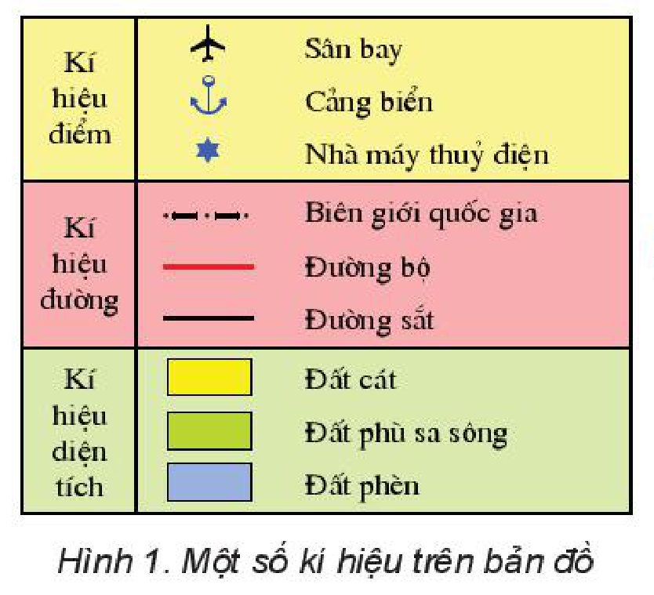
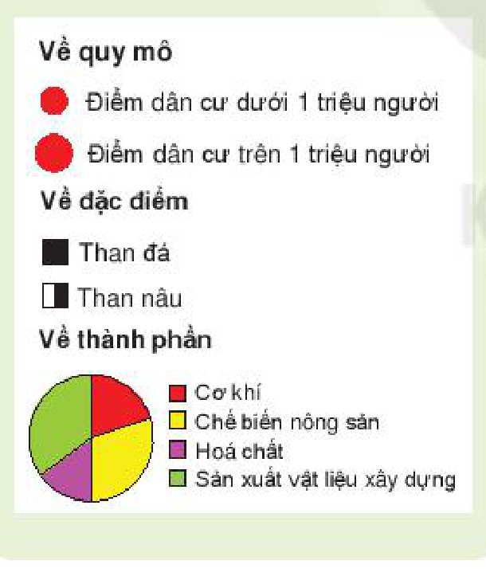
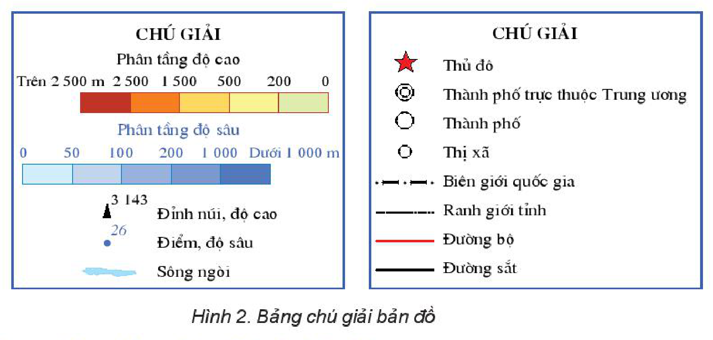
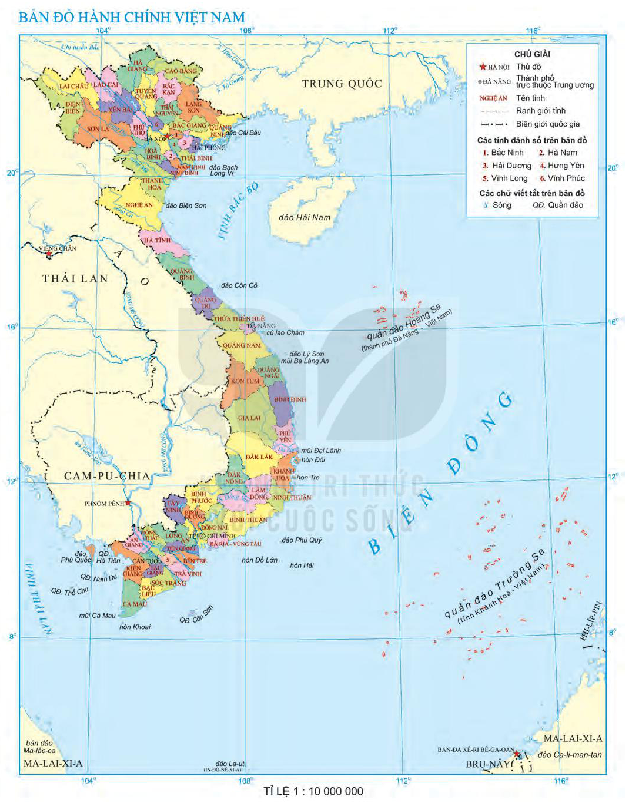
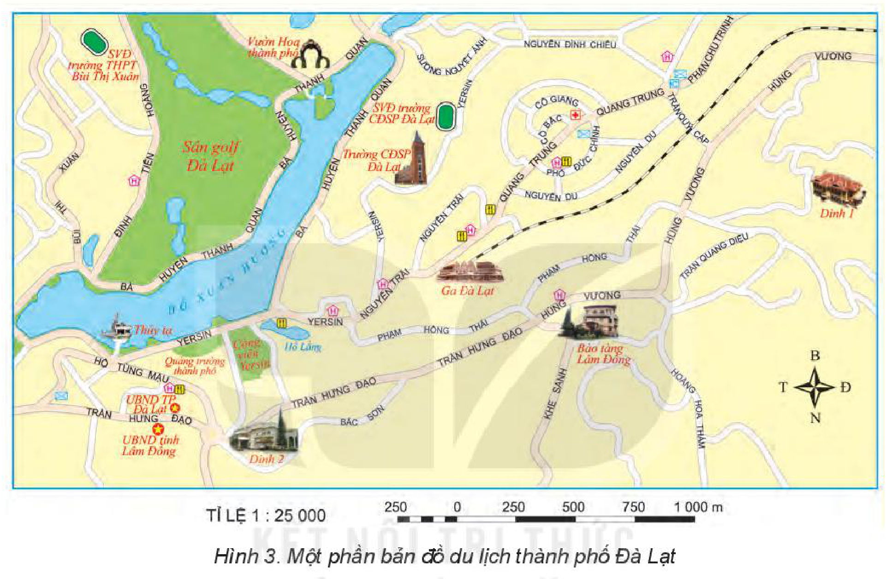
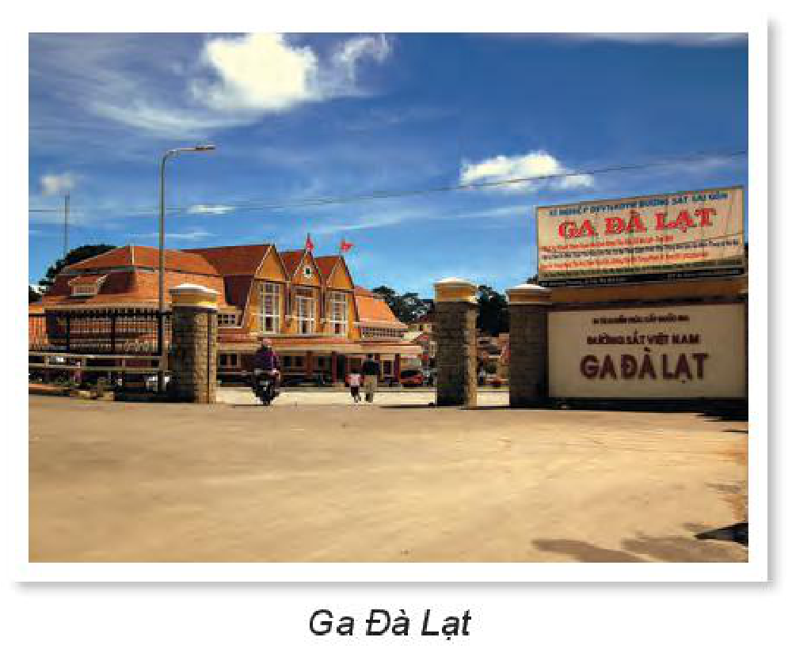

<!-- pdf:109 -->

# BÀI 4: KÍ HIỆU VÀ BẢNG CHÚ GIẢI BẢN ĐỒ. TÌM ĐƯỜNG ĐI TRÊN BẢN ĐỒ

## 🎯 Học xong bài này, em sẽ:

- Đọc được các kí hiệu và chú giải bản đồ hành chính, bản đồ địa hình.
- Biết đọc bản đồ, xác định được vị trí của đối tượng địa lí trên bản đồ.
- Biết tìm đường đi trên bản đồ.

## 🔴 Mở đầu

Bản đồ có vai trò rất quan trọng trong học tập và đời sống. Bài học này sẽ giúp các em có được kĩ năng đọc và sử dụng bản đồ.

- Bản đồ trong chiếc điện thoại thông minh này sẽ chỉ đường cho chúng ta đến mọi nơi ta muốn.
- Bây giờ, chúng ta đi đường nào nhỉ?
- Yên tâm, tớ có bản đồ ở đây.
<!-- ocr-ok: đã đối chiếu ảnh trang gốc 108 (PDF 109), lời thoại trong tranh minh hoạ mở đầu -->

## 1. Kí hiệu và bảng chú giải bản đồ

### a) Kí hiệu bản đồ

<!-- term: Kí hiệu bản đồ -->
Để thể hiện các đối tượng địa lí trên bản đồ, người ta phải sử dụng các dấu hiệu quy ước gọi là kí hiệu bản đồ.

<!-- term: Kí hiệu bản đồ -->
Kí hiệu bản đồ rất đa dạng, có thể là những hình vẽ, màu sắc,... được dùng một cách quy ước để thể hiện các sự vật, hiện tượng địa lí trên bản đồ. Người ta thường sử dụng ba loại: kí hiệu điểm, kí hiệu đường và kí hiệu diện tích.

*Hình 1. Một số kí hiệu trên bản đồ*

> ❓ Hãy kể thêm tên một số đối tượng địa lí được thể hiện bằng các loại kí hiệu: điểm, đường, diện tích.

> 💡 **Em có biết?**
>
> Người ta có thể sử dụng kí hiệu để thể hiện quy mô, đặc điểm, thành phần của các đối tượng địa lí.
>
> 

> 💡 **Em có biết?**
>
> Thứ tự các kí hiệu trong bảng chú giải được sắp xếp phụ thuộc vào nội dung chính mà bản đồ thể hiện. Ví dụ: Ở bảng chú giải của bản đồ tự nhiên, các kí hiệu thể hiện địa hình được đưa lên đầu, sau đó là các kí hiệu thể hiện sông ngòi, đường giao thông, ranh giới, điểm dân cư,...

<!-- pdf:110 -->

### b) Bảng chú giải

<!-- term: Bảng chú giải -->
Trên bản đồ, các kí hiệu được giải thích trong bảng chú giải, thường được bố trí ở phía dưới bản đồ hoặc những khu vực trống trên bản đồ.

*Hình 2. Bảng chú giải bản đồ*

> ❓ Quan sát hai bảng chú giải ở hình 2, hãy:
> - Cho biết bảng chú giải nào của bản đồ hành chính, bảng chú giải nào của bản đồ tự nhiên.
> - Kể ít nhất ba đối tượng địa lí được thể hiện trên bản đồ hành chính và ba đối tượng địa lí được thể hiện trên bản đồ tự nhiên.

## 2. Đọc một số bản đồ thông dụng

### a) Cách đọc bản đồ

<!-- term: Cách đọc bản đồ -->
- Đọc tên bản đồ để biết nội dung và lãnh thổ được thể hiện.
- Biết tỉ lệ bản đồ để có thể đo tính khoảng cách giữa các đối tượng.
- Đọc kí hiệu trong bảng chú giải để nhận biết các đối tượng trên bản đồ.
- Xác định các đối tượng địa lí cần quan tâm trên bản đồ.
- Trình bày mối quan hệ của các đối tượng địa lí.

### b) Đọc bản đồ tự nhiên và bản đồ hành chính

- Quan sát bản đồ Tự nhiên thế giới ở trang 96 – 97, em hãy:
  + Nêu nội dung và lãnh thổ được thể hiện trên bản đồ.
  + Nêu tỉ lệ bản đồ.
  + Cho biết các kí hiệu trong bảng chú giải thể hiện những đối tượng địa lí nào.
  + Kể tên ít nhất một dãy núi, đồng bằng, dòng sông lớn ở châu Mỹ.
- Quan sát bản đồ hành chính Việt Nam trang 110, em hãy:
  + Nêu nội dung và lãnh thổ được thể hiện trên bản đồ.
  + Nêu tỉ lệ bản đồ.
  + Cho biết các kí hiệu trong bảng chú giải thể hiện những đối tượng địa lí nào.
  + Đọc và xác định trên bản đồ tên và vị trí của: thủ đô, các thành phố trực thuộc Trung ương, tỉnh/thành phố nơi em sinh sống.

<!-- pdf:111 -->

*BẢN ĐỒ HÀNH CHÍNH VIỆT NAM (TỈ LỆ 1 : 10 000 000)*
<!-- ocr-ok: đã đối chiếu ảnh trang gốc 110 (PDF 111), trang bản đồ hành chính Việt Nam toàn trang -->

<!-- pdf:112 -->

## 3. Tìm đường đi trên bản đồ

<!-- term: Tìm đường đi trên bản đồ -->
Để tìm đường đi trên bản đồ, cần thực hiện theo các bước sau:

<!-- term: Tìm đường đi trên bản đồ -->
- **Bước 1:** Xác định nơi đi và nơi đến, hướng đi trên bản đồ.
- **Bước 2:** Tìm các cung đường có thể đi và lựa chọn cung đường thích hợp với mục đích (ngắn nhất, thuận lợi nhất hoặc yêu cầu phải đi qua một số địa điểm cần thiết), đảm bảo tuân thủ theo quy định của luật an toàn giao thông.
- **Bước 3:** Dựa vào tỉ lệ bản đồ để xác định khoảng cách thực tế sẽ đi.

*Hình 3. Một phần bản đồ du lịch thành phố Đà Lạt*

> ❓
> 1. Tìm trên bản đồ hình 3 các địa điểm: Trường Cao đẳng Sư phạm Đà Lạt, Ga Đà Lạt, Bảo tàng Lâm Đồng.
> 2. Mô tả đường đi từ Trường Cao đẳng Sư phạm Đà Lạt đến Ga Đà Lạt, từ Ga Đà Lạt đến Bảo tàng Lâm Đồng.

*Trường Cao đẳng Sư phạm Đà Lạt*

<!-- pdf:113 -->

*Ga Đà Lạt*

*Bảo tàng Lâm Đồng*

## ✏️ Luyện tập và Vận dụng

1. Khi thể hiện các đối tượng: sông, mỏ khoáng sản, vùng trồng rừng, ranh giới tỉnh, nhà máy trên bản đồ người ta dùng loại kí hiệu nào?

Chọn một trong hai nhiệm vụ sau:

2. Sưu tầm bản đồ du lịch Hà Nội, sau đó tìm đường đi từ Trung tâm Hội nghị Quốc gia đến Nhà hát Lớn Hà Nội.
3. Tìm hiểu về một ứng dụng bản đồ trên thiết bị điện tử (điện thoại thông minh, máy tính,...) và tìm đường đi từ chùa Thiên Mụ đến lăng Khải Định (Thừa Thiên Huế) trên ứng dụng đó.

*Hồ Xuân Hương, thành phố Đà Lạt*

## 📷 Danh sách hình trong bài

| Mã hình | Trang PDF | Trang sách | Chú thích |
| --- | :---: | :---: | --- |
| H6-lich_su_va_dia_ly-dl-b04-01 | 109 | 108 | (sách không đánh số, bảng minh hoạ kí hiệu thể hiện quy mô, đặc điểm, thành phần của các đối tượng địa lí trong hộp Em có biết?) |
| H6-lich_su_va_dia_ly-dl-b04-02 | 109 | 108 | Hình 1. Một số kí hiệu trên bản đồ |
| H6-lich_su_va_dia_ly-dl-b04-03 | 110 | 109 | Hình 2. Bảng chú giải bản đồ |
| H6-lich_su_va_dia_ly-dl-b04-04 | 111 | 110 | (sách không đánh số, Bản đồ hành chính Việt Nam tỉ lệ 1 : 10 000 000) |
| H6-lich_su_va_dia_ly-dl-b04-05 | 112 | 111 | Hình 3. Một phần bản đồ du lịch thành phố Đà Lạt |
| H6-lich_su_va_dia_ly-dl-b04-06 | 112 | 111 | (sách không đánh số, ảnh Trường Cao đẳng Sư phạm Đà Lạt) |
| H6-lich_su_va_dia_ly-dl-b04-07 | 113 | 112 | (sách không đánh số, ảnh Ga Đà Lạt) |
| H6-lich_su_va_dia_ly-dl-b04-08 | 113 | 112 | (sách không đánh số, ảnh Bảo tàng Lâm Đồng) |
