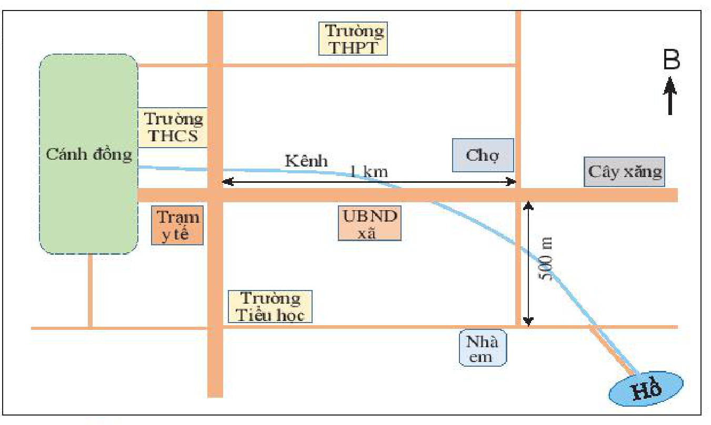
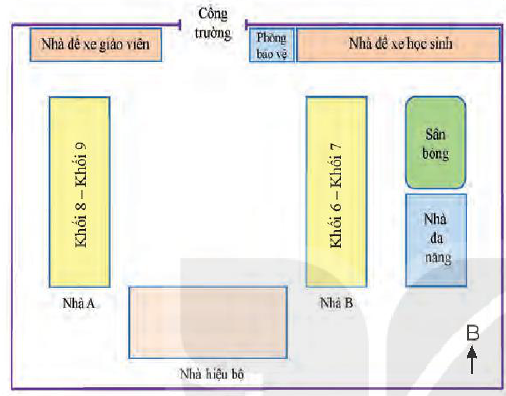

<!-- pdf:114 -->

# BÀI 5: LƯỢC ĐỒ TRÍ NHỚ

## 🎯 Học xong bài này, em sẽ:

- Biết được thế nào là lược đồ trí nhớ.
- Vẽ được lược đồ trí nhớ thể hiện một số đối tượng địa lí.

## 🔴 Mở đầu

Trong cuộc sống hằng ngày, nhiều lúc các em sẽ gặp tình huống hỏi đường từ những khách du lịch hoặc người từ nơi khác đến. Vậy làm thế nào để các em có thể giúp họ đến đúng nơi họ muốn tới mà không phải trực tiếp dẫn đi?

## 1. Khái niệm lược đồ trí nhớ

<!-- term: Lược đồ trí nhớ -->
Lược đồ trí nhớ là những thông tin không gian về thế giới được giữ lại trong trí óc con người. Lược đồ trí nhớ được đặc trưng bởi sự đánh dấu các địa điểm mà một người từng gặp, từng đến,... Lược đồ trí nhớ của một người phản ánh sự cảm nhận của người đó về không gian sống và ý nghĩa của không gian ấy đối với cá nhân.

## 2. Vẽ lược đồ trí nhớ

Để vẽ được lược đồ trí nhớ, trước hết phải hồi tưởng lại không gian cần vẽ với các sự vật, hiện tượng cụ thể. Sau đó thể hiện những hồi tưởng đó thành lược đồ. Có hai loại lược đồ trí nhớ thường được vẽ là: lược đồ trí nhớ về đường đi và lược đồ trí nhớ về một khu vực.

### a) Vẽ lược đồ trí nhớ đường đi

<!-- term: Lược đồ trí nhớ đường đi -->
Đầu tiên phải hồi tưởng điểm xuất phát và điểm kết thúc của quãng đường, hướng đi chính và khoảng cách giữa hai địa điểm đó. Sau đó hồi tưởng và xác định những điểm mốc chính trên toàn bộ quãng đường. Tiếp theo, xác định hướng đi và khoảng cách giữa các điểm mốc với nhau.

*Ví dụ: Lược đồ trí nhớ từ nhà đến trường Trung học cơ sở*

> Từ nhà đi về bên trái theo hướng tây khoảng 1 km, gặp trường Tiểu học rồi đến ngã tư, sau đó rẽ phải đi khoảng 500 m gặp một ngã tư nữa, đi qua ngã tư này khoảng 250 m là đến trường Trung học cơ sở.

> ❓ Em hãy mô tả đường đi từ nhà em tới trường và trình bày trước lớp.

<!-- pdf:115 -->

### b) Vẽ lược đồ một khu vực

<!-- term: Lược đồ trí nhớ một khu vực -->
Khi vẽ lược đồ một khu vực, cần hồi tưởng lại tổng thể khu vực đó gồm các đối tượng nào; diện tích, hướng, khoảng cách các đối tượng với nhau,...

*Ví dụ: Lược đồ trí nhớ một trường học*

> Trường bao gồm nhà hiệu bộ ở giữa, bên trái nhà hiệu bộ là nhà A (cho học sinh khối 8 và khối 9), bên phải là nhà B (cho học sinh khối 6 và khối 7), hai nhà có kích thước bằng nhau, sau nhà B là sân bóng và nhà đa năng,... xung quanh trường có tường bao, cổng trường đối diện nhà hiệu bộ,...

> ❓ Em hãy mô tả trường em qua trí nhớ của mình và trình bày trước lớp.

## ✏️ Luyện tập và Vận dụng

Em hãy chọn một trong hai nhiệm vụ sau:

1. Vẽ sơ đồ trường em đang học.
2. Vẽ lược đồ trí nhớ để chỉ đường cho một người bạn của em đến nhà một người bạn khác. Ví dụ:
   - Khoảng cách từ nơi đứng đến nhà bạn đó khoảng 2 km về hướng đông bắc.
   - Từ nơi đứng, đi về hướng bắc khoảng 500 m, gặp một ngã ba, đối diện ngã ba là chợ.
   - Từ ngã ba, rẽ phải, đi thẳng khoảng 300 m có cây xăng ở bên phải, từ cây xăng đi thẳng khoảng 700 m sẽ gặp một ngã tư.
   - Từ ngã tư đó, rẽ trái, đi thẳng khoảng 500 m nữa là tới, nhà bạn đó nằm ở bên trái đường.

## 📷 Danh sách hình trong bài

| Mã hình | Trang PDF | Trang sách | Chú thích |
| --- | :---: | :---: | --- |
| H6-lich_su_va_dia_ly-dl-b05-01 | 114 | 113 | (sách không đánh số, Ví dụ: Lược đồ trí nhớ từ nhà đến trường Trung học cơ sở) |
| H6-lich_su_va_dia_ly-dl-b05-02 | 115 | 114 | (sách không đánh số, Ví dụ: Lược đồ trí nhớ một trường học) |
