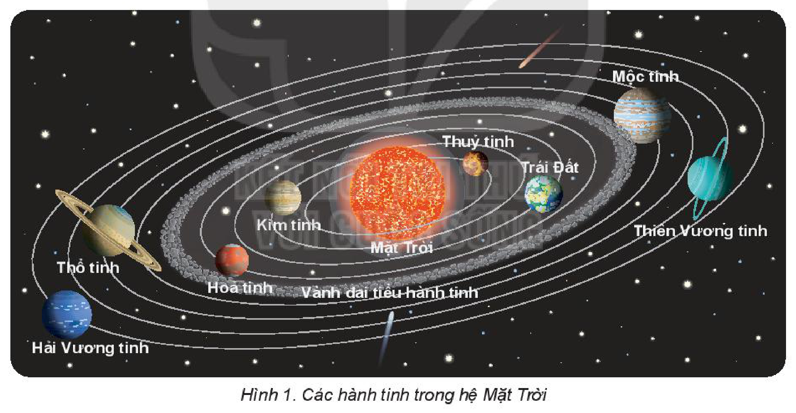
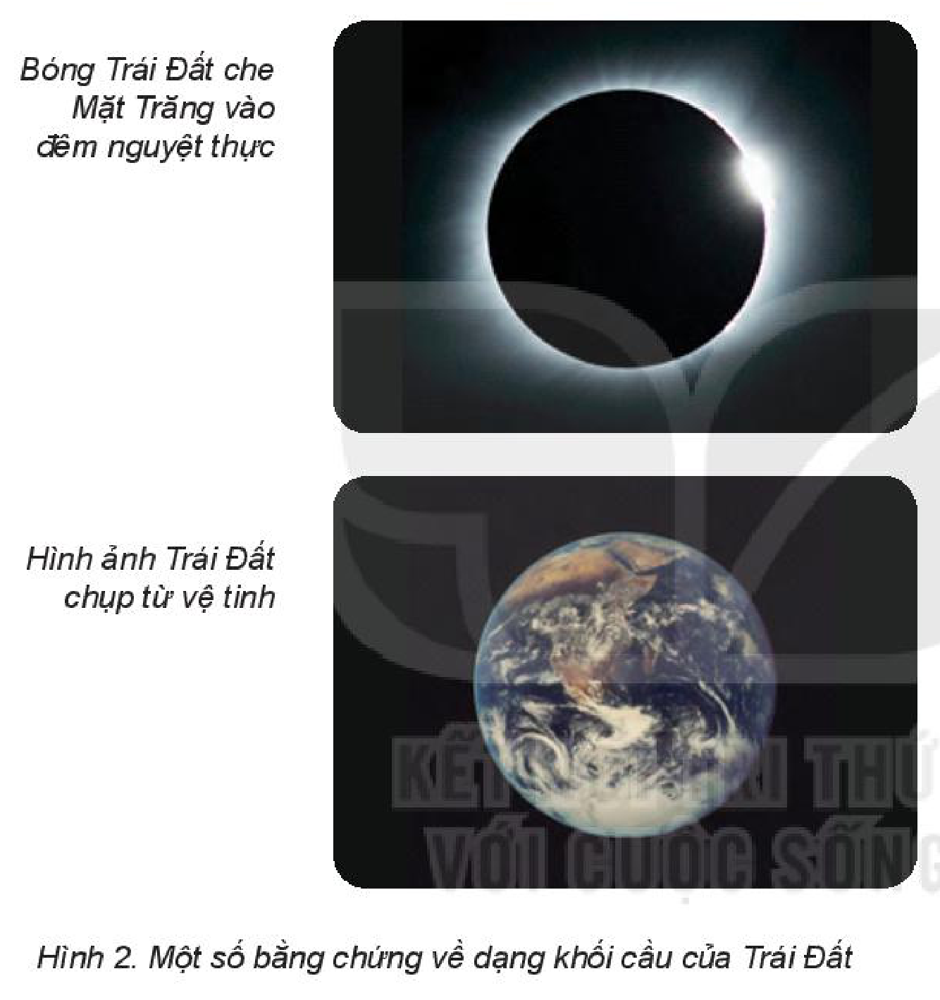
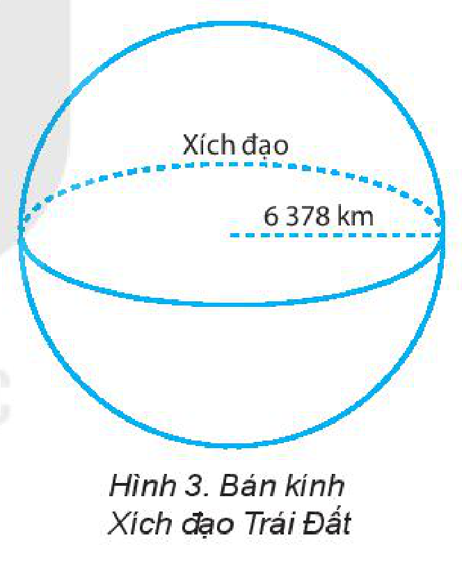

<!-- pdf:117 -->

# BÀI 6: TRÁI ĐẤT TRONG HỆ MẶT TRỜI

## 🎯 Học xong bài này, em sẽ:

- Xác định được vị trí của Trái Đất trong hệ Mặt Trời.
- Mô tả được hình dạng, kích thước của Trái Đất.

## 🔴 Mở đầu

Chúng ta đang sống trên Trái Đất, một hành tinh trong Vũ Trụ bao la, chắc hẳn không ít lần chúng ta đặt câu hỏi về nơi mình đang sống: Trái Đất nằm ở đâu trong Vũ Trụ? Trái Đất có hình dạng như thế nào?...

## 1. Vị trí của Trái Đất trong hệ Mặt Trời

<!-- term: Dải Ngân Hà -->
Vũ Trụ là không gian vô tận. Trong Vũ Trụ bao la có vô số thiên hà. Thiên hà chứa hệ Mặt Trời gọi là dải Ngân Hà.

<!-- term: Hệ Mặt Trời -->
Nằm ở trung tâm của hệ Mặt Trời là một ngôi sao, tự phát ra ánh sáng – đó là Mặt Trời. Chuyển động xung quanh Mặt Trời là tám hành tinh. Các hành tinh, ngoài chuyển động xung quanh Mặt Trời còn tự quay quanh mình.

*Hình 1. Các hành tinh trong hệ Mặt Trời*

Khoảng cách từ Trái Đất đến Mặt Trời là khoảng cách lí tưởng giúp cho Trái Đất nhận được lượng nhiệt và ánh sáng phù hợp để sự sống có thể tồn tại và phát triển.

> 💡 **Em có biết?**

<!-- term: Hành tinh trong hệ Mặt Trời -->
> Hành tinh trong hệ Mặt Trời là những thiên thể không tự phát sáng, ánh sáng chúng ta nhìn thấy từ các hành tinh là do phản chiếu ánh sáng mặt trời.
<!-- ocr-ok: đã đối chiếu ảnh trang gốc 116 (PDF 117), hộp Em có biết? ở cột lề trái -->

> ❓ Dựa vào hình 1, em hãy cho biết:
> - Trái Đất nằm ở vị trí thứ mấy theo thứ tự xa dần Mặt Trời.
> - Ý nghĩa của khoảng cách từ Trái Đất đến Mặt Trời.

<!-- pdf:118 -->

## 2. Hình dạng, kích thước của Trái Đất

<!-- term: Hình dạng và kích thước của Trái Đất -->
Vào thời Cổ đại, hầu hết con người đều nghĩ rằng Trái Đất là một mặt phẳng. Tuy nhiên, thế kỉ IV trước Công nguyên, triết gia người Hy Lạp, A-ri-xtốt đã đưa ra các bằng chứng cho thấy Trái Đất có dạng hình cầu.

<!-- term: Hình dạng và kích thước của Trái Đất -->
Trái Đất có bán kính Xích đạo là 6 378 km, diện tích bề mặt là khoảng 510 triệu km². Nhờ có kích thước và khối lượng đủ lớn, Trái Đất đã tạo ra lực hút giữ được các chất khí làm thành lớp vỏ khí bảo vệ mình.

> 💡 **Em có biết?**
>
> Tháng 9 năm 1519, nhà thám hiểm người Bồ Đào Nha Ma-gien-lăng đã chỉ huy năm con tàu xuất phát từ bờ biển Tây Ban Nha đi về phía tây. Trải qua nhiều sóng gió, tháng 9 năm 1522 chỉ còn một con tàu quay trở về Tây Ban Nha. Như vậy, bằng cách chỉ đi về phía tây, con tàu đã đi được một vòng quanh thế giới.

*Hình 2. Một số bằng chứng về dạng khối cầu của Trái Đất*

*Hình 3. Bán kính Xích đạo Trái Đất*

> ❓ Có bạn cho rằng Trái Đất là một mặt phẳng. Bằng hiểu biết và các thông tin, hình ảnh trong bài, em hãy nêu một số ví dụ để thuyết phục bạn đó rằng Trái Đất có dạng khối cầu.

## ✏️ Luyện tập và Vận dụng

1. Dựa vào hình 1, hãy nêu tên các hành tinh theo thứ tự xa dần Mặt Trời.
2. Giả sử có người sinh sống ở hành tinh khác, em hãy viết một lá thư khoảng 10 dòng giới thiệu về Trái Đất của chúng ta với họ.

## 📷 Danh sách hình trong bài

| Mã hình | Trang PDF | Trang sách | Chú thích |
| --- | :---: | :---: | --- |
| H6-lich_su_va_dia_ly-dl-b06-01 | 117 | 116 | Hình 1. Các hành tinh trong hệ Mặt Trời |
| H6-lich_su_va_dia_ly-dl-b06-02 | 118 | 117 | Hình 2. Một số bằng chứng về dạng khối cầu của Trái Đất |
| H6-lich_su_va_dia_ly-dl-b06-03 | 118 | 117 | Hình 3. Bán kính Xích đạo Trái Đất |
