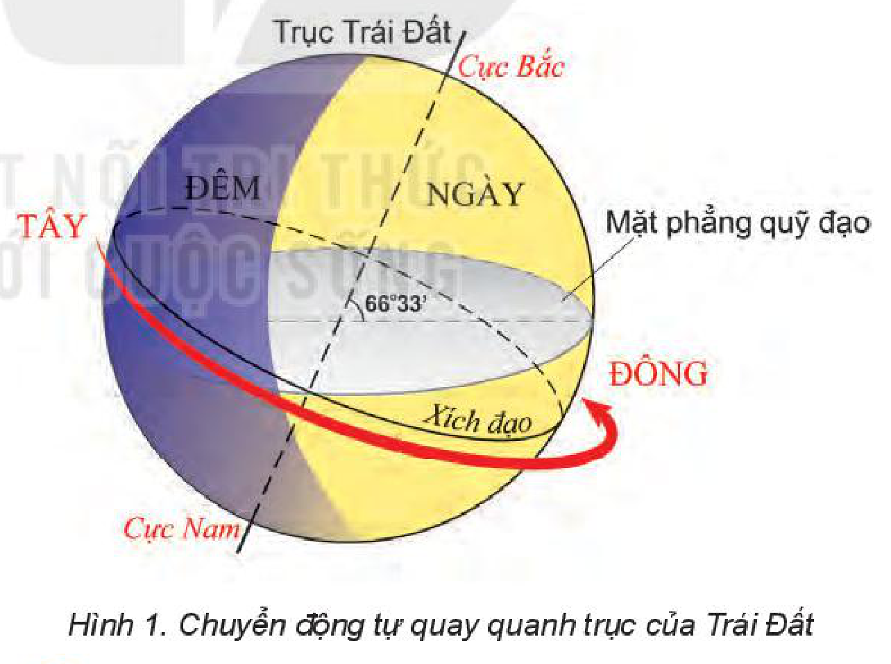
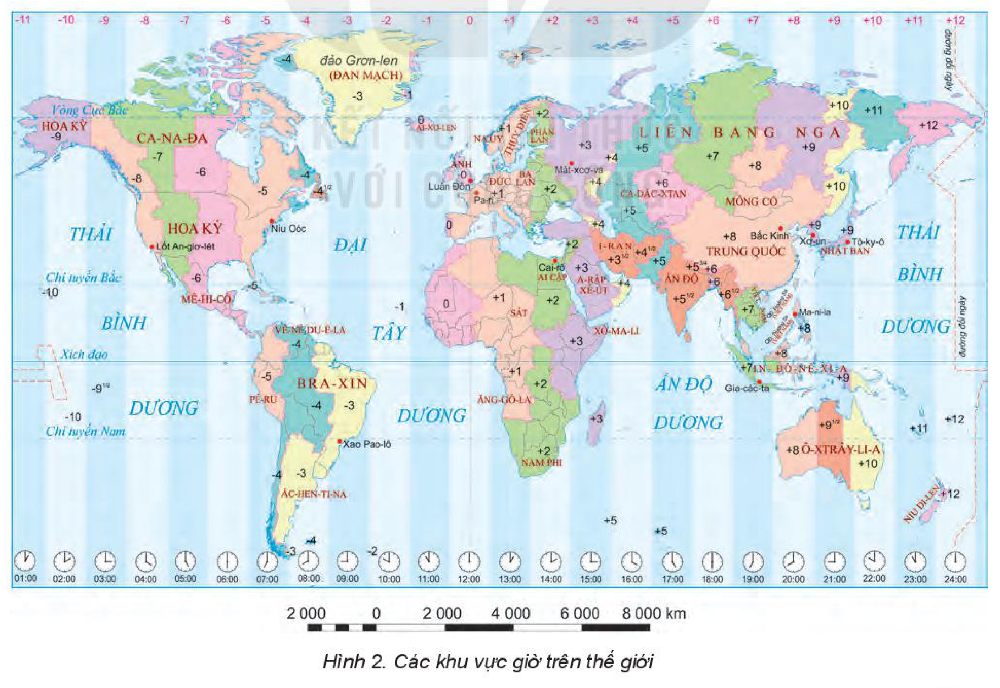
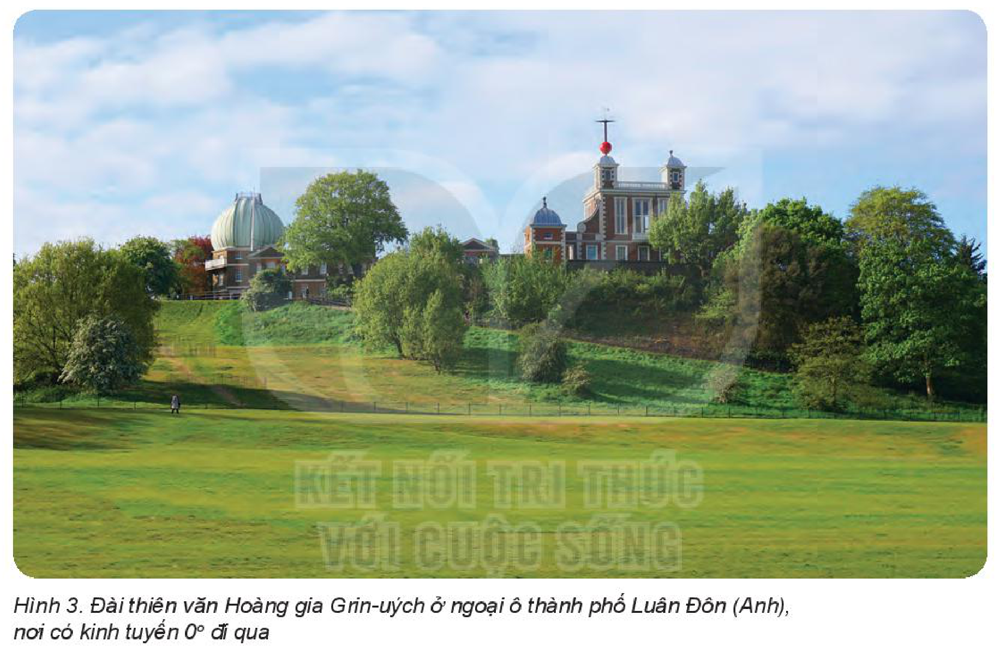
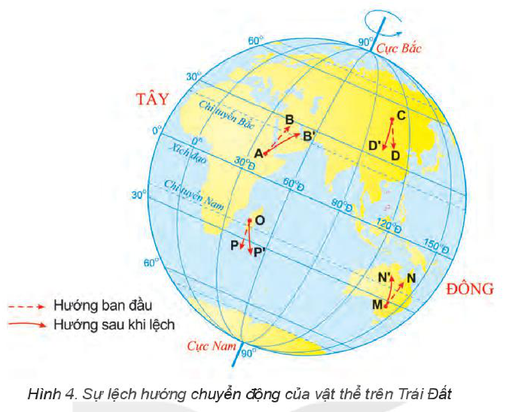
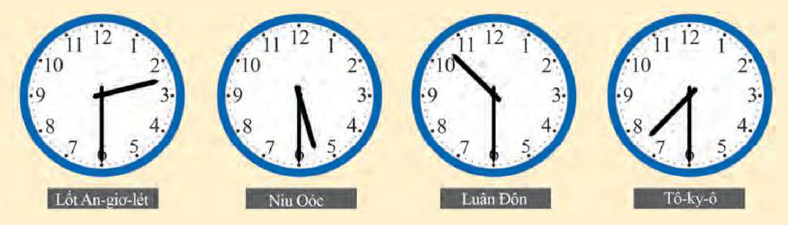

<!-- pdf:119 -->

# BÀI 7: CHUYỂN ĐỘNG TỰ QUAY QUANH TRỤC CỦA TRÁI ĐẤT VÀ HỆ QUẢ

## 🎯 Học xong bài này, em sẽ:

- Mô tả được chuyển động tự quay quanh trục của Trái Đất.
- Trình bày được các hệ quả của chuyển động tự quay quanh trục của Trái Đất: ngày đêm luân phiên nhau, giờ trên Trái Đất (giờ địa phương/giờ khu vực), sự lệch hướng chuyển động của vật thể theo chiều kinh tuyến.
- So sánh được giờ của hai địa điểm trên Trái Đất.

## 🔴 Mở đầu

Trái Đất không đứng yên mà luôn tự quay quanh trục. Điều đó dẫn tới những hệ quả có tác động lớn với đời sống con người. Trái Đất tự quay như thế nào và dẫn tới những hệ quả gì?

## 1. Chuyển động tự quay quanh trục của Trái Đất

<!-- term: Chuyển động tự quay quanh trục của Trái Đất -->
Trái Đất không ngừng tự quay quanh một trục tưởng tượng. Trong quá trình tự quay, trục Trái Đất luôn nghiêng so với mặt phẳng quỹ đạo một góc 66°33'.

*Hình 1. Chuyển động tự quay quanh trục của Trái Đất*

> 💡 **Em có biết?**

<!-- term: Chuyển động tự quay quanh trục của Trái Đất -->
> Trái Đất tự quay quanh trục một vòng hết 23 giờ 56 phút 04 giây. Tuy nhiên, để thuận tiện trong đời sống và sản xuất, thời gian Trái Đất tự quay một vòng quanh trục được quy ước là 24 giờ.

> ❓
> 1. Dựa vào hình 1 và thông tin trong mục 1, em hãy cho biết:
>    - Hướng tự quay quanh trục của Trái Đất.
>    - Góc nghiêng của trục Trái Đất khi tự quay.
>    - Thời gian Trái Đất tự quay quanh trục hết một vòng.
> 2. Sử dụng quả Địa Cầu để mô tả chuyển động tự quay quanh trục của Trái Đất.

<!-- pdf:120 -->

## 2. Hệ quả chuyển động tự quay quanh trục của Trái Đất

### a) Ngày đêm luân phiên

<!-- term: Ngày đêm luân phiên -->
Trái Đất có dạng khối cầu nên lúc nào cũng chỉ được Mặt Trời chiếu sáng một nửa. Nửa được chiếu sáng là ngày, nửa nằm trong bóng tối là đêm (hình 1). Do sự chuyển động tự quay quanh trục theo hướng từ tây sang đông nên ở khắp mọi nơi trên Trái Đất đều lần lượt có ngày và đêm luân phiên nhau.

> ❓ Sử dụng quả Địa Cầu để trình bày hiện tượng ngày đêm luân phiên trên Trái Đất.

> 💡 **Em có biết?**

<!-- term: Giờ địa phương -->
> Hằng ngày, chúng ta thấy Mặt Trời dường như mọc ở phía đông và lặn ở phía tây. Khi Mặt Trời lên cao nhất trên bầu trời, người ta quy ước đó là lúc 12 giờ, từ đó tính ra các giờ khác trong ngày. Giờ được tính dựa vào độ cao Mặt Trời trong ngày như vậy gọi là giờ địa phương. Giờ địa phương không thuận tiện trong đời sống, sản xuất.

### b) Giờ trên Trái Đất

<!-- term: Giờ khu vực -->
Để thuận tiện trong sinh hoạt và giao dịch, người ta chia bề mặt Trái Đất ra 24 khu vực giờ. Các địa điểm nằm trong cùng một khu vực sẽ có giờ giống nhau, gọi là giờ khu vực. Hai khu vực giờ liền nhau chênh nhau 1 giờ. Ranh giới của các khu vực giờ rất phức tạp do bị điều chỉnh theo đường biên giới của các quốc gia, vùng lãnh thổ.

<!-- term: Giờ Quốc tế -->
Giờ của khu vực số 0 có đường kinh tuyến 0° đi qua chính giữa được lấy làm giờ Quốc tế (GMT). Giờ của các khu vực khác được tính dựa theo giờ ở khu vực số 0. Ví dụ: Khi ở Luân Đôn là 0 giờ thì Hà Nội là 7 giờ sáng, Bắc Kinh là 8 giờ sáng.

*Hình 2. Các khu vực giờ trên thế giới*

<!-- pdf:121 -->

> 💡 **Em có biết?**
>
> Lãnh thổ nước ta nằm trong khu vực giờ số 7 và số 8, nhưng thống nhất sử dụng giờ của khu vực giờ số 7.

> ❓
> 1. Dựa vào hình 2, em hãy:
>    - Cho biết tên một số quốc gia sử dụng giờ của nhiều khu vực.
>    - Kể tên một số quốc gia sử dụng cùng khu vực giờ với Việt Nam.
> 2. Đêm gala nghệ thuật "Sắc màu văn hoá bốn phương" được truyền hình trực tiếp vào 20 giờ ngày 31 tháng 5 năm 2019 tại Việt Nam. Vậy khi đó ở các địa điểm Xơ-un (Hàn Quốc), Mát-xcơ-va (Nga), Ma-ni-la (Phi-líp-pin) là mấy giờ?

*Hình 3. Đài thiên văn Hoàng gia Grin-uých ở ngoại ô thành phố Luân Đôn (Anh), nơi có kinh tuyến 0° đi qua*

### c) Sự lệch hướng chuyển động của vật thể

<!-- term: Sự lệch hướng chuyển động của vật thể -->
Do Trái Đất chuyển động tự quay quanh trục nên các vật thể chuyển động trên bề mặt Trái Đất đều bị lệch hướng. Lực làm lệch hướng đó được gọi là lực Cô-ri-ô-lít.

<!-- term: Sự lệch hướng chuyển động của vật thể -->
Lực Cô-ri-ô-lít có tác động đến hướng di chuyển của dòng sông, dòng biển, gió,... trên Trái Đất.

> ❓ Quan sát hình 4, em hãy cho biết:
> - Ở bán cầu Bắc, vật thể chuyển động theo chiều kinh tuyến lệch về bên trái hay bên phải so với hướng di chuyển ban đầu.
> - Ở bán cầu Nam, vật thể chuyển động theo chiều kinh tuyến lệch về bên trái hay bên phải so với hướng di chuyển ban đầu.

<!-- pdf:122 -->

*Hình 4. Sự lệch hướng chuyển động của vật thể trên Trái Đất*

> 💡 **Em có biết?**
>
> Cô-ri-ô-lít (1792 – 1843) là nhà toán học, vật lí học người Pháp. Năm 1835, ông đã lần đầu tiên giải thích các hiện tượng lệch hướng chuyển động của vật thể khi chuyển động trên Trái Đất do sự tự quay quanh trục.

## ✏️ Luyện tập và Vận dụng

1. Ở sảnh các khách sạn thường treo một số đồng hồ của các địa điểm khác nhau trên thế giới, các đồng hồ này chỉ các giờ khác nhau. Tại sao lại như vậy? Nếu đặt thêm đồng hồ địa điểm Hà Nội vào hình thì đồng hồ đó sẽ chỉ mấy giờ?

2. An sống ở Hà Nội và có bạn sống ở thành phố Xao Pao-lô (Bra-xin). Vào lúc 11 giờ trưa, sau khi đi học về, An định gọi điện cho bạn để nói chuyện. Bố khuyên An không nên gọi vào giờ này. Theo em, tại sao bố lại khuyên An như vậy?

## 📷 Danh sách hình trong bài

| Mã hình | Trang PDF | Trang sách | Chú thích |
| --- | :---: | :---: | --- |
| H6-lich_su_va_dia_ly-dl-b07-01 | 119 | 118 | Hình 1. Chuyển động tự quay quanh trục của Trái Đất |
| H6-lich_su_va_dia_ly-dl-b07-02 | 120 | 119 | Hình 2. Các khu vực giờ trên thế giới |
| H6-lich_su_va_dia_ly-dl-b07-03 | 121 | 120 | Hình 3. Đài thiên văn Hoàng gia Grin-uých ở ngoại ô thành phố Luân Đôn (Anh), nơi có kinh tuyến 0° đi qua |
| H6-lich_su_va_dia_ly-dl-b07-04 | 122 | 121 | Hình 4. Sự lệch hướng chuyển động của vật thể trên Trái Đất |
| H6-lich_su_va_dia_ly-dl-b07-05 | 122 | 121 | (sách không đánh số, hình bốn đồng hồ ở Lốt An-giơ-lét, Niu Oóc, Luân Đôn, Tô-ky-ô trong mục Luyện tập và Vận dụng) |
