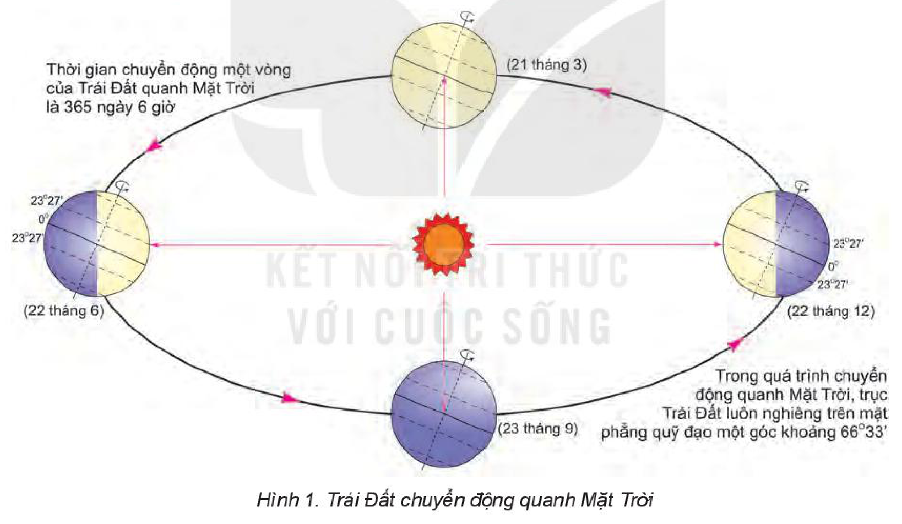
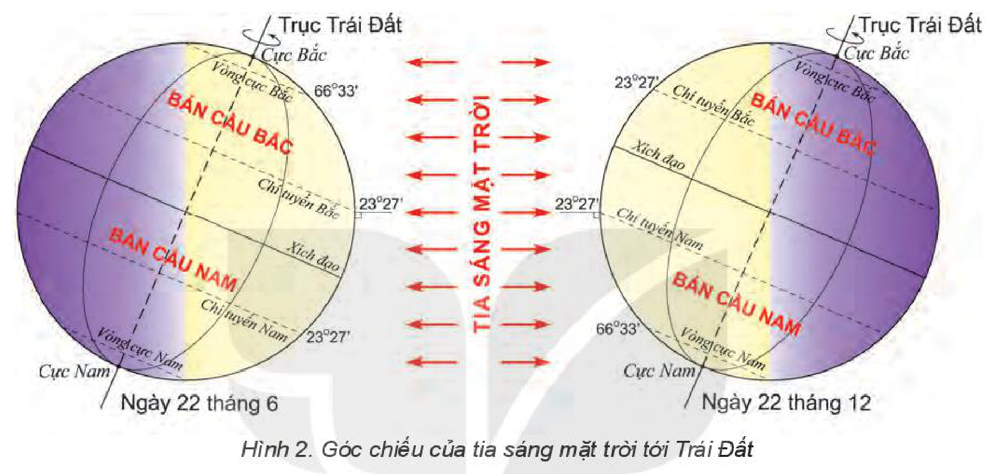
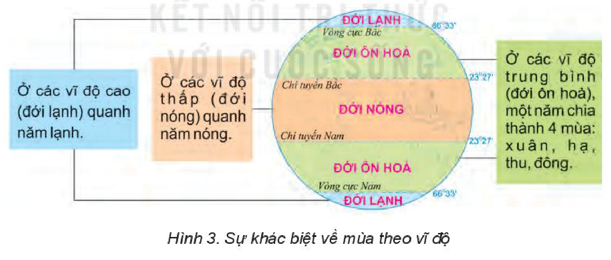
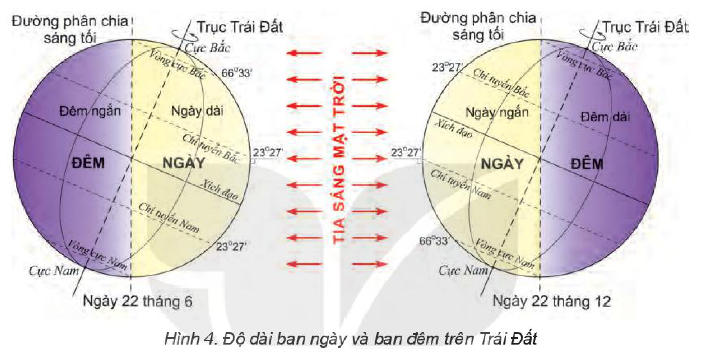

<!-- pdf:123 -->

# BÀI 8: CHUYỂN ĐỘNG CỦA TRÁI ĐẤT QUANH MẶT TRỜI VÀ HỆ QUẢ

## 🎯 Học xong bài này, em sẽ:

- Biết sử dụng sơ đồ để mô tả chuyển động của Trái Đất quanh Mặt Trời.
- Trình bày được hiện tượng mùa và ngày – đêm dài ngắn theo mùa.

## 🔴 Mở đầu

Cảnh vật thiên nhiên trên Trái Đất thay đổi theo mùa. Bằng hiểu biết của mình, em hãy nêu một số đặc điểm thiên nhiên của từng mùa ở địa phương em.

Bài học này sẽ cho em biết tại sao trên Trái Đất có các mùa và hiện tượng ngày – đêm dài ngắn theo mùa.

## 1. Chuyển động của Trái Đất quanh Mặt Trời

*Hình 1. Trái Đất chuyển động quanh Mặt Trời*

> 💡 **Em có biết?**

<!-- term: Năm nhuận -->
> Thời gian Trái Đất chuyển động một vòng quanh Mặt Trời là 365 ngày 6 giờ. Vì vậy, cứ sau ba năm có 365 ngày, sẽ có một năm có 366 ngày. Năm đó gọi là năm nhuận. Trong năm nhuận, tháng 2 có 29 ngày.

> ❓ Quan sát hình 1, em hãy mô tả chuyển động của Trái Đất quanh Mặt Trời, theo gợi ý:
> - Hình dạng quỹ đạo chuyển động.
> - Hướng chuyển động.
> - Thời gian chuyển động hết một vòng.
> - Góc nghiêng và hướng của trục trong quá trình chuyển động.

<!-- pdf:124 -->

## 2. Hệ quả chuyển động của Trái Đất quanh Mặt Trời

### a) Mùa trên Trái Đất

<!-- term: Nguyên nhân sinh ra mùa trên Trái Đất -->
Trong quá trình chuyển động quanh Mặt Trời, trục Trái Đất nghiêng và không đổi hướng dẫn đến bán cầu Bắc và bán cầu Nam luân phiên ngả về phía Mặt Trời.

<!-- term: Nguyên nhân sinh ra mùa trên Trái Đất -->
Bán cầu nào ngả về phía Mặt Trời sẽ có góc chiếu của tia sáng mặt trời lớn, nhận được nhiều ánh sáng và nhiệt; khi ấy là mùa nóng của bán cầu đó. Cùng lúc, bán cầu không ngả về phía Mặt Trời có góc chiếu của tia sáng mặt trời nhỏ, nhận được ít ánh sáng và nhiệt; khi ấy là mùa lạnh của bán cầu đó.

*Hình 2. Góc chiếu của tia sáng mặt trời tới Trái Đất*

Trong thực tế, hiện tượng mùa có sự khác biệt theo vĩ độ.

*Hình 3. Sự khác biệt về mùa theo vĩ độ*

> ❓
> 1. Dựa vào hình 1, 2 và thông tin trong mục 2, cho biết:
>    - Vào ngày 22 tháng 6, bán cầu Bắc đang là mùa gì, bán cầu Nam đang là mùa gì. Tại sao?
>    - Vào ngày 22 tháng 12, bán cầu Bắc đang là mùa gì, bán cầu Nam đang là mùa gì. Tại sao?
> 2. Dựa vào hình 2, nêu sự khác nhau về thời gian diễn ra mùa của hai bán cầu. Dựa vào hình 3, nêu sự khác nhau về hiện tượng mùa theo vĩ độ.

<!-- pdf:125 -->

### b) Hiện tượng ngày – đêm dài ngắn theo mùa

<!-- term: Hiện tượng ngày – đêm dài ngắn theo mùa -->
Trong quá trình chuyển động quanh Mặt Trời, do trục Trái Đất nghiêng và không đổi hướng nên độ dài thời gian ban ngày và thời gian ban đêm có sự thay đổi theo mùa và theo vĩ độ.

<!-- term: Hiện tượng ngày – đêm dài ngắn theo mùa -->
Quan sát hình 4, ta thấy: ngày 22 tháng 6, bán cầu Bắc đang là mùa nóng, có ngày dài đêm ngắn. Cùng lúc, ở bán cầu Nam đang là mùa lạnh, có ngày ngắn đêm dài. Ngày 22 tháng 12 hiện tượng diễn ra ngược lại.

> 💡 **Em có biết?**

<!-- term: Hiện tượng ngày – đêm dài ngắn theo mùa -->
> Xích đạo là nơi quanh năm có độ dài thời gian ban ngày và thời gian ban đêm bằng nhau. Trong khi đó, ở cực trong năm có 6 tháng là ngày và 6 tháng là đêm.
<!-- ocr-ok: đã đối chiếu ảnh trang gốc 124 (PDF 125), hộp Em có biết? ở cột lề trái -->

*Hình 4. Độ dài ban ngày và ban đêm trên Trái Đất*

> ❓ Dựa vào hình 4, hãy hoàn thành bảng vào vở theo mẫu sau:
>
> HIỆN TƯỢNG NGÀY – ĐÊM DÀI NGẮN THEO MÙA
>
> | Địa điểm \ Thời gian | Ngày 22 tháng 6 (Mùa) | Ngày 22 tháng 6 (So sánh độ dài ngày – đêm) | Ngày 22 tháng 12 (Mùa) | Ngày 22 tháng 12 (So sánh độ dài ngày – đêm) |
> | --- | --- | --- | --- | --- |
> | Bán cầu Bắc | | | | |
> | Bán cầu Nam | | | | |

## ✏️ Luyện tập và Vận dụng

1. Hãy trình bày hiện tượng ngày – đêm dài ngắn theo mùa trên Trái Đất.
2. Nghỉ hè năm nay, bố cho Nam đi du lịch ở Ô-xtrây-li-a. Nam không hiểu tại sao bố lại dặn chuẩn bị nhiều đồ ấm để làm gì. Em hãy giải thích cho Nam.
<!-- ocr-ok: đã đối chiếu ảnh trang gốc 124 (PDF 125), mục Luyện tập và Vận dụng ở cuối trang bị thiếu trong OCR cũ -->

## 📷 Danh sách hình trong bài

| Mã hình | Trang PDF | Trang sách | Chú thích |
| --- | :---: | :---: | --- |
| H6-lich_su_va_dia_ly-dl-b08-01 | 123 | 122 | Hình 1. Trái Đất chuyển động quanh Mặt Trời |
| H6-lich_su_va_dia_ly-dl-b08-02 | 124 | 123 | Hình 2. Góc chiếu của tia sáng mặt trời tới Trái Đất |
| H6-lich_su_va_dia_ly-dl-b08-03 | 124 | 123 | Hình 3. Sự khác biệt về mùa theo vĩ độ |
| H6-lich_su_va_dia_ly-dl-b08-04 | 125 | 124 | Hình 4. Độ dài ban ngày và ban đêm trên Trái Đất |
