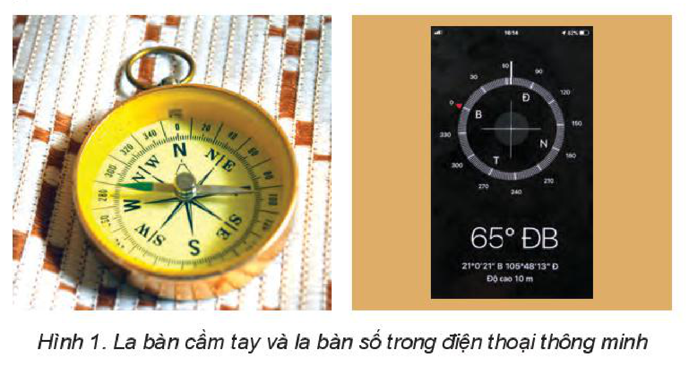
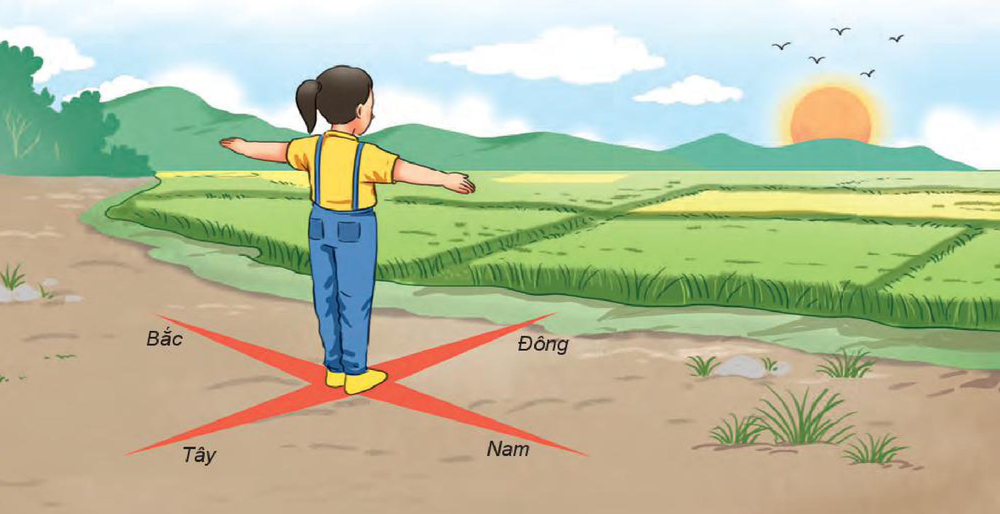
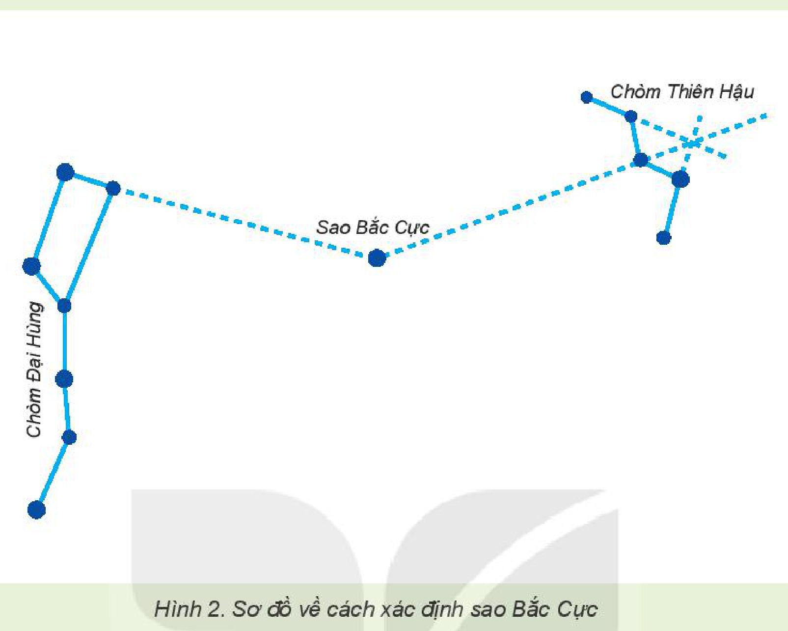

<!-- pdf:126 -->

# BÀI 9: XÁC ĐỊNH PHƯƠNG HƯỚNG NGOÀI THỰC TẾ

## 🎯 Học xong bài này, em sẽ:

- Xác định được phương hướng ngoài thực tế dựa vào la bàn hoặc quan sát các hiện tượng tự nhiên.

## 🔴 Mở đầu

Trong cuộc sống, nhiều khi con người rơi vào những tình huống hết sức khó khăn, thậm chí nguy hiểm đến tính mạng do bị mất phương hướng. Đó là khi bị lạc trong rừng, lênh đênh giữa đại dương hoặc lạc lối giữa một vùng đất xa lạ,... Khi đó, xác định phương hướng ngoài thực tế là một kĩ năng cần thiết để chúng ta có thể vượt qua hiểm nguy.

Có nhiều cách để xác định phương hướng. Thông thường, chỉ cần xác định được một trong bốn hướng chính (bắc, nam, đông, tây), từ đó sẽ suy ra các hướng còn lại.

## 1. Xác định phương hướng bằng la bàn

### a) Cấu tạo la bàn

<!-- term: La bàn -->
Một la bàn có những bộ phận cơ bản như:

<!-- term: La bàn -->
- Kim nam châm làm bằng kim loại có từ tính, thường có dạng hình thoi. Đầu kim bắc và đầu kim nam có màu khác nhau để phân biệt, đầu kim bắc thường có màu đậm hơn.
- Vòng chia độ: Trên vòng chia độ có ghi bốn hướng chính và số độ từ 0° đến 360°. Hướng bắc 0° (360°), hướng nam 180°, hướng đông 90°, hướng tây 270°.

### b) Cách sử dụng

<!-- term: La bàn -->
Khi sử dụng la bàn cần chú ý đặt la bàn thăng bằng trên mặt phẳng, tránh xa các vật bằng kim loại có thể ảnh hưởng tới kim nam châm. Mở chốt hãm cho kim chuyển động, đến khi kim đứng yên, ta đã xác định được hướng bắc – nam, từ đó xác định các hướng khác. Dựa vào số độ trên mặt la bàn, người ta có thể biết được độ lệch hướng của các đối tượng địa lí so với hướng bắc.

<!-- pdf:127 -->

Ngày nay, trên các điện thoại thông minh đều tích hợp ứng dụng la bàn. Khi mở ứng dụng la bàn trên điện thoại, cách xác định phương hướng tương tự như với la bàn cầm tay.

*Hình 1. La bàn cầm tay và la bàn số trong điện thoại thông minh*

> ❓ Sử dụng la bàn trong lớp học, xác định hướng cửa lớp, hướng cổng trường.

## 2. Xác định phương hướng dựa vào quan sát hiện tượng tự nhiên

<!-- term: Xác định phương hướng dựa vào Mặt Trời mọc và lặn -->
Dựa vào hướng Mặt Trời mọc và lặn có thể xác định được phương hướng một cách tương đối chính xác. Mặt Trời mọc ở hướng đông và lặn ở hướng tây, từ đó xác định được các hướng khác.

> ❓ Quan sát hình vẽ, mô tả lại cách xác định phương hướng qua việc quan sát Mặt Trời mọc.

<!-- pdf:128 -->

> 💡 **Em có biết?**
>
> 
>
> *Hình 2. Sơ đồ về cách xác định sao Bắc Cực*

<!-- term: Sao Bắc Cực -->
> Ở bán cầu Bắc, vào đêm tối, nếu tìm thấy sao Bắc Cực trên bầu trời là ta đã tìm được hướng bắc. Để tìm được sao Bắc Cực, có thể dựa vào các chòm sao: Đại Hùng, Thiên Hậu,...

<!-- term: Xác định phương hướng dựa vào động, thực vật tự nhiên -->
> Bằng việc quan sát động, thực vật tự nhiên, người xưa đã rút ra một số kinh nghiệm để xác định phương hướng ngoài thực địa. Ví dụ như dựa vào hướng chim bay (đối với những đàn chim di cư), mùa đông chim bay về hướng nam tránh rét, mùa hạ chim bay về hướng bắc hay quan sát hoa hướng dương, loài hoa này khi nở thường quay mặt về phía Mặt Trời,... Tuy nhiên, những phương pháp này chỉ cho phép ta xác định phương hướng một cách tương đối.

## ✏️ Luyện tập và Vận dụng

1. Hãy nêu một số cách xác định phương hướng ngoài thực tế.
2. Quan sát Mặt Trời hoặc sử dụng la bàn, hãy xác định khi đi từ nhà đến trường, trước tiên em phải đi về hướng nào.

## 📷 Danh sách hình trong bài

| Mã hình | Trang PDF | Trang sách | Chú thích |
| --- | :---: | :---: | --- |
| H6-lich_su_va_dia_ly-dl-b09-01 | 127 | 126 | Hình 1. La bàn cầm tay và la bàn số trong điện thoại thông minh |
| H6-lich_su_va_dia_ly-dl-b09-02 | 127 | 126 | (sách không đánh số, hình vẽ minh hoạ xác định bốn hướng bắc, nam, đông, tây qua việc quan sát Mặt Trời mọc) |
| H6-lich_su_va_dia_ly-dl-b09-03 | 128 | 127 | Hình 2. Sơ đồ về cách xác định sao Bắc Cực |
