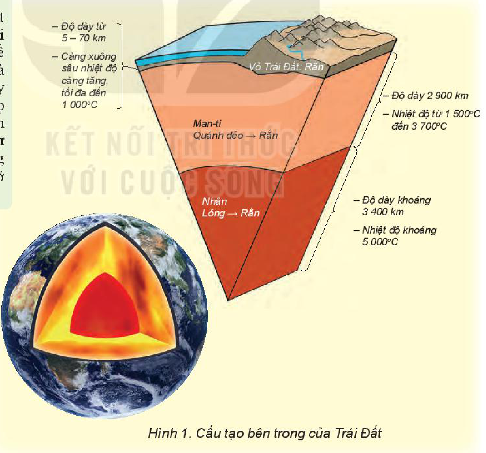
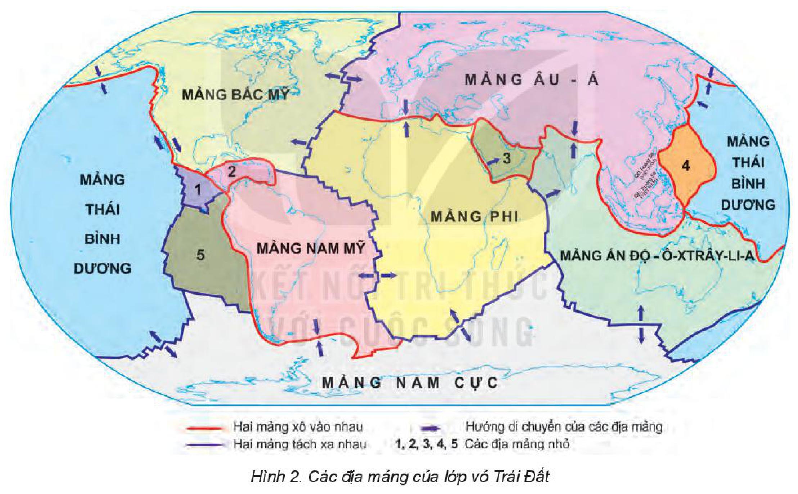

<!-- pdf:130 -->

# BÀI 10: CẤU TẠO CỦA TRÁI ĐẤT. CÁC MẢNG KIẾN TẠO

## 🎯 Học xong bài này, em sẽ:

- Trình bày được cấu tạo của Trái Đất gồm ba lớp.
- Xác định được trên lược đồ các mảng kiến tạo lớn, đới tiếp giáp của hai mảng xô vào nhau.

## 🔴 Mở đầu

Từ xưa tới nay con người vẫn muốn tìm hiểu: Trong lòng Trái Đất có gì? Cấu tạo của Trái Đất ra sao? Bài học này sẽ đề cập tới những vấn đề đó.

## 1. Cấu tạo bên trong của Trái Đất

<!-- term: Cấu tạo bên trong của Trái Đất -->
<!-- term: Vỏ Trái Đất -->
<!-- term: Man-ti -->
<!-- term: Nhân Trái Đất -->
Trái Đất được cấu tạo bởi ba lớp, từ ngoài vào trong bao gồm: vỏ Trái Đất, man-ti và nhân Trái Đất.

<!-- term: Phương pháp địa chấn -->
> 💡 **Em có biết?**
>
> Việc nghiên cứu vật chất trong lòng Trái Đất là một vấn đề khó khăn. Các nhà khoa học hiện nay dùng phương pháp địa chấn để suy đoán cấu trúc cũng như thành phần và trạng thái của vật chất ở trong lòng Trái Đất.

> ❓ Hãy nêu sự khác nhau về độ dày, trạng thái, nhiệt độ giữa vỏ Trái Đất, man-ti và nhân (có thể lập bảng so sánh).

<!-- pdf:131 -->

## 2. Các địa mảng (mảng kiến tạo)

<!-- term: Vỏ Trái Đất -->
<!-- term: Man-ti -->
<!-- term: Địa mảng -->
<!-- term: Mac-ma -->
Vỏ Trái Đất được cấu tạo bởi các địa mảng nằm kề nhau. Do tác động của vật chất nóng chảy (mac-ma) trong lớp man-ti, các địa mảng di chuyển với tốc độ rất chậm. Trong khi di chuyển, các địa mảng có thể xô vào nhau hoặc tách xa nhau. Ở đới tiếp giáp giữa các mảng sẽ hình thành các dãy núi, các vực sâu,... kèm theo là các hiện tượng động đất và núi lửa.

> 💡 **Em có biết?**
>
> Khi một mảng đại dương và một mảng lục địa xô vào nhau sẽ hình thành một dải núi lửa ở rìa mảng lục địa; tạo ra dãy núi cao ở lục địa và vực biển sâu ở đại dương. Điển hình là dãy núi An-đét và vực biển Pê-ru – Chi-lê ở Nam Mỹ.

> ❓ Quan sát hình 2, em hãy:
>
> - Kể tên các địa mảng lớn của Trái Đất. Việt Nam nằm ở địa mảng nào?
> - Dựa vào chú giải, tìm trên hình các địa mảng xô vào nhau và đới tiếp giáp của các địa mảng đó.

## ✏️ Luyện tập và Vận dụng

1. Vẽ vào vở một hình tròn tượng trưng cho Trái Đất, thể hiện trên đó cấu tạo bên trong của Trái Đất.
2. Tìm kiếm thông tin và trình bày về vành đai núi lửa Thái Bình Dương.

## 📷 Danh sách hình trong bài

| Mã hình | Trang PDF | Trang sách | Chú thích |
| --- | :---: | :---: | --- |
| H6-lich_su_va_dia_ly-dl-b10-01 | 130 | 129 | Hình 1. Cấu tạo bên trong của Trái Đất |
| H6-lich_su_va_dia_ly-dl-b10-02 | 131 | 130 | Hình 2. Các địa mảng của lớp vỏ Trái Đất |
