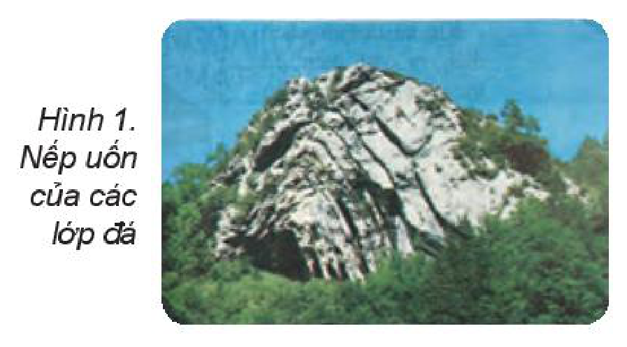
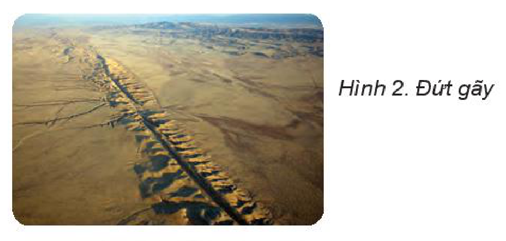
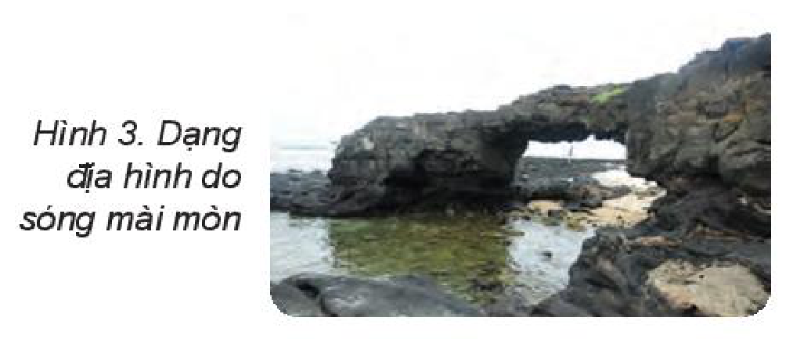
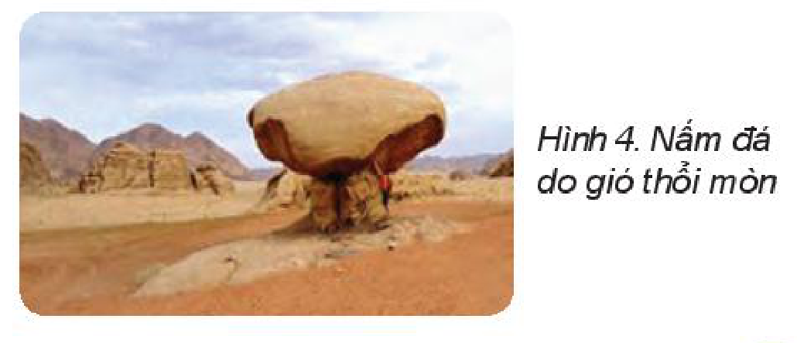
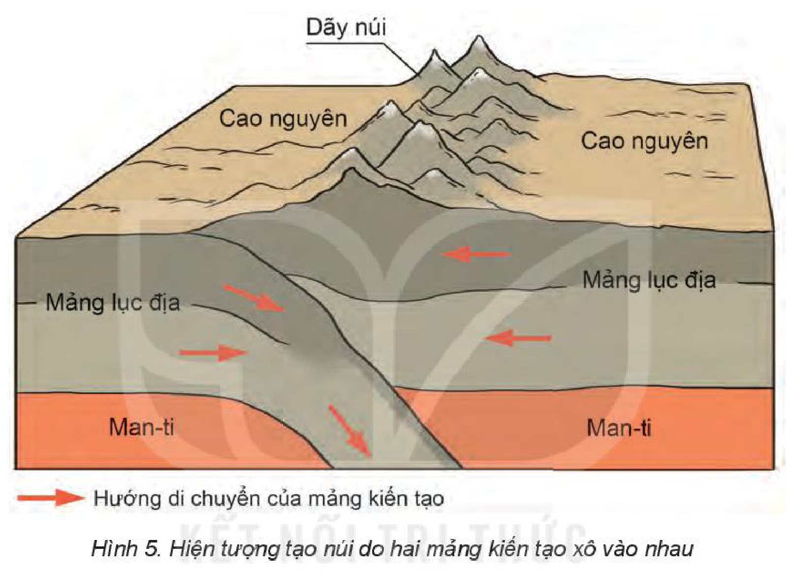

<!-- pdf:132 -->

# BÀI 11: QUÁ TRÌNH NỘI SINH VÀ QUÁ TRÌNH NGOẠI SINH. HIỆN TƯỢNG TẠO NÚI

## 🎯 Học xong bài này, em sẽ:

- Phân biệt được quá trình nội sinh và quá trình ngoại sinh.
- Trình bày được tác động đồng thời của quá trình nội sinh và quá trình ngoại sinh trong hiện tượng tạo núi.

## 🔴 Mở đầu

Bề mặt Trái Đất không bằng phẳng mà rất lồi lõm. Những nơi cao là vùng núi, cao nhất là đỉnh Ê-vơ-rét (Chô-mô-lung-ma) với độ cao 8 848 m. Những nơi thấp là những vực sâu dưới đáy đại dương, sâu nhất là vực Ma-ri-an với độ sâu khoảng 11 000 m. Theo em, điều gì khiến bề mặt Trái Đất lồi lõm như vậy?

## 1. Quá trình nội sinh và quá trình ngoại sinh

> ❓ Dựa vào nội dung kiến thức dưới đây, em hãy cho biết:
>
> - Quá trình nội sinh và quá trình ngoại sinh khác nhau như thế nào.
> - Trong các hình 1, 2, 3, 4, hình nào thể hiện tác động chủ yếu của quá trình nội sinh, hình nào thể hiện tác động chủ yếu của quá trình ngoại sinh.

**Nội sinh** là các quá trình xảy ra trong lòng Trái Đất. Quá trình nội sinh làm di chuyển các mảng kiến tạo, nén ép các lớp đất đá, làm cho chúng bị uốn nếp, đứt gãy hoặc đẩy vật chất nóng chảy ở dưới sâu ra ngoài mặt đất tạo thành núi lửa, động đất,...

**Ngoại sinh** là các quá trình xảy ra ở bên ngoài, trên bề mặt Trái Đất. Quá trình ngoại sinh có xu hướng phá vỡ, san bằng các địa hình do nội sinh tạo nên, đồng thời cũng tạo ra các dạng địa hình mới.

<!-- pdf:133 -->

## 2. Hiện tượng tạo núi

<!-- term: Hiện tượng tạo núi -->
Trong quá trình di chuyển, các địa mảng có thể xô vào nhau hoặc tách xa nhau khiến cho các lớp đất đá ở đới tiếp giáp giữa các địa mảng bị dồn ép, uốn lên thành núi; hoặc bị đứt gãy, vật chất nóng chảy phun trào lên mặt đất tạo thành núi lửa. Đồng thời với quá trình nâng cao do nội sinh thì núi cũng chịu tác động phá huỷ của ngoại sinh.

<!-- term: Vùng núi trẻ -->
<!-- term: Vùng núi già -->
Ở nhiều vùng núi trẻ, mới được hình thành cách đây khoảng vài chục triệu năm, tác động của nội sinh mạnh hơn ngoại sinh nên vẫn tiếp tục được nâng cao. Ở những vùng núi già được hình thành cách đây hàng trăm triệu năm, tác động của ngoại sinh mạnh hơn nội sinh nên bị bào mòn mạnh.

> ❓ 1. Quan sát hình 5 và đọc thông tin trong mục 2, em hãy trình bày hiện tượng tạo núi.
>
> 2. Ngoại sinh có vai trò như thế nào trong việc làm biến đổi hình dạng của núi?

## ✏️ Luyện tập và Vận dụng

1. Em hãy nêu vai trò của quá trình nội sinh và quá trình ngoại sinh trong việc hình thành địa hình bề mặt Trái Đất.
2. Nêu tác động đồng thời của quá trình nội sinh và quá trình ngoại sinh trong hiện tượng tạo núi.
3. Thu thập thông tin, hình ảnh về một số dạng địa hình do gió, nước,... tạo thành và chia sẻ với các bạn.

## 📷 Danh sách hình trong bài

| Mã hình | Trang PDF | Trang sách | Chú thích |
| --- | :---: | :---: | --- |
| H6-lich_su_va_dia_ly-dl-b11-01 | 132 | 131 | Hình 1. Nếp uốn của các lớp đá |
| H6-lich_su_va_dia_ly-dl-b11-02 | 132 | 131 | Hình 2. Đứt gãy |
| H6-lich_su_va_dia_ly-dl-b11-03 | 132 | 131 | Hình 3. Dạng địa hình do sóng mài mòn |
| H6-lich_su_va_dia_ly-dl-b11-04 | 132 | 131 | Hình 4. Nấm đá do gió thổi mòn |
| H6-lich_su_va_dia_ly-dl-b11-05 | 133 | 132 | Hình 5. Hiện tượng tạo núi do hai mảng kiến tạo xô vào nhau |
