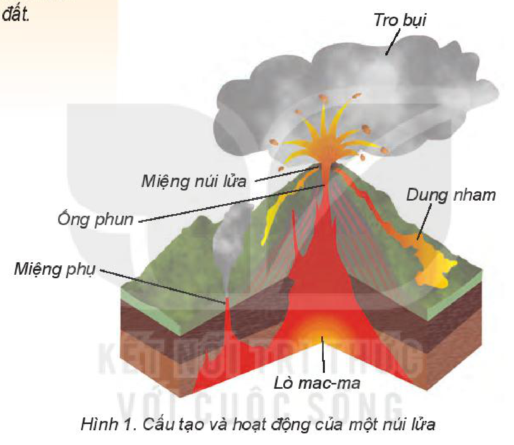
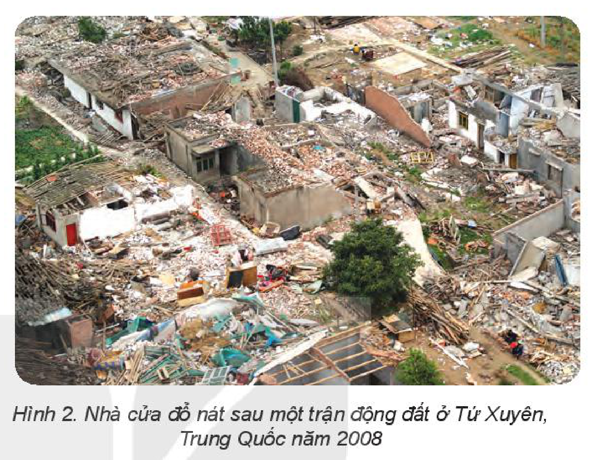
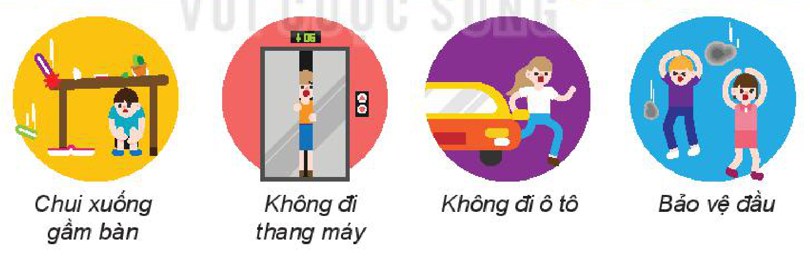

<!-- pdf:134 -->

# BÀI 12: NÚI LỬA VÀ ĐỘNG ĐẤT

## 🎯 Học xong bài này, em sẽ:

- Trình bày được hiện tượng núi lửa, động đất và nêu được nguyên nhân của hiện tượng này.
- Biết tìm kiếm thông tin về các thảm hoạ thiên nhiên do núi lửa và động đất gây ra.
- Biết cách ứng phó khi có núi lửa và động đất.

## 🔴 Mở đầu

Núi lửa và động đất là hai dạng thiên tai gây ra nhiều thảm hoạ kinh hoàng trong lịch sử nhân loại. Động đất và núi lửa diễn ra như thế nào và nguyên nhân do đâu?

## 1. Núi lửa

<!-- term: Núi lửa -->
<!-- term: Mac-ma -->
Ở những nơi vỏ Trái Đất bị đứt gãy, các dòng mac-ma theo các khe nứt của vỏ Trái Đất, phun trào lên bề mặt (cả trên lục địa và đại dương) tạo thành núi lửa.

> ❓ 1. Quan sát hình 1 và đọc thông tin trong mục 1, em hãy mô tả hiện tượng núi lửa và nêu nguyên nhân hình thành núi lửa.
>
> 2. Theo em, núi lửa phun trào sẽ gây ra những hậu quả gì?

> 💡 **Em có biết?**
>
> Năm 1815, núi lửa Tam-bô-ra ở In-đô-nê-xi-a phun trào. Hậu quả là có hơn 70 nghìn người chết sau khi thảm hoạ xảy ra, chủ yếu do nạn đói vì mất mùa, bệnh dịch và không khí bị ô nhiễm.
<!-- ocr-ok: đã đối chiếu ảnh trang gốc p134 (trang sách 133), hộp nền màu làm OCR lỗi dấu -->

Trước khi núi lửa phun trào, có thể mặt đất rung nhẹ, nóng hơn, có khí bốc lên ở miệng núi. Khi núi lửa có dấu hiệu phun trào, người dân quanh vùng phải sơ tán nhanh chóng khỏi khu vực đó.

<!-- term: Núi lửa -->
Núi lửa phun trào gây thiệt hại cho các vùng lân cận. Tro bụi và dung nham vùi lấp các thành thị, làng mạc, ruộng nương, gây thiệt hại về người và tài sản. Tuy nhiên, các vùng đất đỏ phì nhiêu do dung nham bị phong hoá lại rất thuận lợi cho sản xuất nông nghiệp.

<!-- pdf:135 -->

## 2. Động đất

<!-- term: Động đất -->
Động đất là các rung chuyển đột ngột, mạnh mẽ của vỏ Trái Đất chủ yếu do hoạt động của núi lửa, sự dịch chuyển các mảng kiến tạo hoặc sự đứt gãy trong vỏ Trái Đất gây ra. Động đất thường được lan truyền trên một diện tích rộng lớn.

<!-- term: Thang Rich-te -->
> 💡 **Em có biết?**
>
> Cường độ động đất được tính bằng thang Rich-te:
>
> Nhẹ (4 – 4,9 độ): các vật treo lúc lắc.
>
> Trung bình (5 – 5,9 độ): nứt đất, nứt công trình xây dựng, mực nước giếng thay đổi.
>
> Mạnh (6 – 6,9 độ): công trình xây dựng thông thường bị sụp đổ.
>
> Rất mạnh (7 – 7,9 độ): tàn phá nghiêm trọng, đê sụt lở, đường sá bị phá huỷ.
>
> Cực mạnh (8 – 8,9 độ): tàn phá vô cùng nghiêm trọng trên diện tích rộng.
>
> Phá huỷ (≥ 9 độ): môi trường bị biến đổi hoàn toàn. Rất hiếm khi xảy ra.

Có một số dấu hiệu trước khi động đất xảy ra như: mực nước giếng thay đổi, nổi bong bóng; động vật hoảng loạn tìm nơi trú ẩn,...

> ❓ 1. Quan sát hình 2 và thông tin trong mục 2, em hãy nêu hậu quả do động đất gây ra.
>
> 2. Quan sát các hình sau, hãy cho biết những hành động đúng khi động đất xảy ra.

## ✏️ Luyện tập và Vận dụng

1. Nếu đang trong lớp học mà có động đất xảy ra, em sẽ làm gì để bảo vệ mình?
2. Em hãy tìm kiếm thông tin về thảm hoạ do một trận động đất hoặc núi lửa gây ra trên thế giới và chia sẻ trước lớp.

## 📷 Danh sách hình trong bài

| Mã hình | Trang PDF | Trang sách | Chú thích |
| --- | :---: | :---: | --- |
| H6-lich_su_va_dia_ly-dl-b12-01 | 134 | 133 | Hình 1. Cấu tạo và hoạt động của một núi lửa |
| H6-lich_su_va_dia_ly-dl-b12-02 | 135 | 134 | Hình 2. Nhà cửa đổ nát sau một trận động đất ở Tứ Xuyên, Trung Quốc năm 2008 |
| H6-lich_su_va_dia_ly-dl-b12-03 | 135 | 134 | (sách không đánh số, các hình minh hoạ hành động khi động đất xảy ra: Chui xuống gầm bàn, Không đi thang máy, Không đi ô tô, Bảo vệ đầu) |
