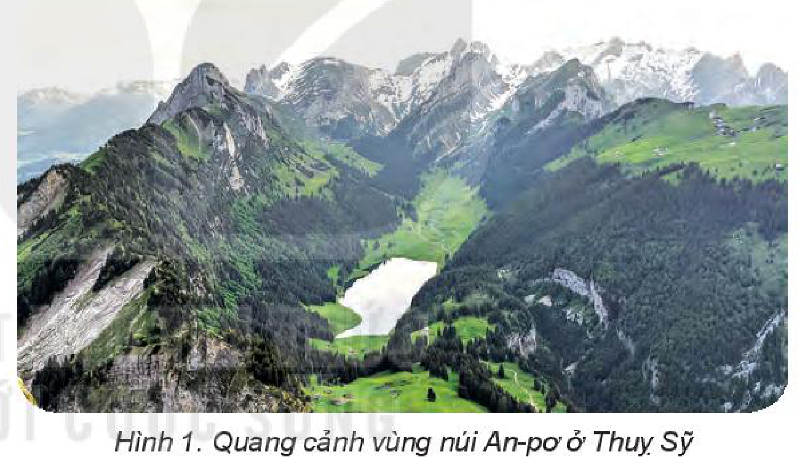
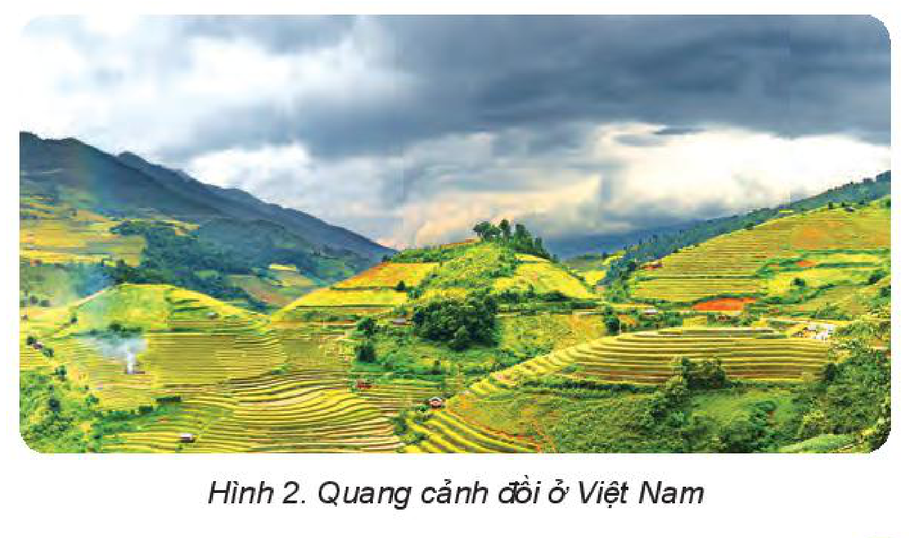
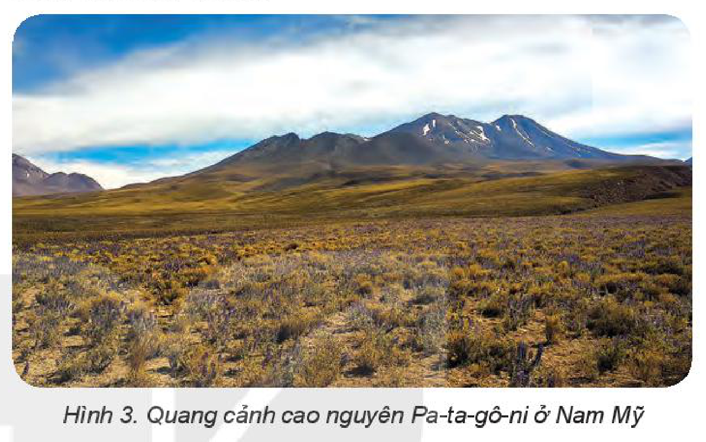
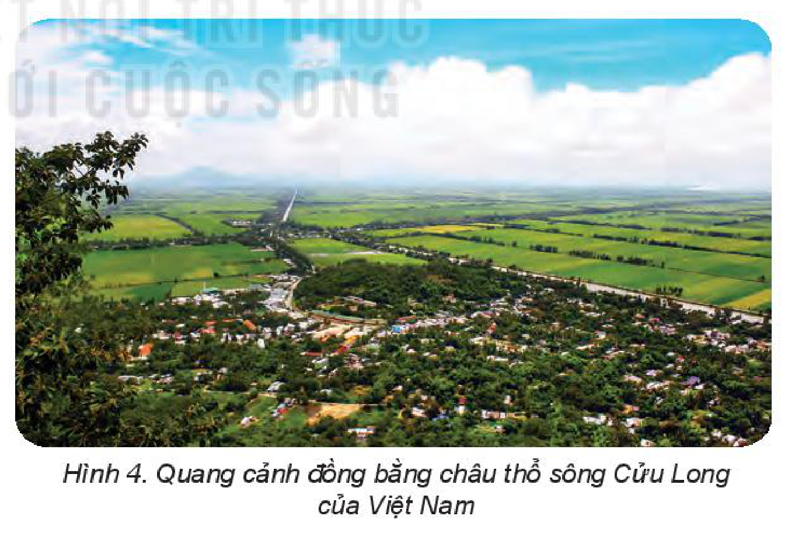
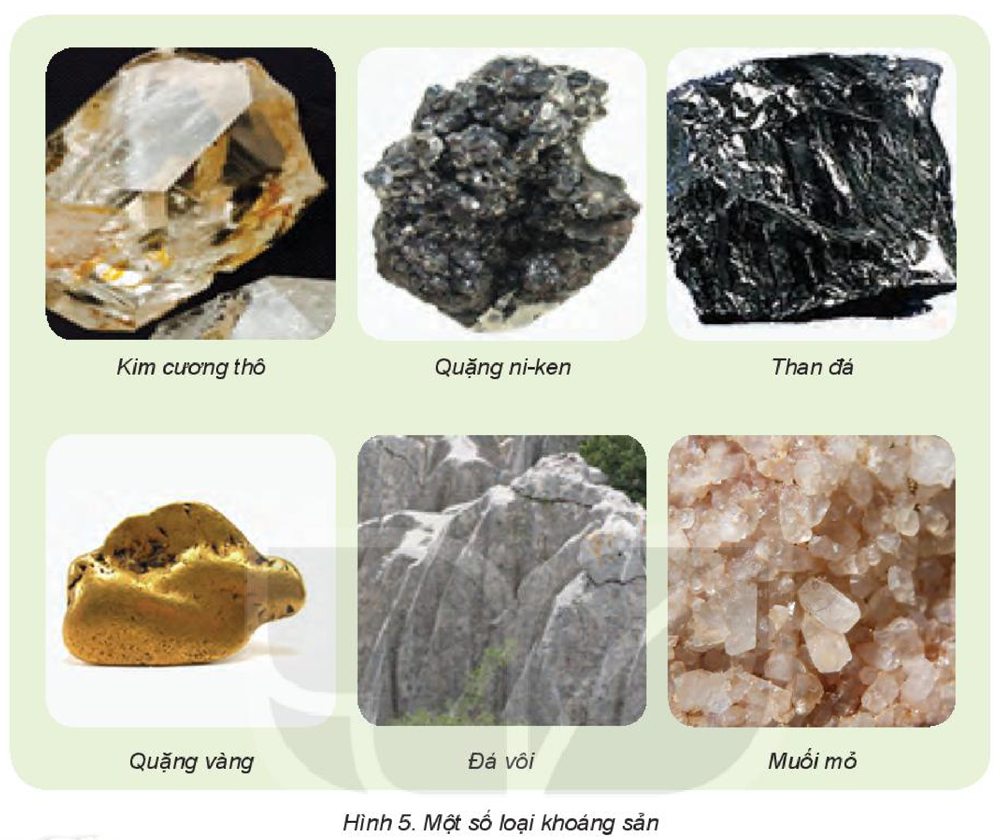

<!-- pdf:136 -->

# BÀI 13: CÁC DẠNG ĐỊA HÌNH CHÍNH TRÊN TRÁI ĐẤT. KHOÁNG SẢN

## 🎯 Học xong bài này, em sẽ:

- Phân biệt được các dạng địa hình chính trên Trái Đất.
- Kể được tên một số loại khoáng sản.
- Có ý thức bảo vệ và sử dụng tiết kiệm nguồn tài nguyên khoáng sản.

## 🔴 Mở đầu

Tác động của quá trình nội sinh và quá trình ngoại sinh không giống nhau ở mọi nơi trên Trái Đất đã tạo nên sự đa dạng về địa hình và khoáng sản. Trên bề mặt Trái Đất có các dạng địa hình chính và các loại khoáng sản nào? Dựa vào đâu để phân biệt chúng?

## 1. Các dạng địa hình chính

a) **Núi** là dạng địa hình nhô cao rõ rệt so với mặt bằng xung quanh. Độ cao của núi so với mực nước biển là từ 500 m trở lên. Núi thường có đỉnh nhọn, sườn dốc.

<!-- term: Chân núi -->
> 💡 **Em có biết?**
>
> Chỗ tiếp giáp giữa núi và mặt đất xung quanh gọi là chân núi. Sườn núi càng dốc thì đường chân núi biểu hiện càng rõ.

b) **Đồi** cũng là dạng địa hình nhô cao. Độ cao của đồi so với vùng đất xung quanh thường không quá 200 m. Đồi có đỉnh tròn, sườn thoải.

> 💡 **Em có biết?**
>
> Hi-ma-lay-a là dãy núi đồ sộ, với đỉnh Ê-vơ-rét cao nhất thế giới. Liền kề với dãy núi này là cao nguyên Tây Tạng – cao nguyên cao nhất thế giới (cao trung bình trên 4 500 m so với mực nước biển), có diện tích 2,5 triệu km².

<!-- pdf:137 -->

> ❓ 1. Dựa vào hình 1, 2 và thông tin trong mục 1, em hãy cho biết sự khác nhau giữa núi và đồi.
>
> 2. Dựa vào bản đồ Tự nhiên thế giới (trang 96 – 97), kể tên một số dãy núi lớn trên thế giới.

c) **Cao nguyên** là vùng đất tương đối bằng phẳng hoặc gợn sóng, thường cao trên 500 m so với mực nước biển, có sườn dốc, nhiều khi dựng đứng thành vách so với vùng đất xung quanh.

<!-- term: Độ cao tuyệt đối -->
<!-- term: Độ cao tương đối -->
> 💡 **Em có biết?**
>
> Khoảng cách đo theo chiều thẳng đứng từ một địa điểm so với mực nước biển trung bình gọi là độ cao tuyệt đối của địa điểm đó.
>
> Khoảng cách đo theo chiều thẳng đứng từ một điểm ở trên cao so với một điểm khác ở dưới thấp gọi là độ cao tương đối của địa điểm đó.

d) **Đồng bằng** là dạng địa hình thấp có bề mặt khá bằng phẳng hoặc hơi gợn sóng, có thể rộng tới hàng triệu km². Độ cao của hầu hết đồng bằng là dưới 200 m so với mực nước biển.

> ❓ 1. Quan sát hình 3, 4 và thông tin trong mục 1, em hãy nêu sự khác nhau giữa cao nguyên và đồng bằng.
>
> 2. Dựa vào bản đồ Tự nhiên thế giới (trang 96 – 97), kể tên một số cao nguyên, đồng bằng lớn trên thế giới.

<!-- pdf:138 -->

## 2. Khoáng sản

<!-- term: Khoáng sản -->
Khoáng sản là những khoáng vật và khoáng chất có ích trong tự nhiên nằm trong vỏ Trái Đất mà con người có thể khai thác để sử dụng trong sản xuất và đời sống.

<!-- term: Khoáng vật -->
> 💡 **Em có biết?**
>
> Khoáng vật là các hợp chất tự nhiên được hình thành qua các quá trình địa chất.
<!-- ocr-ok: đã đối chiếu ảnh trang gốc p138 (trang sách 137), hộp Em có biết? đặt ngang cột bên phải -->

<!-- term: Khoáng sản -->
Đa số khoáng sản gặp ở trạng thái rắn (các loại quặng, than,...). Chỉ có một số ít ở trạng thái lỏng (nước khoáng, dầu mỏ,...) hoặc trạng thái khí (khí thiên nhiên,...).

Khoáng sản trong tự nhiên rất phong phú và đa dạng, có thể phân ra ba nhóm.

<!-- term: Khoáng sản năng lượng -->
| Nhóm khoáng sản | Tên khoáng sản | Công dụng |
| --- | --- | --- |
| Năng lượng (nhiên liệu) | Than đá, dầu mỏ,... | Nhiên liệu cho công nghiệp năng lượng, nguyên liệu cho công nghiệp hoá chất,... |
| Kim loại (Đen) | Sắt, man-gan, crôm,... | Nguyên liệu cho công nghiệp luyện kim đen và luyện kim màu, từ đó sản xuất ra các loại gang, thép, đồng, chì,... |
| Kim loại (Màu) | Đồng, chì,... | Nguyên liệu cho công nghiệp luyện kim đen và luyện kim màu, từ đó sản xuất ra các loại gang, thép, đồng, chì,... |
| Phi kim loại | Muối mỏ, thạch anh, đá vôi,... | Nguyên liệu để sản xuất phân bón, đồ gốm, sứ, làm vật liệu xây dựng,... |

<!-- term: Mỏ khoáng sản -->
Mỏ khoáng sản là nơi tập trung khoáng sản có trữ lượng và chất lượng có thể khai thác để sử dụng vào mục đích kinh tế. Các mỏ khoáng sản đều được hình thành trong một thời gian dài hàng triệu năm. Tuy nhiên, chỉ trong vòng vài trăm năm, con người đã khai thác phần lớn trữ lượng khoáng sản đã thăm dò. Vì vậy, chúng ta cần phải sử dụng khoáng sản một cách hợp lí, hiệu quả.

> ❓ 1. Em hãy cho biết trong các vật liệu sau, vật liệu nào là khoáng sản: nhựa, than đá, gỗ, cát, xi măng, thép, đá vôi.
>
> 2. Hãy kể tên ít nhất một vật dụng hằng ngày em thường sử dụng được làm từ khoáng sản.
>
> 3. Sắp xếp các loại khoáng sản sau vào ba nhóm sao cho đúng: vàng, nước khoáng, kim cương, than bùn, khí thiên nhiên, cao lanh, ni-ken, phốt phát, bô-xít.

<!-- pdf:139 -->

## ✏️ Luyện tập và Vận dụng

1. Nêu đặc điểm của các dạng địa hình chính trên Trái Đất: núi, đồi, cao nguyên, đồng bằng.
2. Khi xây dựng nhà, chúng ta sử dụng những vật liệu gì có nguồn gốc từ khoáng sản?

Chọn một trong hai nhiệm vụ sau:

3. Sưu tầm hình ảnh về các dạng địa hình đồi, núi, cao nguyên, đồng bằng ở nước ta.
4. Tìm kiếm thông tin và viết báo cáo ngắn về hiện trạng khai thác một loại khoáng sản ở nước ta.

## 📷 Danh sách hình trong bài

| Mã hình | Trang PDF | Trang sách | Chú thích |
| --- | :---: | :---: | --- |
| H6-lich_su_va_dia_ly-dl-b13-01 | 136 | 135 | Hình 1. Quang cảnh vùng núi An-pơ ở Thuỵ Sỹ |
| H6-lich_su_va_dia_ly-dl-b13-02 | 136 | 135 | Hình 2. Quang cảnh đồi ở Việt Nam |
| H6-lich_su_va_dia_ly-dl-b13-03 | 137 | 136 | Hình 3. Quang cảnh cao nguyên Pa-ta-gô-ni ở Nam Mỹ |
| H6-lich_su_va_dia_ly-dl-b13-04 | 137 | 136 | Hình 4. Quang cảnh đồng bằng châu thổ sông Cửu Long của Việt Nam |
| H6-lich_su_va_dia_ly-dl-b13-05 | 139 | 138 | Hình 5. Một số loại khoáng sản |
