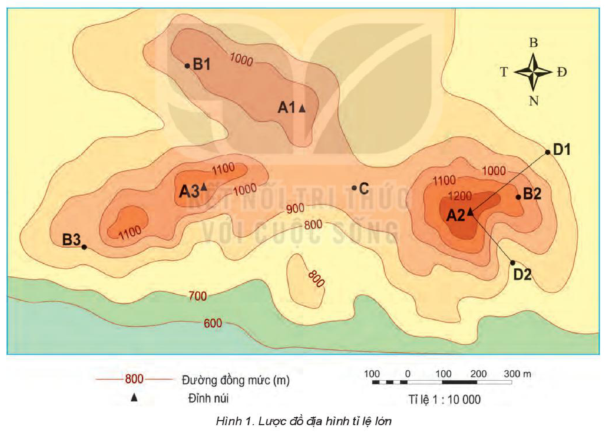
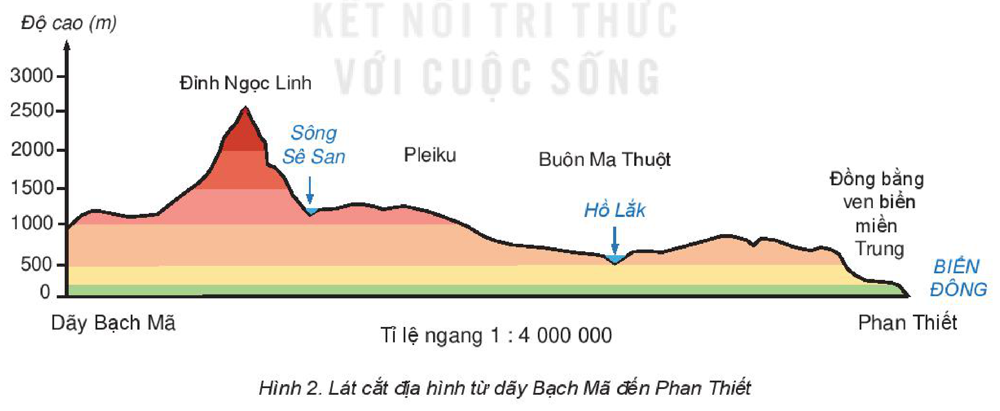

<!-- pdf:140 -->

# BÀI 14: THỰC HÀNH: ĐỌC LƯỢC ĐỒ ĐỊA HÌNH TỈ LỆ LỚN VÀ LÁT CẮT ĐỊA HÌNH ĐƠN GIẢN

## 🎯 Học xong bài này, em sẽ:

- Đọc được lược đồ địa hình tỉ lệ lớn và lát cắt địa hình đơn giản.

## 1. Đọc lược đồ địa hình tỉ lệ lớn

<!-- term: Lược đồ địa hình tỉ lệ lớn -->
<!-- term: Khoảng cao đều -->
Lược đồ địa hình tỉ lệ lớn là lược đồ thể hiện đặc điểm địa hình (độ cao, độ dốc,...) của một khu vực có diện tích nhỏ bằng các đường đồng mức và màu sắc. Đường đồng mức là đường nối liền những điểm có cùng độ cao. Các đường đồng mức cách nhau một độ cao đều đặn gọi là khoảng cao đều. Các đường đồng mức càng gần nhau, địa hình càng dốc; các đường đồng mức càng cách xa nhau, địa hình càng thoải.

Hướng dẫn đọc lược đồ địa hình tỉ lệ lớn:

- Trước hết, cần xác định được các đường đồng mức có khoảng cao đều cách nhau bao nhiêu mét.
- Căn cứ vào các đường này, ta có thể tính ra độ cao của các địa điểm trên lược đồ.

<!-- pdf:141 -->

- Căn cứ vào độ gần hay xa nhau của đường đồng mức, ta biết được độ dốc của địa hình.
- Căn cứ vào tỉ lệ lược đồ, ta tính được khoảng cách thực tế giữa các địa điểm.

> ❓ Dựa vào hình 1, em hãy:
>
> - Cho biết các đường đồng mức có khoảng cao đều cách nhau bao nhiêu mét.
> - So sánh độ cao của các điểm B1, B2, B3, C.
> - Cho biết một bạn muốn leo lên đỉnh A2, để đỡ leo dốc, thì nên đi theo sườn D1 – A2 hay sườn D2 – A2.

## 2. Đọc lát cắt địa hình đơn giản

<!-- term: Lát cắt địa hình -->
Lát cắt địa hình là hình vẽ biểu hiện được đầy đủ hình dáng và độ cao của các loại địa hình dọc theo một đường (tuyến) cắt nhất định.

Hướng dẫn đọc lát cắt địa hình:

- Khi đọc lát cắt, trước tiên ta phải xác định được điểm bắt đầu và điểm cuối của lát cắt.
- Từ hai điểm mốc này, ta có thể biết được lát cắt có hướng như thế nào, đi qua những điểm độ cao, dạng địa hình đặc biệt nào, độ dốc của địa hình biến đổi ra sao,...
- Từ đó, ta có thể mô tả sự thay đổi của địa hình từ điểm đầu đến điểm cuối lát cắt.
- Dựa vào tỉ lệ lát cắt, có thể tính được khoảng cách giữa các địa điểm.

> ❓ Căn cứ vào hình 2, em hãy:
>
> - Cho biết lát cắt lần lượt đi qua các dạng địa hình nào.
> - Xác định độ cao của đỉnh Ngọc Linh.

## 📷 Danh sách hình trong bài

| Mã hình | Trang PDF | Trang sách | Chú thích |
| --- | :---: | :---: | --- |
| H6-lich_su_va_dia_ly-dl-b14-01 | 140 | 139 | Hình 1. Lược đồ địa hình tỉ lệ lớn |
| H6-lich_su_va_dia_ly-dl-b14-02 | 141 | 140 | Hình 2. Lát cắt địa hình từ dãy Bạch Mã đến Phan Thiết |
