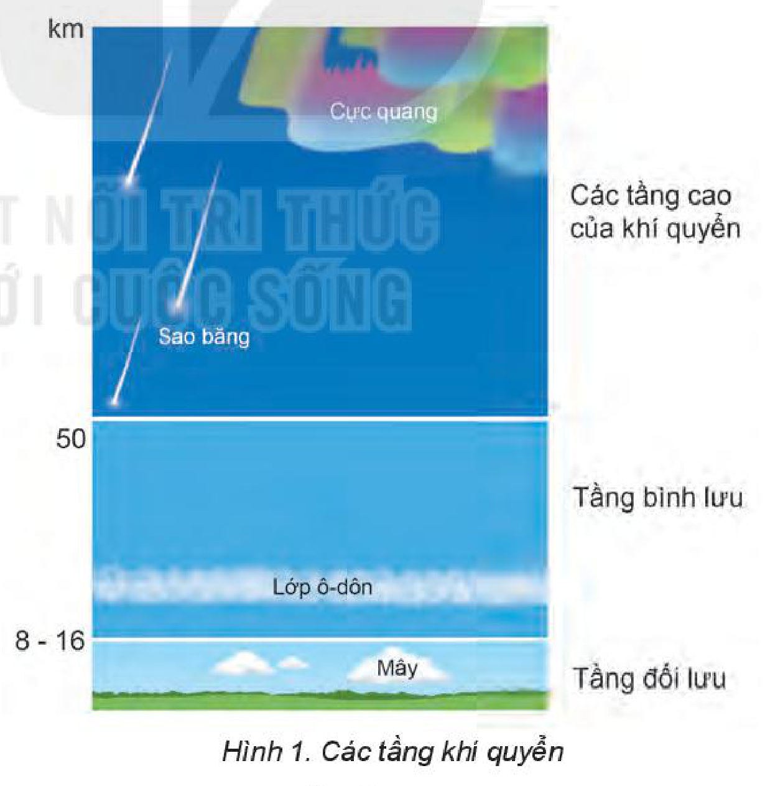
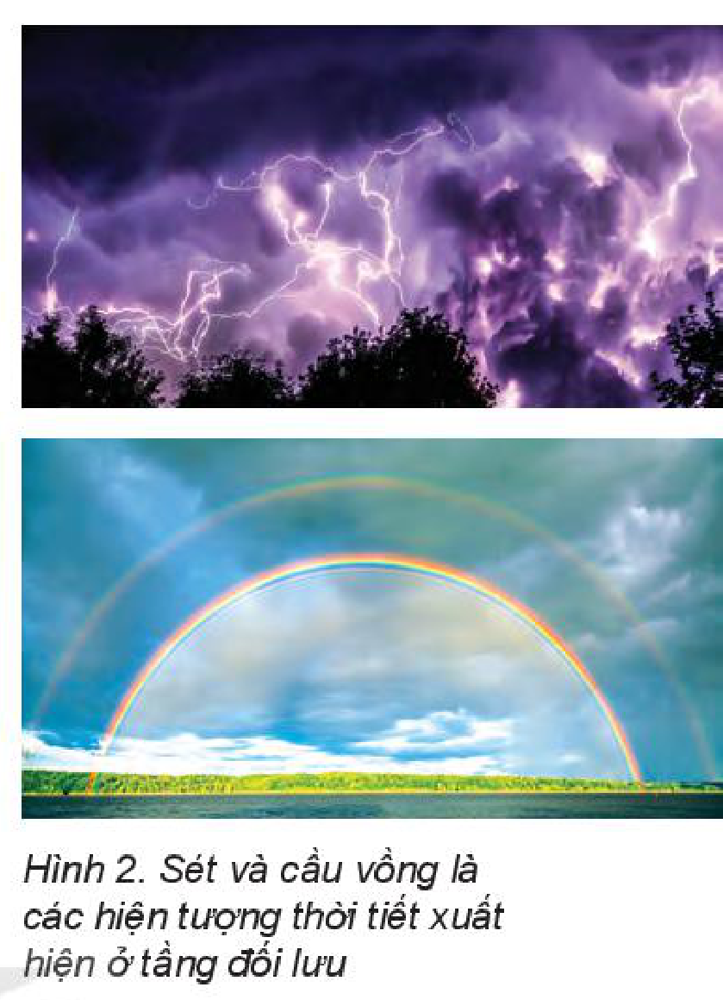
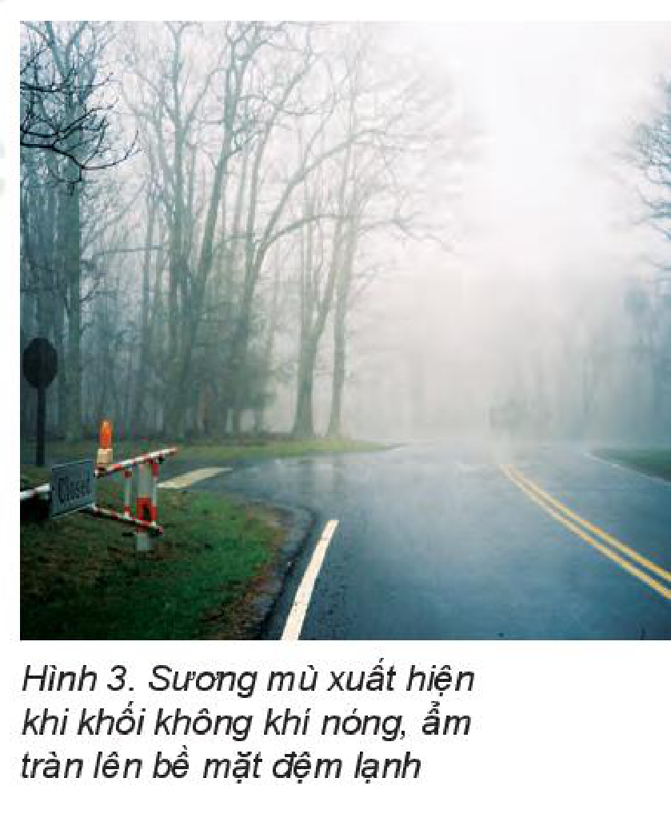
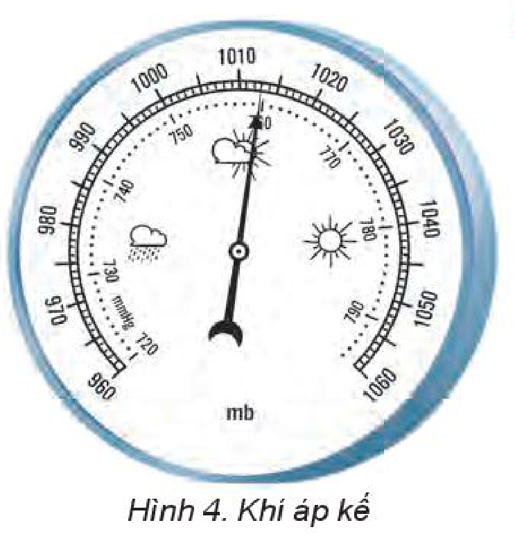
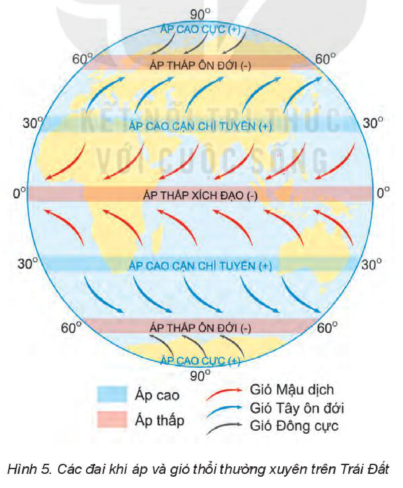
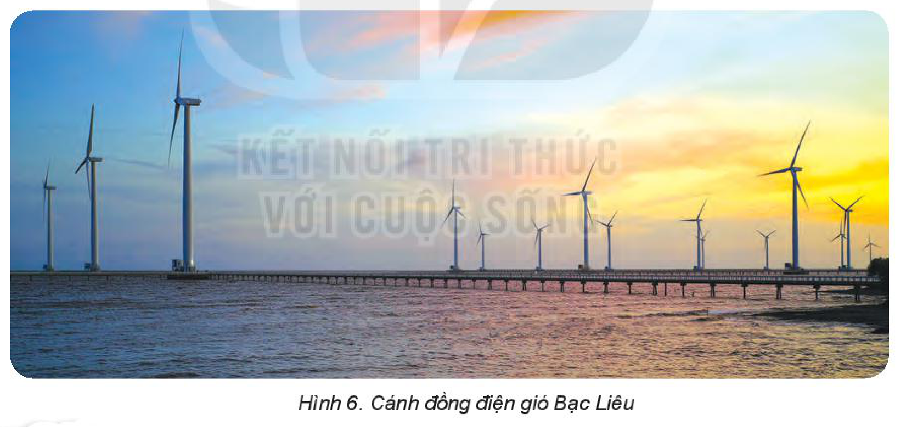

<!-- pdf:143 -->

# BÀI 15: LỚP VỎ KHÍ CỦA TRÁI ĐẤT. KHÍ ÁP VÀ GIÓ

## 🎯 Học xong bài này, em sẽ:

- Hiểu được vai trò của oxy, hơi nước và khí carbonic trong khí quyển.
- Mô tả được các tầng khí quyển, đặc điểm chính của tầng đối lưu và tầng bình lưu.
- Kể được tên và nêu được đặc điểm về nhiệt độ, độ ẩm của một số khối khí.
- Trình bày được sự phân bố các đai khí áp và các loại gió thổi thường xuyên trên Trái Đất.
- Biết cách sử dụng khí áp kế.
- Có ý thức bảo vệ bầu khí quyển và lớp ô-dôn.

## 🔴 Mở đầu

<!-- term: Khí quyển -->
Lớp không khí bao quanh Trái Đất được gọi là khí quyển hay lớp vỏ khí của Trái Đất. Lớp vỏ khí gồm những thành phần nào và cấu tạo ra sao? Khí áp và gió phân bố như thế nào trên Trái Đất?

## 1. Thành phần không khí gần bề mặt đất

<!-- term: Thành phần không khí gần bề mặt đất -->
Thành phần của không khí gần bề mặt đất chủ yếu là các khí: nitơ (78%); oxy (21%); hơi nước, khí carbonic và các khí khác (1%).

Các khí này có vai trò rất quan trọng đối với tự nhiên và đời sống.

> ❓ Bằng kiến thức đã học và hiểu biết thực tế, em hãy cho biết vai trò của oxy, hơi nước và khí carbonic đối với tự nhiên và đời sống.

## 2. Các tầng khí quyển

<!-- term: Khí quyển -->
<!-- term: Các tầng khí quyển -->
Dựa vào sự thay đổi của nhiệt độ theo độ cao và sự khuếch tán của không khí vào vũ trụ, khí quyển được chia thành: tầng đối lưu, tầng bình lưu và các tầng cao của khí quyển (tầng giữa, tầng nhiệt, tầng khuếch tán). Càng lên cao không khí càng loãng.

<!-- pdf:144 -->

<!-- term: Tầng đối lưu -->
Tại tầng đối lưu, nhiệt độ giảm theo độ cao (trung bình cứ lên cao 100 m, nhiệt độ lại giảm 0,6°C), luôn có sự chuyển động của không khí theo chiều thẳng đứng. Tầng đối lưu là nơi sinh ra các hiện tượng thời tiết như mây, mưa, sấm sét,...

<!-- term: Tầng bình lưu -->
<!-- term: Lớp ô-dôn -->
Tại tầng bình lưu, nhiệt độ tăng theo độ cao, không khí luôn luôn chuyển động ngang. Lớp ô-dôn trong tầng này đã giúp hấp thụ phần lớn bức xạ cực tím, bảo vệ sự sống trên Trái Đất.

Ở các tầng khí quyển cao hơn, không khí rất loãng.
<!-- ocr-ok: đã đối chiếu ảnh trang gốc p144 (trang sách 143), OCR nhầm dấu 'tầng khí quyển' -->

> ❓ Đọc thông tin trong mục 2 và quan sát hình 1, 2, em hãy:
>
> - Cho biết khí quyển gồm những tầng nào.
> - Nêu đặc điểm chính của tầng đối lưu và tầng bình lưu.

## 3. Các khối khí

<!-- term: Khối khí -->
Không khí ở đáy tầng đối lưu do tiếp xúc với các bộ phận khác nhau của bề mặt Trái Đất (lục địa hay đại dương) nên chịu ảnh hưởng của mặt tiếp xúc mà hình thành các khối khí có đặc tính khác nhau về nhiệt độ và độ ẩm.

Các khối khí:

<!-- term: Khối khí nóng -->
<!-- term: Khối khí lạnh -->
<!-- term: Khối khí đại dương -->
<!-- term: Khối khí lục địa -->
- Khối khí nóng hình thành trên các vùng vĩ độ thấp, có nhiệt độ tương đối cao.
- Khối khí lạnh hình thành trên các vùng vĩ độ cao, có nhiệt độ tương đối thấp.
- Khối khí đại dương hình thành trên các biển và đại dương, có độ ẩm lớn.
- Khối khí lục địa hình thành trên các vùng đất liền, có tính chất tương đối khô.

<!-- term: Khối khí -->
Một khối khí khi di chuyển qua các bề mặt đệm khác nhau sẽ biến đổi tính chất, đồng thời làm thay đổi thời tiết của nơi khối khí đi qua.

> ❓ Em hãy hoàn thành bảng theo mẫu sau:
>
> | Khối khí | Nơi hình thành | Đặc điểm chính |
> | --- | --- | --- |
> | ... | ... | ... |

<!-- pdf:145 -->

## 4. Khí áp. Các đai khí áp trên Trái Đất

<!-- term: Khí áp -->
Không khí dù rất nhẹ nhưng vẫn có trọng lượng. Do khí quyển rất dày nên không khí tạo ra một sức ép lên bề mặt Trái Đất. Sức ép của khí quyển lên một đơn vị diện tích trên mặt đất được gọi là khí áp bề mặt Trái Đất. Khí áp trung bình trên mặt biển là 1 013 mb.

<!-- term: Khí áp kế -->
> 💡 **Em có biết?**
>
> Để đo khí áp người ta dùng khí áp kế.
>
> Đơn vị đo khí áp là mb (đọc là mi-li-ba).

<!-- term: Các đai khí áp -->
Trên bề mặt Trái Đất, khí áp được phân bố thành những đai áp cao và đai áp thấp từ Xích đạo đến cực. Tuy nhiên, do sự xen kẽ giữa lục địa và đại dương nên các đai khí áp này không liên tục mà chia cắt thành từng khu khí áp riêng biệt.

> ❓ 1. Cho biết giá trị khí áp được thể hiện ở hình 4.
>
> 2. Dựa vào hình 5, hãy cho biết:
>
> - Tên của các đai áp cao và đai áp thấp trên bề mặt Trái Đất.
> - Sự phân bố của các đai khí áp ở bán cầu Bắc và bán cầu Nam.

<!-- pdf:146 -->

## 5. Gió. Các loại gió thổi thường xuyên trên Trái Đất

<!-- term: Gió -->
Gió là sự chuyển động của không khí từ nơi khí áp cao về nơi khí áp thấp. Gió được đặc trưng bởi tốc độ gió (đơn vị đo là m/s hay km/h) và hướng gió (là hướng nơi gió xuất phát).

<!-- term: Gió Mậu dịch -->
<!-- term: Gió Tây ôn đới -->
<!-- term: Gió Đông cực -->
Các loại gió thường xuyên thổi từ các đai áp cao về các đai áp thấp trên Trái Đất gồm gió Mậu dịch (Tín phong), gió Tây ôn đới và gió Đông cực.

<!-- term: Gió Mậu dịch -->
<!-- term: Gió Tây ôn đới -->
<!-- term: Gió Đông cực -->
> 💡 **Em có biết?**
>
> Gió Mậu dịch là loại gió có hướng và tốc độ tương đối ổn định. Từ xa xưa, con người đã biết lợi dụng nó để di chuyển thuyền buồm, phục vụ mục đích buôn bán, nên có tên là gió Mậu dịch.
>
> Gió Tây ôn đới là gió ấm, ẩm, gây mưa cho khu vực nó tác động, trong khi gió Đông cực thường khô và lạnh.

> ❓ Dựa vào hình 5 và thông tin trong mục 5, em hãy hoàn thành bảng theo mẫu sau vào vở.
>
> | Đặc điểm \ Gió | Mậu dịch | Tây ôn đới | Đông cực |
> | --- | --- | --- | --- |
> | Thổi từ áp cao... đến áp thấp... | ... | ... | ... |
> | Hướng gió | ... | ... | ... |

## ✏️ Luyện tập và Vận dụng

1. Tại sao các loại gió thường xuyên trên Trái Đất không thổi theo chiều bắc – nam?
2. Quan sát hình 6, thu thập thông tin về hoạt động sản xuất điện gió và chia sẻ với các bạn.

## 📷 Danh sách hình trong bài

| Mã hình | Trang PDF | Trang sách | Chú thích |
| --- | :---: | :---: | --- |
| H6-lich_su_va_dia_ly-dl-b15-01 | 143 | 142 | Hình 1. Các tầng khí quyển |
| H6-lich_su_va_dia_ly-dl-b15-02 | 144 | 143 | Hình 2. Sét và cầu vồng là các hiện tượng thời tiết xuất hiện ở tầng đối lưu |
| H6-lich_su_va_dia_ly-dl-b15-03 | 144 | 143 | Hình 3. Sương mù xuất hiện khi khối không khí nóng, ẩm tràn lên bề mặt đệm lạnh |
| H6-lich_su_va_dia_ly-dl-b15-04 | 145 | 144 | Hình 4. Khí áp kế |
| H6-lich_su_va_dia_ly-dl-b15-05 | 145 | 144 | Hình 5. Các đai khí áp và gió thổi thường xuyên trên Trái Đất |
| H6-lich_su_va_dia_ly-dl-b15-06 | 146 | 145 | Hình 6. Cánh đồng điện gió Bạc Liêu |
