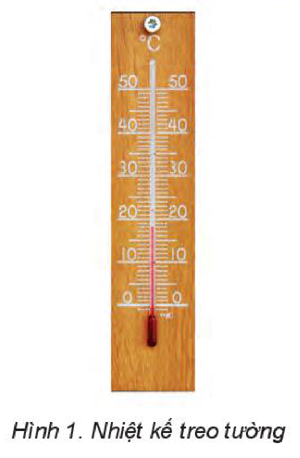
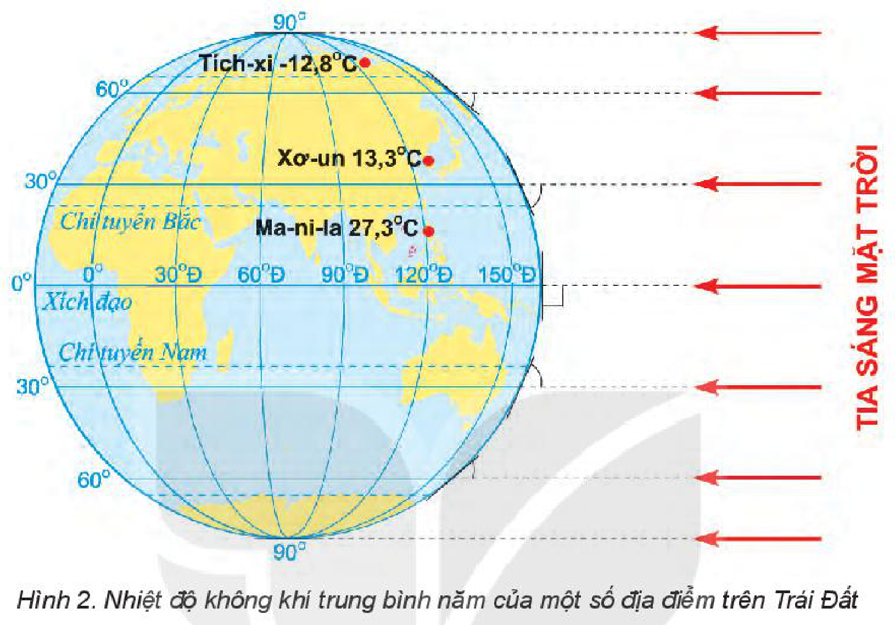
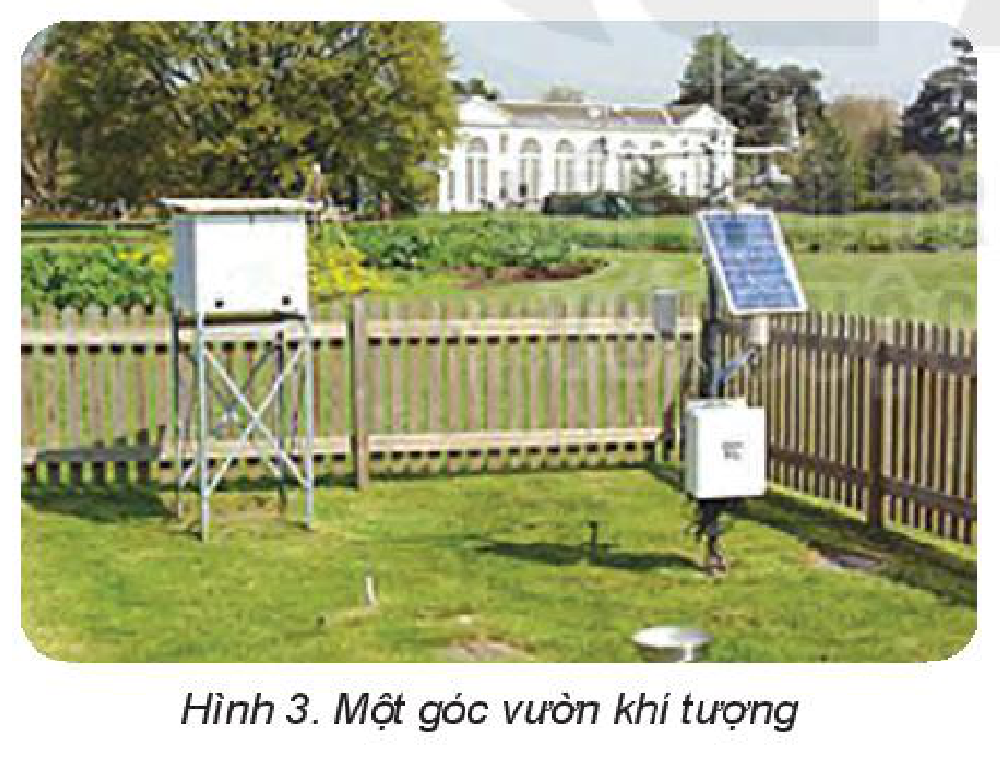
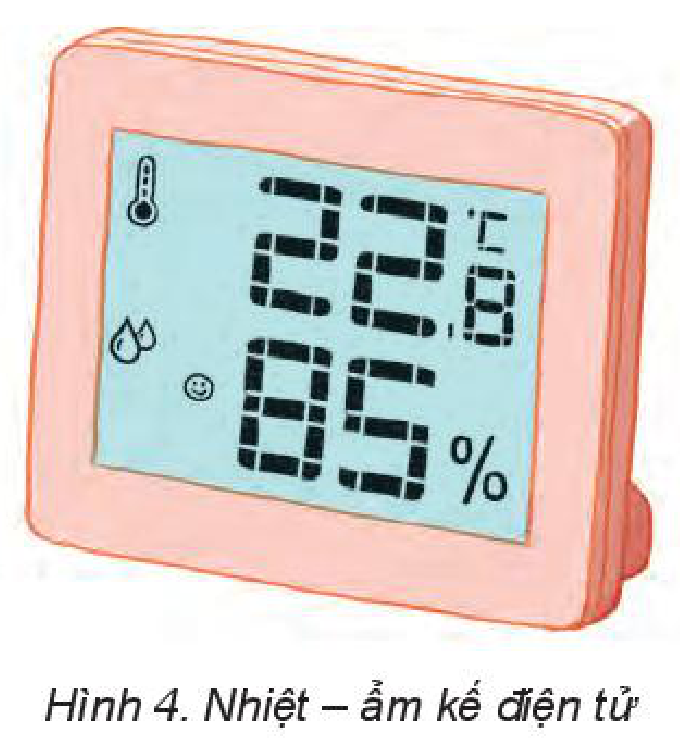
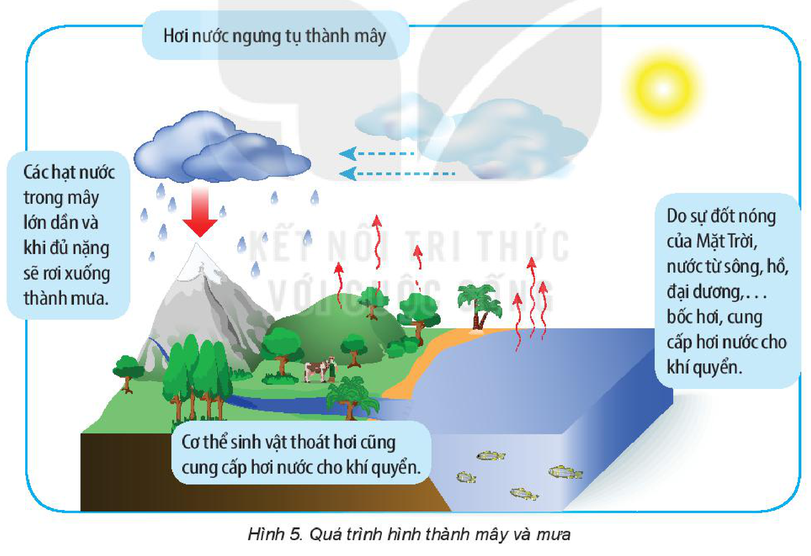
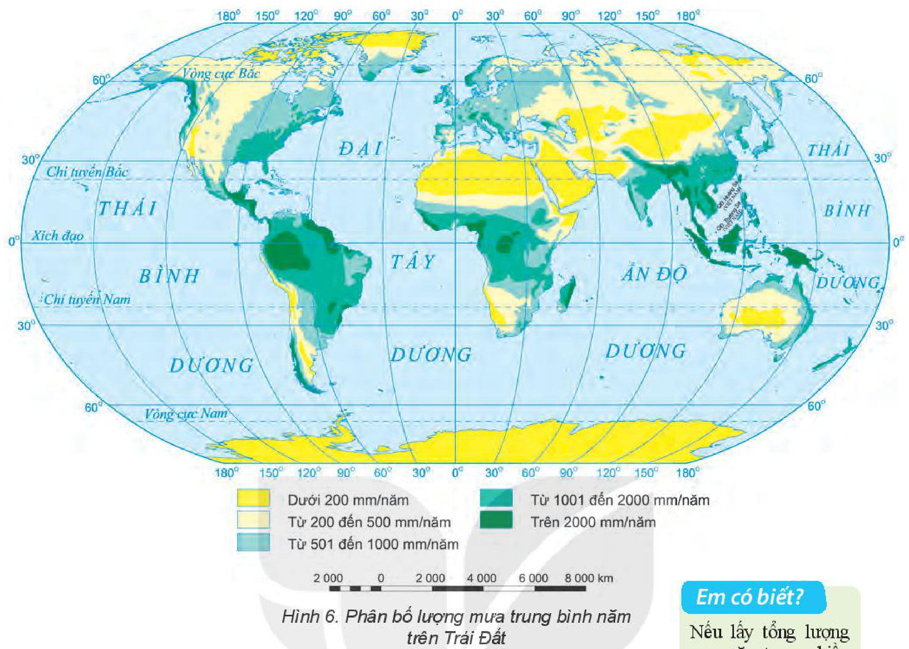

<!-- pdf:147 -->

# BÀI 16: NHIỆT ĐỘ KHÔNG KHÍ. MÂY VÀ MƯA

## 🎯 Học xong bài này, em sẽ:

- Trình bày được sự thay đổi nhiệt độ không khí trên bề mặt Trái Đất theo vĩ độ.
- Mô tả được hiện tượng hình thành mây và mưa.
- Biết cách sử dụng nhiệt kế, ẩm kế.

## 🔴 Mở đầu

Nhiệt độ không khí và mưa có vai trò hết sức quan trọng đối với đời sống và sản xuất. Nhiệt độ không khí và mưa do đâu mà có? Tại sao nhiệt độ không khí và mưa lại khác nhau ở mọi nơi trên Trái Đất?

## 1. Nhiệt độ không khí

### a) Nhiệt độ không khí và cách sử dụng nhiệt kế

<!-- term: Nhiệt độ không khí -->
Mặt Trời là nguồn cung cấp ánh sáng và nhiệt cho Trái Đất. Các tia sáng mặt trời đi qua khí quyển làm nhiệt độ không khí nóng lên không đáng kể. Chỉ khi bề mặt đất hấp thụ nhiệt của Mặt Trời rồi phản hồi lại vào không khí thì lúc đó không khí mới nóng lên rõ rệt.

<!-- term: Nhiệt độ không khí -->
Độ nóng, lạnh của không khí được gọi là nhiệt độ không khí. Đơn vị đo nhiệt độ không khí được dùng phổ biến là độ C (°C).

<!-- term: Nhiệt kế -->
Dụng cụ đo nhiệt độ không khí là nhiệt kế. Có hai loại nhiệt kế thường dùng là nhiệt kế có bầu thuỷ ngân (hoặc rượu) và nhiệt kế điện tử.

Ở các trạm khí tượng, nhiệt kế được đặt trong lều khí tượng sơn màu trắng (hình 3), cách mặt đất 1,5 m. Nhiệt độ không khí được đo ít nhất 4 lần trong ngày (ở Việt Nam vào các thời điểm: 1, 7, 13, 19 giờ).

<!-- term: Nhiệt độ trung bình ngày -->
<!-- term: Nhiệt độ trung bình tháng -->
<!-- term: Nhiệt độ trung bình năm -->
> 💡 **Em có biết?**
>
> Nhiệt độ trung bình ngày là giá trị trung bình của 4 lần đo trong ngày. Nhiệt độ trung bình tháng là giá trị trung bình của nhiệt độ các ngày trong tháng. Nhiệt độ trung bình năm là giá trị trung bình của nhiệt độ 12 tháng trong năm.

> ❓ 1. Em hãy đọc giá trị nhiệt độ không khí hiển thị trên nhiệt kế ở hình 1.
>
> 2. Ở trạm khí tượng Láng (Hà Nội), kết quả đo nhiệt độ ở bốn thời điểm trong ngày 25 tháng 7 năm 2019 lần lượt là 27°C, 27°C, 32°C, 30°C. Hãy cho biết nhiệt độ không khí trung bình của ngày hôm đó.

<!-- pdf:148 -->

### b) Sự thay đổi nhiệt độ không khí trên bề mặt Trái Đất theo vĩ độ

<!-- term: Sự thay đổi nhiệt độ không khí theo vĩ độ -->
Không khí ở các vùng vĩ độ thấp nóng hơn không khí ở các vùng vĩ độ cao. Ở các vùng vĩ độ thấp quanh năm có góc chiếu của tia sáng mặt trời với mặt đất lớn nên nhận được nhiều nhiệt, không khí trên mặt đất nóng. Càng lên gần cực, góc chiếu của tia sáng mặt trời càng nhỏ, mặt đất nhận được ít nhiệt hơn, không khí trên mặt đất cũng ít nóng hơn.

> ❓ Quan sát hình 2 và đọc thông tin mục 1b), em hãy nhận xét sự thay đổi nhiệt độ không khí trung bình năm giữa các địa điểm. Giải thích nguyên nhân của sự thay đổi đó.

## 2. Mây và mưa

### a) Quá trình hình thành mây và mưa. Cách sử dụng ẩm kế

<!-- term: Độ ẩm không khí -->
<!-- term: Ẩm kế -->
<!-- term: Bão hoà hơi nước -->
Không khí liên tục được cung cấp hơi nước do quá trình bốc hơi từ đại dương và bề mặt đất. Vì vậy, trong không khí bao giờ cũng chứa một lượng hơi nước nhất định, tạo nên độ ẩm không khí. Dụng cụ để đo độ ẩm không khí gọi là ẩm kế, đơn vị thường dùng là %. Tuy nhiên, sức chứa hơi nước của không khí là có hạn. Khi không khí đã chứa được lượng hơi nước tối đa, không thể chứa thêm được nữa, người ta nói không khí đã bão hoà hơi nước (độ ẩm là 100%).

<!-- pdf:149 -->

<!-- term: Hơi nước ngưng tụ -->
<!-- term: Mây -->
Nếu không khí đã bão hoà hơi nước mà vẫn tiếp tục được bổ sung hơi nước hoặc bị lạnh đi thì sẽ xảy ra hiện tượng hơi nước ngưng tụ thành các hạt nước nhỏ, nhẹ. Các hạt nước này tập hợp lại thành từng đám gọi là mây.

> ❓ 1. Cho biết giá trị độ ẩm không khí hiển thị trên hình 4. Còn bao nhiêu % nữa thì độ ẩm không khí sẽ đạt mức bão hoà?
>
> 2. Đọc thông tin trong mục a và quan sát hình 5, em hãy mô tả quá trình hình thành mây và mưa. Gợi ý:
>
> - Hơi nước trong không khí được cung cấp từ những nguồn nào?
> - Khi nào hơi nước ngưng tụ thành mây?
> - Khi nào mây tạo thành mưa?

### b) Sự phân bố lượng mưa trung bình năm trên Trái Đất

Lượng mưa trung bình năm phân bố không đều trên bề mặt Trái Đất. Trong khi phần lớn khu vực Xích đạo có lượng mưa trên 2 000 mm/năm, thì hầu hết khu vực chí tuyến và vùng cực chỉ có lượng mưa dưới 500 mm/năm. Lượng mưa ở vùng ôn đới thay đổi tuỳ khu vực, dao động từ 500 đến hơn 1 000 mm/năm.

<!-- pdf:150 -->

<!-- term: Lượng mưa trung bình năm -->
> 💡 **Em có biết?**
>
> Nếu lấy tổng lượng mưa năm trong nhiều năm của một địa phương cộng lại, rồi chia cho số năm sẽ có lượng mưa trung bình năm của địa phương đó.

> ❓ Hãy xác định trên bản đồ hình 6:
>
> - Những vùng có lượng mưa trung bình năm trên 2 000 mm.
> - Những vùng có lượng mưa trung bình năm dưới 200 mm.

## ✏️ Luyện tập và Vận dụng

1. Cho bảng số liệu sau:

NHIỆT ĐỘ TRUNG BÌNH CÁC THÁNG CỦA TRẠM KHÍ TƯỢNG A
*(Đơn vị: °C)*

| Tháng | 1 | 2 | 3 | 4 | 5 | 6 | 7 | 8 | 9 | 10 | 11 | 12 |
| --- | :---: | :---: | :---: | :---: | :---: | :---: | :---: | :---: | :---: | :---: | :---: | :---: |
| Nhiệt độ | 25,8 | 26,7 | 27,9 | 28,9 | 28,3 | 27,5 | 27,1 | 27,1 | 26,8 | 26,7 | 26,4 | 25,7 |

Tính nhiệt độ trung bình năm của trạm.

2. Em hãy nêu ví dụ cụ thể về ảnh hưởng của mưa đến sản xuất nông nghiệp và đời sống.
3. Theo dõi bản tin dự báo thời tiết trong một ngày. Cho biết nhiệt độ không khí cao nhất và nhiệt độ không khí thấp nhất, sự chênh lệch nhiệt độ trong ngày ở bản tin đó.

## 📷 Danh sách hình trong bài

| Mã hình | Trang PDF | Trang sách | Chú thích |
| --- | :---: | :---: | --- |
| H6-lich_su_va_dia_ly-dl-b16-01 | 147 | 146 | Hình 1. Nhiệt kế treo tường |
| H6-lich_su_va_dia_ly-dl-b16-02 | 148 | 147 | Hình 2. Nhiệt độ không khí trung bình năm của một số địa điểm trên Trái Đất |
| H6-lich_su_va_dia_ly-dl-b16-03 | 148 | 147 | Hình 3. Một góc vườn khí tượng |
| H6-lich_su_va_dia_ly-dl-b16-04 | 149 | 148 | Hình 4. Nhiệt – ẩm kế điện tử |
| H6-lich_su_va_dia_ly-dl-b16-05 | 149 | 148 | Hình 5. Quá trình hình thành mây và mưa |
| H6-lich_su_va_dia_ly-dl-b16-06 | 150 | 149 | Hình 6. Phân bố lượng mưa trung bình năm trên Trái Đất |
