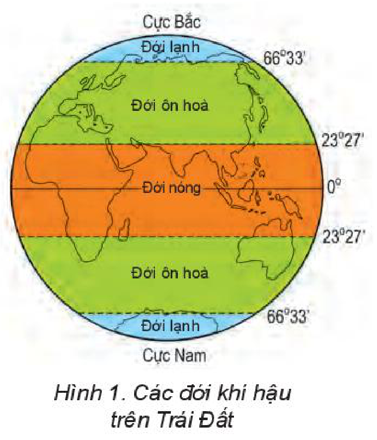
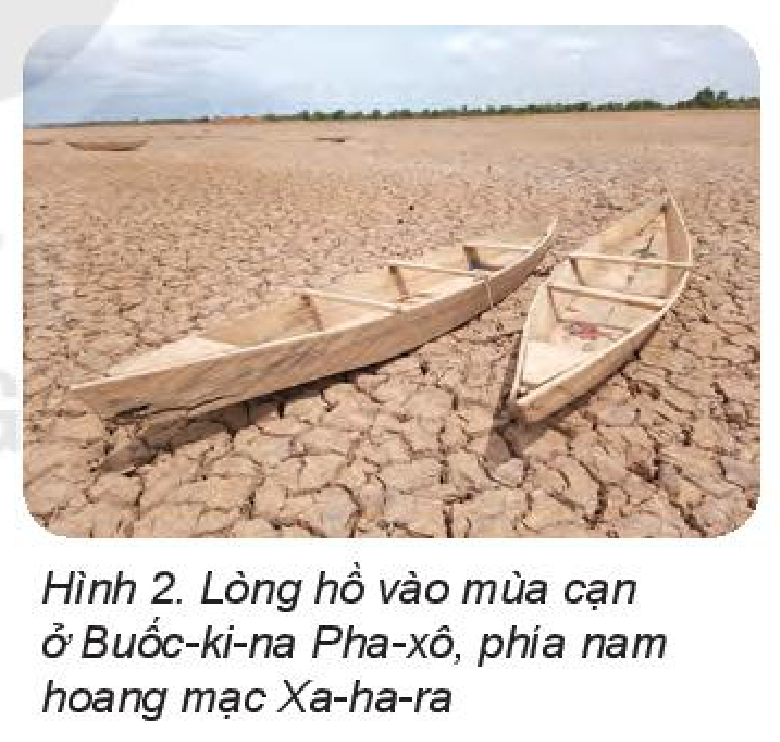
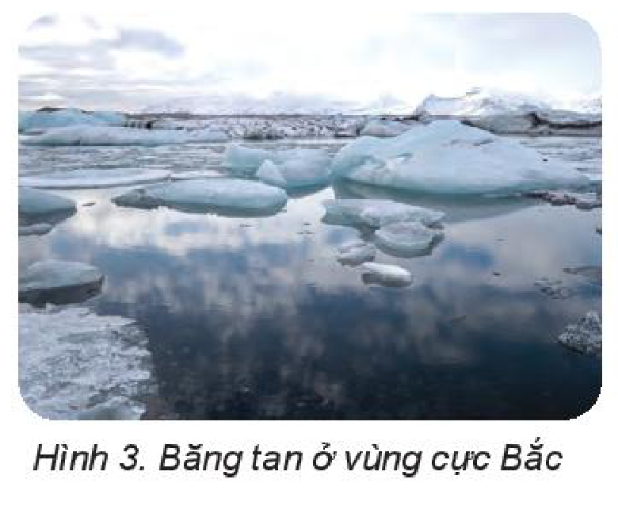

<!-- pdf:151 -->

# BÀI 17: THỜI TIẾT VÀ KHÍ HẬU. BIẾN ĐỔI KHÍ HẬU

## 🎯 Học xong bài này, em sẽ:

- Phân biệt được thời tiết và khí hậu.
- Trình bày được khái quát đặc điểm của một trong các đới khí hậu trên Trái Đất.
- Nêu được một số biểu hiện của biến đổi khí hậu.
- Trình bày được một số biện pháp phòng tránh thiên tai và ứng phó với biến đổi khí hậu.

## 🔴 Mở đầu

Vào một ngày có nắng nhẹ, không mưa
<!-- ocr-ok: đã đối chiếu ảnh trang gốc p151 (trang sách 150), chữ uốn cong trong tranh mở đầu -->

- Khí hậu hôm nay thật là đẹp!
- Thời tiết hôm nay thật là đẹp!

Theo em, bạn nào nói đúng?

## 1. Khái niệm về thời tiết và khí hậu

**Thời tiết** là trạng thái của khí quyển tại một thời điểm và khu vực cụ thể được xác định bằng nhiệt độ, độ ẩm, mưa, mây, gió,... Thời tiết luôn thay đổi.

*Dưới đây là một bản tin dự báo thời tiết ở một địa điểm:*

| Thời gian | Thứ Ba, 06/03/2018 | Thứ Tư, 07/03/2018 | Thứ Năm, 08/03/2018 | Thứ Sáu, 09/03/2018 |
| --- | :---: | :---: | :---: | :---: |
| Thời tiết | Mưa rào nhẹ | Có lúc có mưa | Có mưa | Ít mây, trời nắng |
| Nhiệt độ (°C) — thấp nhất | 21 | 23 | 18 | 17 |
| Nhiệt độ (°C) — cao nhất | 26 | 29 | 23 | 21 |
| Độ ẩm (%) | 80 | 75 | 77 | 65 |
| Gió | Đông bắc | Đông bắc | Đông bắc | Đông bắc |

<!-- term: Quan trắc khí tượng -->
> 💡 **Em có biết?**
>
> Người ta quan trắc nhiệt độ, độ ẩm, khí áp, gió, mây, mưa, các hiện tượng thời tiết,... tại các trạm khí tượng vào cùng những thời điểm nhất định trên toàn thế giới (ít nhất 4 lần, vào lúc 0, 6, 12, 18 giờ GMT).

> ❓ Dựa vào bản tin dự báo thời tiết ở trên, em hãy:
>
> - Nêu những yếu tố được sử dụng để biểu hiện thời tiết.
> - Mô tả đặc điểm thời tiết của từng ngày trong bảng.

**Khí hậu** ở một nơi là tổng hợp các yếu tố thời tiết (nhiệt độ, độ ẩm, lượng mưa, gió,...) của nơi đó, trong một thời gian dài và đã trở thành quy luật.

> ❓ Hãy cho biết, trong tình huống ở đầu bài, bạn nào là người nói đúng.

<!-- pdf:152 -->

## 2. Các đới khí hậu trên Trái Đất

<!-- term: Đới khí hậu -->
Trên Trái Đất có năm đới khí hậu:

<!-- term: Đới khí hậu -->
<!-- term: Đới nóng -->
<!-- term: Đới ôn hoà -->
<!-- term: Đới lạnh -->
- Đới nóng (nhiệt đới) quanh năm nóng, nhiệt độ trung bình năm không thấp hơn 20°C. Lượng mưa trung bình năm từ 1 000 mm đến trên 2 000 mm. Gió thổi thường xuyên là gió Mậu dịch.
- Hai đới ôn hoà (ôn đới) có nhiệt độ không khí trung bình năm dưới 20°C, tháng nóng nhất không thấp hơn 10°C. Các mùa trong năm rất rõ rệt. Lượng mưa trung bình năm dao động từ 500 mm đến 1 000 mm. Gió thổi thường xuyên là gió Tây ôn đới.
- Hai đới lạnh (hàn đới) là khu vực có băng tuyết hầu như quanh năm, nhiệt độ trung bình của tất cả các tháng trong năm đều dưới 10°C. Lượng mưa trung bình năm dưới 500 mm. Gió thổi thường xuyên là gió Đông cực.

> ❓ 1. Xác định trên hình 1 phạm vi của năm đới khí hậu trên Trái Đất.
>
> 2. Hãy lựa chọn và trình bày khái quát đặc điểm của một đới khí hậu.

## 3. Biến đổi khí hậu

### a) Biểu hiện của biến đổi khí hậu

<!-- term: Biến đổi khí hậu -->
Biến đổi khí hậu là sự thay đổi của khí hậu trong một khoảng thời gian dài do tác động của các điều kiện tự nhiên và hoạt động của con người, biểu hiện bởi sự nóng lên toàn cầu, mực nước biển dâng và gia tăng các hiện tượng khí tượng thuỷ văn cực đoan. Ngày nay, biến đổi khí hậu diễn ra ngày càng nhanh, do con người đưa vào khí quyển ngày càng nhiều khí nhà kính (carbonic, metan,...).

> ❓ Dựa vào thông tin trong mục a và hình 2, 3, em hãy nêu một số biểu hiện của biến đổi khí hậu.

### b) Phòng tránh thiên tai và ứng phó với biến đổi khí hậu

<!-- term: Phòng tránh thiên tai -->
Biến đổi khí hậu làm cho thiên tai xảy ra ngày càng nhiều và khốc liệt. Để phòng tránh thiên tai hiệu quả, chúng ta cần thực hiện một số yêu cầu: Trước khi thiên tai xảy ra cần có các biện pháp chủ động phòng ngừa (gia cố nhà cửa, bảo quản đồ đạc, sơ tán người và tài sản,...); khi thiên tai xảy ra cần theo dõi để ứng phó kịp thời, đảm bảo an toàn cá nhân...;

<!-- pdf:153 -->

<!-- term: Phòng tránh thiên tai -->
sau khi thiên tai xảy ra cần nhanh chóng khắc phục hậu quả (dọn dẹp, vệ sinh, phòng chống dịch bệnh,...).

Có những hành động rất nhỏ nhưng đóng góp vào việc giảm lượng khí nhà kính đưa vào khí quyển, qua đó làm giảm nhẹ biến đổi khí hậu như: sử dụng tiết kiệm và hiệu quả năng lượng, sử dụng phương tiện giao thông công cộng, hạn chế dùng túi ni-lông, tích cực trồng cây xanh, bảo vệ rừng,...

Tăng cường áp dụng những thành tựu của khoa học công nghệ vào cuộc sống để hạn chế những tác động của thiên tai cũng như thích ứng với biến đổi khí hậu.

Tích cực tuyên truyền về bảo vệ môi trường và phòng chống thiên tai cho bạn bè, người thân và cộng đồng dân cư để có nhận thức đầy đủ về nguyên nhân, hậu quả của thiên tai và biến đổi khí hậu.

> ❓ 1. Nêu một số biện pháp để sử dụng tiết kiệm và hiệu quả năng lượng.
>
> 2. Dựa vào hình 4 và hiểu biết của bản thân, em hãy nêu một số biện pháp để giảm nhẹ biến đổi khí hậu.
>
> 3. Hãy nêu một số giải pháp cụ thể để phòng tránh bão.

## ✏️ Luyện tập và Vận dụng

1. Trình bày khái quát đặc điểm khí hậu của đới ôn hoà (ôn đới) hoặc đới lạnh (hàn đới).
2. Cuối tuần, lớp em dự định tổ chức đi dã ngoại một ngày. Đài khí tượng thuỷ văn có dự báo thời tiết ngày hôm đó như sau: nhiệt độ thấp nhất là 15°C, nhiệt độ cao nhất là 23°C; sáng sớm có sương mù, trời lạnh; trưa chiều hửng nắng, có lúc có mưa. Em cần chuẩn bị những gì để phù hợp với thời tiết của buổi dã ngoại đó?

Chọn một trong hai nhiệm vụ sau:

3. Em hãy nêu một số hoạt động mà bản thân và gia đình có thể làm để góp phần ứng phó với biến đổi khí hậu.
4. Em hãy chuẩn bị một số nội dung để tuyên truyền về biến đổi khí hậu và ứng phó với biến đổi khí hậu cho gia đình cũng như những người xung quanh.

## 📷 Danh sách hình trong bài

| Mã hình | Trang PDF | Trang sách | Chú thích |
| --- | :---: | :---: | --- |
| H6-lich_su_va_dia_ly-dl-b17-01 | 151 | 150 | (sách không đánh số, tranh tình huống mở đầu phân biệt thời tiết và khí hậu) |
| H6-lich_su_va_dia_ly-dl-b17-02 | 152 | 151 | Hình 1. Các đới khí hậu trên Trái Đất |
| H6-lich_su_va_dia_ly-dl-b17-03 | 152 | 151 | Hình 2. Lòng hồ vào mùa cạn ở Buốc-ki-na Pha-xô, phía nam hoang mạc Xa-ha-ra |
| H6-lich_su_va_dia_ly-dl-b17-04 | 152 | 151 | Hình 3. Băng tan ở vùng cực Bắc |
| H6-lich_su_va_dia_ly-dl-b17-05 | 153 | 152 | Hình 4. Một số cách để giảm nhẹ biến đổi khí hậu |
