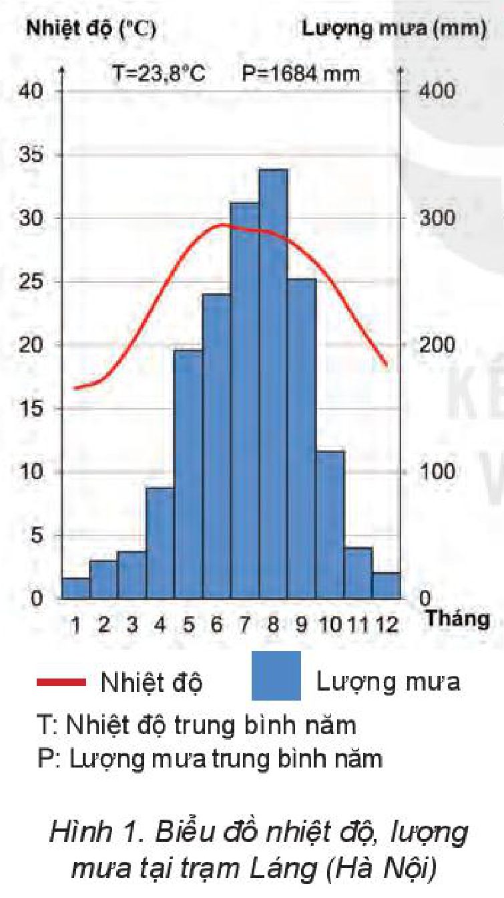
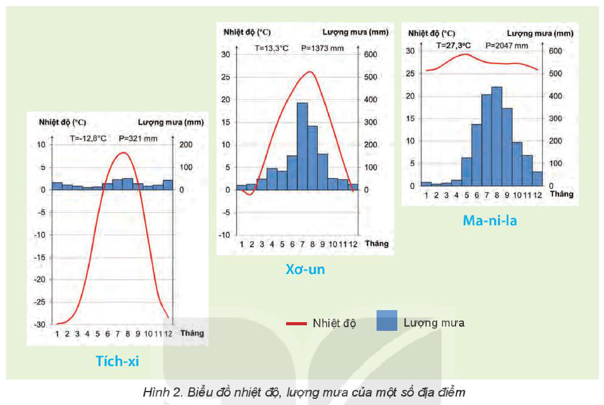
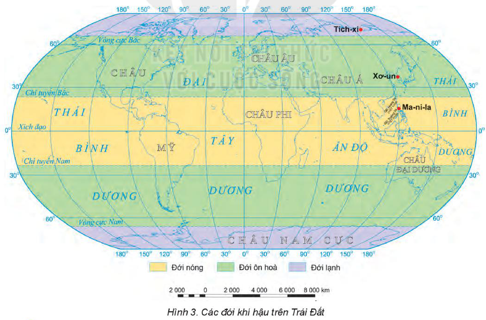

<!-- pdf:154 -->

# BÀI 18: THỰC HÀNH: PHÂN TÍCH BIỂU ĐỒ NHIỆT ĐỘ, LƯỢNG MƯA

## 🎯 Học xong bài này, em sẽ:

- Phân tích được biểu đồ nhiệt độ, lượng mưa.
- Xác định được đặc điểm về nhiệt độ và lượng mưa của một số địa điểm trên bản đồ khí hậu thế giới.

## 1. Hướng dẫn đọc biểu đồ nhiệt độ, lượng mưa

<!-- term: Biểu đồ nhiệt độ, lượng mưa -->
Quan sát hình 1, em hãy cho biết:

<!-- term: Biểu đồ nhiệt độ, lượng mưa -->
- Trục bên tay trái thể hiện yếu tố nào. Đơn vị đo của yếu tố đó.
- Trục bên tay phải thể hiện yếu tố nào. Đơn vị đo của yếu tố đó.
- Biểu đồ cột màu xanh thể hiện cho yếu tố nào.
- Đường biểu diễn màu đỏ thể hiện cho yếu tố nào.
- Trục ngang thể hiện yếu tố nào.

## 2. Nội dung thực hành

Quan sát hình 2, 3, em hãy:

<!-- term: Biểu đồ nhiệt độ, lượng mưa -->
- Xác định vị trí của các địa điểm trên bản đồ (thuộc đới khí hậu nào).
- Hoàn thành bảng gợi ý theo mẫu sau vào vở để đọc được biểu đồ nhiệt độ, lượng mưa của Tích-xi, Xơ-un, Ma-ni-la.

| Chỉ tiêu | Tích-xi | Xơ-un | Ma-ni-la |
| --- | --- | --- | --- |
| **Về nhiệt độ** | | | |
| Nhiệt độ tháng cao nhất (°C) | | | |
| Nhiệt độ tháng thấp nhất (°C) | | | |
| Biên độ nhiệt độ năm (°C) | | | |
| Nhiệt độ trung bình năm (°C) | | | |
| **Về lượng mưa** | | | |
| Lượng mưa tháng cao nhất (mm) | | | |
| Lượng mưa tháng thấp nhất (mm) | | | |
| Lượng mưa trung bình năm (mm) | | | |

- Nêu đặc điểm về nhiệt độ, lượng mưa của ba địa điểm trên.

<!-- pdf:155 -->

## 📷 Danh sách hình trong bài

| Mã hình | Trang PDF | Trang sách | Chú thích |
| --- | :---: | :---: | --- |
| H6-lich_su_va_dia_ly-dl-b18-01 | 154 | 153 | Hình 1. Biểu đồ nhiệt độ, lượng mưa tại trạm Láng (Hà Nội) |
| H6-lich_su_va_dia_ly-dl-b18-02 | 155 | 154 | Hình 2. Biểu đồ nhiệt độ, lượng mưa của một số địa điểm |
| H6-lich_su_va_dia_ly-dl-b18-03 | 155 | 154 | Hình 3. Các đới khí hậu trên Trái Đất |
