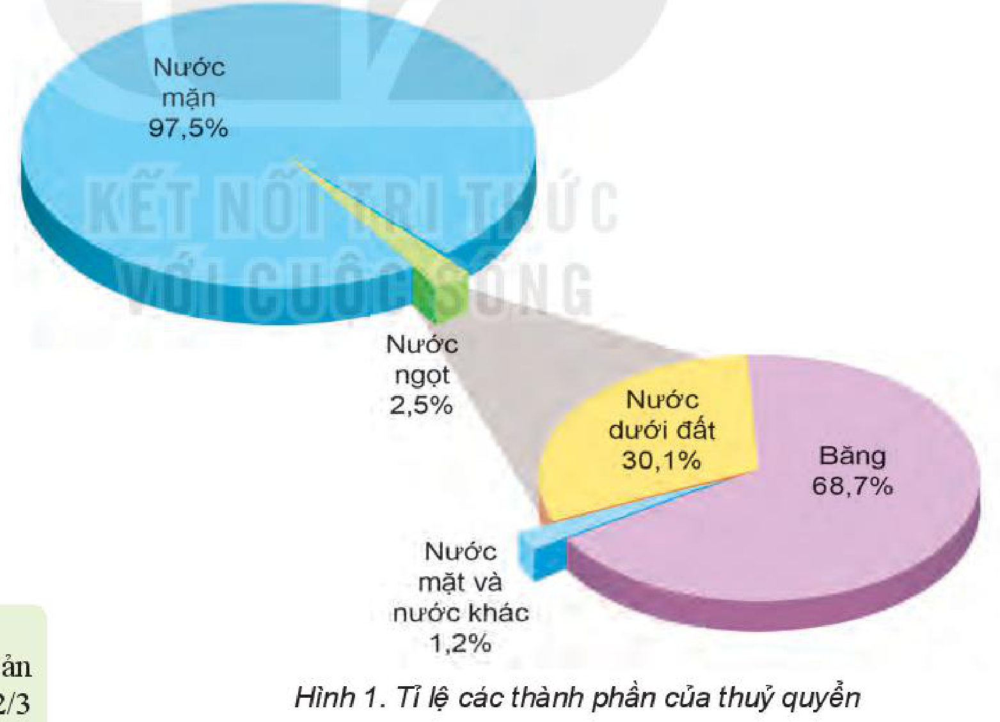
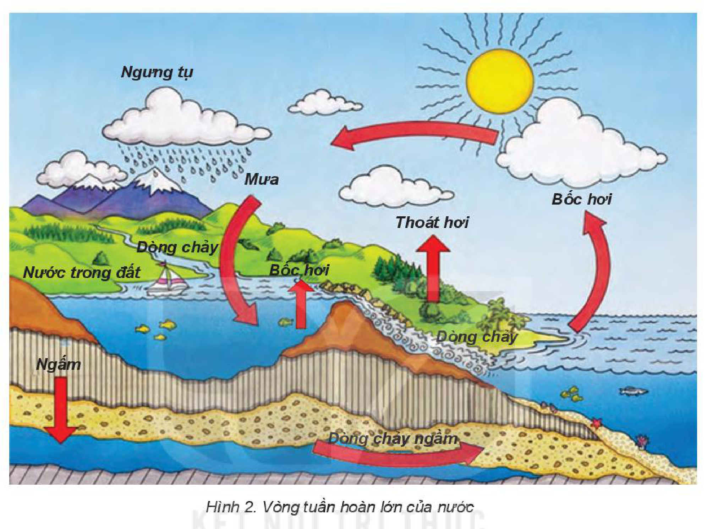

<!-- pdf:157 -->

# BÀI 19: THUỶ QUYỂN VÀ VÒNG TUẦN HOÀN LỚN CỦA NƯỚC

## 🎯 Học xong bài này, em sẽ:

- Kể tên được các thành phần chủ yếu của thuỷ quyển.
- Mô tả được vòng tuần hoàn lớn của nước.
- Có ý thức sử dụng hợp lí và bảo vệ tài nguyên nước.

## 🔴 Mở đầu

- Nước có ở sông, hồ, ao, biển.
- Cậu nói đúng, nhưng vẫn còn thiếu!
- ???
<!-- ocr-ok: đã đối chiếu ảnh trang gốc PDF 157, bóng thoại trong hộp Mở đầu -->

Theo em, nước còn có ở những nơi nào nữa?

## 1. Thuỷ quyển

**Thuỷ quyển** là toàn bộ lớp nước bao quanh Trái Đất, nằm trên bề mặt và bên trong của vỏ Trái Đất; gồm nước ở các đại dương, biển, sông, hồ, đầm lầy, nước dưới đất (nước ngầm), tuyết, băng và hơi nước trong khí quyển,...

*Hình 1. Tỉ lệ các thành phần của thuỷ quyển*

> **Em có biết?**
>
> Nước là nhu cầu cơ bản của sự sống. Hơn 2/3 bề mặt Trái Đất được bao phủ bởi nước. Tuy nhiên, lượng nước ngọt có thể sử dụng cho sinh hoạt và sản xuất lại rất ít và ngày càng suy giảm về chất lượng.

> ❓ Quan sát hình 1 và đọc thông tin trong mục 1, em hãy:
> - Kể tên các thành phần chủ yếu của thuỷ quyển.
> - Cho biết nước ngọt tồn tại dưới những dạng nào. Nêu tỉ lệ của từng dạng.

<!-- pdf:158 -->

## 2. Vòng tuần hoàn lớn của nước

<!-- term: Vòng tuần hoàn lớn của nước -->
Nước trong thiên nhiên không ngừng vận động và chuyển từ trạng thái này sang trạng thái khác, tạo nên vòng tuần hoàn. Nước luôn di chuyển giữa đại dương, lục địa và khí quyển.

*Hình 2. Vòng tuần hoàn lớn của nước*

> ❓ Quan sát sơ đồ hình 2 và kết hợp với hiểu biết của em, hãy:
> - Cho biết nước mưa rơi xuống bề mặt đất sẽ tồn tại ở những đâu.
> - Mô tả vòng tuần hoàn lớn của nước.

<!-- term: Các quá trình chuyển trạng thái của nước -->
> **Em có biết?**
>
> Các quá trình chuyển trạng thái của nước bao gồm: lỏng thành hơi là bốc hơi, hơi thành lỏng là ngưng tụ, rắn chuyển thành lỏng là tan chảy, lỏng thành rắn là đông đặc,...
<!-- ocr-ok: đã đối chiếu ảnh trang gốc PDF 158, hộp Em có biết? xếp hai cột cạnh câu hỏi -->

## ✏️ Luyện tập và Vận dụng

1. Nước trong các sông, hồ có tham gia vào vòng tuần hoàn lớn của nước không? Vì sao?
2. Nguồn nước ngọt ở Việt Nam đang bị ô nhiễm nghiêm trọng. Em hãy tìm hiểu và cho biết, tình trạng đó dẫn đến những hậu quả gì.

## 📷 Danh sách hình trong bài

| Mã hình | Trang PDF | Vị trí trong bài | Chú thích gốc |
| --- | --- | --- | --- |
| H6-lich_su_va_dia_ly-dl-b19-01 | 157 | Mục 1 (cạnh hộp Em có biết?: góc dưới bên trái khung chạm nhẹ hộp thông tin bố trí sát dưới biểu đồ tròn) | Hình 1. Tỉ lệ các thành phần của thuỷ quyển |
| H6-lich_su_va_dia_ly-dl-b19-02 | 158 | Mục 2 | Hình 2. Vòng tuần hoàn lớn của nước |
