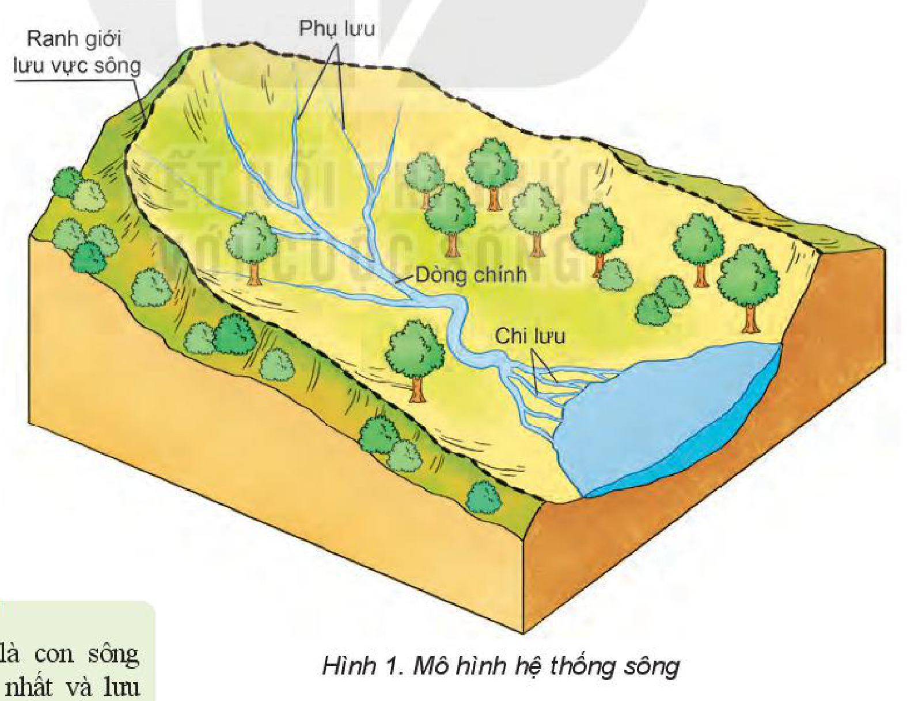
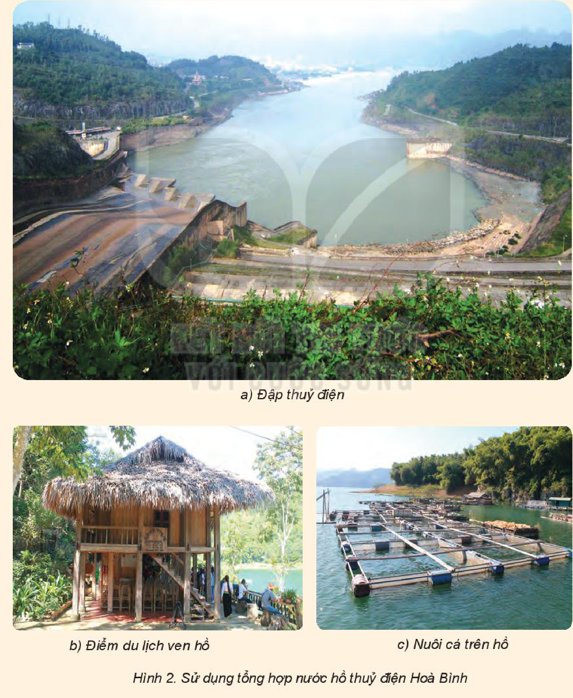
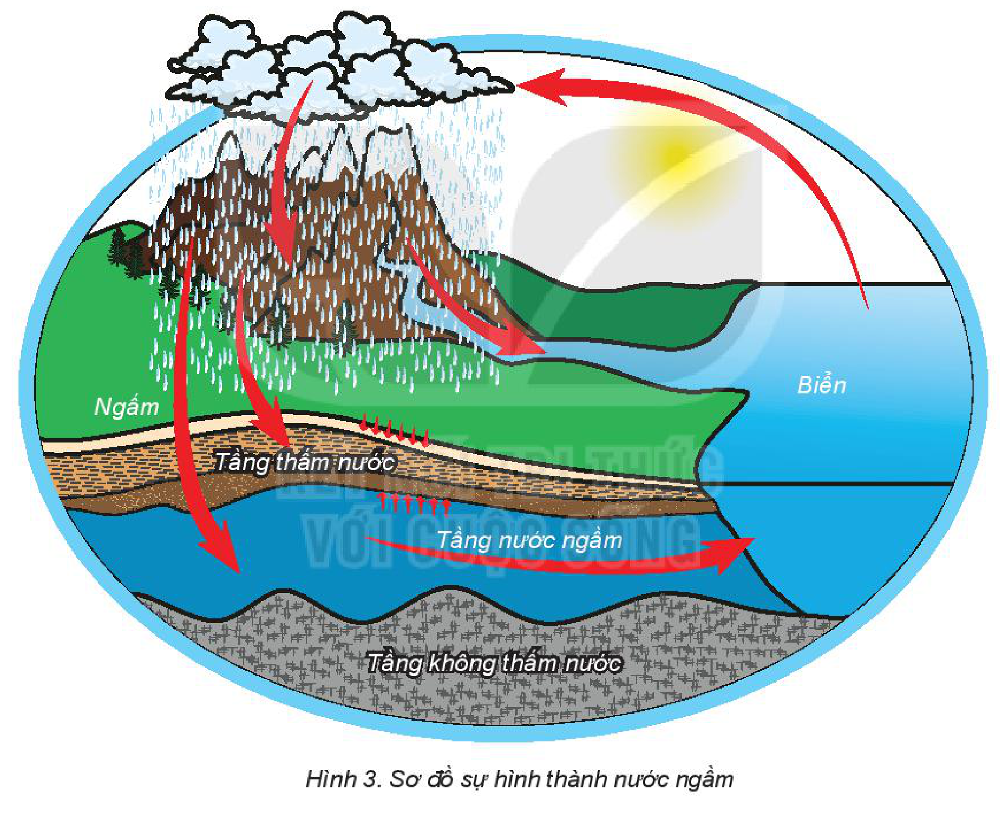
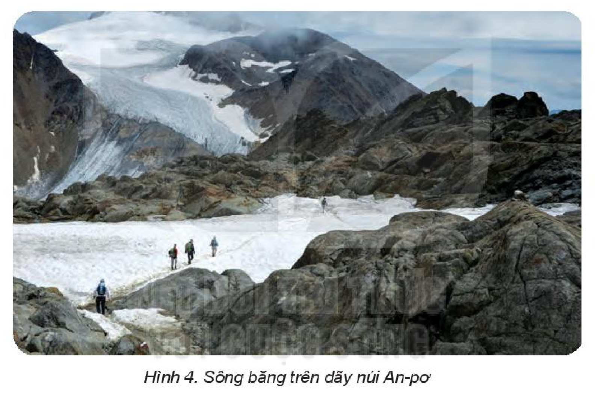

<!-- pdf:159 -->

# BÀI 20: SÔNG VÀ HỒ. NƯỚC NGẦM VÀ BĂNG HÀ

## 🎯 Học xong bài này, em sẽ:

- Mô tả được các bộ phận của một dòng sông lớn, mối quan hệ giữa mùa lũ của sông với các nguồn cấp nước sông.
- Nêu được tầm quan trọng của việc sử dụng tổng hợp nước sông, hồ.
- Nêu được tầm quan trọng của nước ngầm và băng hà.
- Có ý thức sử dụng hợp lí và bảo vệ nước sông, hồ, nước ngầm và băng hà.

## 🔴 Mở đầu

Nước sông, hồ, nước ngầm và băng hà là nguồn nước ngọt chính trên Trái Đất. Các nguồn nước này có vai trò như thế nào đối với tự nhiên và đời sống con người? Làm thế nào để sử dụng chúng đạt hiệu quả cao?

## 1. Sông, hồ

### a) Sông

**Sông** là dòng chảy thường xuyên tương đối lớn trên bề mặt lục địa và đảo, được các nguồn nước mưa, nước ngầm, nước băng tuyết tan nuôi dưỡng.

Mỗi con sông đều có một vùng đất cung cấp nước thường xuyên cho nó gọi là **lưu vực sông**. Một **hệ thống sông** gồm sông chính, **phụ lưu** là sông đổ nước vào sông chính và **chi lưu** là các sông thoát nước cho sông chính.

*Hình 1. Mô hình hệ thống sông*

> **Em có biết?**
>
> Sông A-ma-dôn là con sông có lưu vực rộng nhất và lưu lượng nước nhiều nhất thế giới. Vào mùa lũ, chỗ rộng nhất của sông có thể lên đến hơn 40 km. Vì thế, người ta còn gọi nó là "sông biển".

> ❓ 1. Đọc thông tin trong mục a và quan sát hình 1, em hãy mô tả các bộ phận của một dòng sông lớn.
>
> 2. Em hãy nêu mối quan hệ giữa mùa lũ của sông với nguồn cung cấp nước sông.

<!-- pdf:160 -->

Trong một năm, mực nước sông thường thay đổi theo mùa. Vào **mùa lũ** mực nước trong lòng sông dâng cao, vào **mùa cạn** mực nước trong lòng sông hạ thấp. Với những sông có nguồn cung cấp nước chủ yếu từ mưa thì mùa lũ trùng với mùa mưa, mùa cạn trùng với mùa khô. Với những sông có nguồn cung cấp nước chủ yếu là tuyết tan thì mùa lũ trùng với mùa xuân, còn những sông có nguồn cung cấp nước chủ yếu từ băng tan thì mùa lũ vào đầu mùa hạ.

Những sông có nhiều nguồn cung cấp nước khác nhau thì mùa lũ phức tạp hơn.

Sông ngòi đem lại nhiều lợi ích cho con người, tuy nhiên cũng gây ra lụt lội ảnh hưởng đến sản xuất, gây thiệt hại về người và tài sản.

> **Em có biết?**
>
> **Hồ** là vùng trũng chứa nước trên bề mặt Trái Đất, không thông với biển. Các hồ trên Trái Đất khác nhau về nguồn gốc hình thành, hình dạng và kích thước.

*Hồ Cra-tơ ở Hoa Kỳ là hồ hình thành từ miệng núi lửa đã tắt gần 7 000 năm trước — Hồ Tây ở Hà Nội là hồ móng ngựa được hình thành từ một khúc uốn của sông Hồng*

### b) Sử dụng tổng hợp nước sông, hồ

Nước sông, hồ được con người sử dụng vào nhiều mục đích: giao thông, du lịch, nước cho sinh hoạt, tưới tiêu, đánh bắt và nuôi trồng thuỷ sản, làm thuỷ điện.

<!-- term: Sử dụng tổng hợp nước sông, hồ -->
Trước đây, nước sông, hồ chủ yếu được sử dụng vào các mục đích đơn lẻ (hoặc cho giao thông, hoặc để tưới tiêu, hoặc để nuôi trồng thuỷ sản,...) dẫn tới lãng phí, thiếu hiệu quả, gây ô nhiễm nguồn nước. Để khắc phục tình trạng đó, người ta đã sử dụng tổng hợp nước sông, hồ. Việc sử dụng tổng hợp nước sông, hồ sẽ mang lại hiệu quả kinh tế cao, hạn chế sự lãng phí nước và góp phần bảo vệ tài nguyên nước.

> ❓ 1. Em hãy cho biết nước sông, hồ có vai trò như thế nào đối với đời sống và sản xuất.
>
> 2. Đọc thông tin trong mục b, quan sát hình 2 và dựa vào hiểu biết của em, hãy cho biết việc sử dụng tổng hợp nước sông, hồ có thể mang lại những lợi ích gì. Nêu ví dụ.

<!-- pdf:161 -->

> **Em có biết?**
>
> Hồ thuỷ điện Hoà Bình được xây dựng tại tỉnh Hoà Bình, trên sông Đà. Đây là nhà máy thuỷ điện lớn nhất Việt Nam từ năm 1994 đến năm 2012. Hồ thuỷ điện Hoà Bình có nhiệm vụ phòng chống lũ lụt cho vùng đồng bằng sông Hồng; là nguồn cung cấp điện chủ lực cho điện lưới quốc gia; hồ góp phần quan trọng vào việc cung cấp nước tưới cho sản xuất nông nghiệp ở vùng hạ lưu sông Hồng; hồ cũng cải thiện việc đi lại bằng đường thuỷ ở cả thượng lưu và hạ lưu.

*a) Đập thuỷ điện — b) Điểm du lịch ven hồ — c) Nuôi cá trên hồ*
<!-- ocr-ok: đã đối chiếu ảnh trang gốc PDF 161, chú thích thành phần a, b, c của Hình 2 -->

*Hình 2. Sử dụng tổng hợp nước hồ thuỷ điện Hoà Bình*

<!-- pdf:162 -->

## 2. Nước ngầm (nước dưới đất)

**Nước ngầm** là nước nằm trong tầng chứa nước thường xuyên dưới bề mặt đất. Nước ngầm được tạo nên chủ yếu bởi nước mưa, nước sông, hồ,... thấm xuống đất.
<!-- ocr-ok: đã đối chiếu ảnh trang gốc PDF 162, OCR dính chữ không dấu cách ở đoạn đầu mục 2 -->

Lượng nước ngầm nhiều hay ít, mực nước ngầm nông hay sâu phụ thuộc vào địa hình, nguồn cung cấp nước và lượng bốc hơi,...

Nước ngầm là nguồn cung cấp nước sinh hoạt và nước tưới quan trọng trên thế giới. Nước ngầm góp phần ổn định dòng chảy của sông ngòi; đồng thời, cố định các lớp đất đá bên trên, ngăn chặn sự sụt lún.

> **Em có biết?**
>
> Nước ngầm từ xa xưa được con người khai thác để sử dụng trong sinh hoạt dưới dạng các giếng đào.

*Hình 3. Sơ đồ sự hình thành nước ngầm*

> ❓ 1. Dựa vào hình 3, em hãy cho biết nước ngầm được hình thành như thế nào.
>
> 2. Nước ngầm chủ yếu được sử dụng vào mục đích gì?
>
> 3. Nêu một số biện pháp sử dụng hợp lí và bảo vệ nước ngầm.

<!-- pdf:163 -->

## 3. Băng hà (sông băng)

Trên Trái Đất, 10% diện tích lục địa được bao phủ bởi băng hà. Trong đó, 99% khối lượng băng nằm tại châu Nam Cực và đảo Grơn-len, 1% còn lại thuộc về các sông băng phân bố rải rác trên núi cao của các lục địa (hình 4).

Băng hà góp phần điều hoà nhiệt độ trên Trái Đất, cung cấp nước cho các dòng sông.

Băng hà chiếm gần 70% trữ lượng nước ngọt của Trái Đất và ít bị ô nhiễm. Nguồn nước ngọt này ngày càng trở nên quan trọng, khi lượng nước sạch ở sông, hồ, nước ngầm đang suy giảm cả về số lượng và chất lượng.

> **Em có biết?**
>
> Vào thời kì băng phát triển nhất, mực nước biển thấp hơn hiện nay 120 m và gần 30% diện tích các lục địa bị các sông băng che lấp.

> ❓ Nêu vai trò của băng hà đối với tự nhiên và đời sống con người.

*Hình 4. Sông băng trên dãy núi An-pơ*

## ✏️ Luyện tập và Vận dụng

1. Em hãy kể tên các nguồn nước ngọt quan trọng trên Trái Đất và tầm quan trọng của chúng đối với con người.

Chọn một trong hai nhiệm vụ sau:

2. Thu thập thông tin và cho biết trong các sông: sông Đà, sông Luộc, sông Đuống, sông Lô, sông nào là phụ lưu, sông nào là chi lưu của sông Hồng.
3. Việc khai thác nước ngầm vượt quá giới hạn cho phép sẽ gây ra hậu quả như thế nào?

## 📷 Danh sách hình trong bài

| Mã hình | Trang PDF | Vị trí trong bài | Chú thích gốc |
| --- | --- | --- | --- |
| H6-lich_su_va_dia_ly-dl-b20-01 | 159 | Mục 1.a (góc dưới bên trái khung chạm nhẹ hộp Em có biết? bố trí sát dưới khối mô hình lưu vực sông) | Hình 1. Mô hình hệ thống sông |
| H6-lich_su_va_dia_ly-dl-b20-02 | 160 | Mục 1.a, hộp Em có biết? | Hồ Cra-tơ ở Hoa Kỳ là hồ hình thành từ miệng núi lửa đã tắt gần 7 000 năm trước; Hồ Tây ở Hà Nội là hồ móng ngựa được hình thành từ một khúc uốn của sông Hồng |
| H6-lich_su_va_dia_ly-dl-b20-03 | 161 | Mục 1.b | Hình 2. Sử dụng tổng hợp nước hồ thuỷ điện Hoà Bình |
| H6-lich_su_va_dia_ly-dl-b20-04 | 162 | Mục 2 | Hình 3. Sơ đồ sự hình thành nước ngầm |
| H6-lich_su_va_dia_ly-dl-b20-05 | 163 | Mục 3 | Hình 4. Sông băng trên dãy núi An-pơ |
