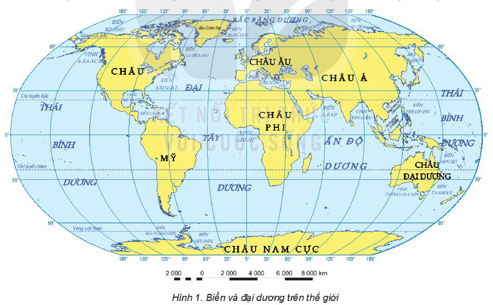
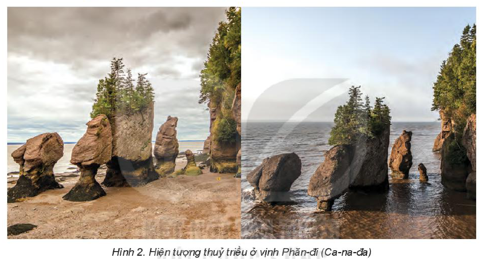
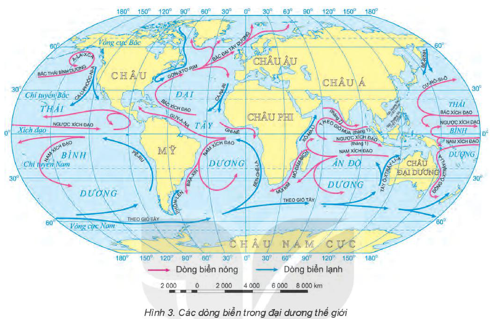

<!-- pdf:164 -->

# BÀI 21: BIỂN VÀ ĐẠI DƯƠNG

## 🎯 Học xong bài này, em sẽ:

- Xác định được trên bản đồ các đại dương thế giới.
- Nêu được sự khác biệt về nhiệt độ, độ muối giữa vùng biển nhiệt đới và vùng biển ôn đới.
- Trình bày được các hiện tượng sóng, thuỷ triều, dòng biển.

## 🔴 Mở đầu

Nước mặn chiếm 97,5% khối nước trên Trái Đất, gần như toàn bộ nằm trong các biển và đại dương. Nước trong các biển và đại dương có nhiệt độ và độ muối khác nhau theo vĩ độ và luôn vận động.

## 1. Đại dương thế giới

**Đại dương thế giới** là lớp nước liên tục, bao phủ hơn 70% diện tích bề mặt Trái Đất, bao gồm: Thái Bình Dương, Đại Tây Dương, Ấn Độ Dương và Bắc Băng Dương.

*Hình 1. Biển và đại dương trên thế giới*

> **Em có biết?**
>
> Tháng 6 năm 2021, Hiệp hội Địa lí Quốc gia Hoa Kỳ chính thức công nhận Nam Đại Dương (Nam Băng Dương) là đại dương thứ năm trên thế giới.
<!-- ocr-ok: đã đối chiếu ảnh trang gốc PDF 164, hộp Em có biết? xếp hai cột cuối trang -->

> ❓ Xác định vị trí các đại dương trên hình 1. Cho biết mỗi đại dương tiếp giáp với các châu lục nào.

<!-- pdf:165 -->

## 2. Độ muối, nhiệt độ của nước biển

### a) Độ muối

Nước ở biển và đại dương có vị mặn. **Độ muối** trung bình của nước đại dương là 35‰, tức là trung bình trong 1 ki-lô-gam nước đại dương có 35 gam muối.

Độ muối của nước trong các vùng biển không giống nhau, tuỳ thuộc vào lượng nước sông chảy vào nhiều hay ít, lượng mưa và độ bốc hơi lớn hay nhỏ,...

Ở vùng biển nhiệt đới, độ muối trung bình khoảng 35 – 36‰. Ở vùng biển ôn đới, độ muối trung bình khoảng 34 – 35‰.

> **Em có biết?**
>
> Lượng muối của đại dương thế giới nếu đem rải đều trên mặt lục địa sẽ tạo nên một lớp dày hơn 150 m.
>
> Ở đới lạnh, độ muối của nước biển thấp do nước băng tan và bốc hơi ít. Ở vùng chí tuyến, độ muối cao do lượng bốc hơi nhiều.

### b) Nhiệt độ

<!-- term: Nhiệt độ nước biển -->
Nhiệt độ trung bình bề mặt toàn bộ đại dương thế giới là khoảng 17°C. Nhiệt độ trung bình nước biển trên mặt ở vùng nhiệt đới, dao động từ 24 – 27°C, ở vùng ôn đới, dao động từ 16 – 18°C.

> ❓ Dựa vào thông tin trong mục 2, em hãy nhận xét sự thay đổi của độ muối và nhiệt độ giữa vùng biển nhiệt đới với vùng biển ôn đới.

## 3. Một số dạng vận động của nước biển và đại dương

### a) Sóng biển

<!-- term: Sóng biển -->
Đứng trên bờ biển, người ta thấy sóng ở ngoài khơi xô vào bờ, tạo cảm giác là nước di chuyển theo chiều ngang, nhưng thực chất nước chỉ dao động tại chỗ.

<!-- term: Sóng biển -->
Sóng biển chủ yếu được hình thành do tác động của gió. Gió thổi càng mạnh và thời gian càng lâu thì sóng biển càng lớn.

Khi ngoài khơi xảy ra động đất hay núi lửa ngầm có thể xuất hiện những sóng dài đơn độc, di chuyển nhanh, vào đến bờ có thể cao trên 20 m, gọi là **sóng thần**. Sóng thần là thiên tai khủng khiếp, gây thiệt hại nặng nề về người và tài sản ở vùng ven biển.

> **Em có biết?**
>
> Dấu hiệu sắp có sóng thần:
> - Chim chóc hoảng loạn bay ra biển.
> - Nước biển nổi bong bóng, có mùi khó chịu.
> - Mực nước biển hạ nhanh đột ngột.
>
> Biện pháp ứng phó:
> - Loan báo nguy cơ sóng thần cho người khác.
> - Nhanh chóng di chuyển xa khỏi bờ biển hoặc tới những chỗ cao ở xa bờ.

<!-- pdf:166 -->

### b) Thuỷ triều

**Thuỷ triều** là hiện tượng nước biển dâng cao và hạ thấp theo quy luật hằng ngày. Thuỷ triều hình thành do lực hút của Mặt Trăng và Mặt Trời cùng với lực li tâm của Trái Đất. Mỗi tháng có hai lần thuỷ triều lên, xuống lớn nhất (**triều cường**) là các ngày trăng tròn hoặc không trăng; đồng thời có hai lần thuỷ triều lên, xuống nhỏ nhất (**triều kém**) là các ngày trăng khuyết.

> **Em có biết?**
>
> Có nơi mỗi ngày thuỷ triều lên, xuống hai lần (**bán nhật triều**), có nơi thuỷ triều chỉ lên, xuống mỗi ngày một lần (**nhật triều**) hoặc không đều (có ngày một lần, có ngày hai lần).

> ❓ Đọc thông tin trong mục a, b và quan sát hình 2, em hãy trình bày hiện tượng sóng biển và hiện tượng thuỷ triều (biểu hiện, nguyên nhân,...).

*Hình 2. Hiện tượng thuỷ triều ở vịnh Phăn-đi (Ca-na-đa)*

### c) Dòng biển

**Dòng biển** là các dòng nước chảy trong biển và đại dương (giống như các dòng sông trên lục địa). Có hai loại dòng biển: **dòng biển nóng** (chảy từ vĩ độ thấp hơn đến vĩ độ cao hơn) và **dòng biển lạnh** (chảy từ vĩ độ cao hơn về vĩ độ thấp hơn). Dòng biển nóng hay lạnh là so với nhiệt độ nước biển xung quanh.

Dòng biển được hình thành chủ yếu do tác động của các loại gió thường xuyên trên bề mặt Trái Đất.

> **Em có biết?**
>
> Ở những vùng ven biển có dòng biển nóng chảy qua có khí hậu ấm áp, mưa nhiều hơn và ngược lại. Những nơi gặp gỡ của các dòng biển nóng và lạnh cũng là những nơi có nguồn hải sản phong phú.

> ❓ 1. Em hãy cho biết thế nào là dòng biển.
>
> 2. Dựa vào hình 3, em hãy kể tên hai dòng biển nóng và hai dòng biển lạnh ở Thái Bình Dương và Đại Tây Dương.

<!-- pdf:167 -->

*Hình 3. Các dòng biển trong đại dương thế giới*

## ✏️ Luyện tập và Vận dụng

1. Em hãy phân biệt ba dạng vận động của nước biển và đại dương: sóng, thuỷ triều và dòng biển.

Chọn một trong hai nhiệm vụ sau:

2. Sưu tầm thông tin về việc con người khai thác năng lượng từ sóng và thuỷ triều.
3. Hãy sưu tầm tư liệu về ảnh hưởng của dòng biển nóng và dòng biển lạnh đối với các vùng ven bờ nơi chúng chảy qua.

## 📷 Danh sách hình trong bài

| Mã hình | Trang PDF | Vị trí trong bài | Chú thích gốc |
| --- | --- | --- | --- |
| H6-lich_su_va_dia_ly-dl-b21-01 | 164 | Mục 1 | Hình 1. Biển và đại dương trên thế giới |
| H6-lich_su_va_dia_ly-dl-b21-02 | 166 | Mục 3.b | Hình 2. Hiện tượng thuỷ triều ở vịnh Phăn-đi (Ca-na-đa) |
| H6-lich_su_va_dia_ly-dl-b21-03 | 167 | Mục 3.c | Hình 3. Các dòng biển trong đại dương thế giới |
