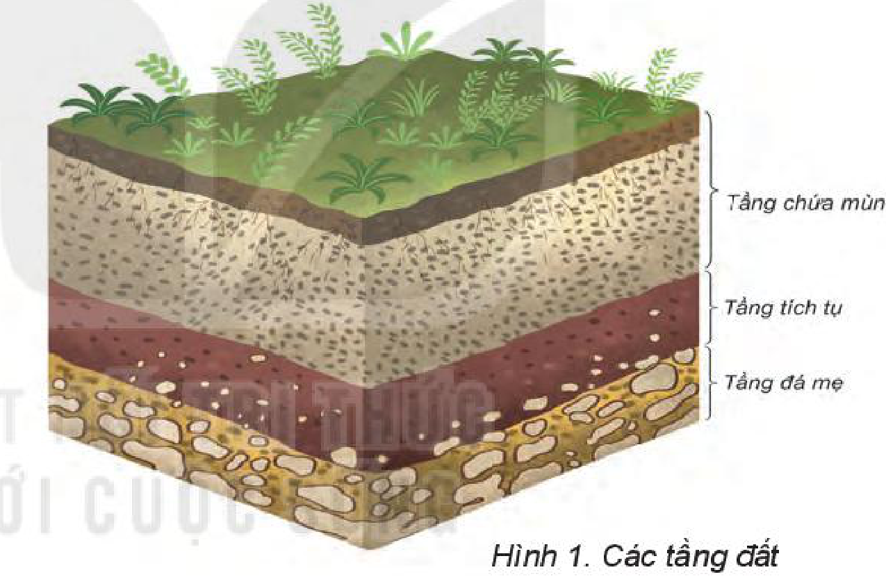
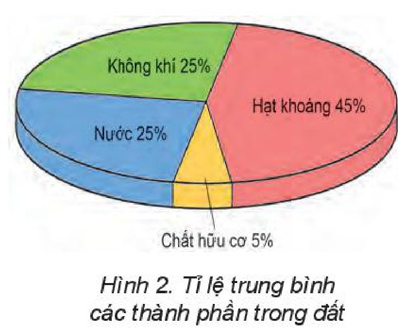
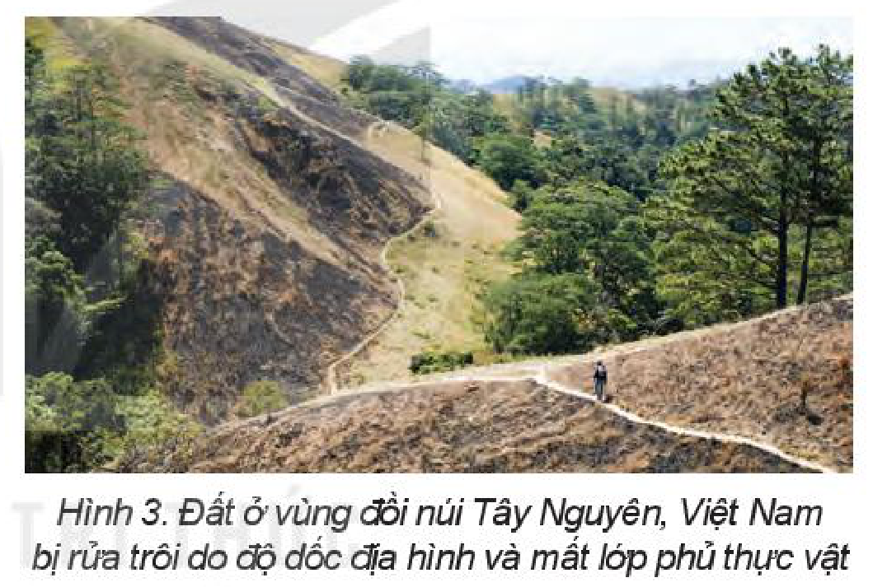
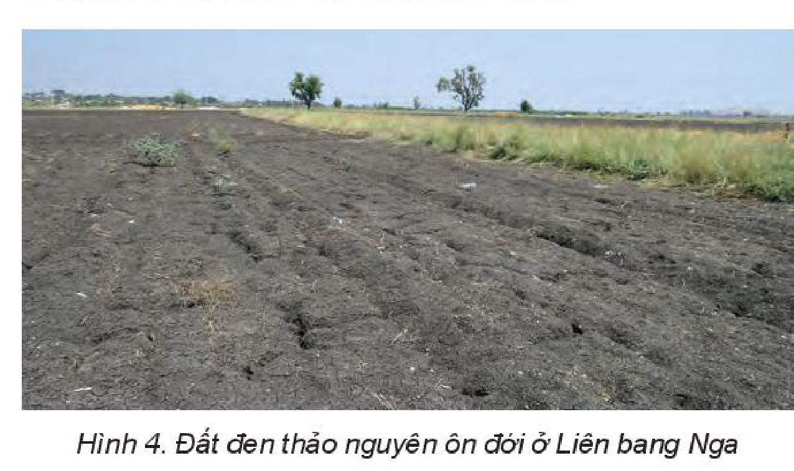
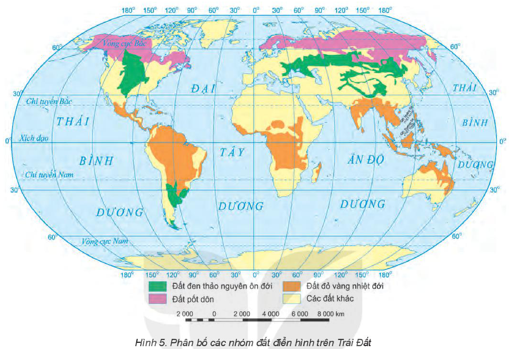

<!-- pdf:169 -->

# BÀI 22: LỚP ĐẤT TRÊN TRÁI ĐẤT

## 🎯 Học xong bài này, em sẽ:

- Nêu được các tầng đất và các thành phần chính của đất.
- Trình bày được một số nhân tố hình thành đất.
- Kể được tên và xác định được trên bản đồ một số nhóm đất điển hình ở vùng nhiệt đới hoặc ở vùng ôn đới.
- Có ý thức sử dụng hợp lí và bảo vệ đất.

## 🔴 Mở đầu

Đất là một trong các thành phần tự nhiên của Trái Đất. Sự sống trên Trái Đất được bao bọc, nuôi dưỡng và phát triển nhờ đất. Em có biết: Đất gồm những thành phần nào? Đất được hình thành như thế nào? Trên Trái Đất có bao nhiêu nhóm đất điển hình?

## 1. Các tầng đất

**Đất** là lớp vật chất mỏng, vụn bở, bao phủ trên bề mặt các lục địa và đảo, được đặc trưng bởi độ phì.

Khi ta đào đất theo chiều thẳng đứng sẽ thấy xuất hiện các tầng đất khác nhau. Ở các địa điểm khác nhau thì độ dày, màu sắc của các tầng đất cũng khác nhau, phản ánh quá trình hình thành và tính chất của đất.

*Hình 1. Các tầng đất*

> **Em có biết?**
>
> **Độ phì** là khả năng của đất cung cấp nước, chất dinh dưỡng và các yếu tố cần thiết khác như nhiệt độ, không khí,... cho cây sinh trưởng và phát triển.

> ❓ 1. Quan sát hình 1, em hãy kể tên các tầng đất.
>
> 2. Trong các tầng đất, tầng nào trực tiếp tác động đến sự sinh trưởng và phát triển của thực vật?

## 2. Thành phần của đất

*Hình 2. Tỉ lệ trung bình các thành phần trong đất*

<!-- term: Thành phần của đất -->
Đất bao gồm nhiều thành phần: khoáng, chất hữu cơ, không khí và nước. Tỉ lệ các thành phần trong đất thay đổi tuỳ thuộc vào điều kiện hình thành đất ở từng nơi.

> ❓ 1. Quan sát hình 2, cho biết đất bao gồm những thành phần nào. Thành phần nào chiếm tỉ lệ lớn nhất trong đất?
>
> 2. Tại sao chất hữu cơ chiếm tỉ lệ rất nhỏ trong đất nhưng lại có ý nghĩa quan trọng đối với cây trồng?

<!-- pdf:170 -->

## 3. Các nhân tố hình thành đất

<!-- term: Các nhân tố hình thành đất -->
Đất được hình thành do tác động đồng thời của năm nhân tố: đá mẹ, khí hậu, sinh vật, địa hình và thời gian.

**Đá mẹ** là nguồn gốc sinh ra thành phần khoáng trong đất. Đất hình thành trên các loại đá mẹ khác nhau sẽ có tính chất và màu sắc khác nhau.

*Khí hậu* (đặc biệt là nhiệt độ và lượng mưa) tạo điều kiện thuận lợi hoặc gây khó khăn cho quá trình phân giải các chất khoáng và chất hữu cơ trong đất.

*Sinh vật* là nguồn gốc sinh ra thành phần hữu cơ trong đất. Vi sinh vật phân huỷ xác động, thực vật để hình thành mùn. Động vật sống trong đất có tác dụng làm đất tơi xốp hơn.

*Địa hình* (đặc biệt là độ cao và độ dốc) ảnh hưởng tới độ dày của tầng đất và độ phì của đất.

*Thời gian:* Trong cùng một điều kiện hình thành như nhau, nơi có thời gian hình thành đất lâu hơn, sẽ có tầng đất dày hơn.

> **Em có biết?**
>
> Trong quá trình phát triển kinh tế, con người có thể làm cho đất tốt hơn nhưng cũng có thể làm cho đất xấu đi. Các hoạt động của con người như sử dụng thuốc trừ sâu, khai thác tài nguyên, chặt phá rừng,... đều làm cho đất mất chất dinh dưỡng, giảm độ phì. Ngược lại, việc phủ xanh đất trống đồi núi trọc, canh tác hợp lí, phát triển nông nghiệp bền vững,... sẽ làm tăng độ phì cho đất.

*Hình 3. Đất ở vùng đồi núi Tây Nguyên, Việt Nam bị rửa trôi do độ dốc địa hình và mất lớp phủ thực vật*

> ❓ Dựa vào hình ảnh và thông tin trong mục 3, em hãy trình bày nhân tố hình thành đất mà em cho là quan trọng nhất và giải thích cho sự lựa chọn đó.

## 4. Một số nhóm đất điển hình trên Trái Đất

Dựa vào quá trình hình thành và tính chất đất mà người ta phân thành các nhóm đất khác nhau. Trong đó đất đen thảo nguyên ôn đới, đất pốt dôn và đất đỏ vàng nhiệt đới là một số nhóm đất điển hình.

*Hình 4. Đất đen thảo nguyên ôn đới ở Liên bang Nga*

> **Em có biết?**
>
> **Đất đen thảo nguyên ôn đới** giàu mùn, có màu đen đặc trưng và là loại đất tốt nhất thế giới.
>
> **Đất pốt dôn** có đặc tính chua và nghèo mùn, ít dinh dưỡng.
>
> **Đất đỏ vàng nhiệt đới** có quá trình tích tụ oxit sắt và nhôm mạnh làm cho đất có màu đỏ vàng, tầng đất dày, tương đối chua và ít dinh dưỡng.

<!-- pdf:171 -->

*Hình 5. Phân bố các nhóm đất điển hình trên Trái Đất*

> ❓ Xác định trên hình 5 nơi phân bố chủ yếu của ba nhóm đất: đất đen thảo nguyên ôn đới, đất pốt dôn, đất đỏ vàng nhiệt đới.

## ✏️ Luyện tập và Vận dụng

1. Dựa vào bản đồ hình 5, cho biết tên nhóm đất phổ biến ở nước ta.
2. Tại sao để bảo vệ đất, chúng ta phải phủ xanh đất trống, đồi núi trọc?
3. Con người có tác động như thế nào đến sự biến đổi đất?

## 📷 Danh sách hình trong bài

| Mã hình | Trang PDF | Vị trí trong bài | Chú thích gốc |
| --- | --- | --- | --- |
| H6-lich_su_va_dia_ly-dl-b22-01 | 169 | Mục 1 | Hình 1. Các tầng đất |
| H6-lich_su_va_dia_ly-dl-b22-02 | 169 | Mục 2 | Hình 2. Tỉ lệ trung bình các thành phần trong đất |
| H6-lich_su_va_dia_ly-dl-b22-03 | 170 | Mục 3 | Hình 3. Đất ở vùng đồi núi Tây Nguyên, Việt Nam bị rửa trôi do độ dốc địa hình và mất lớp phủ thực vật |
| H6-lich_su_va_dia_ly-dl-b22-04 | 170 | Mục 4 | Hình 4. Đất đen thảo nguyên ôn đới ở Liên bang Nga |
| H6-lich_su_va_dia_ly-dl-b22-05 | 171 | Mục 4 | Hình 5. Phân bố các nhóm đất điển hình trên Trái Đất |
