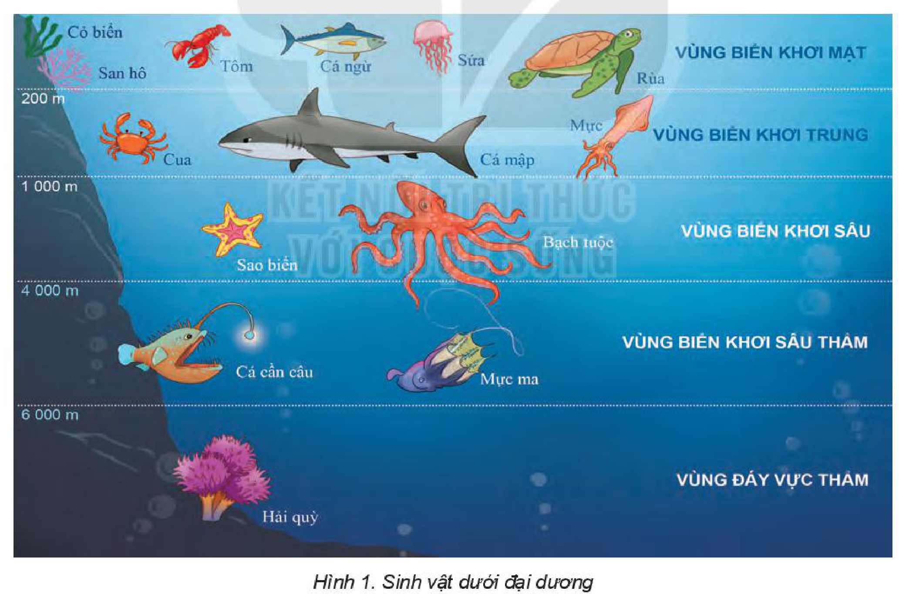
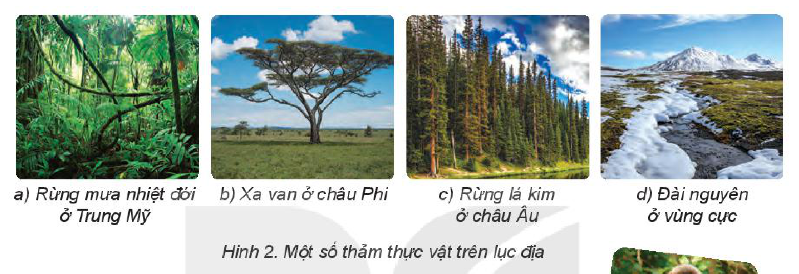
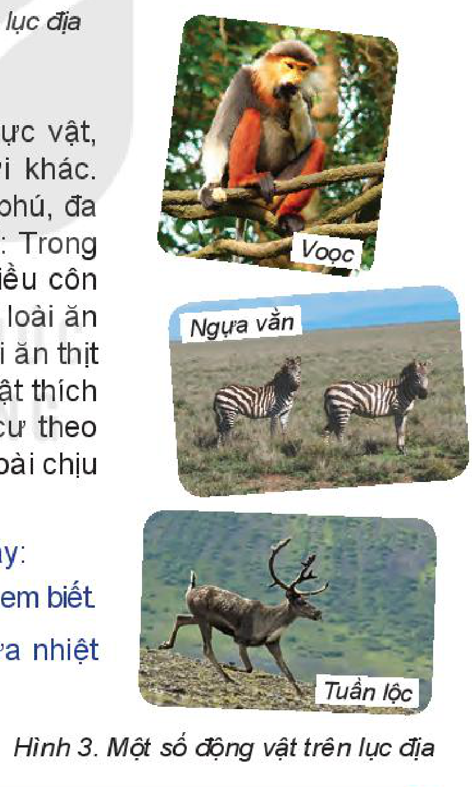

<!-- pdf:172 -->

# BÀI 23: SỰ SỐNG TRÊN TRÁI ĐẤT

## 🎯 Học xong bài này, em sẽ:

- Nêu được ví dụ về sự đa dạng của thế giới sinh vật ở lục địa và đại dương.
- Yêu thiên nhiên, có ý thức bảo vệ sự đa dạng của sinh vật trên Trái Đất.

## 🔴 Mở đầu

Các cơ thể sống tồn tại và phát triển ở các môi trường khác nhau đã tạo nên sự khác biệt, tính đa dạng của sinh vật trên Trái Đất. Vậy sự đa dạng của sinh vật trên Trái Đất biểu hiện như thế nào?

## 1. Sự đa dạng của sinh vật dưới đại dương

<!-- term: Sự đa dạng của sinh vật dưới đại dương -->
Sinh vật ở đại dương vô cùng phong phú, đa dạng. Ở các vĩ độ và độ sâu khác nhau sẽ có sự khác nhau về nhiệt độ, độ muối, áp suất, ánh sáng, nồng độ oxy,... dẫn đến sự đa dạng của các loài sinh vật.

*Hình 1. Sinh vật dưới đại dương*

> ❓ Quan sát hình 1, em hãy kể tên một số loài sinh vật ở các vùng biển trong đại dương.

<!-- pdf:173 -->

## 2. Sự đa dạng của sinh vật trên lục địa

### a) Thực vật

<!-- term: Sự đa dạng của thực vật trên lục địa -->
Giới thực vật trên lục địa hết sức phong phú, đa dạng, có sự khác biệt rõ rệt giữa các đới khí hậu. Tuỳ theo điều kiện khí hậu (đặc biệt là nhiệt độ và lượng mưa) mà ở từng đới xuất hiện các kiểu thảm thực vật khác nhau.

<!-- term: Sự đa dạng của thực vật trên lục địa -->
Ở đới nóng có rừng mưa nhiệt đới, rừng nhiệt đới gió mùa, xa van,... Ở đới ôn hoà có rừng lá rộng, rừng lá kim, thảo nguyên, rừng cận nhiệt đới,... Ở đới lạnh có thảm thực vật đài nguyên.

*a) Rừng mưa nhiệt đới ở Trung Mỹ — b) Xa van ở châu Phi — c) Rừng lá kim ở châu Âu — d) Đài nguyên ở vùng cực*

*Hình 2. Một số thảm thực vật trên lục địa*

### b) Động vật

<!-- term: Sự đa dạng của động vật trên lục địa -->
Động vật chịu ảnh hưởng của khí hậu ít hơn thực vật, do động vật có thể di chuyển từ nơi này đến nơi khác. Giới động vật trên các lục địa cũng hết sức phong phú, đa dạng, có sự khác biệt giữa các đới khí hậu. Ví dụ: Trong rừng mưa nhiệt đới, có nhiều loài leo trèo giỏi, nhiều côn trùng, chim, thú,...; xa van và thảo nguyên có nhiều loài ăn cỏ, chạy nhanh như ngựa, linh dương,... và các loài ăn thịt như sư tử, linh cẩu,... Ở đới lạnh là các loài động vật thích nghi với khí hậu lạnh bằng cách ngủ đông hay di cư theo mùa như gấu trắng, ngỗng trời,... Ở sa mạc có các loài chịu được nóng và khô hạn như bọ cạp, rắn, lạc đà,...

*Hình 3. Một số động vật trên lục địa*

> ❓ Đọc thông tin và các hình ảnh trong mục 2, em hãy:
> 1. Kể tên một số loài thực vật, động vật ở các đới mà em biết.
> 2. Nêu sự khác nhau về thực vật giữa rừng mưa nhiệt đới với rừng lá kim và đài nguyên.

## ✏️ Luyện tập và Vận dụng

1. Hãy trình bày sự đa dạng của sinh vật trên Trái Đất.
2. Có nhiều loài sinh vật đang đứng trước nguy cơ bị tuyệt chủng. Theo em nguyên nhân do đâu? Hãy nêu một số biện pháp để bảo vệ các loài đó.

## 📷 Danh sách hình trong bài

| Mã hình | Trang PDF | Vị trí trong bài | Chú thích gốc |
| --- | --- | --- | --- |
| H6-lich_su_va_dia_ly-dl-b23-01 | 172 | Mục 1 | Hình 1. Sinh vật dưới đại dương |
| H6-lich_su_va_dia_ly-dl-b23-02 | 173 | Mục 2.a (góc dưới bên phải khung chạm đỉnh ảnh nghiêng Voọc của Hình 3 xếp gối lên dòng chú thích Hình 2) | Hình 2. Một số thảm thực vật trên lục địa |
| H6-lich_su_va_dia_ly-dl-b23-03 | 173 | Mục 2.b (đoạn văn mục 2.b bên trái chạy lấn qua toạ độ x của dòng chú thích Hình 3 bên dưới) | Hình 3. Một số động vật trên lục địa |
