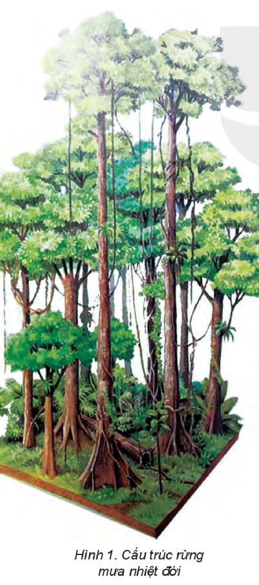
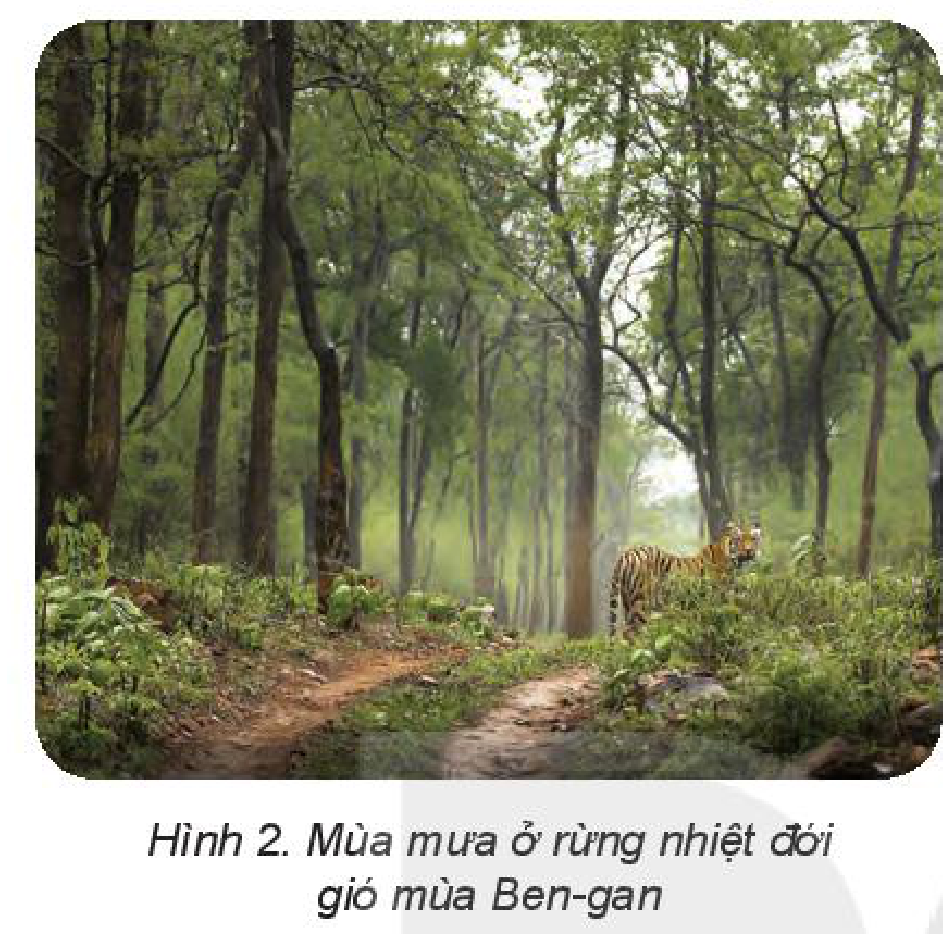
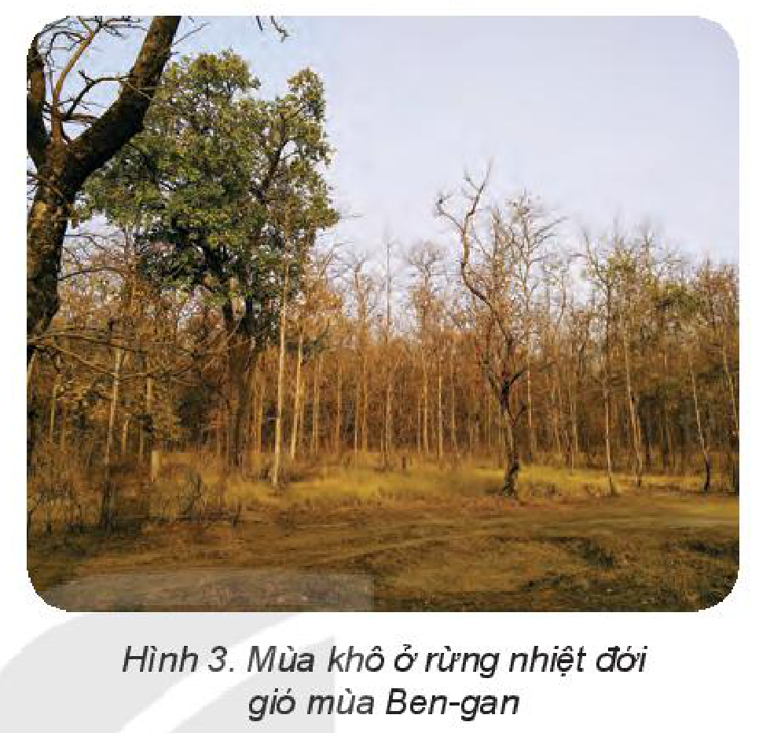

<!-- pdf:174 -->

# BÀI 24: RỪNG NHIỆT ĐỚI

## 🎯 Học xong bài này, em sẽ:

- Trình bày được đặc điểm của rừng nhiệt đới.
- Có ý thức bảo vệ rừng.

## 🔴 Mở đầu

Trong các thảm thực vật ở đới nóng, rừng nhiệt đới có vai trò hết sức quan trọng đối với môi trường trên Trái Đất. Rừng nhiệt đới có đặc điểm gì? Cần làm gì để bảo vệ rừng nhiệt đới?

## 1. Đặc điểm rừng nhiệt đới

<!-- term: Rừng nhiệt đới -->
Rừng nhiệt đới trải từ vùng Xích đạo đến hết vành đai nhiệt đới ở cả bán cầu Bắc và bán cầu Nam, với đặc trưng khí hậu: nhiệt độ trung bình năm trên 21°C, lượng mưa trung bình năm trên 1 700 mm. Rừng gồm nhiều tầng; trong rừng có nhiều loài cây thân gỗ, dây leo chằng chịt; phong lan, tầm gửi, địa y bám trên thân cây. Động vật rất phong phú, nhiều loài sống trên cây, leo trèo giỏi như khỉ, vượn,... nhiều loài chim ăn quả có màu sắc sặc sỡ,...

Tuỳ theo sự phân bố lượng mưa trong năm, rừng nhiệt đới được chia thành hai kiểu chính:

- **Rừng mưa nhiệt đới**: được hình thành ở nơi mưa nhiều quanh năm, chủ yếu phân bố ở lưu vực sông A-ma-dôn (Nam Mỹ), lưu vực sông Công-gô (châu Phi) và một phần Đông Nam Á. Rừng rậm rạp, có 4 – 5 tầng.
- **Rừng nhiệt đới gió mùa** phát triển ở những nơi có một mùa mưa và một mùa khô rõ rệt (Đông Nam Á, Đông Ấn Độ,...). Phần lớn các cây trong rừng rụng lá vào mùa khô. Cây trong rừng thấp hơn và ít tầng hơn ở rừng mưa nhiệt đới.

*Hình 1. Cấu trúc rừng mưa nhiệt đới*

<!-- pdf:175 -->

> ❓ 1. Em hãy cho biết nơi phân bố của rừng nhiệt đới.
>
> 2. Dựa vào thông tin trong mục 1 và các hình 1, 2, 3, em hãy:
> - Trình bày đặc điểm của rừng nhiệt đới.
> - Nêu sự khác nhau của rừng mưa nhiệt đới và rừng nhiệt đới gió mùa.

*Hình 2. Mùa mưa ở rừng nhiệt đới gió mùa Ben-gan*

*Hình 3. Mùa khô ở rừng nhiệt đới gió mùa Ben-gan*

## 2. Bảo vệ rừng nhiệt đới

<!-- term: Vai trò và bảo vệ rừng nhiệt đới -->
Rừng nhiệt đới có vai trò hết sức quan trọng đối với việc ổn định khí hậu Trái Đất, đồng thời là nơi bảo tồn đa dạng sinh học, nguồn dược liệu, thực phẩm và gỗ,... Tuy nhiên, diện tích rừng nhiệt đới đang giảm ở mức báo động, mỗi năm mất đi 130 nghìn km² do cháy rừng và các hoạt động của con người. Vì vậy, mỗi chúng ta cần có hành động cụ thể như sử dụng các sản phẩm có nguồn gốc từ rừng một cách tiết kiệm và hợp lí, đồng thời bảo vệ và phát triển rừng.

> **Em có biết?**
>
> Rừng A-ma-dôn là rừng mưa nhiệt đới tạo ra khoảng 20% lượng oxy của Trái Đất và được coi là lá phổi của hành tinh. Các vụ cháy rừng xảy ra ở A-ma-dôn năm 2019 đã gây ra những tổn thất quy mô toàn cầu, tác động rất lớn đến biến đổi khí hậu, kéo theo những thảm hoạ môi trường nghiêm trọng.
<!-- ocr-ok: đã đối chiếu ảnh trang gốc PDF 175, hộp Em có biết? xếp cột trái cạnh mục 2 -->

> ❓ Theo em, cần làm gì để bảo vệ rừng nhiệt đới?
<!-- ocr-ok: đã đối chiếu ảnh trang gốc PDF 175, câu hỏi cuối mục 2 -->

## ✏️ Luyện tập và Vận dụng

1. Hãy giải thích vì sao rừng nhiệt đới có nhiều tầng.
2. Ở Việt Nam, kiểu rừng nhiệt đới nào chiếm ưu thế? Em hãy tìm hiểu về kiểu rừng đó.

## 📷 Danh sách hình trong bài

| Mã hình | Trang PDF | Vị trí trong bài | Chú thích gốc |
| --- | --- | --- | --- |
| H6-lich_su_va_dia_ly-dl-b24-01 | 174 | Mục 1 (hình tràn sát mép trái trang in gốc) | Hình 1. Cấu trúc rừng mưa nhiệt đới |
| H6-lich_su_va_dia_ly-dl-b24-02 | 175 | Mục 1 | Hình 2. Mùa mưa ở rừng nhiệt đới gió mùa Ben-gan |
| H6-lich_su_va_dia_ly-dl-b24-03 | 175 | Mục 1 | Hình 3. Mùa khô ở rừng nhiệt đới gió mùa Ben-gan |
