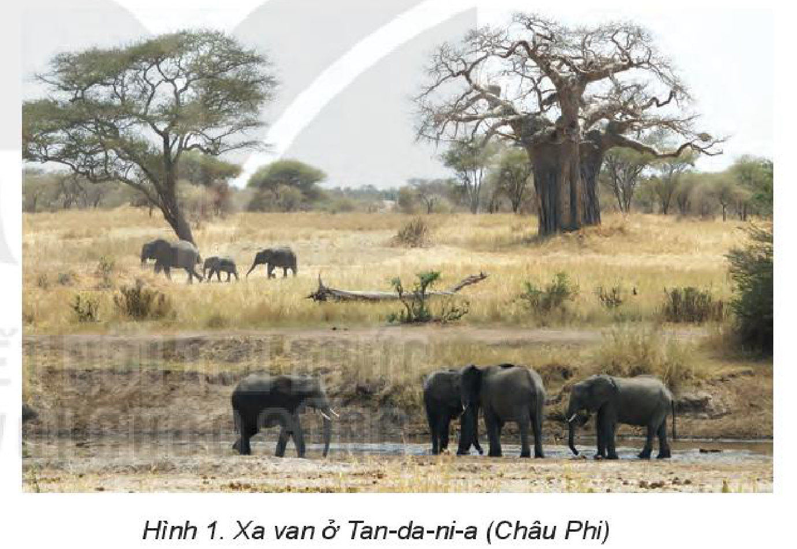
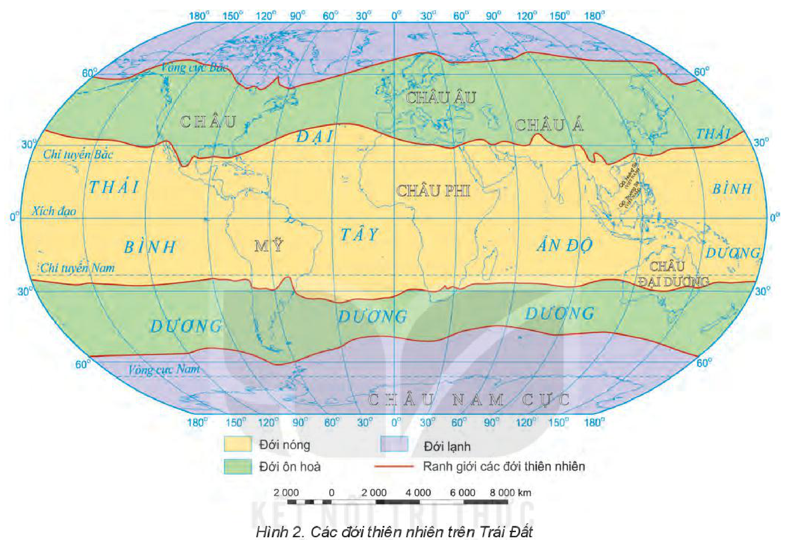

<!-- pdf:176 -->

# BÀI 25: SỰ PHÂN BỐ CÁC ĐỚI THIÊN NHIÊN TRÊN TRÁI ĐẤT

## 🎯 Học xong bài này, em sẽ:

- Nêu được đặc điểm của các đới thiên nhiên trên Trái Đất.
- Xác định được trên bản đồ sự phân bố các đới thiên nhiên trên Trái Đất.

## 🔴 Mở đầu

Điều kiện khí hậu ở đới nóng, đới ôn hoà, đới lạnh khác nhau dẫn đến các đặc điểm đất, sinh vật,... cũng khác nhau, hình thành nên các đới thiên nhiên. Các đới thiên nhiên trên Trái Đất khác nhau như thế nào?

<!-- term: Đới thiên nhiên -->
Tương ứng với năm đới khí hậu là năm đới thiên nhiên trên Trái Đất: một đới nóng, hai đới ôn hoà và hai đới lạnh.

## 1. Đới nóng

<!-- term: Đới nóng -->
Là nơi có nhiệt độ cao. Cảnh quan thiên nhiên thay đổi chủ yếu phụ thuộc vào chế độ mưa. Giới thực, động vật hết sức đa dạng, phong phú.

> **Em có biết?**
>
> Ở xa van (đới nóng), mùa khô kéo dài, thực vật chủ yếu là các loài cỏ cao, lác đác xuất hiện cây thân gỗ ưa khô. Có các loài động vật ăn cỏ (voi, linh dương, ngựa vằn,...), các loài ăn thịt (sư tử, linh cẩu, kền kền,...),...

*Hình 1. Xa van ở Tan-da-ni-a (Châu Phi)*

## 2. Đới ôn hoà

<!-- term: Đới ôn hoà -->
Có khí hậu mang tính trung gian giữa đới nóng và đới lạnh. Thiên nhiên đới ôn hoà thay đổi rõ rệt theo mùa. Cảnh quan thay đổi theo vĩ độ và ảnh hưởng của dòng biển nóng cùng gió Tây ôn đới.

<!-- term: Rừng Tai-ga -->
> **Em có biết?**
>
> Rừng Tai-ga phân bố ở vùng ôn đới lạnh. Đây là rừng có diện tích rộng nhất trên Trái Đất (chiếm 9% diện tích Trái Đất). Đất pốt dôn nghèo dinh dưỡng. Thực vật chủ yếu là cây lá kim: thông, linh sam, vân sam, tuyết tùng,... Động vật chủ yếu là sóc, nhím, gấu nâu, chó sói, hổ Xi-bia,...

## 3. Đới lạnh

<!-- term: Đới lạnh -->
Là xứ sở của băng tuyết, khí hậu vô cùng khắc nghiệt, tầng đất đài nguyên mỏng. Thực vật thấp lùn, chủ yếu là rêu, địa y và các loại cây thân thảo tồn tại trong mùa hạ ngắn ngủi, tạo nên cảnh quan **đài nguyên**. Động vật là các loài thích nghi được với khí hậu lạnh như gấu trắng, chim cánh cụt,...

<!-- pdf:177 -->

> ❓ 1. Xác định trên bản đồ hình 2 phạm vi của các đới thiên nhiên trên Trái Đất.
>
> 2. Dựa vào kiến thức đã học và hình 1, hãy trình bày về đặc điểm của một đới thiên nhiên.

*Hình 2. Các đới thiên nhiên trên Trái Đất*

## ✏️ Luyện tập và Vận dụng

1. Quan sát hình 2 kết hợp với các kiến thức đã học, em hãy hoàn thành bảng sau vào vở:

CÁC ĐỚI THIÊN NHIÊN TRÊN TRÁI ĐẤT

| Đới | Phạm vi | Khí hậu | Thực vật, động vật |
| --- | --- | --- | --- |
| Nóng | | | |
| Ôn hoà | | | |
| Lạnh | | | |
<!-- ocr-ok: đã đối chiếu ảnh trang gốc PDF 177, bảng trong mục Luyện tập và Vận dụng -->

2. Tìm và xác định vị trí của nước ta trên hình 2. Từ đó, nêu một số đặc điểm của thiên nhiên Việt Nam.

## 📷 Danh sách hình trong bài

| Mã hình | Trang PDF | Vị trí trong bài | Chú thích gốc |
| --- | --- | --- | --- |
| H6-lich_su_va_dia_ly-dl-b25-01 | 176 | Mục 1 | Hình 1. Xa van ở Tan-da-ni-a (Châu Phi) |
| H6-lich_su_va_dia_ly-dl-b25-02 | 177 | Mục 3 | Hình 2. Các đới thiên nhiên trên Trái Đất |
