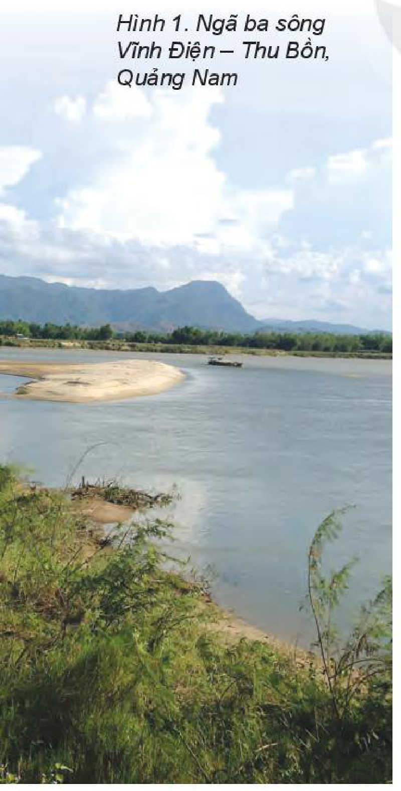
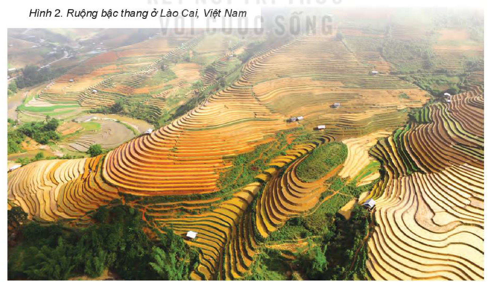

<!-- pdf:178 -->

# BÀI 26: THỰC HÀNH: TÌM HIỂU MÔI TRƯỜNG TỰ NHIÊN ĐỊA PHƯƠNG

## 🎯 Học xong bài này, em sẽ:

- Biết cách tìm hiểu môi trường tự nhiên qua tài liệu và tham quan địa phương.
- Yêu thiên nhiên, có ý thức bảo vệ thiên nhiên.

## 1. Gợi ý một số nội dung

Học sinh có thể chọn một trong các nội dung sau:

### a) Nội dung 1: Địa hình

- Đặc điểm chung
- Các dạng địa hình chính
- Mối quan hệ giữa địa hình với các thành phần tự nhiên khác (khí hậu, sông ngòi, đất trồng, sinh vật)

### b) Nội dung 2: Khí hậu

- Đặc điểm chung
- Các nét đặc trưng của khí hậu (nhiệt độ, độ ẩm, lượng mưa, gió,...)
- Mối quan hệ giữa khí hậu và các thành phần tự nhiên khác (địa hình, sông ngòi, đất trồng, sinh vật)

*Hình 1. Ngã ba sông Vĩnh Điện – Thu Bồn, Quảng Nam*

### c) Nội dung 3: Sông ngòi

- Mạng lưới sông ngòi
- Đặc điểm chính của sông ngòi (hướng dòng chảy, mùa lũ – mùa cạn)
- Mối quan hệ giữa sông ngòi với các thành phần tự nhiên khác (địa hình, khí hậu,...)

### d) Nội dung 4: Đất

- Các loại đất. Đặc điểm chung của đất
- Phân bố đất ở địa phương
- Mối quan hệ giữa đất với các thành phần tự nhiên khác (địa hình, khí hậu, sông ngòi,...)

**đ) Nội dung 5: Sinh vật**

- Hiện trạng thảm thực vật tự nhiên (đặc biệt là độ che phủ)
- Các loài động vật hoang dã
- Mối quan hệ giữa thực vật với động vật, giữa sinh vật với các thành phần tự nhiên khác (khí hậu, đất,...)

<!-- pdf:179 -->

## 2. Cách thức tiến hành
<!-- ocr-ok: đã đối chiếu ảnh trang gốc PDF 179, tiêu đề mục 2 -->

### a) Thành lập nhóm và lựa chọn nội dung

### b) Phân công nhiệm vụ cho các thành viên trong nhóm

### c) Xác định thời gian và địa điểm tham quan ở địa phương

### d) Thu thập tài liệu và xử lí tài liệu

- Thu thập tài liệu qua sách vở, mạng internet, cơ quan quản lí vấn đề ở địa phương.
- Tham quan, tìm hiểu thực tế địa phương.
- Tìm hiểu qua người dân địa phương (phương pháp xã hội học).
- Phân tích, tổng hợp, so sánh các kết quả đã tìm hiểu được.

**đ) Viết báo cáo**

- Viết báo cáo
  Từ các tài liệu đã có, viết báo cáo theo gợi ý (nên viết ngắn gọn, súc tích):
  + Nêu ý nghĩa của việc tìm hiểu môi trường tự nhiên.
  + Nêu hiện trạng và nguyên nhân.
  + Một số giải pháp.
- Trình bày báo cáo
  + Phân công người báo cáo trước lớp.
  + Chuẩn bị nội dung kèm theo: tranh ảnh, bảng số liệu, biểu đồ,...

*Hình 2. Ruộng bậc thang ở Lào Cai, Việt Nam*

## 📷 Danh sách hình trong bài

| Mã hình | Trang PDF | Vị trí trong bài | Chú thích gốc |
| --- | --- | --- | --- |
| H6-lich_su_va_dia_ly-dl-b26-01 | 178 | Mục 1 (hình tràn sát mép trái trang in gốc) | Hình 1. Ngã ba sông Vĩnh Điện – Thu Bồn, Quảng Nam |
| H6-lich_su_va_dia_ly-dl-b26-02 | 179 | Mục 2 | Hình 2. Ruộng bậc thang ở Lào Cai, Việt Nam |
