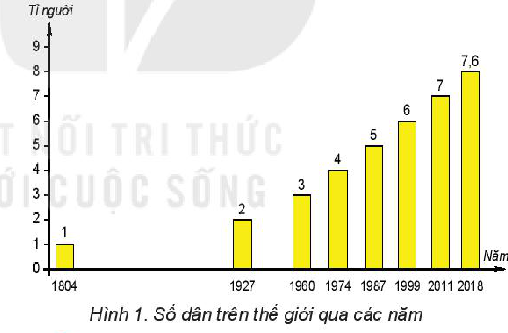
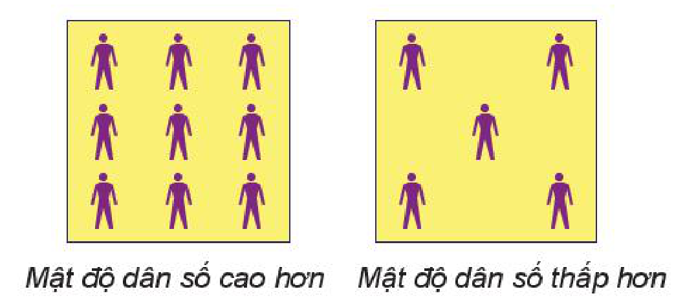
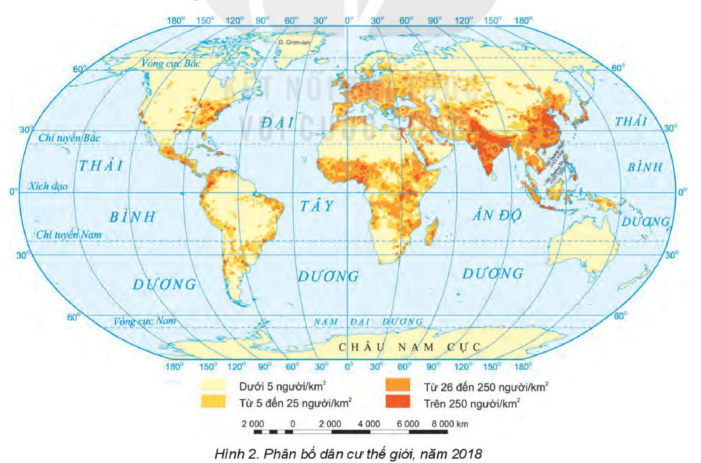
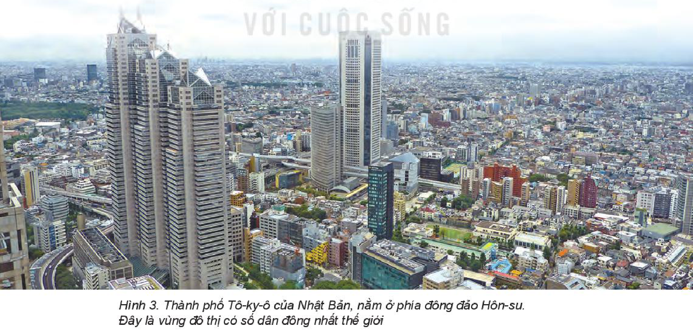
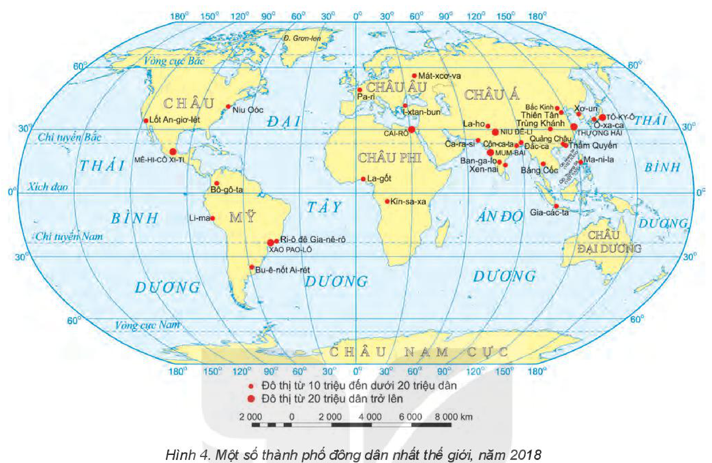

<!-- pdf:181 -->

# BÀI 27: DÂN SỐ VÀ SỰ PHÂN BỐ DÂN CƯ TRÊN THẾ GIỚI

## 🎯 Học xong bài này, em sẽ:

- Biết được số dân trên thế giới. Trình bày và giải thích được đặc điểm phân bố dân cư trên thế giới.
- Đọc được biểu đồ quy mô dân số thế giới.
- Xác định được trên bản đồ một số thành phố đông dân nhất thế giới.

## 🔴 Mở đầu

Người hiện đại đầu tiên xuất hiện cách đây khoảng 40 000 năm. Đến nay, số lượng người trên Trái Đất đã lên tới hàng tỉ người và phân bố khắp các châu lục (trừ châu Nam Cực).

Em có biết số dân và sự phân bố dân cư trên thế giới thay đổi như thế nào không?

## 1. Dân số trên thế giới

<!-- term: Dân số thế giới -->
Năm 2018, thế giới có 7,6 tỉ dân, sống trong hơn 200 quốc gia và vùng lãnh thổ. Số dân của các quốc gia rất khác nhau và luôn biến động. Tuy nhiên, trên phạm vi toàn thế giới, dân số luôn có xu hướng tăng theo thời gian.

*Hình 1. Số dân trên thế giới qua các năm*

> **Em có biết?**
>
> Chỉ hai quốc gia đông dân nhất là Trung Quốc và Ấn Độ đã có hơn 2,8 tỉ dân, năm 2018 (chiếm 36% dân số thế giới); trong khi các quốc gia ít dân nhất chỉ có số dân từ 0,01 – 0,1 triệu người mỗi nước.

> ❓ Đọc thông tin trong mục 1 và quan sát hình 1, em hãy cho biết:
> - Số dân thế giới năm 2018.
> - Số dân thế giới thay đổi như thế nào qua các năm.

## 2. Phân bố dân cư thế giới

Ngày nay, con người đã sinh sống ở hầu khắp các khu vực và châu lục trên thế giới. Để thể hiện tình hình phân bố dân cư, người ta sử dụng tiêu chí mật độ dân số.

<!-- term: Mật độ dân số -->
> **Em có biết?**
>
> Để tính mật độ dân số của một khu vực, người ta lấy số dân chia cho diện tích của khu vực đó. Đơn vị tính là người/km².
<!-- ocr-ok: đã đối chiếu ảnh trang gốc PDF 181, hộp Em có biết? ở cột trái -->

<!-- pdf:182 -->

*Mật độ dân số cao hơn — Mật độ dân số thấp hơn*

Phân bố dân cư và mật độ dân số thế giới thay đổi theo thời gian và không đều trong không gian, phụ thuộc vào điều kiện kinh tế – xã hội cũng như hoàn cảnh tự nhiên. Những nơi kinh tế phát triển, điều kiện tự nhiên thuận lợi,... thường có dân cư tập trung đông đúc. Trong khi đó, các vùng khí hậu khắc nghiệt (băng giá, hoang mạc khô hạn,...), giao thông khó khăn, kinh tế kém phát triển,... là những nơi dân cư thưa thớt, mật độ dân số thấp.

> **Em có biết?**
>
> Năm 2018, mật độ dân số trung bình toàn thế giới là 56 người/km². Mật độ dân số của châu Á (142 người/km²) gấp hơn 28 lần mật độ dân số của châu Đại Dương (5 người/km²). Mật độ dân số của Xin-ga-po gấp hơn 4 000 lần mật độ dân số của Mông Cổ.

> ❓ Dựa vào hình 2, em hãy:
> - Xác định các khu vực trên thế giới có mật độ dân số trên 250 người/km² và các khu vực có mật độ dân số dưới 5 người/km².
> - Nêu một số ví dụ cụ thể để thấy điều kiện tự nhiên hoặc kinh tế – xã hội ảnh hưởng tới sự phân bố dân cư trên thế giới.

*Hình 2. Phân bố dân cư thế giới, năm 2018*

<!-- pdf:183 -->

## 3. Một số thành phố đông dân nhất trên thế giới

Ngày nay, con người trên Trái Đất có xu hướng tập trung vào các đô thị với quy mô dân số rất khác nhau. Đô thị có số dân từ 10 triệu người trở lên được gọi là **siêu đô thị**.

Quá trình phát triển đô thị có thể ảnh hưởng tích cực hoặc tiêu cực đến sự phát triển kinh tế – xã hội và môi trường.

MƯỜI THÀNH PHỐ ĐÔNG DÂN NHẤT THẾ GIỚI, NĂM 2018

| STT | TÊN THÀNH PHỐ | QUỐC GIA | SỐ DÂN (Triệu người) |
| --- | --- | --- | --- |
| 1 | Tô-ky-ô | Nhật Bản | 37,5 |
| 2 | Niu Đê-li | Ấn Độ | 28,5 |
| 3 | Thượng Hải | Trung Quốc | 25,6 |
| 4 | Xao Pao-lô | Bra-xin | 21,7 |
| 5 | Mê-hi-cô Xi-ti | Mê-hi-cô | 21,6 |
| 6 | Cai-rô | Ai Cập | 20,1 |
| 7 | Mum-bai | Ấn Độ | 20,0 |
| 8 | Đắc-ca | Băng-la-đét | 19,6 |
| 9 | Bắc Kinh | Trung Quốc | 19,6 |
| 10 | Ô-xa-ca | Nhật Bản | 19,3 |

*Hình 3. Thành phố Tô-ky-ô của Nhật Bản, nằm ở phía đông đảo Hôn-su. Đây là vùng đô thị có số dân đông nhất thế giới*

<!-- pdf:184 -->

*Hình 4. Một số thành phố đông dân nhất thế giới, năm 2018*

> ❓ Dựa vào bản đồ hình 4 và bảng số liệu trang 182, em hãy:
> 1. Kể tên năm thành phố đông dân nhất thế giới năm 2018.
> 2. Cho biết châu lục nào có nhiều siêu đô thị nhất.

## ✏️ Luyện tập và Vận dụng

1. Dựa vào hình 1, hãy tính thời gian để dân số thế giới tăng thêm một tỉ người (từ 1 tỉ lên 2 tỉ, từ 2 tỉ lên 3 tỉ,...).

Chọn một trong hai nhiệm vụ sau:

2. Cho biết sự gia tăng dân số thế giới quá nhanh sẽ dẫn tới những hậu quả gì về đời sống, sản xuất và môi trường.
3. Dựa vào hình 3 và tìm hiểu thông tin về thành phố Tô-ky-ô, sau đó chia sẻ với các bạn.

## 📷 Danh sách hình trong bài

| Mã hình | Trang PDF | Vị trí trong bài | Chú thích gốc |
| --- | --- | --- | --- |
| H6-lich_su_va_dia_ly-dl-b27-01 | 181 | Mục 1 | Hình 1. Số dân trên thế giới qua các năm |
| H6-lich_su_va_dia_ly-dl-b27-02 | 182 | Mục 2 | Mật độ dân số cao hơn; Mật độ dân số thấp hơn |
| H6-lich_su_va_dia_ly-dl-b27-03 | 182 | Mục 2 | Hình 2. Phân bố dân cư thế giới, năm 2018 |
| H6-lich_su_va_dia_ly-dl-b27-04 | 183 | Mục 3 (hình tràn sát cả hai mép trái và phải trang in gốc) | Hình 3. Thành phố Tô-ky-ô của Nhật Bản, nằm ở phía đông đảo Hôn-su. Đây là vùng đô thị có số dân đông nhất thế giới |
| H6-lich_su_va_dia_ly-dl-b27-05 | 184 | Mục 3 | Hình 4. Một số thành phố đông dân nhất thế giới, năm 2018 |
