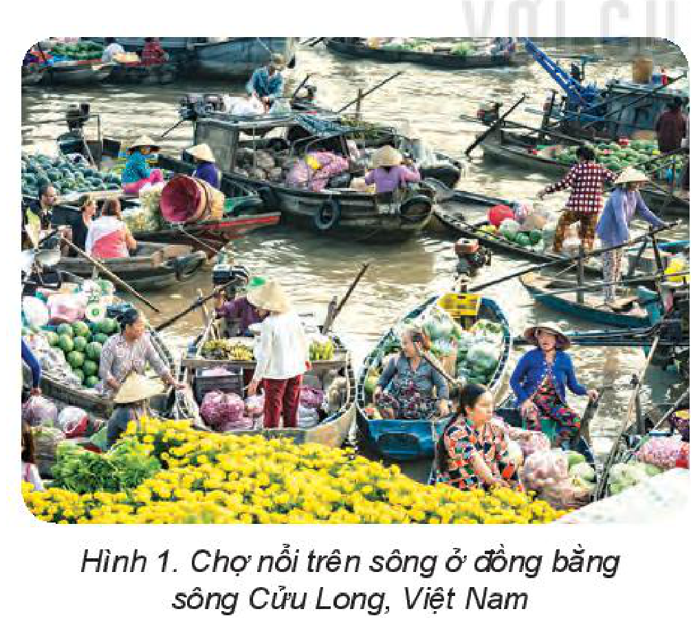
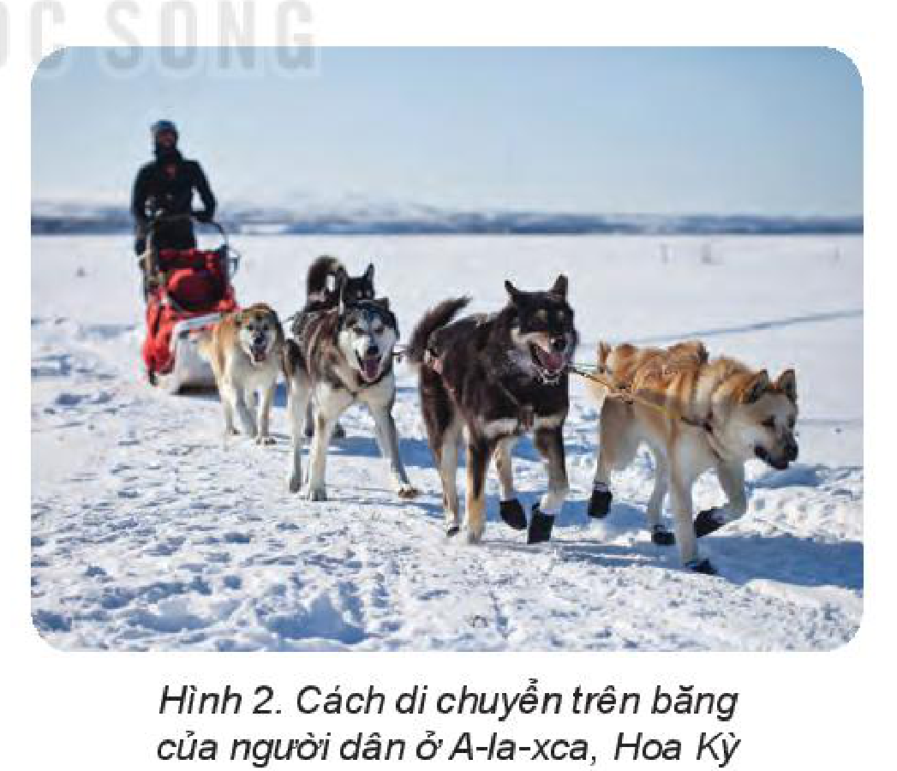
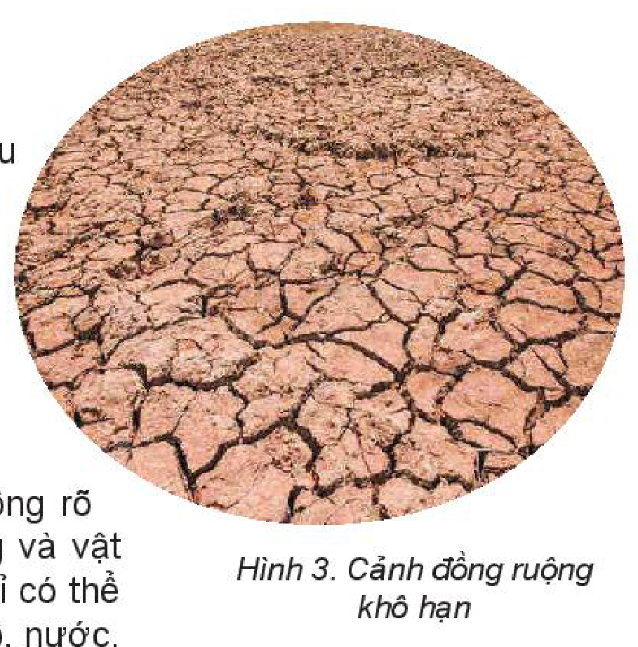
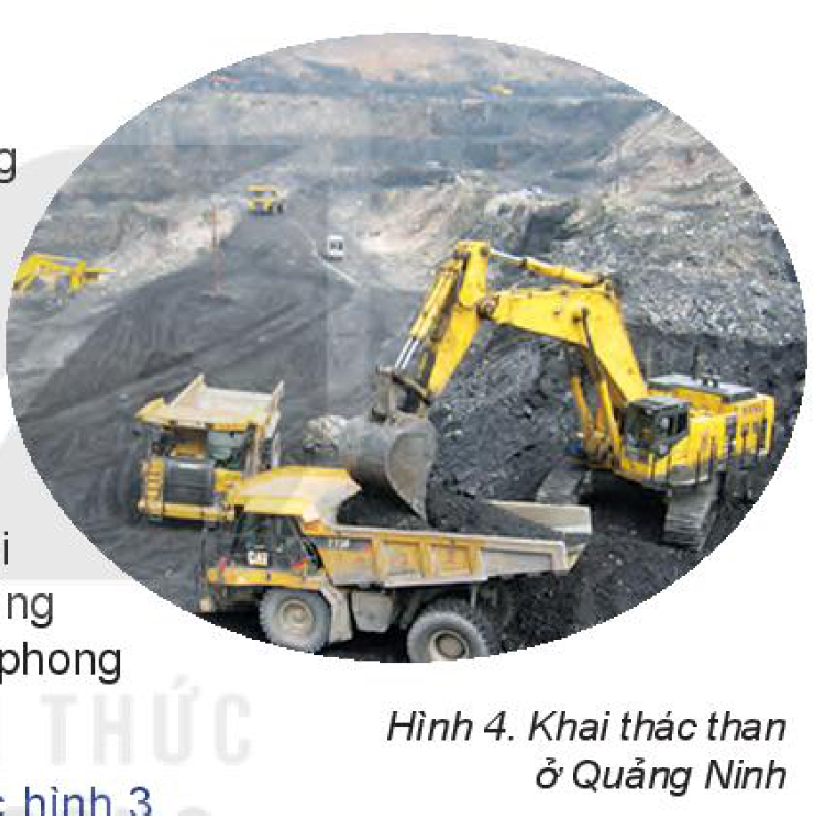
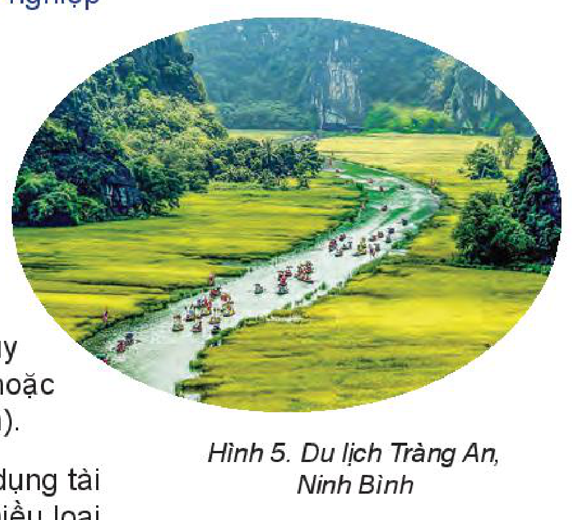
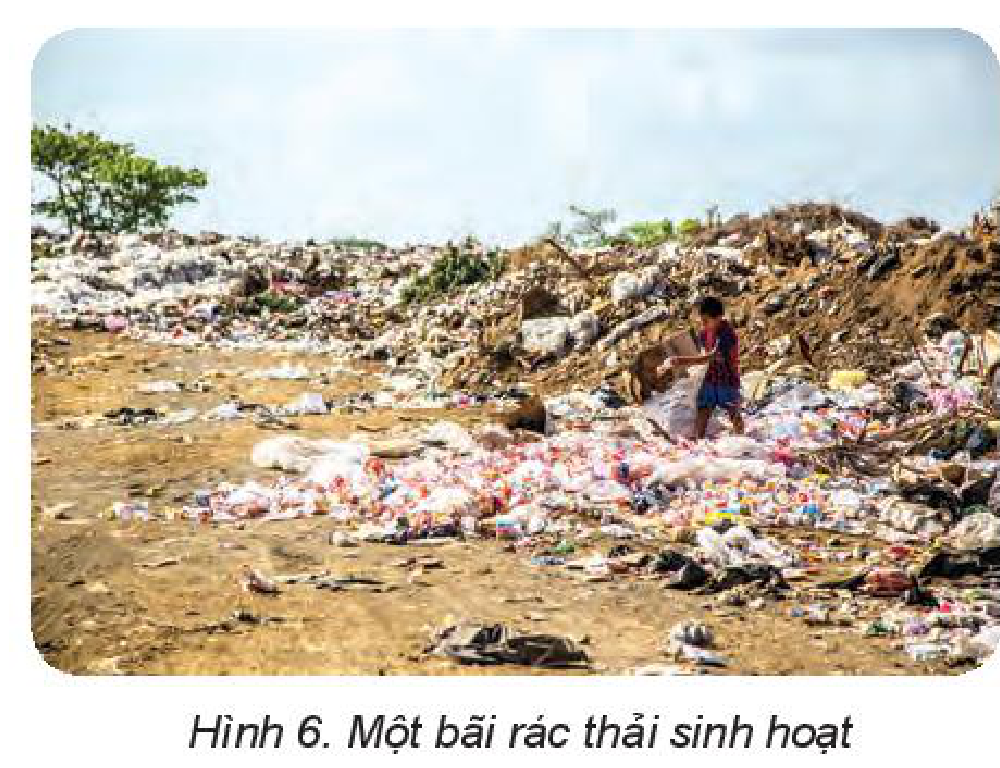
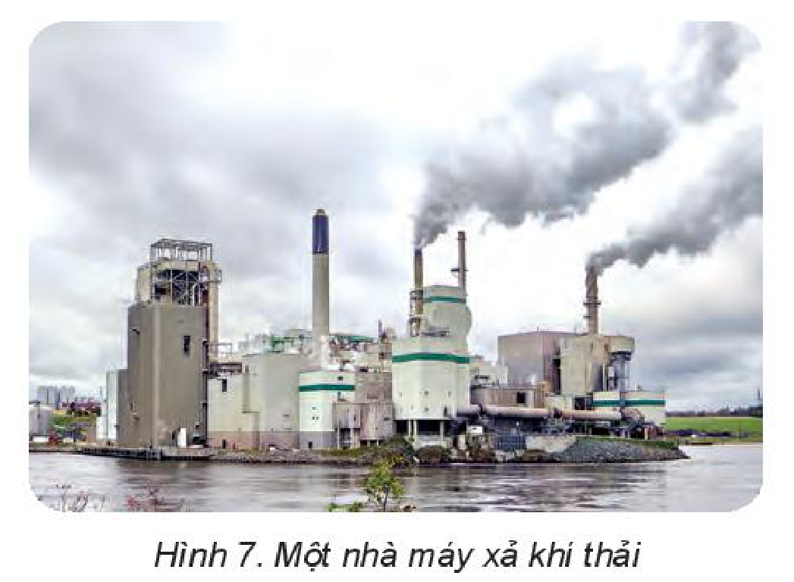

<!-- pdf:185 -->

# BÀI 28: MỐI QUAN HỆ GIỮA CON NGƯỜI VÀ THIÊN NHIÊN

## 🎯 Học xong bài này, em sẽ:

- Nêu được các tác động của thiên nhiên lên hoạt động sản xuất và sinh hoạt của con người.
- Trình bày được những tác động chủ yếu của con người tới thiên nhiên Trái Đất.
- Yêu thiên nhiên, thấy được trách nhiệm với thiên nhiên.

## 🔴 Mở đầu

Đời sống và sản xuất của con người không thể tách rời thiên nhiên Trái Đất. Thiên nhiên là môi trường sống của con người, đồng thời thiên nhiên cũng chịu tác động của con người.

Bài học này cho chúng ta thấy thiên nhiên tác động đến con người như thế nào và con người tác động lại thiên nhiên ra sao.

## 1. Tác động của thiên nhiên đến con người

### a) Tác động của thiên nhiên đến đời sống con người

<!-- term: Tác động của thiên nhiên đến đời sống con người -->
Trong đời sống hằng ngày, thiên nhiên cung cấp những điều kiện hết sức cần thiết (không khí, ánh sáng, nhiệt lượng, nước,...) để con người có thể tồn tại.

<!-- term: Tác động của thiên nhiên đến đời sống con người -->
Các điều kiện tự nhiên như địa hình (cao hay thấp, gồ ghề hay bằng phẳng,...), khí hậu (nóng hay lạnh, mưa nhiều hay mưa ít,...), đất trồng (màu mỡ hay bạc màu,...), nguồn nước (phong phú hay khô cạn,...) đều có ảnh hưởng tới sự phân bố dân cư, lối sống và cả sinh hoạt hằng ngày của con người.

*Hình 1. Chợ nổi trên sông ở đồng bằng sông Cửu Long, Việt Nam*

*Hình 2. Cách di chuyển trên băng của người dân ở A-la-xca, Hoa Kỳ*
<!-- ocr-ok: đã đối chiếu ảnh trang gốc PDF 185, chú thích Hình 2 xếp ngang cạnh Hình 1 -->

> ❓ Đọc thông tin trong mục a và quan sát hình 1, 2; em hãy nêu ví dụ về tác động của thiên nhiên đối với đời sống con người.

<!-- pdf:186 -->

### b) Tác động của thiên nhiên tới sản xuất

<!-- term: Tác động của thiên nhiên tới sản xuất -->
Các hoạt động sản xuất của con người đều chịu tác động của thiên nhiên. Điều kiện tự nhiên có thể tạo thuận lợi hay gây khó khăn cho hoạt động sản xuất. Với sự biến đổi khí hậu, thiên nhiên ngày càng gây nhiều trở ngại cho sản xuất của con người.

**Đối với sản xuất nông nghiệp**

Nông nghiệp là ngành sản xuất chịu tác động rõ rệt nhất của hoàn cảnh tự nhiên vì cây trồng và vật nuôi (đối tượng của sản xuất nông nghiệp) chỉ có thể tồn tại và phát triển bình thường khi có nhiệt độ, nước, ánh sáng, không khí,... phù hợp.

*Hình 3. Cảnh đồng ruộng khô hạn*
<!-- ocr-ok: đã đối chiếu ảnh trang gốc PDF 186, chú thích Hình 3 -->

**Đối với sản xuất công nghiệp**

Tài nguyên thiên nhiên (đặc biệt là khoáng sản) là nguồn cung cấp nhiên liệu, năng lượng, nguyên liệu để các ngành công nghiệp hoạt động.

*Hình 4. Khai thác than ở Quảng Ninh*
<!-- ocr-ok: đã đối chiếu ảnh trang gốc PDF 186, chú thích Hình 4 -->

**Đối với giao thông vận tải và du lịch**

Địa hình đồng bằng thuận lợi để phát triển giao thông đường bộ hơn địa hình đồi núi. Nơi nhiều sông, hồ thuận lợi cho phát triển giao thông đường thuỷ. Nơi có khí hậu ôn hoà, nhiều phong cảnh đẹp thuận lợi cho ngành du lịch.

> ❓ Dựa vào thông tin trong mục b và các hình 3, 4, 5; em hãy nêu ví dụ về tác động của thiên nhiên tới sản xuất (nông nghiệp, công nghiệp hoặc du lịch).

## 2. Tác động của con người tới thiên nhiên

<!-- term: Suy thoái và cạn kiệt tài nguyên thiên nhiên -->
Con người ngày càng khai thác nhiều tài nguyên thiên nhiên để phục vụ cho nhu cầu ngày càng lớn của mình, trong khi tài nguyên thiên nhiên trên Trái Đất là có hạn. Điều đó dẫn tới hậu quả là nhiều loại tài nguyên bị suy thoái (tài nguyên đất, tài nguyên sinh vật,...) hoặc có khả năng cạn kiệt (tài nguyên khoáng sản).

*Hình 5. Du lịch Tràng An, Ninh Bình*

Đồng thời, trong quá trình khai thác và sử dụng tài nguyên, con người đã đưa vào thiên nhiên nhiều loại rác thải ở các dạng khác nhau: bụi, khí, lỏng, rắn,...

<!-- pdf:187 -->

Khi bay vào khí quyển, chúng gây ô nhiễm môi trường không khí; khi trôi nổi hoặc hoà vào nước, gây ô nhiễm môi trường sông, hồ, biển và đại dương; khi thấm xuống đất, gây ô nhiễm môi trường đất và nước ngầm,...

*Hình 6. Một bãi rác thải sinh hoạt*

*Hình 7. Một nhà máy xả khí thải*

Con người ngày càng nhận thức được trách nhiệm của mình với thiên nhiên và đã có những hành động tích cực để bảo vệ môi trường bằng cách trồng rừng, phủ xanh đồi núi, cải tạo đất, biến những vùng khô cằn, bạc màu thành đồng ruộng phì nhiêu,...

> **Em có biết?**
>
> Ở Thuỵ Điển, Chính phủ có quy định khi khai thác một cây phải trồng lại một cây. Thực tế, có nhiều công ty khai thác đã trồng lại ba cây. Nhờ vậy, đất nước này có môi trường sống trong lành, giảm lượng phát thải khí nhà kính.

> ❓ 1. Theo em, những tác động nào của con người khiến tài nguyên thiên nhiên bị suy thoái.
>
> 2. Dựa vào hình 6, 7 và hiểu biết của em, hãy kể tên một số loại rác thải sinh hoạt, công nghiệp, nông nghiệp do con người đưa vào môi trường thiên nhiên.

## ✏️ Luyện tập và Vận dụng

1. Em hãy nêu ví dụ về tác động của thiên nhiên đến sản xuất nông nghiệp, công nghiệp, giao thông vận tải và du lịch.
2. Hãy nêu một số hành động của con người làm ô nhiễm môi trường không khí và nước.

Chọn một trong hai nhiệm vụ sau:

3. Ở nơi em sinh sống, điều kiện tự nhiên nào tác động nhiều nhất tới đời sống và sản xuất của người dân? Tại sao?
4. Em hãy nêu một số sáng kiến để có thể giảm việc sử dụng túi ni-lông trong đời sống hằng ngày.

## 📷 Danh sách hình trong bài

| Mã hình | Trang PDF | Vị trí trong bài | Chú thích gốc |
| --- | --- | --- | --- |
| H6-lich_su_va_dia_ly-dl-b28-01 | 185 | Mục 1.a | Hình 1. Chợ nổi trên sông ở đồng bằng sông Cửu Long, Việt Nam |
| H6-lich_su_va_dia_ly-dl-b28-02 | 185 | Mục 1.a | Hình 2. Cách di chuyển trên băng của người dân ở A-la-xca, Hoa Kỳ |
| H6-lich_su_va_dia_ly-dl-b28-03 | 186 | Mục 1.b (chữ đoạn văn bên trái xếp uốn lượn sát theo đường viền bầu dục của hình) | Hình 3. Cảnh đồng ruộng khô hạn |
| H6-lich_su_va_dia_ly-dl-b28-04 | 186 | Mục 1.b (chữ đoạn văn bên trái xếp uốn lượn sát theo đường viền bầu dục của hình) | Hình 4. Khai thác than ở Quảng Ninh |
| H6-lich_su_va_dia_ly-dl-b28-05 | 186 | Mục 2 (chữ đoạn văn bên trái xếp uốn lượn sát theo đường viền bầu dục của hình) | Hình 5. Du lịch Tràng An, Ninh Bình |
| H6-lich_su_va_dia_ly-dl-b28-06 | 187 | Mục 2 | Hình 6. Một bãi rác thải sinh hoạt |
| H6-lich_su_va_dia_ly-dl-b28-07 | 187 | Mục 2 | Hình 7. Một nhà máy xả khí thải |
