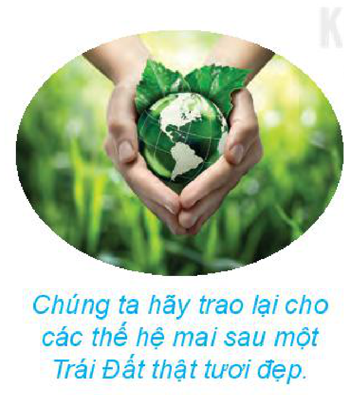
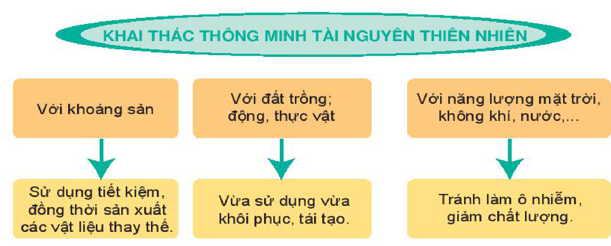
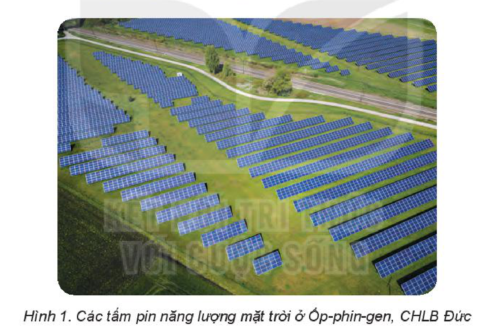

<!-- pdf:188 -->

# BÀI 29: BẢO VỆ TỰ NHIÊN VÀ KHAI THÁC THÔNG MINH CÁC TÀI NGUYÊN THIÊN NHIÊN VÌ SỰ PHÁT TRIỂN BỀN VỮNG

## 🎯 Học xong bài này, em sẽ:

- Nêu được ý nghĩa của việc bảo vệ tự nhiên và khai thác thông minh các tài nguyên thiên nhiên vì sự phát triển bền vững.
- Thấy được trách nhiệm và có hành động cụ thể để bảo vệ tự nhiên và khai thác thông minh tài nguyên ở địa phương.

## 🔴 Mở đầu

- Thiên nhiên đang kêu cứu. Chúng ta phải làm gì để bảo vệ thiên nhiên?
- Có lẽ chúng mình phải đưa vấn đề này ra trao đổi trong lớp.
<!-- ocr-ok: đã đối chiếu ảnh trang gốc PDF 188, bóng thoại nghiêng trong hộp Mở đầu -->

## 1. Thế nào là phát triển bền vững?

Sự phát triển nhằm đáp ứng các nhu cầu của thế hệ hiện tại mà không làm tổn hại đến nhu cầu của các thế hệ tương lai gọi là **phát triển bền vững**.

> ❓ Hãy nêu một số tác động của con người tới thiên nhiên sẽ làm ảnh hưởng đến khả năng đáp ứng nhu cầu của các thế hệ mai sau.

## 2. Bảo vệ tự nhiên và khai thác thông minh các tài nguyên thiên nhiên

*Chúng ta hãy trao lại cho các thế hệ mai sau một Trái Đất thật tươi đẹp.*

<!-- term: Bảo vệ tự nhiên -->
Bảo vệ tự nhiên có ý nghĩa trong việc giữ gìn sự đa dạng sinh học, ngăn chặn ô nhiễm và suy thoái môi trường tự nhiên. Nhờ đó, bảo vệ được không gian sống của con người, đảm bảo cho con người tồn tại trong môi trường trong lành, thuận lợi để phát triển kinh tế, xã hội.

<!-- term: Khai thác thông minh tài nguyên thiên nhiên -->
Khai thác thông minh các tài nguyên thiên nhiên có ý nghĩa trong việc sử dụng tài nguyên hợp lí, tiết kiệm nhằm hạn chế sự suy giảm tài nguyên cả về số lượng và chất lượng, đảm bảo nguồn tài nguyên cho sinh hoạt và sản xuất của con người trong hiện tại cũng như trong tương lai.

<!-- pdf:189 -->

<!-- term: Khai thác thông minh tài nguyên thiên nhiên -->
KHAI THÁC THÔNG MINH TÀI NGUYÊN THIÊN NHIÊN:
- Với khoáng sản: Sử dụng tiết kiệm, đồng thời sản xuất các vật liệu thay thế.
- Với đất trồng; động, thực vật: Vừa sử dụng vừa khôi phục, tái tạo.
- Với năng lượng mặt trời, không khí, nước,...: Tránh làm ô nhiễm, giảm chất lượng.
<!-- ocr-ok: đã đối chiếu ảnh trang gốc PDF 189, sơ đồ ba nhánh ở đầu trang -->

> ❓ 1. Em hãy cho biết ý nghĩa của việc bảo vệ tự nhiên và khai thác thông minh tài nguyên thiên nhiên.
>
> 2. Để bảo vệ môi trường, mỗi người chúng ta cần phải làm gì?
>
> 3. Dựa vào sơ đồ trên và hình 1, em hãy lấy ví dụ cụ thể về các biện pháp khai thác và sử dụng thông minh tài nguyên thiên nhiên.

*Hình 1. Các tấm pin năng lượng mặt trời ở Ốp-phin-gen, CHLB Đức*
<!-- ocr-ok: đã đối chiếu ảnh trang gốc PDF 189, chú thích Hình 1 bị OCR bỏ sót -->

## ✏️ Luyện tập và Vận dụng

1. Em hãy nêu một số việc có thể làm hằng ngày để bảo vệ môi trường.
2. Thu thập thông tin về việc khai thác các tài nguyên thiên nhiên để phát triển bền vững ở địa phương em.

## 📷 Danh sách hình trong bài

| Mã hình | Trang PDF | Vị trí trong bài | Chú thích gốc |
| --- | --- | --- | --- |
| H6-lich_su_va_dia_ly-dl-b29-01 | 188 | Mục 2 | Chúng ta hãy trao lại cho các thế hệ mai sau một Trái Đất thật tươi đẹp. |
| H6-lich_su_va_dia_ly-dl-b29-02 | 189 | Mục 2 | KHAI THÁC THÔNG MINH TÀI NGUYÊN THIÊN NHIÊN |
| H6-lich_su_va_dia_ly-dl-b29-03 | 189 | Mục 2 | Hình 1. Các tấm pin năng lượng mặt trời ở Ốp-phin-gen, CHLB Đức |
