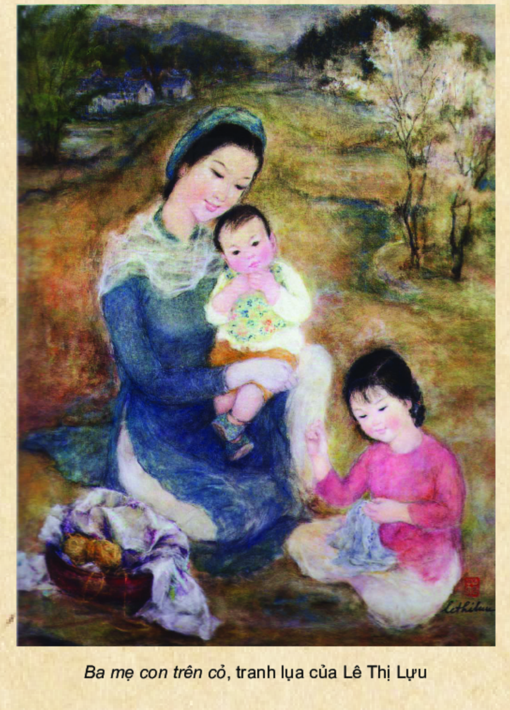

<!-- pdf:43 -->

# BÀI 2: GÕ CỬA TRÁI TIM

*Công cha như núi Thái Sơn*
*Nghĩa mẹ như nước trong nguồn chảy ra.*

(Ca dao Việt Nam)

## Giới thiệu bài học

- Con người ai cũng cần một mái ấm gia đình. Nhưng gia đình chỉ trở thành mái ấm khi mọi thành viên đều cố gắng vun đắp hạnh phúc từng ngày. Vậy mỗi chúng ta cần làm gì để gia đình thực sự là mái ấm tràn ngập hạnh phúc, yêu thương?
- Những bài thơ trong bài học này sẽ “gõ cửa trái tim” mỗi người, giúp ta cảm nhận sâu sắc hơn tình yêu của những người thân trong gia đình, đánh thức những yêu thương trong trái tim mình, để ta biết trân trọng và vun đắp hạnh phúc gia đình.

*Ba mẹ con trên cỏ*, tranh lụa của Lê Thị Lựu

<!-- pdf:44 -->

## 🎯 Mục tiêu bài học

- Nhận biết và bước đầu nhận xét được nét độc đáo của bài thơ thể hiện qua từ ngữ, hình ảnh, biện pháp tu từ; nêu được tác dụng của các yếu tố tự sự và miêu tả trong thơ.
- Viết được đoạn văn ghi lại cảm xúc sau khi đọc một bài thơ.
- Trình bày được ý kiến về một vấn đề trong đời sống.
- Nhân ái, yêu gia đình, yêu vẻ đẹp của thiên nhiên và cuộc sống.

## Đọc

### TRI THỨC NGỮ VĂN

**Một số đặc điểm của thơ**

<!-- term: thể thơ -->
- Mỗi bài thơ thường được sáng tác theo một thể thơ nhất định với những đặc điểm riêng về số tiếng trong mỗi dòng, số câu trong mỗi bài,...

<!-- term: ngôn ngữ thơ -->
<!-- term: nhạc điệu -->
<!-- term: hình ảnh -->
<!-- term: biện pháp tu từ -->
<!-- term: điệp ngữ -->
- Ngôn ngữ thơ cô đọng, giàu nhạc điệu và hình ảnh, sử dụng nhiều biện pháp tu từ (so sánh, ẩn dụ, điệp ngữ,...).

<!-- term: yếu tố tự sự và miêu tả trong thơ -->
<!-- term: miêu tả -->
- Nội dung chủ yếu của thơ là tình cảm, cảm xúc của nhà thơ trước cuộc sống. Thơ có thể có yếu tố tự sự (kể lại một sự việc, câu chuyện) và miêu tả (tái hiện những đặc điểm nổi bật của đối tượng) nhưng những yếu tố ấy chỉ là phương tiện để nhà thơ bộc lộ tình cảm, cảm xúc.

**Ẩn dụ**

**Ẩn dụ** là biện pháp tu từ gọi tên sự vật, hiện tượng này bằng tên sự vật, hiện tượng khác có nét tương đồng với nó, nhằm tăng khả năng gợi hình, gợi cảm cho sự diễn đạt.

### VĂN BẢN ĐỌC

- *Chuyện cổ tích về loài người*, Xuân Quỳnh
- *Mây và sóng*, Ra-bin-đơ-ra-nát Ta-go (Rabindranath Tagore)
- *Bức tranh của em gái tôi*, Tạ Duy Anh

<!-- pdf:45 -->

**Chuyện cổ tích về loài người**

XUÂN QUỲNH

**Trước khi đọc**

1. Nêu tên một truyện kể về nguồn gốc loài người trong kho tàng văn học dân gian Việt Nam hoặc văn học nước ngoài mà em biết. Trong truyện kể đó, sự ra đời của loài người có điều gì kì lạ?
2. Đọc một bài thơ mà em yêu thích.

**Đọc văn bản**

Trời sinh ra trước nhất
Chỉ toàn là trẻ con
Trên trái đất trụi trần
Không dáng cây ngọn cỏ
Mặt trời cũng chưa có
Chỉ toàn là bóng đêm
Không khí chỉ màu đen
Chưa có màu sắc khác

> **THEO DÕI:** Số lượng tiếng trong một câu thơ.

> **HÌNH DUNG:** Hình ảnh trái đất khi trẻ con được sinh ra.

\* \* \*

Mắt trẻ con sáng lắm
Nhưng chưa thấy gì đâu!
Mặt trời mới nhô cao
Cho trẻ con nhìn rõ
Màu xanh bắt đầu cỏ
Màu xanh bắt đầu cây

> **HÌNH DUNG:** Sự thay đổi của trái đất sau khi trẻ con được sinh ra qua miêu tả của nhà thơ.

<!-- pdf:46 -->

Cây cao bằng gang tay
Lá cỏ bằng sợi tóc
Cái hoa bằng cái cúc
Màu đỏ làm ra hoa
Chim bấy giờ sinh ra
Cho trẻ nghe tiếng hót
Tiếng hót trong bằng nước
Tiếng hót cao bằng mây
Những làn gió thơ ngây
Truyền âm thanh đi khắp
Muốn trẻ con được tắm
Sông bắt đầu làm sông
Sông cần đến mênh mông
Biển có từ thuở đó
Biển thì sinh ý nghĩ
Biển sinh cá sinh tôm
Biển sinh những cánh buồm
Cho trẻ con đi khắp
Đám mây cho bóng rợp
Trời nắng mây theo che
Khi trẻ con tập đi
Đường có từ ngày đó

> **THEO DÕI:** Các nhân vật, sự việc được kể trong bài thơ.

Nhưng còn cần cho trẻ
Tình yêu và lời ru
Cho nên mẹ sinh ra
Để bế bồng chăm sóc
Mẹ mang về tiếng hát
Từ cái bống cái bang
Từ cái hoa rất thơm
Từ cánh cò rất trắng

> **HÌNH DUNG:** Sự chăm sóc, yêu thương của mẹ dành cho con.

<!-- pdf:47 -->

Từ vị gừng rất đắng
Từ vết lấm chưa khô
Từ đầu nguồn cơn mưa
Từ bãi sông cát vắng...

Biết trẻ con khao khát
Chuyện ngày xưa, ngày sau
Không hiểu là từ đâu
Mà bà về ở đó
Kể cho bao chuyện cổ:
Chuyện con cóc, nàng tiên
Chuyện cô Tấm ở hiền
Thằng Lý Thông ở ác...
Mái tóc bà thì bạc
Con mắt bà thì vui
Bà kể đến suốt đời
Cũng không sao hết chuyện.

> **HÌNH DUNG:** Hình ảnh bà kể chuyện và thế giới trong những câu chuyện cổ bà kể.

Muốn cho trẻ hiểu biết
Thế là bố sinh ra
Bố bảo cho biết ngoan
Bố dạy cho biết nghĩ
Rộng lắm là mặt bể
Dài là con đường đi
Núi thì xanh và xa
Hình tròn là trái đất...

> **HÌNH DUNG:** Sự yêu thương, chăm sóc mà bố dành cho con.

Chữ bắt đầu có trước
Rồi có ghế có bàn
Rồi có lớp có trường

<!-- pdf:48 -->

Và sinh ra thầy giáo...
Cái bảng bằng cái chiếu
Cục phấn từ đá ra
Thầy viết chữ thật to:
“Chuyện loài người” trước nhất.

> **HÌNH DUNG:** Khung cảnh mái trường thân yêu.
<!-- ocr-ok: thẻ chỉ dẫn đọc ở cột phải bị OCR đọc nhầm "HÌNH DUNG Khung cảnh" thành "KĂNH DỰNG Khung cônh", đã đối chiếu ảnh trang PDF 48 -->

(Xuân Quỳnh, *Lời ru trên mặt đất*, NXB Tác phẩm mới, Hà Nội, 1978, tr. 49 – 52)

**Sau khi đọc**

**XUÂN QUỲNH**

- Xuân Quỳnh (1942 – 1988) quê ở Hà Nội. Truyện và thơ viết cho thiếu nhi của bà tràn đầy tình yêu thương, trìu mến. Thơ Xuân Quỳnh có hình thức giản dị, ngôn ngữ thơ trong trẻo, phù hợp với cách cảm, cách nghĩ của trẻ thơ. Tác phẩm viết cho thiếu nhi của Xuân Quỳnh được tập hợp trong các tập: *Lời ru trên mặt đất, Bầu trời trong quả trứng, Bến tàu trong thành phố*,...
- Bài thơ *Chuyện cổ tích về loài người* in trong tập thơ *Lời ru trên mặt đất*.

**Trả lời câu hỏi**

1. Nhan đề *Chuyện cổ tích về loài người* gợi cho em suy nghĩ gì?
2. Em hãy nêu những căn cứ để xác định *Chuyện cổ tích về loài người* là một bài thơ.
3. Trong tưởng tượng của nhà thơ, thế giới đã biến đổi ra sao sau khi trẻ con ra đời?
4. Món quà tình cảm nào mà theo nhà thơ, chỉ có mẹ mới đem đến được cho trẻ?
5. Bà đã kể cho trẻ nghe những câu chuyện gì? Hãy nêu những điều bà muốn gửi gắm trong những câu chuyện đó.
6. Theo cách nhìn của nhà thơ, tình cảm mà bố dành cho trẻ có gì khác so với tình cảm của bà và mẹ?

<!-- pdf:49 -->

7. Trong khổ thơ cuối, em thấy hình ảnh trường lớp và thầy giáo hiện lên như thế nào?
8. Câu chuyện về nguồn gốc loài người qua lời của nhà thơ Xuân Quỳnh có gì khác so với những câu chuyện về nguồn gốc loài người mà em đã biết? Sự khác biệt ấy có ý nghĩa như thế nào?

#### Viết kết nối với đọc

Viết đoạn văn (khoảng 5 – 7 câu) thể hiện cảm xúc của em về một đoạn thơ mà em yêu thích trong bài thơ *Chuyện cổ tích về loài người*.

### Thực hành tiếng Việt

*NGHĨA CỦA TỪ NGỮ*

1. Đọc đoạn thơ sau và thực hiện các yêu cầu:

*Mắt trẻ con sáng lắm*
*Nhưng chưa thấy gì đâu!*
*Mặt trời mới nhô cao*
*Cho trẻ con nhìn rõ.*

a. Giải thích nghĩa của từ *nhô*.
b. Trong đoạn thơ trên, có thể thay thế từ *nhô* bằng từ khác được không?
c. Qua việc thử thay thế, hãy chỉ ra sự tinh tế của nhà thơ trong việc sử dụng từ *nhô*.

2. Trong bài thơ có các từ như *trụi trần, bế bồng*,... Trong tiếng Việt cũng có những từ như *trần trụi, bồng bế*,... Tìm thêm ở trong và ngoài bài thơ những trường hợp khác tương tự: hai từ đồng nghĩa, có các tiếng giống nhau nhưng trật tự các tiếng khác nhau.

*BIỆN PHÁP TU TỪ*

3. Hãy chỉ ra những câu thơ có sử dụng biện pháp tu từ so sánh trong khổ hai của bài thơ. Nêu tác dụng của biện pháp tu từ so sánh đó.
4. Nhà thơ đã sử dụng biện pháp tu từ gì trong câu thơ *Những làn gió thơ ngây*? Nêu tác dụng của biện pháp tu từ ấy.
5. Hãy ghi lại những câu thơ sử dụng biện pháp tu từ điệp ngữ trong khổ thơ từ *Nhưng còn cần cho trẻ* đến *Từ bãi sông cát vắng...* và nêu tác dụng của việc sử dụng biện pháp tu từ đó.

<!-- pdf:50 -->

**Mây và sóng**

RA-BIN-ĐƠ-RA-NÁT TA-GO

**Trước khi đọc**

Một lần, em được mẹ cho phép đến nhà bạn chơi. Trò chơi đang vui và em rất muốn chơi tiếp thì đến giờ mẹ dặn phải trở về nhà. Khi ấy, em sẽ làm gì?

**Đọc văn bản**

Mẹ ơi, những người sống trên mây đang gọi con:
“Chúng ta chơi đùa từ khi thức dậy cho đến lúc chiều tà,
Chúng ta chơi với buổi sớm mai vàng,
Chúng ta chơi với vầng trăng bạc”.

> **HÌNH DUNG:** Cảnh em bé trò chuyện với những người “trên mây” và “trong sóng nước”.

Con hỏi: “Nhưng tôi làm sao mà lên được với các bạn?”
Họ trả lời: “Hãy đến bên bờ trái đất,
và đưa tay lên trời,
em sẽ được nhấc bổng lên mây”.

Con nói: “Mẹ tôi đang đợi ở nhà
Làm sao tôi có thể bỏ mẹ tôi mà đi được?”
Thế là họ cười rồi bay đi mất.

<!-- pdf:51 -->

Nhưng con biết một trò chơi thích hơn trò ấy, mẹ ơi.
Con sẽ là mây và mẹ sẽ là trăng.
Con sẽ lấy hai tay trùm lên người mẹ,
Và mái nhà sẽ là bầu trời xanh thẳm.

> **HÌNH DUNG:** Niềm vui của em bé trong trò chơi với mẹ.

Những người sống trong sóng nước gọi con:
“Chúng ta hát từ sớm mai đến tối,
Chúng ta ngao du khắp nơi này nơi nọ mà không biết mình đã từng qua những nơi nào”.

Con hỏi: “Nhưng tôi làm sao gặp được các bạn?”
Họ bảo con: “Hãy đến chỗ gần sát biển
và đứng đó, nhắm nghiền mắt lại,
là em sẽ được đưa lên trên làn sóng”.

Con bảo: “Buổi chiều, mẹ tôi luôn luôn muốn tôi ở nhà với mẹ.
Làm sao tôi có thể bỏ mẹ tôi mà đi được?”
Thế là họ cười, múa nhảy rồi đi qua.

Nhưng con biết một trò chơi hay hơn trò ấy,
Con sẽ là sóng, mẹ sẽ là một bờ biển lạ lùng.
Con sẽ lăn, lăn, lăn mãi
và vỗ vào gối mẹ, cười vang.
Và không một ai trên cõi đời này biết nơi đâu mẹ con ta đang ở.

(R. Ta-go, *Tuyển tập thơ*, *theo* Đào Xuân Quý *dịch*, NXB Văn hoá – Thông tin, Hà Nội, 2000, tr. 137 – 138)

<!-- pdf:52 -->

**Sau khi đọc**

**RA-BIN-ĐƠ-RA-NÁT TA-GO**

- Ra-bin-đơ-ra-nát Ta-go (1861 – 1941) là danh nhân văn hoá, nhà thơ hiện đại lớn nhất của Ấn Độ. Ông để lại một gia tài nghệ thuật đồ sộ, trong đó nổi tiếng nhất là các tác phẩm thơ ca. Thơ R. Ta-go chan chứa tình yêu đất nước, con người, cuộc sống,... Những tình cảm ấy được thể hiện một cách độc đáo qua những hình ảnh tưởng tượng huyền ảo lay động lòng người. Các tập thơ tiêu biểu của R. Ta-go: *Thơ Dâng, Người làm vườn, Những con chim bay lạc, Mùa hái quả*,...
- Bài thơ *Mây và sóng* được in trong tập *Trăng non* – tập thơ R. Ta-go viết cho trẻ thơ. Ban đầu, tập thơ được viết bằng tiếng Ben-gan (Bengal) có tên là *Trẻ thơ*, về sau, ông dịch ra tiếng Anh và đổi thành *Trăng non*.

**Trả lời câu hỏi**

1. Đọc bài thơ *Mây và sóng*, ta như được nghe kể một câu chuyện. Theo em, ai đang kể chuyện với ai và kể về điều gì?
2. Qua lời trò chuyện của những người “trên mây” và “trong sóng”, em thấy thế giới của họ hiện lên như thế nào?
3. Câu hỏi: “Nhưng tôi làm sao mà lên được với các bạn?”, “Nhưng tôi làm sao gặp được các bạn?” thể hiện tâm trạng gì của em bé?
4. Vì sao em bé từ chối lời mời gọi của những người “trên mây” và “trong sóng”?
5. Em bé đã sáng tạo ra những trò chơi gì? Em cảm nhận như thế nào về mẹ và em bé trong những trò chơi ấy?

<!-- term: vần -->
<!-- term: vần thơ -->
6. Văn bản *Mây và sóng* có hình thức khác với văn bản *Chuyện cổ tích về loài người* (số tiếng trong các dòng không bằng nhau, không vần,...). Vì sao nó vẫn được coi là văn bản thơ?

#### Viết kết nối với đọc

Hãy tưởng tượng em là người đang trò chuyện với mây và sóng. Viết đoạn văn (khoảng 5 – 7 câu) về cuộc trò chuyện ấy.

<!-- pdf:53 -->

### Thực hành tiếng Việt

*BIỆN PHÁP TU TỪ*

1. Trong bài thơ *Mây và sóng*, “mây” và “sóng” là những hình ảnh ẩn dụ. Hai hình ảnh ấy có thể gợi cho em liên tưởng tới những đối tượng nào khác?

> **Nhận biết ẩn dụ**
> Đọc câu thơ sau:
> *Cha lại dắt con đi trên cát mịn*
> *Ánh nắng chảy đầy vai.*
> (Hoàng Trung Thông, *Những cánh buồm*)
> Từ *chảy* vốn chỉ sự vận động của chất lỏng, nay được dùng cho ánh nắng, giúp người đọc cảm nhận được ánh nắng vàng rực tràn trề trên vai hai cha con và lan toả khắp không gian.

2. Xác định biện pháp tu từ được sử dụng trong hình ảnh “buổi sớm mai vàng”, “vầng trăng bạc” và nêu tác dụng của biện pháp tu từ đó.

<!-- term: điệp từ -->
3. Xác định và phân tích tác dụng của biện pháp tu từ điệp từ, điệp ngữ trong đoạn thơ sau:

*Nhưng con biết một trò chơi hay hơn trò ấy,*
*Con sẽ là sóng, mẹ sẽ là một bờ biển lạ lùng.*
*Con sẽ lăn, lăn, lăn mãi*
*và vỗ vào gối mẹ, cười vang.*
*Và không một ai trên cõi đời này biết nơi đâu mẹ con ta đang ở.*

*DẤU CÂU*

4. Trong bài thơ *Mây và sóng* có nhiều đoạn dẫn lời nói trực tiếp của các nhân vật. Hãy cho biết dấu câu nào được dùng để đánh dấu những lời nói trực tiếp đó.

*ĐẠI TỪ*

5. “Chúng ta” trong những lời nói trực tiếp ở bài *Mây và sóng* dùng để chỉ những ai?
6. Trong tiếng Việt, ngoài “chúng ta” còn có một số đại từ nhân xưng ngôi thứ nhất số nhiều khác. Có thể dùng một từ nào trong số đó để thay cho “chúng ta” trong bản dịch không? Vì sao?

<!-- pdf:54 -->

**Bức tranh của em gái tôi**

TẠ DUY ANH

**Đọc văn bản**

Em gái tôi tên là Kiều Phương, nhưng tôi quen gọi nó là Mèo bởi vì mặt nó luôn bị chính nó bôi bẩn. Nó vui vẻ chấp nhận cái tên tôi tặng cho và hơn thế, còn dùng để xưng hô với bạn bè. Mèo rất hay lục lọi(1) các đồ vật với một sự thích thú đến khó chịu.

- Này, em không để chúng nó yên được à?

Nó vênh mặt:

- Mèo mà lại! Em không phá là được...

Một hôm tôi bắt gặp nó nhào một thứ bột gì đó đen sì, trông rất sợ, thỉnh thoảng lại bôi ra cổ tay. Trời ạ, thì ra nó chế thuốc vẽ. Thảo nào các đít xoong chảo bị nó cạo trắng cả. Tôi quyết định bí mật theo dõi em gái tôi. Sau khi có vẻ đã hài lòng, nó lôi trong túi ra ba bốn lọ nhỏ, cái màu đỏ, cái màu vàng, cái màu xanh lục,... đều do nó tự chế. Nó đưa mắt canh chừng rồi lại nhét tất cả vào túi sau khi cho màu đen nhọ nồi(2) vào một cái lọ còn bỏ không.

Xong, nó vui vẻ chạy đi làm những việc bố mẹ tôi phân công, vừa làm vừa hát, có vẻ vui lắm.

> (1) *Lục lọi*: tìm kĩ lưỡng, tỉ mỉ mọi chỗ, mọi nơi.
> (2) *Nhọ nồi*: bụi đen bám ở đáy và xung quanh nồi, chảo,... khi người ta đun nấu bằng củi, than, rơm rạ,...

<!-- pdf:55 -->

Nhưng mọi bí mật của Mèo cuối cùng cũng bị bại lộ(1). Hôm đó, chú Tiến Lê – hoạ sĩ, bạn thân của bố tôi – đưa theo bé Quỳnh đến chơi. Vớ được bạn gái nó mừng quýnh(2) lên. Hai đứa lôi nhau ra vườn. Tại đây Mèo đưa toàn bộ những bức tranh nó vẽ giấu ra cho bé Quỳnh xem. Chỉ thấy bé Quỳnh thỉnh thoảng lại reo lên khe khẽ. Lát sau bé Quỳnh chạy vào thì thầm gì đó với chú Tiến Lê khiến chú phải xin phép bố tôi theo bé Quỳnh ra vườn. Lúc đó, tôi đang mải mê với chiếc diều nên không biết có chuyện gì xảy ra. Chỉ thấy từ ngoài vườn trở vào, mặt chú Tiến Lê rạng rỡ lắm:

- Anh chị có phúc lớn rồi. Anh có biết con gái anh là một thiên tài(3) hội hoạ không?

Chú trải sáu bức tranh do Mèo vẽ ra trước mặt bố tôi. Đến lượt bố tôi ngây người ra như không tin vào mắt mình.

- Con gái tôi vẽ đây ư? Chả lẽ lại đúng là nó, cái con Mèo hay lục lọi ấy?

Và ông không kìm được, ôm thốc Mèo lên:

- Ôi, con đã cho bố một bất ngờ quá lớn.

Mẹ tôi vừa về, kịp nghe và kịp chứng kiến tất cả, cũng không kìm được xúc động. Theo chú Tiến Lê thì những bức tranh của Mèo rất độc đáo, có thể đem đóng khung treo ở bất cứ phòng tranh nào. Bố mẹ tôi rất tin vào thẩm định(4) của chú Tiến Lê. Chú còn hứa sẽ giúp em gái tôi để nó phát huy tài năng.

Kể từ hôm đó, mặc dù mọi chuyện vẫn như cũ trong căn nhà của chúng tôi, nhưng tôi luôn luôn cảm thấy mình bất tài nên bị đẩy ra ngoài. Những lúc ngồi bên bàn học, tôi chỉ muốn gục đầu xuống khóc.

Tôi chẳng tìm thấy ở tôi một năng khiếu gì. Và không hiểu vì sao tôi không thể thân với Mèo như trước kia được nữa. Chỉ cần một lỗi nhỏ ở nó là tôi gắt um lên.

Tôi quyết định làm một việc mà tôi vẫn coi khinh: xem trộm những bức tranh của Mèo. Dường như mọi thứ có trong ngôi nhà của chúng tôi đều được

> (1) *Bại lộ*: vỡ lở, không giấu giếm được nữa. Ở đây ý nói việc vẽ tranh của bé Mèo được mọi người phát hiện ra.
> (2) *Mừng quýnh*: mừng quá dẫn đến cuống quýt.
> (3) *Thiên tài*: tài năng nổi bật, hơn hẳn mọi người, dường như là được trời phú cho.
> (4) *Thẩm định*: xem xét nhằm đánh giá để xác định, quyết định.

<!-- pdf:56 -->

nó đưa vào tranh. Mặc dù nó vẽ bằng những nét to tướng, nhưng ngay cả cái bát múc cám lợn sứt một miếng, cũng trở nên ngộ nghĩnh. Con mèo vằn vào tranh nó, to hơn cả con hổ nhưng nét mặt lại vô cùng dễ mến. Có cảm tưởng nó biết mọi việc chúng tôi làm và lơ đi vì không chấp trẻ con.

Gấp lại những bức tranh của Mèo, tôi lén trút ra một tiếng thở dài...

Bố mẹ tôi hào hứng mua sắm cho em gái tôi tất cả những gì cần cho công việc vẽ. Chú Tiến Lê tặng “đồng nghiệp” hẳn một hộp màu ngoại xịn. Chỉ có mặt Mèo là không thay đổi. Lúc nào cũng lem nhem, bị tôi quát thì xịu xuống, miệng dẩu ra. Tôi từng thấy nó rất ngộ với vẻ mặt ấy. Nhưng đấy là trước kia. Bây giờ tôi cảm thấy nó như chọc tức tôi...

Rồi cả nhà – trừ tôi – vui như tết khi bé Phương, qua giới thiệu của chú Tiến Lê, được mời tham gia trại thi vẽ Quốc tế. Luật của cuộc thi là thí sinh phải vẽ một bức tranh theo đề tài tự chọn ngay trước mắt ban giám khảo. Trước khi đi thi, nó có vẻ cứ hay xét nét(1) tôi, khiến tôi rất khó chịu. Nó nhập tâm(2) lời dạy của chú Tiến Lê: “Cháu hãy vẽ cái gì thân thuộc nhất với cháu”. Một tuần sau em gái tôi trở về trong vòng tay dang sẵn của cả bố và mẹ tôi: Bức tranh của nó được trao giải nhất. Nó lao vào ôm cổ tôi, nhưng tôi viện cớ đang dở việc đẩy nhẹ nó ra. Tuy thế nó vẫn kịp thì thầm vào tai tôi: “Em muốn cả anh cũng đi nhận giải”.

Trong gian phòng lớn tràn ngập ánh sáng, những bức tranh của thí sinh treo kín bốn bức tường. Bố, mẹ tôi kéo tôi chen qua đám đông để xem bức tranh của Kiều Phương đã được đóng khung, lồng kính. Trong tranh,

> (1) *Xét nét*: để ý từng cái quá nhỏ nhặt để đánh giá, nhận xét con người. Ở đây có nghĩa là chú ý, quan sát rất kĩ.
> (2) *Nhập tâm*: nhớ rất rõ, rất kĩ, như khắc sâu trong lòng.

<!-- pdf:57 -->

một chú bé đang ngồi nhìn ra ngoài cửa sổ, nơi bầu trời trong xanh. Mặt chú bé như toả ra một ánh sáng rất lạ. Toát lên từ cặp mắt, tư thế ngồi của chú không chỉ sự suy tư mà còn rất mơ mộng nữa. Mẹ hồi hộp thì thầm vào tai tôi:

- Con có nhận ra con không?

Tôi giật sững(1) người. Chẳng hiểu sao tôi phải bám chặt lấy tay mẹ. Thoạt tiên là sự ngỡ ngàng, rồi đến hãnh diện, sau đó là xấu hổ. Dưới mắt em tôi, tôi hoàn hảo đến thế kia ư? Tôi nhìn như thôi miên(2) vào dòng chữ đề trên bức tranh: “Anh trai tôi”. Vậy mà dưới mắt tôi thì...

- Con đã nhận ra con chưa? – Mẹ vẫn rất hồi hộp.

Tôi không trả lời mẹ vì tôi muốn khóc quá. Bởi vì nếu nói được với mẹ, tôi sẽ nói rằng: “Không phải con đâu. Đấy là tâm hồn và lòng nhân hậu của em gái con đấy”.

(Tạ Duy Anh, *Bản nhạc con đà điểu*, NXB Kim Đồng, Hà Nội, 2016, tr. 45 – 50)

**Sau khi đọc**

**TẠ DUY ANH**

- Tạ Duy Anh tên khai sinh là Tạ Viết Đãng, sinh năm 1959 tại Hà Nội. Truyện viết cho thiếu nhi của Tạ Duy Anh trong sáng, đậm chất thơ và giàu ý nghĩa nhân văn. Viết cho thiếu nhi chính là cách ông bày tỏ tình yêu với thế giới tuổi thơ thuần khiết. *Bản nhạc con đà điểu, Quả trứng vàng, Vó ngựa trở về* là những tập truyện viết cho thiếu nhi của nhà văn.
- Truyện ngắn *Bức tranh của em gái tôi* được in trong tập *Bản nhạc con đà điểu*.

> (1) *Sững*: ở vào trạng thái bất động, đờ người ra trong giây lát, do chịu một tác động tinh thần mạnh đột ngột. Ở đây là trạng thái của người anh khi thấy hình ảnh của mình trong tranh em gái vẽ.
> (2) *Thôi miên*: tác động vào tâm lí của một người nào đó, gây ra trạng thái tựa như ngủ, làm cho dễ dàng chịu sự điều khiển của mình. Ở đây chỉ trạng thái bất ngờ đến lặng người của người anh trai khi nhìn thấy mình trong bức tranh của em gái.

<!-- pdf:58 -->

**Trả lời câu hỏi**

1. Trong truyện ngắn *Bức tranh của em gái tôi*, người kể chuyện là ai, xuất hiện ở ngôi thứ mấy?
2. Em thích nhất đặc điểm gì của nhân vật Mèo – Kiều Phương? Vì sao?
3. Em có nhận xét gì về cảm xúc, thái độ, hành động của nhân vật “tôi” trước khi xem bức chân dung của mình do em gái vẽ?
4. Nhân vật “tôi” đã thay đổi ra sao sau khi xem bức chân dung của mình do em gái vẽ? Vì sao có sự thay đổi ấy?
5. Từ các văn bản *Chuyện cổ tích về loài người, Mây và sóng, Bức tranh của em gái tôi*, em nhận thấy điều quan trọng nhất có thể gắn kết các thành viên trong gia đình là gì?

## Viết

**Viết đoạn văn ghi lại cảm xúc về một bài thơ có yếu tố tự sự và miêu tả**

Tình cảm, cảm xúc là một trong những phẩm chất quan trọng hàng đầu của thơ. Để thể hiện tình cảm, cảm xúc, các nhà thơ đã chọn nhiều cách khác nhau, trực tiếp hoặc gián tiếp. Nhiều khi các yếu tố tự sự và miêu tả đã được đưa vào thơ một cách đầy nghệ thuật, cho phép tác giả ẩn mình, nhường chỗ cho câu chuyện, sự việc, cảnh vật tự nói lên những điều cần thiết. Em hãy viết đoạn văn ghi lại cảm xúc, ấn tượng của mình về một bài thơ thuộc loại này để hiểu thêm về một hình thức nghệ thuật độc đáo của thơ ca nói chung.

*Yêu cầu đối với đoạn văn ghi lại cảm xúc sau khi đọc một bài thơ có yếu tố tự sự và miêu tả:*

- Giới thiệu tên bài thơ và tác giả bài thơ.
- Nêu được cảm xúc chung về bài thơ.
- Nêu các chi tiết mang tính tự sự và miêu tả trong bài thơ; đánh giá ý nghĩa của chúng trong việc thể hiện tình cảm, cảm xúc của nhà thơ.
- Chỉ ra được nét độc đáo trong cách tự sự và miêu tả của nhà thơ.

<!-- pdf:59 -->

### Phân tích bài viết tham khảo

**Cảm xúc khi đọc bài thơ *Mây và sóng* của Ta-go**

Nhan đề bài thơ là *Mây và sóng* nhưng nhà thơ Ta-go không đưa người đọc lãng du tới những xứ sở thần tiên xa xôi, mà dẫn chúng ta về giữa cuộc đời bình dị để cảm nhận và xúc động trước tình mẹ con thiêng liêng bất diệt. Đi theo câu chuyện được nhà thơ kể bằng giọng chậm rãi, êm ái với những chi tiết thật đắt, người đọc đồng cảm với tình yêu mẹ tha thiết, mong muốn luôn được ở bên mẹ của em bé bởi đó cũng là tình cảm của mỗi người chúng ta dành cho mẹ của mình. Em bé được mời gọi đến những xứ sở tuyệt vời “trên mây” và “trong sóng nước” – những thế giới xa rộng bao la, đầy hấp dẫn. Khát khao được khám phá những thế giới kì diệu, em bé thốt lên thành câu hỏi háo hức: “Nhưng tôi làm sao mà lên được với các bạn”, “Nhưng tôi làm sao mà gặp được các bạn?”. Khi em nhớ rằng: “Mẹ tôi đang đợi ở nhà”, “mẹ tôi luôn luôn muốn tôi ở nhà với mẹ”, em bé đã từ chối bằng một câu hỏi có tính khẳng định: “Làm sao tôi có thể bỏ mẹ tôi mà đi được?”. Yêu thế giới thiên nhiên kì diệu, yêu mẹ, để làm mẹ vui, em bé đã sáng tạo ra những trò chơi còn vui hơn, thú vị hơn trò chơi của những người “trên mây” và “trong sóng”: con là mây, là sóng tinh nghịch, phiêu du khắp chốn; mẹ là trăng dịu hiền toả sáng, là bờ biển bao dung ôm ấp che chở suốt đời con; và mái nhà – tổ ấm đầu đời – là bầu trời xanh dịu mát, bình yên vĩnh cửu. Qua những lời thoại và chi tiết được nhà thơ thuật kể tuần tự, vừa lặp lại, vừa biến hoá, độc giả từng bước một có cảm nhận thấm thía hơn về chiều sâu của tình cảm mà một người con đã dành cho mẹ của mình. Nói chung, bài thơ đã kể một câu chuyện thật cảm động về tình mẹ con, về niềm hạnh phúc ngọt ngào khi được sống trong vòng tay êm ấm yêu thương của mẹ.

> Giới thiệu tên bài thơ và tác giả.

> Nêu cảm xúc chung về bài thơ.

> Nêu các chi tiết mang tính tự sự và miêu tả trong bài thơ và đánh giá ý nghĩa của chúng.

> Chỉ ra nét độc đáo trong cách tự sự và miêu tả của nhà thơ.

> Khái quát lại cảm xúc chung của người viết về bài thơ trong hình thức kể chuyện độc đáo của nó.

(Nhóm biên soạn)

<!-- pdf:60 -->

**Thực hành viết theo các bước**

### 1. TRƯỚC KHI VIẾT

**a. Lựa chọn bài thơ**

Bài thơ được em chọn phải là bài thơ có yếu tố kể chuyện (xuất hiện câu chuyện, nhân vật, dù nhân vật có thể chỉ mang một cái tên chung chung), có các chi tiết miêu tả bối cảnh không gian, thời gian, con người,... Các bài thơ *Chuyện cổ tích về loài người, Mây và sóng* đều thuộc loại này.

<!-- term: mục đích viết -->
> *Mục đích viết*: Chia sẻ cảm xúc về một bài thơ có yếu tố tự sự và miêu tả.
> *Người đọc*: Thầy cô, bạn bè và những ai quan tâm, mong muốn tìm hiểu, cảm nhận cái hay, cái đẹp của bài thơ.

**b. Tìm ý**

Để tìm ý, em hãy ngầm nêu các câu hỏi để tự trả lời như: *Bài thơ gợi lên câu chuyện gì? Đâu là các chi tiết tự sự và miêu tả nổi bật? Các chi tiết ấy sống động, thú vị như thế nào? Chúng đã góp phần thể hiện ấn tượng điều nhà thơ muốn bày tỏ ra sao?...*

**c. Lập dàn ý**

Từ các ý đã được hình thành qua cách nêu và trả lời những câu hỏi nói trên, em hãy sắp xếp thành một dàn ý:

*Dàn ý*

1. *Mở đoạn*: Giới thiệu tác giả và bài thơ; nêu khái quát ấn tượng, cảm xúc về bài thơ.
2. *Thân đoạn*:
- Nêu ấn tượng, cảm xúc của em về câu chuyện được kể hoặc các chi tiết miêu tả có trong bài thơ.
- Làm rõ nghệ thuật kể chuyện và miêu tả của tác giả.
- Đánh giá hiệu quả của cách triển khai bài thơ bằng câu chuyện và các chi tiết miêu tả.
3. *Kết đoạn*: Nêu khái quát điều em tâm đắc về bài thơ (trong đó có nói tới đặc điểm nghệ thuật riêng của bài thơ đã được phân tích ở trên).

### 2. VIẾT BÀI

Khi viết bài, em cần lưu ý:

- Bám sát dàn ý để viết đoạn.
- Lựa chọn từ ngữ để diễn đạt cảm xúc của em về nội dung của bài thơ cũng như những từ ngữ, hình ảnh, biện pháp tu từ độc đáo nhất.
- Trình bày đúng hình thức của đoạn văn: viết lùi đầu dòng từ đầu tiên của đoạn văn và chữ cái đầu của từ đó phải viết hoa; kết thúc đoạn văn bằng một dấu chấm câu. Các câu trong đoạn cần tập trung vào chủ đề chung, giữa các câu có dùng từ ngữ liên kết. Đoạn văn khoảng 7 – 10 câu.

<!-- pdf:61 -->

### 3. CHỈNH SỬA BÀI VIẾT

Hãy kiểm tra bài viết của em theo những yêu cầu ở cột trái và gợi ý chỉnh sửa ở cột phải.

| Yêu cầu | Gợi ý chỉnh sửa |
| --- | --- |
| Giới thiệu được tên bài thơ, tên tác giả (nếu có) và cảm nhận chung của người viết. | Nếu còn thiếu so với yêu cầu, hãy bổ sung. |
| Nêu được cảm xúc và ý kiến đánh giá về nét đặc sắc của bài thơ có sử dụng yếu tố tự sự và miêu tả. | Sử dụng lại các câu hỏi ở mục tìm ý để biết được nội dung đoạn văn của em còn thiếu ý gì. Hãy bổ sung nếu có câu hỏi bị bỏ quên, chưa được trả lời. |
| Bảo đảm yêu cầu về chính tả và diễn đạt. | Rà soát lỗi chính tả và diễn đạt (dùng từ, đặt câu, sử dụng từ ngữ liên kết câu,...). Chỉnh sửa nếu phát hiện lỗi. |

## Nói và nghe

**Trình bày ý kiến về một vấn đề trong đời sống gia đình**

Qua các văn bản đọc ở bài *Gõ cửa trái tim*, em đã cảm nhận được ý nghĩa của gia đình đối với tất cả chúng ta. Em cũng đã viết đoạn văn nêu cảm xúc về một bài thơ thể hiện tình cảm đẹp đẽ với gia đình. Nhưng trong thực tế, đời sống gia đình còn có nhiều vấn đề khác, cả tích cực lẫn tiêu cực, khiến chúng ta phải suy nghĩ. Sau đây, em sẽ nói về một vấn đề như vậy.

<!-- pdf:62 -->

### 1. TRƯỚC KHI NÓI

**a. Chuẩn bị nội dung nói**

<!-- term: mục đích nói -->
<!-- term: nội dung nói -->
> *Mục đích nói*: Trình bày ý kiến về một vấn đề trong đời sống gia đình.
> *Người nghe*: Thầy cô, bạn bè, người thân và những ai quan tâm đến vấn đề em nói.

- Dựa vào chính trải nghiệm của em để chọn một đề tài phù hợp (Gợi ý: quan hệ giữa các thành viên trong gia đình; việc chăm sóc, lắng nghe, thấu hiểu của cha mẹ đối với con cái; thái độ cư xử của con cái đối với cha mẹ; những việc cần làm để gia đình trở thành một tổ ấm yêu thương; sự tôn trọng sở thích và mong muốn của từng người,...).
- Có thể đọc lại các văn bản đã học trong bài để được gợi ý thêm về ý tưởng, chẳng hạn, hình ảnh em bé và sự chăm sóc của người thân trong *Chuyện cổ tích về loài người*, tình cảm gắn bó của con đối với mẹ trong *Mây và sóng*, tình yêu thương của anh chị em trong *Bức tranh của em gái tôi*,...
- Tìm thêm thông tin liên quan từ sách báo hoặc các phương tiện nghe nhìn để có được cái nhìn toàn diện hơn về đề tài muốn nói.
- Chuẩn bị tranh ảnh, bài hát,... về gia đình để minh hoạ cho bài nói (nếu có).
- Ghi ra giấy những ý chính cần nói và sắp xếp theo trật tự phù hợp (Gợi ý: nêu vấn đề và các biểu hiện cụ thể của vấn đề; nêu tác động của vấn đề đối với các thành viên trong gia đình; trình bày mong muốn của em và cách em đã làm để giải quyết vấn đề;...).

**b. Tập luyện**

- Để trình bày tốt, em hãy tập luyện trước. Có thể tập luyện một mình hoặc trình bày trước bạn bè, người thân và nhờ họ nhận xét, góp ý.
- Chọn cách nói tự nhiên, gần gũi, gần với kiểu tâm tình, chia sẻ, giãi bày.

### 2. TRÌNH BÀY BÀI NÓI

- Trình bày bài nói theo các ý chính đã chuẩn bị. Mở đầu, nên cho người nghe cảm nhận được điều em sắp nói là điều em đã thực sự chứng kiến, có nhiều cảm xúc và suy nghĩ. Ở phần nội dung chính, cần chú ý để không sa vào việc liệt kê bằng chứng hay kể chuyện; cần tập trung nêu được nội dung cốt lõi, mang tính tiêu biểu cho vấn đề đang bàn. Kết thúc bài nói cần nhấn mạnh vào cách ứng xử thích hợp mà em đã lựa chọn.
- Trong khi nói, cần tập trung vào vấn đề mà em đã chọn. Những liên hệ với trải nghiệm của bản thân em sẽ làm cho nội dung bài nói thêm sinh động.
- Chú ý kết hợp trình bày ý kiến với việc sử dụng tranh ảnh, bài hát để làm tăng sức hấp dẫn cho bài nói.

<!-- pdf:63 -->

### 3. SAU KHI NÓI

Trao đổi về bài nói theo một số gợi ý sau:

| Người nghe | Người nói |
| --- | --- |
| Thể hiện sự chia sẻ và nêu nhận xét về phần trình bày của bạn với thái độ chân thành, tôn trọng. Có thể trao đổi về: - Nội dung bài nói: Bài nói đã trình bày được ý kiến về vấn đề trong đời sống gia đình hay chưa? - Cách trình bày: Ngữ điệu, cách diễn đạt, cách tương tác với người nghe như thế nào? | Phản hồi những nhận xét, góp ý của người nghe với tinh thần cầu thị: - Tiếp thu những ý kiến góp ý mà em cho là xác đáng. - Trao đổi về những điều người nghe cần nắm rõ thêm. |

## Củng cố, mở rộng

1. Hãy kẻ bảng vào vở theo mẫu sau và điền thông tin về đặc điểm của các bài thơ đã học trong bài *Gõ cửa trái tim*.

| Nhan đề bài thơ | Nội dung chính | Đặc điểm nghệ thuật: Hình ảnh | Đặc điểm nghệ thuật: Biện pháp tu từ | Đặc điểm nghệ thuật: Yếu tố tự sự, miêu tả |
| --- | --- | --- | --- | --- |
| | | | | |
<!-- ocr-ok: bảng có ô gộp cột "Đặc điểm nghệ thuật" và bị OCR đọc nhầm "Yếu tố" thành "Yếu tó", đã đối chiếu ảnh trang PDF 63 -->

2. Hãy diễn tả nội dung một bài thơ đã được học trong bài *Gõ cửa trái tim* bằng một hình thức nghệ thuật mà em thích (tranh, truyện tranh, nhạc, kịch bản hoạt cảnh,...).

<!-- pdf:64 -->

## Thực hành đọc

*Khi đọc văn bản, em cần chú ý những vấn đề sau:*
<!-- ocr-ok: dòng chữ nghiêng màu xanh bị OCR đọc nhầm "cần" thành "cân" và "vấn đề" thành "vắn đề", đã đối chiếu ảnh trang PDF 64 -->

- Hình ảnh hai cha con và cuộc trò chuyện của họ.
- Ý nghĩa của hình ảnh những cánh buồm trên biển buổi sớm mai sau trận mưa đêm.
- Những nét đặc sắc về nghệ thuật của bài thơ: biện pháp tu từ ẩn dụ, điệp ngữ; cách dùng từ ngữ giàu hình ảnh và cảm xúc,...

**Những cánh buồm**

HOÀNG TRUNG THÔNG(1)

Hai cha con bước đi trên cát
Ánh mặt trời rực rỡ biển xanh.
Bóng cha dài lênh khênh
Bóng con tròn chắc nịch.

Sau trận mưa đêm rả rích
Cát càng mịn, biển càng trong.
Cha dắt con đi dưới ánh mai hồng,
Nghe con bước lòng vui phơi phới.
Con bỗng lắc tay cha khẽ hỏi:
Cha ơi!
Sao xa kia chỉ thấy nước thấy trời
Không thấy nhà, không thấy cây, không thấy người ở đó?
Cha mỉm cười xoa đầu con nhỏ:
Theo cánh buồm đi mãi đến nơi xa

> (1) Hoàng Trung Thông (1925 – 1993) là nhà thơ tiêu biểu của nền thơ cách mạng Việt Nam.

<!-- pdf:65 -->

Sẽ có cây có cửa có nhà,
Vẫn là đất nước của ta,
Nhưng nơi đó cha chưa hề đi đến.

Cha lại dắt con đi trên cát mịn
Ánh nắng chảy đầy vai,
Cha trầm ngâm nhìn mãi cuối chân trời.
Con lại trỏ cánh buồm xa nói khẽ:
Cha mượn cho con buồm trắng nhé,
Để con đi...
Lời của con hay tiếng sóng thầm thì
Hay tiếng của lòng cha từ một thời xa thẳm?
Lần đầu tiên trước biển khơi vô tận
Cha gặp lại mình trong tiếng ước mơ con.

(Hoàng Trung Thông, *Những cánh buồm*, NXB Văn học, Hà Nội, 1964, tr. 76 – 77)

## 📷 Danh sách hình trong bài

| Hình | Trang PDF | Vị trí trong bài | Mô tả / Chú thích |
| --- | --- | --- | --- |
| H6-ngu_van-b02-01 | 43 | Giới thiệu bài học (trang 42) | Ba mẹ con trên cỏ, tranh lụa của Lê Thị Lựu |
