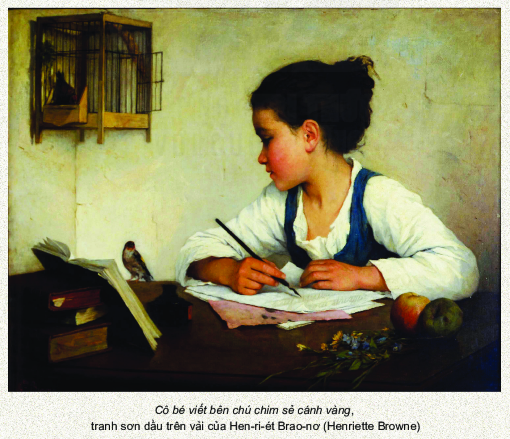

<!-- pdf:66 -->

# BÀI 3: YÊU THƯƠNG VÀ CHIA SẺ

*Thương người như thể thương thân.*
(Tục ngữ Việt Nam)

## Giới thiệu bài học

- Như cỏ cây cần ánh nắng, con người cần tình yêu thương để nuôi dưỡng, sưởi ấm tâm hồn. Điều kì diệu nhất của yêu thương là càng chia sẻ lại càng giàu có; là cùng lúc mang đến niềm vui, hạnh phúc cho cả người được đón nhận và người trao tặng.
- Những truyện kể dưới đây ẩn chứa cả niềm vui và nỗi buồn, ấm áp và giá buốt nhưng đều giúp chúng ta hiểu thêm về giá trị của tình yêu thương và sự đồng cảm trong cuộc sống hằng ngày.

*Cô bé viết bên chú chim sẻ cánh vàng*, tranh sơn dầu trên vải của Hen-ri-ét Brao-nơ (Henriette Browne)

<!-- pdf:67 -->

## 🎯 Mục tiêu bài học

- Nhận biết được người kể chuyện ngôi thứ ba, nhận biết được những điểm giống nhau và khác nhau giữa hai nhân vật trong hai văn bản.
- Nêu được bài học về cách nghĩ và cách ứng xử của cá nhân do văn bản đã đọc gợi ra.
- Viết được bài văn kể lại một trải nghiệm của bản thân.
- Biết nói về một trải nghiệm đáng nhớ đối với bản thân.
- Biết đồng cảm và giúp đỡ những người thiệt thòi, bất hạnh.

## Đọc

### TRI THỨC NGỮ VĂN

*Miêu tả nhân vật trong truyện kể*

<!-- term: đặc điểm nhân vật -->
<!-- term: ngoại hình nhân vật -->
<!-- term: hành động của nhân vật -->
<!-- term: lời nói -->
<!-- term: lời đối thoại -->
<!-- term: đối thoại -->
<!-- term: lời độc thoại -->
<!-- term: độc thoại -->
<!-- term: thế giới nội tâm của nhân vật -->
<!-- term: miêu tả -->
<!-- term: nhân vật -->
<!-- term: truyện kể -->
<!-- term: hình ảnh -->
<!-- term: văn bản -->
- **Ngoại hình**: dáng vẻ bề ngoài của nhân vật (thân hình, gương mặt, ánh mắt, làn da, mái tóc, trang phục,...).
- **Hành động**: những cử chỉ, việc làm thể hiện cách ứng xử của nhân vật với bản thân và thế giới xung quanh.
- **Ngôn ngữ**: lời nói của nhân vật, được xây dựng ở cả hai hình thức đối thoại và độc thoại.
- **Thế giới nội tâm**: những cảm xúc, tình cảm, suy nghĩ của nhân vật.

*Mở rộng thành phần chính của câu bằng cụm từ*

<!-- term: cụm từ -->
- **Thành phần chính của câu** có thể là một từ, cũng có thể là một cụm từ. Dùng cụm từ làm thành phần chính của câu có thể giúp câu cung cấp được nhiều thông tin hơn cho người đọc, người nghe. Có nhiều loại cụm từ, nhưng tiêu biểu nhất là cụm danh từ, cụm động từ, cụm tính từ.
- **Cụm danh từ** gồm danh từ và một hoặc một số từ khác bổ nghĩa cho danh từ. **Cụm động từ** gồm động từ và một hoặc một số từ khác bổ nghĩa cho động từ. **Cụm tính từ** gồm tính từ và một hoặc một số từ khác bổ nghĩa cho tính từ.

<!-- pdf:68 -->

### VĂN BẢN ĐỌC

- *Cô bé bán diêm*, Han Cri-xti-an An-đéc-xen (Hans Christian Andersen)
- *Gió lạnh đầu mùa*, Thạch Lam
- *Con chào mào*, Mai Văn Phấn

**Cô bé bán diêm**

**HAN CRI-XTI-AN AN-ĐÉC-XEN**

**Trước khi đọc**

1. Giới thiệu ngắn gọn một truyện kể hoặc một bộ phim có nhân vật trẻ em gây ấn tượng với em.
2. Chia sẻ một vài cảm nhận của em về nhân vật đó.

**Đọc văn bản**

Rét dữ dội, tuyết rơi. Trời đã tối hẳn. Đêm nay là đêm giao thừa.

> **THEO DÕI:** Chú ý các chi tiết miêu tả trang phục của cô bé bán diêm giữa trời đông giá rét.

Giữa trời đông giá rét, một em gái nhỏ đầu trần, chân đi đất, đang dò dẫm trong đêm tối.

Lúc ra khỏi nhà em có đi giày vải, nhưng giày vải phỏng(1) có tác dụng gì kia chứ!

Giày ấy của mẹ em để lại, rộng quá, em đã liên tiếp làm văng mất cả hai chiếc khi em chạy qua đường, vào lúc hai chiếc xe ngựa đang phóng nước đại.

Chiếc thứ nhất bị xe song mã(2) nghiến, rồi dính theo tuyết vào bánh xe; thế là mất hút. Còn chiếc thứ hai, một thằng bé lượm được, cười sằng sặc,

> **DỰ ĐOÁN:** Điều gì sẽ đến với cô bé bán diêm trong đêm giao thừa?
<!-- ocr-ok: hộp chỉ dẫn đọc DỰ ĐOÁN nền vàng ở cột phải bị OCR bỏ sót dòng đầu "DỰ ĐOÁN Điều gì sẽ đến với", đã đối chiếu ảnh trang PDF 68 -->

> (1) *Phỏng*: từ thể hiện ý nghi ngờ, phủ định (như *thử hỏi, liệu có*).
> (2) *Xe song mã*: xe do hai con ngựa kéo.

<!-- pdf:69 -->

đem tung lên trời. Nó còn nói to với em bé rằng nó sẽ giữ chiếc giày để làm nôi cho con chó sau này.

Thế rồi em phải đi đất, chân em đỏ ửng lên, rồi tím bầm lại vì rét.

Chiếc tạp dề(1) cũ kĩ của em đựng đầy diêm và tay em còn cầm thêm một bao.

Em cố kiếm một nơi có nhiều người qua lại. Nhưng trời rét quá, khách qua đường đều rảo bước rất nhanh, chẳng ai đoái hoài đến lời chào hàng của em.

Suốt ngày em chẳng bán được gì cả và chẳng ai bố thí(2) cho em chút đỉnh. Em bé đáng thương, bụng đói rét vẫn lang thang trên đường. Bông tuyết bám đầy trên mái tóc dài xoã thành từng búp trên lưng em, em cũng không để ý.

Cửa sổ mọi nhà đều sáng rực ánh đèn và trong phố sực nức mùi ngỗng quay. Chả là đêm giao thừa mà! Em tưởng nhớ lại năm xưa, khi bà nội hiền hậu của em còn sống, em cũng được đón giao thừa ở nhà. Nhưng Thần Chết đã đến cướp bà em đi mất, gia sản tiêu tán(3) và gia đình em đã phải rời ngôi nhà xinh xắn có dây

> **THEO DÕI:** Sau khi bà mất, gia đình cô bé bán diêm rơi vào tình cảnh như thế nào?

> (1) *Tạp dề*: tấm vải có dây buộc, dùng đeo phía trước người để giữ cho quần áo khỏi bẩn khi làm việc nội trợ.
> (2) *Bố thí*: cho theo lối làm ơn, làm phúc để cứu giúp.
> (3) *Tiêu tán*: tan biến, mất hết, không còn tí gì.

<!-- pdf:70 -->

trường xuân(1) leo quanh, nơi em đã sống những ngày đầm ấm, để chui rúc trong một xó tối tăm, luôn luôn nghe những lời mắng nhiếc, chửi rủa.

Em ngồi nép trong một góc tường, giữa hai ngôi nhà, một cái xây lùi lại một chút.

Em thu đôi chân vào người, nhưng mỗi lúc em càng thấy rét buốt hơn.

Tuy nhiên, em không thể nào về nhà nếu không bán được ít bao diêm, hay không ai bố thí cho một đồng xu nào đem về; nhất định là cha em sẽ đánh em.

Vả lại ở nhà cũng rét thế thôi. Cha con em ở trên gác, sát mái nhà, và mặc dầu đã nhét giẻ rách vào các kẽ hở lớn trên vách, gió vẫn thổi rít vào trong nhà. Lúc này đôi bàn tay em đã cứng đờ ra.

Chà! Giá quẹt một que diêm lên mà sưởi cho đỡ rét một chút nhỉ? Cuối cùng em đánh liều quẹt một que. Diêm bén lửa thật là nhạy. Ngọn lửa lúc đầu xanh lam, dần dần biếc đi, trắng ra, rực hồng lên quanh que gỗ, sáng chói trông đến vui mắt.

> **THEO DÕI:** Mỗi lần quẹt diêm, cô bé nhìn thấy những hình ảnh gì? Đó là thực hay mơ?
<!-- ocr-ok: hộp chỉ dẫn đọc THEO DÕI nền vàng ở cột phải bị OCR đọc nhầm dấu ("DỐI", "lằn", "thầy") và trộn lẫn vào dòng truyện, đã đối chiếu ảnh trang PDF 70 -->

Em hơ đôi tay trên que diêm sáng rực như than hồng. Chà! Ánh sáng kì diệu làm sao! Em tưởng chừng như đang ngồi trước một lò sưởi bằng sắt có những hình nổi bằng đồng bóng nhoáng. Trong lò, lửa cháy nom đến vui mắt và toả ra hơi nóng dịu dàng.

Thật là dễ chịu! Đôi bàn tay em hơ trên ngọn lửa, bên tay cầm diêm, ngón cái nóng bỏng lên. Chà! Khi tuyết phủ kín mặt đất, gió bấc(2) thổi vun vút mà được

> (1) *Trường xuân*: một loại cây leo, lá xanh tốt quanh năm, thường được trồng trang trí tường, hàng rào.
> (2) *Gió bấc*: gió mùa đông, thổi từ phương bắc.

<!-- pdf:71 -->

ngồi hàng giờ như thế, trong đêm đông rét buốt, trước một lò sưởi thì khoái biết bao!

Em vừa duỗi chân ra sưởi thì lửa vụt tắt, lò sưởi biến mất. Em ngồi đó, tay cầm que diêm đã tàn hẳn. Em bần thần cả người và chợt nghĩ ra rằng cha của em đã giao cho em đi bán diêm. Đêm nay, về nhà thế nào cũng bị cha mắng.

Em quẹt que diêm thứ hai, diêm cháy và sáng rực lên. Bức tường như biến thành một tấm rèm bằng vải màn. Em nhìn thấu vào tận trong nhà. Bàn ăn đã dọn, khăn trải trắng tinh, trên bàn bày toàn bát đĩa bằng sứ quý giá và có cả một con ngỗng quay. Nhưng điều kì diệu nhất là ngỗng ta nhảy ra khỏi đĩa và mang cả dao ăn, phóng sét(1), cắm trên lưng, tiến về phía em bé.

Rồi... que diêm vụt tắt; trước mặt em chỉ còn là những bức tường dầy đặc và lạnh lẽo.

Thực tế đã thay thế cho mộng mị: chẳng có bàn ăn thịnh soạn nào cả, mà chỉ có phố xá vắng teo, lạnh buốt, tuyết phủ trắng xoá, gió bấc vi vu và mấy người khách qua đường quần áo ấm áp vội vã đi đến những nơi hẹn hò, hoàn toàn lãnh đạm(2) với cảnh nghèo khổ của em bé bán diêm.

Em quẹt que diêm thứ ba. Bỗng em thấy hiện ra một cây thông Nô-en (Noel)(3). Cây này lớn và trang trí lộng lẫy hơn cây mà em đã được thấy năm ngoái qua cửa kính một nhà buôn giàu có. Hàng ngàn ngọn nến sáng rực, lấp lánh trên cành lá xanh tươi và rất nhiều bức tranh màu sắc rực rỡ như những bức bày trong các tủ hàng, hiện ra trước mắt em bé. Em với đôi tay về phía cây... nhưng diêm tắt. Tất cả các ngọn nến bay lên, bay lên mãi rồi biến thành những ngôi sao trên trời.

> **THEO DÕI:** Chú ý trình tự xuất hiện của các hình ảnh khi cô bé quẹt diêm:
> - Lần thứ nhất
> - Lần thứ hai
> - Lần thứ ba
> - Lần thứ tư.
<!-- ocr-ok: hộp chỉ dẫn đọc THEO DÕI nền vàng ở cột phải bị OCR đọc nhầm "quẹt diêm" thành "quen ong" và dính chữ "Lânthứba", "thứtư", đã đối chiếu ảnh trang PDF 71 -->

– Chắc hẳn có ai vừa chết. – Em bé tự nhủ, vì bà em, người hiền hậu độc nhất đối với em, đã chết từ lâu, trước đây thường nói rằng: “Khi có một ngôi sao đổi ngôi là có một linh hồn bay lên trời với Thượng đế”.

> (1) *Phóng sét*: đồ dùng có răng nhọn, cán dẹt, thường làm bằng kim loại, dùng để lấy thức ăn.
> (2) *Lãnh đạm*: lạnh nhạt, không biểu hiện cảm xúc, không quan tâm.
> (3) *Cây thông Nô-en*: cây hoặc cành thông non được trang trí để đón lễ Nô-en.

<!-- pdf:72 -->

Em quẹt một que diêm nữa vào tường, một ánh sáng xanh toả ra xung quanh và em bé nhìn thấy rõ ràng bà em đang mỉm cười với em.

– Bà ơi! – Em bé reo lên. – Cho cháu đi với! Cháu biết rằng diêm tắt thì bà cũng biến đi mất như lò sưởi, ngỗng quay và cây Nô-en ban nãy, nhưng xin bà đừng bỏ cháu ở nơi này; trước kia, khi bà chưa về với Thượng đế chí nhân(1), bà cháu ta đã từng sung sướng biết bao! Dạo ấy bà đã nhủ cháu rằng nếu cháu ngoan ngoãn, cháu sẽ được gặp lại bà, bà ơi! Cháu van bà, bà xin với Thượng đế chí nhân cho cháu về với bà. Chắc Người không từ chối đâu.

Que diêm tắt phụt, và ảo ảnh(2) rực sáng trên khuôn mặt em bé cũng biến mất.

Thế là em quẹt tất cả những que diêm còn lại trong bao. Em muốn níu bà lại! Diêm nối nhau chiếu sáng như giữa ban ngày. Chưa bao giờ em thấy bà em to lớn và đẹp lão như thế này. Bà cụ cầm lấy tay em, rồi hai bà cháu bay vụt lên cao, cao mãi, chẳng còn đói rét, đau buồn nào đe doạ họ nữa. Họ đã về chầu Thượng đế.

> **ĐỐI CHIẾU:** Điều xảy ra với cô bé bán diêm có giống như dự đoán của em không?

Sáng hôm sau tuyết vẫn phủ kín mặt đất, nhưng mặt trời lên trong sáng, chói chang trên bầu trời nhạt. Mọi người vui vẻ ra khỏi nhà.

Trong buổi sáng lạnh lẽo ấy, ở một xó tường người ta thấy một em gái có đôi má hồng và đôi môi đang mỉm cười. Em đã chết vì rét trong đêm giao thừa.

> (1) *Chí nhân*: vô cùng nhân từ, hết mực yêu thương (*chí*: rất, hết mực; *nhân*: nhân từ, yêu thương).
> (2) *Ảo ảnh*: hình ảnh giống như thật nhưng không có thật.

<!-- pdf:73 -->

Ngày mồng một đầu năm hiện lên tử thi(1) em bé ngồi giữa những bao diêm, trong đó có một bao đã hết nhãn. Mọi người bảo nhau: “Chắc nó muốn sưởi ấm!”. Nhưng chẳng ai biết những cái kì diệu em đã trông thấy, nhất là cảnh huy hoàng lúc hai bà cháu bay lên để đón lấy những niềm vui đầu năm.

> **THEO DÕI:** Có những hình ảnh trái ngược nào trong quang cảnh ngày đầu năm mới?

(Han Cri-xti-an An-đéc-xen, *Truyện cổ An-đéc-xen*, Nguyễn Văn Hải – Vũ Minh Toàn *dịch*, NXB Văn học, Hà Nội, 2016, tr. 546 – 549)

**Sau khi đọc**

**HAN CRI-XTI-AN AN-ĐÉC-XEN**

- Han Cri-xti-an An-đéc-xen (1805 – 1875) là nhà văn Đan Mạch chuyên viết truyện cổ tích cho thiếu nhi. Bằng trí tưởng tượng bay bổng, lãng mạn, An-đéc-xen đã sáng tạo nên một thế giới thần tiên mà vẫn rất gần gũi với con người, với cuộc sống đời thường. Ông luôn khẳng định: *Không có truyện kể nào hay hơn được những điều do chính cuộc sống tạo nên.* Nhiều tác phẩm của An-đéc-xen được trẻ em trên toàn thế giới yêu thích: *Cô bé bán diêm, Nàng tiên cá, Nữ thần băng giá, Chú lính chì dũng cảm, Bầy chim thiên nga*,...
- *Cô bé bán diêm* là một trong những truyện cổ tích nổi tiếng nhất của An-đéc-xen.

> **Em có biết?**
>
> Truyện *Cô bé bán diêm* đã được chuyển thể thành nhiều tác phẩm thuộc các thể loại: nhạc, nhạc kịch, phim. Trong đó, bộ phim hoạt hình *Cô bé bán diêm* của đạo diễn Ác-tuya Đa-vít (Arthur Davis, Mỹ) phát hành năm 1937 và của đạo diễn Rô-giơ An-lớt (Roger Allers, Mỹ) phát hành năm 2006 đã được đề cử giải Ô-xca (Oscar).

> (1) *Tử thi*: thân thể người đã chết.

<!-- pdf:74 -->

**TRẢ LỜI CÂU HỎI**

<!-- term: người kể chuyện ngôi thứ ba -->
<!-- term: người kể chuyện -->
1. Truyện *Cô bé bán diêm* được kể bằng lời của người kể chuyện ngôi thứ mấy?
2. Cô bé bán diêm phải ở ngoài đường phố trong một đêm như thế nào? Vì sao cô bé không muốn trở về nhà?
3. Nêu các chi tiết miêu tả ngoại hình của cô bé bán diêm. Những chi tiết đó giúp em hình dung như thế nào về cuộc sống của nhân vật?
4. Những hình ảnh xuất hiện sau mỗi lần quẹt diêm phản chiếu những ước mong nào của cô bé bán diêm? Theo em, có thể thay đổi trình tự xuất hiện của các hình ảnh đó không?
5. Nêu cảm nhận của em về thái độ của người kể chuyện đối với cô bé bán diêm. Phân tích một vài chi tiết làm cơ sở cho cảm nhận đó.
6. Đọc lại một số câu văn miêu tả cách ứng xử của người đi đường trước tình cảnh của cô bé bán diêm. Em nghĩ gì về cách ứng xử của họ?
7\*. Trong truyện, tác giả đã sử dụng nhiều chi tiết, hình ảnh tương phản như: cảnh đoàn tụ của các gia đình đêm giao thừa với tình cảnh đói rét, đơn độc ngoài đường phố của cô bé bán diêm; không khí tươi vui của ngày đầu năm mới với cảnh tượng em bé chết rét nơi xó tường;... Em hãy chỉ ra ý nghĩa, tác dụng của một vài chi tiết, hình ảnh đó.
8. Những câu chuyện cổ tích thường kết thúc có hậu: nhân vật chính được hưởng cuộc sống bình yên, hạnh phúc. Theo em, truyện *Cô bé bán diêm* có kết thúc giống như vậy không?

#### Viết kết nối với đọc

Viết đoạn văn (khoảng 5 – 7 câu) với nhan đề: *Gửi tác giả truyện “Cô bé bán diêm”*.

### Thực hành tiếng Việt

*CỤM DANH TỪ*

1. Tìm cụm danh từ trong những câu sau:
   a. *Nhưng trời rét quá, khách qua đường đều rảo bước rất nhanh, chẳng ai đoái hoài đến lời chào hàng của em.*
   b. *Tất cả các ngọn nến bay lên, bay lên mãi rồi biến thành những ngôi sao trên trời.*
2. Tìm một cụm danh từ trong truyện *Cô bé bán diêm*. Từ danh từ trong cụm từ đó, hãy tạo ra ba cụm danh từ khác.

> **Nhận biết cụm từ và cụm danh từ**
>
> - Đọc các câu sau: (1) *Thời tiết/ lạnh.*; (2) *Tuyết/ rơi.*; (3) *Thời tiết mùa đông ở Sa Pa/ rất lạnh.*; (4) *Tuyết trắng/ rơi đầy trên đường.* Trong câu (1) và (2), mỗi thành phần chính của câu chỉ là một từ. Trong câu (3) và (4), thành phần chính của câu là một cụm từ.
> - Đọc câu sau: *Tất cả học sinh lớp 6A đều thích môn học ấy.* Trong câu này, *tất cả học sinh lớp 6A* là một **cụm danh từ** có *học sinh* là danh từ trung tâm. Các từ ở trước danh từ trung tâm thường thể hiện số lượng của sự vật mà danh từ trung tâm biểu hiện, ví dụ: *tất cả*. Các từ đứng sau danh từ trung tâm thường nêu đặc điểm của sự vật, xác định vị trí của sự vật đó trong không gian, thời gian,..., ví dụ: *lớp 6A*.

<!-- pdf:75 -->

3. So sánh những câu văn sau đây và rút ra nhận xét về tác dụng của việc dùng cụm danh từ làm thành phần chính của câu:
   a. – *Em bé vẫn lang thang trên đường.*
      – *Em bé đáng thương, bụng đói rét vẫn lang thang trên đường.*
   b. – *Em gái đang dò dẫm trong đêm tối.*
      – *Một em gái nhỏ đầu trần, chân đi đất, đang dò dẫm trong đêm tối.*
4. Các câu sau có chủ ngữ là một từ. Hãy mở rộng chủ ngữ thành cụm danh từ.
   a. *Gió vẫn thổi rít vào trong nhà.*
   b. *Lửa toả ra hơi nóng dịu dàng.*
5. Hãy tưởng tượng và viết đoạn văn (khoảng 5 – 7 câu) về cảnh cô bé bán diêm gặp lại người bà trên thiên đường, trong đó có ít nhất một cụm danh từ làm thành phần chủ ngữ của câu.

**Gió lạnh đầu mùa**

**THẠCH LAM**

**Trước khi đọc**

1. Kể về một sự giúp đỡ, chia sẻ mà em đã từng dành cho ai đó hoặc từng được đón nhận.
2. Đọc nhan đề *Gió lạnh đầu mùa*, em dự đoán nhà văn sẽ kể câu chuyện gì?

**Đọc văn bản**

(1)

Buổi sáng hôm nay, mùa đông đột nhiên đến, không báo cho biết trước. Vừa mới ngày hôm qua giời hãy còn nắng ấm và hanh(1), cái nắng về cuối tháng mười làm nứt nẻ đất ruộng, và làm giòn khô những chiếc lá rơi. Sơn và chị chơi cỏ gà ở ngoài cánh đồng còn thấy nóng bức, chảy mồ hôi.

> (1) *Hanh*: thời tiết khô và hơi lạnh.

<!-- pdf:76 -->

Thế mà qua một đêm mưa rào, trời bỗng đổi gió bấc, rồi cái lạnh ở đâu đến làm cho người ta tưởng đang ở giữa mùa đông rét mướt. Sơn tung chăn tỉnh dậy, nhưng không bước xuống giường ngay như mọi khi, còn ngồi thu tay vào trong bọc, bên cạnh đứa em bé vẫn nắm tay ngủ kĩ. Chị Sơn và mẹ Sơn đã trở dậy, đang ngồi quạt hoả lò(1) để pha nước chè uống. Sơn nhận thấy mọi người đã mặc áo rét cả rồi.

Nhìn ra ngoài sân, Sơn thấy đất khô trắng, luôn luôn cơn gió vi vu làm bốc lên những màn bụi nhỏ, thổi lăn những cái lá khô lạo xạo. Trời không u ám, toàn một màu trắng đục. Những cây lan trong chậu, lá rung động và hình như sắt lại vì rét.

> **THEO DÕI:** Chú ý những cảm nhận của Sơn về thời tiết và cảnh vật.

Sơn cũng thấy lạnh, vội vơ lấy cái chăn trùm lên đầu rồi cất tiếng gọi chị. Mẹ Sơn nghe thấy, đặt chén nước chè xuống, bảo chị Lan:

– Con vào buồng lấy thúng áo ra mẹ mặc cho em đi.

[...] Chị Lan từ trong buồng đi ra, khệ nệ ôm cái thúng quần áo đặt lên đầu phản. Mẹ Sơn lật cái vỉ buồm(2), lục đống quần áo rét. [...] Mẹ Sơn giơ lên một cái áo bông cánh đã cũ nhưng còn lành lặn, nói:

– Đây là áo của cô Duyên đây.

Duyên là đứa em gái bé của Sơn, chết từ năm lên bốn tuổi. Mẹ Sơn nhắc đến làm Sơn nhớ em, cảm động và thương em quá. Vú già(3) là người đã nuôi Duyên từ lúc mới đẻ, với lấy cái áo lật đi lật lại ngắm nghía, tay mân mê các đường chỉ:

> **DỰ ĐOÁN:** Chiếc áo bông cũ có xuất hiện ở phần tiếp theo của truyện không?

> (1) *Hoả lò*: lò than nhỏ để đun nấu hoặc để sưởi ấm.
> (2) *Vỉ buồm*: tấm cói đan dùng để đậy hoặc lót rổ, thúng.
> (3) *Vú già*: cách gọi người phụ nữ có tuổi, đã từng đi ở để cho trẻ bú trong xã hội cũ.

<!-- pdf:77 -->

– Giá mà bây giờ em nó có còn cũng chả mặc được.

Mẹ Sơn yên lặng không nói gì. Nhưng đến lúc vời Sơn lại gần để mặc áo, Sơn thấy mẹ hơi rơm rớm nước mắt.

(2)

Sơn đã mặc xong áo ấm: cả cái áo dạ chỉ đỏ lẫn áo vệ sinh, ngoài lại mặc phủ cái áo vải thâm(1) dài. Sơn đứng trên giường trước mặt mẹ, đã quay đi quay lại ba, bốn lần để mẹ Sơn ngắm áo. Sau cùng mẹ Sơn vuốt các tà áo cho phẳng phiu, rồi đẩy Sơn ra, bảo:

– Thôi, con đi chơi.

Sơn xúng xính rủ chị ra chợ chơi. Nhà Sơn ở quay lưng vào chợ cạnh một dãy nhà lá của những người nghèo khổ mà Sơn quen biết cả vì họ vẫn vào vay mượn ở nhà Sơn. Sơn biết lũ trẻ con các gia đình ấy chắc bây giờ đương đợi mình ở cuối chợ để đánh khăng(2), đánh đáo(3).

Không phải ngày phiên chợ nên chợ vắng không. Mấy cái quán chơ vơ lộng gió, rác bẩn rải rác lẫn với lá rụng của cây đề. Gió thổi mạnh làm Sơn thấy lạnh, và cay mắt. Nhưng chân trời trong hơn mọi hôm, những làng ở xa, Sơn thấy rõ như gần. Mặt đất rắn lại và nứt nẻ những đường nho nhỏ, kêu vang lên tanh tách dưới nhịp guốc(4) của hai chị em.

Đến cuối chợ đã thấy lũ trẻ đang quây quần chơi nghịch. Chúng nó thấy chị em Sơn đến đều lộ vẻ vui mừng, nhưng chúng vẫn đứng xa, không dám vồ vập. Chúng như biết cái phận nghèo hèn của chúng vậy, tuy Sơn và chị vẫn thân mật chơi đùa với, chứ không kiêu kì và khinh khỉnh như các em họ của Sơn.

Thằng Cúc, thằng Xuân, con Tý, con Túc sán gần giương đôi mắt ngắm bộ quần áo mới của Sơn.

> **THEO DÕI:** Chú ý các chi tiết miêu tả ngoại hình của các bạn nhỏ ở ngoài chợ.

> (1) *Áo vải thâm*: áo vải màu đen.
> (2) *Đánh khăng*: một trò chơi dân gian của trẻ em – dùng một đoạn cây nhỏ, chắc, tròn, dài khoảng từ 30 – 40 cm (gọi là *cái*) đánh cho đoạn cây tròn, ngắn khoảng từ 15 – 20 cm (gọi là *con*) văng xa để tính điểm.
> (3) *Đánh đáo*: một trò chơi dân gian của trẻ em – kẻ vạch trên nền đất phẳng, rải những đồng xu, người chơi đứng từ một khoảng cách quy định, dùng một vật hình tròn nhỏ như đồng xu, nặng để chọi vào những đồng xu rải trên vạch. Luật chơi phong phú, tuỳ theo vùng, miền.
> (4) *Guốc*: đồ dùng làm bằng gỗ và có quai, công dụng như giày, dép.

<!-- pdf:78 -->

Sơn nhận thấy chúng ăn mặc không khác ngày thường, vẫn những bộ quần áo màu nâu bạc đã vá nhiều chỗ. Nhưng hôm nay, môi chúng nó tím lại và qua những chỗ áo rách, da thịt thâm đi. Mỗi cơn gió đến, chúng lại run lên, hàm răng đập vào nhau.

[...] Chị Lan bỗng giơ tay vẫy một con bé, từ nãy vẫn đứng dựa vào cột quán, gọi:

– Sao không lại đây, Hiên? Lại đây chơi với tôi.

Hiên là đứa con gái bên hàng xóm, bạn chơi với Lan và Duyên. Sơn thấy chị gọi nó không lại, bước đến gần, trông thấy con bé co ro đứng bên cột quán, chỉ mặc có manh áo rách tả tơi, hở cả lưng và tay. Chị Lan cũng đến hỏi:

> **THEO DÕI:** Dáng vẻ bề ngoài của bé Hiên được miêu tả như thế nào?

– Sao áo mày rách thế, Hiên? Áo lành đâu không mặc?

Con bé bịu xịu(1) nói:
<!-- ocr-ok: dòng văn ngắn có số cước chú mũ (1) bị OCR đọc nhầm "bịu xịu(1)" thành "bịu xju())", đã đối chiếu ảnh trang PDF 78 -->

– Hết áo rồi, chỉ còn cái này.

– Sao không bảo u mày may cho?

Sơn bấy giờ mới chợt nhớ ra là mẹ cái Hiên rất nghèo, chỉ có nghề đi mò cua bắt ốc thì còn lấy đâu ra tiền mà sắm áo cho con nữa. Sơn thấy động lòng thương cũng như ban sáng Sơn đã nhớ thương đến em Duyên ngày trước vẫn chơi cùng với Hiên, đùa nghịch ở vườn nhà. Một ý nghĩ tốt bỗng thoáng qua trong trí, Sơn lại gần chị thì thầm:

> **THEO DÕI:** Chú ý những chi tiết miêu tả suy nghĩ, cảm xúc của Sơn.

– Hay là chúng ta đem cho nó cái áo bông cũ, chị ạ.

– Ừ, phải đấy. Để chị về lấy.

Với lòng ngây thơ của tuổi trẻ, chị Lan hăm hở chạy về nhà lấy áo. Sơn đứng lặng yên đợi, trong lòng tự nhiên thấy ấm áp vui vui.

> (1) *Bịu xịu*: vẻ mặt xị xuống, thường đi kèm những lời nói có ý buồn tủi.

<!-- pdf:79 -->

(3)

Nhưng cái vui của Sơn không được bao lâu. Bữa cơm về tới nhà, Sơn không thấy mẹ đâu cả, hỏi vú già:

– Mợ tôi đâu hả vú?

– Chị Lan và cậu cứ ăn cơm trước đi. Mợ còn đi ăn cỗ đến trưa mới về.

> **THEO DÕI:** Chú ý lời đối thoại giữa vú già với Sơn, giữa hai chị em Sơn.
<!-- ocr-ok: hộp chỉ dẫn đọc THEO DÕI nền vàng ở cột phải bị OCR đọc nhầm thành "xHEODOI Chú ý lơ: do; thoại", đã đối chiếu ảnh trang PDF 79 -->

Rồi vú già nhìn rõ vào mặt Sơn hỏi:

– Có phải cậu đem cho con Hiên cái áo bông cũ phải không?

Sơn ngạc nhiên đáp:

– Phải, nhưng sao vú biết?

– Con Sinh nó nói với tôi đấy. (Sinh là đứa em họ Sơn, vẫn hay nói hỗn với vú già nên vú ấy ghét). Nó lại còn bảo hễ mợ về nó sẽ sang mách mợ cho cậu phải đòn.

Sơn lo quá, sắp ăn, bỏ đũa đứng dậy, van:

– Thế bây giờ làm thế nào, hở vú? Mợ tôi biết thì chết.

– Ai bảo cậu dại dột đem áo cho nó? Bây giờ cậu sang bảo cái Hiên trả lại thì không việc gì.

Sơn vội vàng đi ra chợ tìm Hiên nhưng không thấy con bé ở đó, đến nhà cũng không thấy ai, mẹ nó cũng không có nhà. Hai chị em lo sợ, đi ra cánh đồng tìm cũng không gặp. Gần đến buổi chiều, Sơn và chị chưa đòi được áo. Lan trách em:

– Sao em lại nghĩ đem cho nó cái áo ấy, có phải bây giờ mợ mắng chết không?

<!-- pdf:80 -->

– Ai bảo chị về lấy? Nếu chị không về lấy thì em biết đâu?

> **DỰ ĐOÁN:** Theo em, mẹ Sơn có phạt hai chị em Sơn không? Điều gì khiến em suy đoán như vậy?

Chị Lan đấu dịu:

– Thôi, bây giờ phải về nhà vậy chứ biết làm thế nào.

– Nhưng mà em sợ lắm.

Chị Lan thở dài, nắm chặt lấy tay em, an ủi:

– Đằng nào cũng phải về cơ mà. May ra có lẽ mợ không mắng đâu.

Hai chị em lo lắng dắt nhau lẻn về nhà. Đến cửa, Sơn nghe thấy có tiếng mẹ nói ở trong với tiếng người đàn bà khác nữa, nghe quen quen. Lan dắt tay Sơn khép nép bước vào; hai chị em ngạc nhiên đứng sững ra khi thấy mẹ con Hiên đang ngồi ở cái ghế con trên đất trước mặt mẹ, tay cầm cái áo bông cũ.

Thấy hai con về, mẹ Sơn ngửng lên nhìn rồi nghiêm nghị bảo:

– Kìa, hai cô cậu đã về kia. Thế áo bông của tôi đâu mà tự tiện đem cho đấy?

Sơn sợ hãi, cúi đầu lặng im, nép vào sau lưng chị. Bác Hiên vừa cười vừa nói:

– Tôi về thấy cháu nó mặc cái áo bông tôi hỏi ngay. Nó bảo của cậu Sơn cho nó. Tôi biết cậu ở đây đùa, nên tôi phải vội vàng đem lại đây trả mợ. Thôi, bây giờ, xin phép mợ tôi về.

Mẹ Sơn hỏi:

– Con Hiên nó không có áo à?

– Bẩm nhà cháu độ này khổ lắm, chẳng để dành ra được đồng nào may áo cho con cả. Thành thử vẫn cái áo từ năm ngoái nó mặc mãi.

Mẹ Sơn với cái âu đồng lấy tiền đưa cho bác Hiên:

– Đây, tôi cho mượn năm hào về mà may áo cho con.

Khi bác Hiên bước ra khỏi cửa, mẹ Sơn vẫy hai con lại gần, rồi âu yếm ôm vào lòng mà bảo:

– Hai con tôi quý quá, dám tự do lấy áo đem cho người ta không sợ mẹ mắng ư?

> **ĐỐI CHIẾU:** Em có đoán đúng những gì xảy ra trong phần kết của câu chuyện này không?

(Thạch Lam, *Tuyển tập Thạch Lam*, NXB Văn học, Hà Nội, 2015, tr. 119 – 126)

<!-- pdf:81 -->

**Sau khi đọc**

**THẠCH LAM**

- Thạch Lam (1910 – 1942) tên khai sinh là Nguyễn Tường Vinh, sinh ra ở Hà Nội, lúc nhỏ sống ở quê ngoại – phố huyện Cẩm Giàng, tỉnh Hải Dương. Ông sáng tác ở nhiều thể loại (tiểu thuyết, truyện ngắn, tuỳ bút,...) song thành công nhất vẫn là truyện ngắn. Truyện ngắn của Thạch Lam giàu cảm xúc, lời văn bình dị và đậm chất thơ. Nhân vật chính thường là những con người bé nhỏ, cuộc sống nhiều vất vả, cơ cực mà tâm hồn vẫn tinh tế, đôn hậu. Tác phẩm của Thạch Lam ẩn chứa niềm yêu thương, trân trọng đối với thiên nhiên, con người, cuộc sống. Các tập truyện ngắn tiêu biểu của Thạch Lam: *Gió đầu mùa, Nắng trong vườn, Sợi tóc*,...
- *Gió lạnh đầu mùa* được đánh giá là truyện ngắn viết về đề tài trẻ em xuất sắc nhất của Thạch Lam.

> **Nhà văn nói về tác phẩm**
>
> “... Gió heo may sẽ làm cho họ buồn rầu lo sợ, vì mùa đông sắp tới, mùa đông giá lạnh và lầy lội phủ trên lưng họ cái màn lặng lẽ của sương mù. Và lòng tôi se lại khi nghĩ rằng chỉ một chút âu yếm, một chút tình thương, cũng đủ nâng đỡ an ủi những người cùng khốn ấy...” (Thạch Lam)

**TRẢ LỜI CÂU HỎI**

1. Câu chuyện được kể bằng lời của người kể chuyện ngôi thứ mấy?
2. Liệt kê một số chi tiết, hình ảnh miêu tả thái độ của chị em Sơn với các bạn nhỏ.
3. Chỉ ra các câu văn miêu tả ý nghĩ của Sơn khi nghe mẹ và vú già trò chuyện về chiếc áo bông cũ của em Duyên; khi Sơn nhớ ra cuộc sống nghèo khổ của mẹ con Hiên. Những suy nghĩ, cảm xúc ấy giúp em cảm nhận được gì về nhân vật này?
4. Khi cùng chị Lan mang chiếc áo bông cũ cho Hiên, Sơn cảm thấy như thế nào? Cảm xúc ấy giúp em hiểu gì về ý nghĩa của sự chia sẻ?
5. Hành động vội vã đi tìm Hiên để đòi lại chiếc áo bông cũ có làm em giảm bớt thiện cảm với nhân vật Sơn không? Vì sao?
6. Hãy nhận xét về cách ứng xử của mẹ Hiên và mẹ Sơn trong đoạn kết của truyện.
7. Đọc lại một số đoạn văn tác giả miêu tả những đổi thay của đất trời khi mùa đông đến. Em có thích những đoạn văn này không? Vì sao?

<!-- pdf:82 -->

8. Hãy chỉ ra một vài điểm giống nhau và khác nhau giữa hai nhân vật cô bé bán diêm (*Cô bé bán diêm*) và bé Hiên (*Gió lạnh đầu mùa*).

#### Viết kết nối với đọc

Có nhiều nhân vật trẻ em xuất hiện trong truyện *Gió lạnh đầu mùa*. Hãy viết đoạn văn (khoảng 5 – 7 câu) trình bày cảm nhận về một chi tiết miêu tả trẻ em mà em thấy thú vị.

### Thực hành tiếng Việt

*CỤM ĐỘNG TỪ VÀ CỤM TÍNH TỪ*

1. Tìm một cụm động từ trong truyện *Gió lạnh đầu mùa*. Từ động từ của cụm từ đó, hãy tạo ra ba cụm động từ khác.
2. Trong truyện *Gió lạnh đầu mùa*, Thạch Lam thường sử dụng kiểu câu có vị ngữ là một chuỗi cụm động từ, chẳng hạn: *Mẹ Sơn* **nghe thấy, đặt chén nước chè xuống, bảo chị Lan**. Hãy tìm thêm trong văn bản này hai câu văn có vị ngữ là một chuỗi cụm động từ và cho biết tác dụng của cách diễn đạt đó.
3. Tìm cụm động từ trong những câu sau. Xác định động từ trung tâm và những ý nghĩa mà động từ đó được bổ sung.
   a. *Nhìn ra ngoài sân, Sơn thấy đất khô trắng.*
   b. *Mẹ Sơn lật cái vỉ buồm, lục đống quần áo rét.*
   c. *Mẹ tôi còn hẹn mua cho tôi một cái áo len nhiều tiền hơn nữa kia.*
   d. *Với lòng ngây thơ của tuổi trẻ, chị Lan hăm hở chạy về nhà lấy áo.*
4. Tìm một cụm tính từ trong truyện *Gió lạnh đầu mùa*. Với tính từ của cụm từ đó, hãy tạo ra ba cụm tính từ khác.

> **Nhận biết cụm động từ**
>
> - Đọc câu sau: *Nó không mặc áo rét.* Trong câu này, *không mặc áo rét* là một **cụm động từ** có *mặc* là động từ trung tâm.
> - Các từ trước động từ trung tâm thường bổ sung cho động từ những ý nghĩa như: thời gian, khẳng định, phủ định, tiếp diễn, mệnh lệnh,... Ví dụ: từ *không* trước động từ *mặc* có ý nghĩa phủ định. Các từ đứng sau động từ trung tâm thường bổ sung cho động từ những ý nghĩa như: đối tượng, địa điểm, thời gian, cách thức,... Ví dụ: từ *áo rét* ở sau động từ *mặc* chỉ đối tượng của hành động.

> **Nhận biết cụm tính từ**
>
> - Đọc câu sau: *Trời vẫn rét quá.* Trong câu này, *vẫn rét quá* là một **cụm tính từ** có *rét* là tính từ trung tâm.
> - Các từ trước tính từ trung tâm thường bổ sung cho tính từ những ý nghĩa như: mức độ, thời gian, sự tiếp diễn,... Ví dụ: từ *vẫn* trước tính từ *rét* chỉ rét đang tiếp diễn. Các từ đứng sau tính từ trung tâm thường bổ sung cho tính từ những ý nghĩa như: phạm vi, mức độ,... Ví dụ: từ *quá* ở sau tính từ *rét* chỉ mức độ của rét.

<!-- pdf:83 -->

5. Tìm cụm tính từ trong những câu sau. Xác định tính từ trung tâm và những ý nghĩa mà tính từ đó được bổ sung.
   a. *Năm nay rét sớm hơn mọi năm vú nhỉ?*
   b. *Nhưng chân trời trong hơn mọi hôm, những làng ở xa, Sơn thấy rõ như gần.*
   c. *Cái áo này mặc thì nóng lắm.*
6. Các câu sau có vị ngữ là một từ. Hãy mở rộng vị ngữ thành cụm tính từ.
   a. *Gió rét.*
   b. *Toà nhà cao.*
   c. *Cô ấy đẹp.*
7. Viết đoạn văn (khoảng 5 – 7 câu) nói về cảm xúc của em lúc giao mùa, trong đó có ít nhất một cụm động từ hoặc một cụm tính từ làm thành phần chính của câu.

**Con chào mào**

**MAI VĂN PHẤN**

**Đọc văn bản**

Con chào mào(1) đốm trắng mũ đỏ
Hót trên cây cao chót vót
triu... uýt... huýt... tu hìu...

Tôi vội vẽ chiếc lồng trong ý nghĩ
Sợ chim bay đi

Vừa vẽ xong nó cất cánh
Tôi ôm khung nắng, khung gió
Nhành cây xanh hối hả đuổi theo

> (1) *Chào mào*: loài chim đầu có chỏm lông nhọn, tiếng hót trong, cao.

<!-- pdf:84 -->

Trong vô tăm tích(1) tôi nghĩ
Lát nữa chào mào sẽ mổ những con sâu
Trái cây chín đỏ
Từng giọt nước
Thanh sạch của tôi

triu... uýt... huýt... tu hìu...

Chẳng cần chim lại bay về
Tiếng hót ấy giờ tôi nghe rất rõ.

(Mai Văn Phấn, *Bầu trời không mái che*, NXB Hội Nhà văn, Hà Nội, 2010, tr. 26)

**Sau khi đọc**

**MAI VĂN PHẤN**

- Mai Văn Phấn sinh năm 1955 tại Ninh Bình. Ông sáng tác thơ và viết tiểu luận phê bình. Thơ Mai Văn Phấn rất phong phú về đề tài; có những cách tân về nội dung và nghệ thuật; một số bài được dịch ra nhiều thứ tiếng. Các tập thơ tiêu biểu của Mai Văn Phấn: *Giọt nắng, Gọi xanh, Bầu trời không mái che, Lặng yên cho nước chảy*,...
- Bài thơ *Con chào mào* được in trong tập thơ *Bầu trời không mái che*. Tập thơ đã được dịch ra tiếng Anh và tiếng Pháp.

> (1) *Vô tăm tích*: không có dấu vết nào.

<!-- pdf:85 -->

**TRẢ LỜI CÂU HỎI**

1. Em có thể hình dung, tưởng tượng những hình ảnh gì khi đọc ba dòng thơ đầu?
2. Hãy nêu những ý nghĩ, cảm xúc của nhân vật “tôi” khi “vội vẽ chiếc lồng trong ý nghĩ”.
3. Vì sao lúc đầu, nhân vật “tôi” “sợ chim bay đi” nhưng kết thúc bài thơ lại khẳng định: *Chẳng cần chim lại bay về/ Tiếng hót ấy giờ tôi nghe rất rõ*?
4. Dòng thơ nào được lặp lại trong bài thơ? Theo em, việc lặp lại như vậy có tác dụng gì?
5. Con chim chào mào đã bay đi rồi nhưng nhân vật “tôi” vẫn có thể “nghe rất rõ” tiếng chim hót. Viết đoạn văn (khoảng 5 – 7 câu) miêu tả một hình ảnh thiên nhiên tươi đẹp được em lưu giữ trong kí ức.

## Viết

**Viết bài văn kể lại một trải nghiệm của em**

Trong cuộc sống, có trải nghiệm đem lại cho em niềm vui, sự tự hào, hạnh phúc; có trải nghiệm để lại trong em nỗi buồn, sự sợ hãi hoặc nuối tiếc,... Nhưng dù thế nào, từ những trải nghiệm đó, em có thể rút ra những bài học để trưởng thành hơn. Ở bài *Tôi và các bạn*, em đã được hướng dẫn viết bài văn kể lại một trải nghiệm. Trong bài học này, em sẽ tiếp tục được rèn luyện và phát triển kĩ năng viết bài văn chia sẻ một trải nghiệm đáng nhớ của bản thân với yêu cầu cao hơn.

<!-- term: chuỗi sự kiện -->
*Yêu cầu đối với bài văn kể lại một trải nghiệm:*

- Được kể từ người kể chuyện ngôi thứ nhất.
- Giới thiệu được trải nghiệm đáng nhớ.
- Tập trung vào sự việc đã xảy ra.
- Sắp xếp các sự việc, chi tiết theo trình tự hợp lí.
- Sử dụng các chi tiết miêu tả cụ thể về thời gian, không gian, nhân vật và diễn biến câu chuyện.
- Thể hiện được cảm xúc của người viết trước sự việc được kể; rút ra được ý nghĩa, sự quan trọng của trải nghiệm đối với người viết.

<!-- pdf:86 -->

### Phân tích bài viết tham khảo

**Trải nghiệm buồn của tôi**

Tôi có nhiều trải nghiệm vui với gia đình và bạn bè. Nhưng tôi vẫn muốn kể lại một trải nghiệm buồn vì nó có ý nghĩa rất đặc biệt đối với tôi. Đó là một câu chuyện mà tôi sẽ không bao giờ quên.

> Người kể chuyện ngôi thứ nhất (xưng “tôi”).
> Giới thiệu câu chuyện.
<!-- ocr-ok: thẻ chỉ dẫn nền xanh ở cột phải bài viết tham khảo bị OCR đọc nhầm thành "Người ko yeOgOix nhất (xưng ôi”)", đã đối chiếu ảnh trang PDF 86 -->

Chuyện xảy ra vào cuối tháng 9, năm tôi học lớp sáu. Sau buổi sơ kết tháng học tập đầu tiên, cô giáo chủ nhiệm giao cho tôi nhiệm vụ viết bản tổng hợp về nền nếp và tình hình học tập đầu năm của lớp. Tôi rất vui vì được cô tin tưởng. Tôi cũng muốn cô tự hào về tôi nên đã dành cả buổi sáng Chủ nhật để viết nháp rồi chép lại cho thật sạch đẹp.

> Sử dụng các chi tiết miêu tả cụ thể về thời gian, không gian, nhân vật và diễn biến câu chuyện.

Sáng thứ Hai, tôi đến lớp thật sớm, mang bản tổng hợp ra ngắm nghía lần nữa. Tôi đọc lại, thấy mình đã ghi đầy đủ nội dung các mục như cô hướng dẫn và chữ tôi viết cũng khá đẹp. Chắc chắn cô sẽ khen ngợi. Đúng lúc ấy, bạn Thịnh lớp 6D gọi tôi. Tôi để bản tổng hợp trên bàn và chạy ra hành lang nói chuyện với bạn ấy. Lúc quay vào, tôi thấy một bạn cúi xuống bàn tôi rồi chạy biến ra phía cửa sau. Tôi chỉ kịp nhìn thoáng và đoán ngay đó là Duy. Tôi cầm bài viết lên thì thấy mấy nét nguệch ngoạc ngang dọc ngay trang đầu tiên. Tôi tức giận đến phát khóc, vừa sợ bị cô mắng vừa tiếc bao nhiêu công sức của mình.

Không kịp suy nghĩ, tôi sầm sập chạy ra sân thì thấy Duy đang cười nói với mấy bạn lớp bên. Tôi chộp lấy tay Duy, lôi thẳng vào lớp. Tôi giơ bài viết vào sát mặt Duy và hét lên: “Sao cậu làm thế này? Tớ sẽ mách cô ngay bây giờ!”. Duy ngơ ngác như không hiểu chuyện gì đang diễn ra. Tôi lại càng giận dữ: “Cậu đừng có giả vờ! Chính mắt tớ nhìn thấy cậu vẽ nguệch ngoạc vào đây!”. Mặt Duy đỏ lên: “Không phải tớ! Tớ có đi qua bàn cậu nhưng không làm gì cả!”.

> Tập trung vào sự việc đã xảy ra.
> Sắp xếp các chi tiết hợp lí theo trật tự thời gian, nguyên nhân – kết quả.
<!-- ocr-ok: thẻ chỉ dẫn nền xanh ở cột phải bài viết tham khảo bị OCR đọc nhầm thành "ep lung vàolog việc KH" và "trật lự lhời gian", đã đối chiếu ảnh trang PDF 86 -->

<!-- pdf:87 -->

Khi cô chủ nhiệm vào lớp, tôi và Duy vẫn còn đang cãi nhau. Tôi một mực khẳng định với cô “thủ phạm” chính là Duy. Duy thì đỏ mặt tía tai nhắc đi nhắc lại: “Không phải em! Em không làm!”. Cô giáo hỏi kĩ lại mọi việc một lần nữa rồi bảo: “Việc này chỉ là một phút nghịch dại thôi, nên Duy làm thì hãy nhận lỗi, hay bạn nào lớp mình lỡ nghịch thì cũng nên dũng cảm nhận trách nhiệm, đừng để Duy bị oan”. Nghe cô nói thế, Duy oà lên khóc, còn cả lớp im phăng phắc. Tôi bỗng nhiên cũng thấy hoang mang. Rồi đột nhiên, Tuấn đứng phắt dậy: “Thưa cô, là em ạ. Em xin lỗi cô và các bạn!”. Tôi hết nhìn Tuấn lại nhìn Duy. Hai má tôi lúc ấy nóng rực lên vì xấu hổ.

Cô giáo nhẹ nhàng nhắc nhở Tuấn không được nghịch dại như thế nữa. Cô nói Tuấn đã biết sửa lỗi bằng một việc làm rất đúng đắn và dũng cảm nên chỉ phạt bạn chép lại bản tổng hợp. Tôi lúng búng xin lỗi Duy, xin lỗi các bạn và cô giáo. Tôi cũng xin thôi không làm lớp trưởng nữa vì thấy mình không xứng đáng. Cô bảo đúng là tôi đã quá nóng nảy, cần phải rút kinh nghiệm nhưng ai cũng có thể mắc sai lầm nên cô và các bạn thông cảm cho tôi. Nhờ cô thuyết phục, Duy đã đến bắt tay tôi. Tôi nói cảm ơn mà không dám ngẩng lên nhìn bạn.

Về nhà, tôi càng nghĩ càng thấy xấu hổ và ân hận. Nghĩ đến ngày hôm sau phải tới lớp, tôi rất buồn và sợ hãi. Các bạn sẽ nhìn tôi như thế nào đây? Duy thì chắc sẽ không bao giờ thèm nói chuyện với tôi nữa!

> Thể hiện cảm xúc trước sự việc được kể.

May mắn là các bạn đã bỏ qua lỗi lầm của tôi. Duy và tôi cũng đã nói chuyện với nhau bình thường, vui vẻ như trước. Nhưng tôi không quên câu chuyện này. Tôi giữ nó trong trí nhớ như một lời nhắc nhở bản thân về hậu quả của sự nóng giận, về việc nhất định phải bình tĩnh khi nhận xét, đánh giá người khác.

> Chỉ ra sự quan trọng của trải nghiệm với người viết.

Tôi kể lại trải nghiệm này cũng là để một lần nữa cảm ơn cô giáo và các bạn, nhất là bạn Duy. Duy ơi, cảm ơn vì đã tha lỗi cho tớ nhé!

*(Bài làm của học sinh)*

<!-- pdf:88 -->

**Thực hành viết theo các bước**

### 1. TRƯỚC KHI VIẾT

<!-- term: đề tài -->
**a. Lựa chọn đề tài**

Tham khảo một vài ý tưởng được gợi ý ở bài *Tôi và các bạn*. Ngoài ra, để tìm được đề tài, em có thể liệt kê những sự việc quan trọng đã xảy ra với mình theo trình tự thời gian (bắt đầu vào Tiểu học, chia tay mái trường Tiểu học, gia đình chuyển nhà, khi mới vào trường Trung học cơ sở, làm quen với bạn mới,...).

<!-- term: mục đích viết -->
> *Mục đích viết:* Kể lại một trải nghiệm cá nhân để chia sẻ với người đọc một kinh nghiệm trong cuộc sống và thể hiện bản thân.
>
> *Người đọc:* Thầy cô, bạn bè, người thân và những người quan tâm đến trải nghiệm em chia sẻ.

**b. Tìm ý**

Có thể tìm ý bằng các cách sau:

- Tự đặt một số câu hỏi và trả lời (Chuyện gì? Khi nào? Ở đâu? Ai? Vì sao? Thế nào?).
- Hình dung, tưởng tượng: Nhắm mắt lại và hình dung về câu chuyện trong trí nhớ của em. Hãy viết nhanh những gì xuất hiện trong tâm trí em, dù thoáng qua, bằng một vài cụm từ hoặc câu ngắn.
- Sử dụng kỉ vật: Tìm lại những kỉ vật (nếu có) liên quan đến câu chuyện em định kể (một bức tranh, món quà, bài hát, dòng nhật kí,... có thể gợi lại cho em những điều đã xảy ra).
- Phỏng vấn: Nếu có thể, hãy tới gặp những người có liên quan đến câu chuyện của em, phỏng vấn họ và ghi chép lại.
- Kể trải nghiệm của em cho các bạn trong nhóm nghe. Các bạn sẽ hỏi em về những chi tiết quan trọng của câu chuyện. Hãy ghi lại để bổ sung cho câu chuyện của mình.

**c. Lập dàn ý**

Sắp xếp các ý đã tìm được thành một dàn ý:

**Dàn ý**

1. Mở bài: Giới thiệu câu chuyện.
2. Thân bài: Kể lại diễn biến của câu chuyện.
   - Giới thiệu thời gian, không gian xảy ra câu chuyện và những nhân vật có liên quan.
   - Kể lại các sự việc trong câu chuyện theo trình tự hợp lí (thời gian, không gian, nguyên nhân – kết quả, mức độ quan trọng của sự việc,...).
     + Sự việc 1
     + Sự việc 2
     + Sự việc 3
     + ...
3. Kết bài: Nêu cảm xúc của người viết và rút ra ý nghĩa, sự quan trọng của trải nghiệm đối với bản thân.

<!-- pdf:89 -->

### 2. VIẾT BÀI

Bám sát dàn ý khi viết bài. Xem lại những lưu ý khi viết bài ở bài *Tôi và các bạn*. Ngoài ra, em cần lưu ý thêm:

- Sử dụng các chi tiết miêu tả thời gian, không gian, nhân vật và diễn biến câu chuyện.
- Rút ra kết luận thuyết phục về ý nghĩa, sự quan trọng của trải nghiệm đối với bản thân.

### 3. CHỈNH SỬA BÀI VIẾT

- Rà soát, tự chỉnh sửa bài viết của em theo những gợi ý trong bảng sau:

| Yêu cầu | Gợi ý chỉnh sửa |
| --- | --- |
| Giới thiệu được trải nghiệm. | Nếu chưa giới thiệu được trải nghiệm, hãy bổ sung. |
| Sử dụng nhất quán từ ngữ xưng hô. | Khoanh tròn những từ ngữ chỉ người kể chuyện trong bài viết. Nếu chưa nhất quán, cần sửa lại. |
| Tập trung vào sự việc đã xảy ra. | Bổ sung các thông tin cần thiết để người đọc hiểu về câu chuyện (nếu cần); lược bớt các chi tiết thừa, dài dòng, không tập trung vào câu chuyện. |
| Sắp xếp các sự việc, chi tiết theo trình tự hợp lí. | Đánh số vào các sự việc. Sắp xếp lại sự việc, chi tiết theo trình tự hợp lí (nếu cần). Có thể bổ sung từ ngữ để liên kết các sự việc, chi tiết. |
| Có các chi tiết miêu tả cụ thể về thời gian, không gian, nhân vật và diễn biến câu chuyện. | Bổ sung các chi tiết về thời gian, không gian, nhân vật và diễn biến câu chuyện (nếu cần). |
| Thể hiện được cảm xúc trước sự việc được kể. | Gạch dưới những từ ngữ thể hiện cảm xúc trước sự việc. Hãy bổ sung (nếu cần). |
| Lí giải được ý nghĩa, sự quan trọng của trải nghiệm. | Đánh dấu những câu văn lí giải ý nghĩa, tầm quan trọng của trải nghiệm. Nếu chưa thuyết phục, hãy điều chỉnh. |
| Bảo đảm yêu cầu về chính tả và diễn đạt. | Sửa lỗi chính tả, dùng từ, đặt câu,... (nếu có). |

<!-- pdf:90 -->

- Em có thể chỉnh sửa bài viết bằng cách nhờ bạn đọc, góp ý cho bài viết của mình bằng một số câu hỏi, chẳng hạn:
  + Bạn thích điều gì nhất trong bài viết này? Vì sao?
  + Phần nào của bài viết bạn thấy còn chưa rõ?
  + Cần bổ sung nội dung gì cho bài viết?
  + Nên lược bỏ câu hay đoạn nào trong bài viết?
  + Bài viết có mắc lỗi chính tả và diễn đạt không?

## Nói và nghe

**Kể về một trải nghiệm của em**

Ở bài *Tôi và các bạn*, em đã được hướng dẫn nói và nghe về một trải nghiệm. Trong bài học này, em sẽ tiếp tục có cơ hội chia sẻ những điều thú vị mà mình đã trải qua để phát triển kĩ năng nói và nghe của bản thân.

### 1. TRƯỚC KHI NÓI

<!-- term: nội dung nói -->
**a. Chuẩn bị nội dung nói**

Em hãy đọc lại nhiều lần bài viết của mình. Để không bỏ sót những nội dung quan trọng khi trình bày, em có thể lựa chọn một trong hai cách sau:

- Đánh dấu những từ ngữ, câu văn quan trọng mà khi trình bày không thể bỏ qua, như:
  + Câu văn giới thiệu trải nghiệm em muốn kể.
  + Những từ ngữ giới thiệu thời gian, không gian, nhân vật trong câu chuyện.
  + Những câu văn trình bày diễn biến của câu chuyện.
  + Những từ ngữ thể hiện cảm xúc của em trước sự việc được kể.
- Ghi ngắn gọn ra giấy một số ý quan trọng không thể bỏ qua khi trình bày bài nói như: thời gian, không gian, nhân vật, sự việc, cảm xúc của bản thân,...

<!-- term: mục đích nói -->
> *Mục đích nói:* Nói về trải nghiệm cá nhân để chia sẻ với người nghe một kinh nghiệm trong cuộc sống và thể hiện bản thân.
>
> *Người nghe:* Thầy cô, bạn bè, người thân và những người quan tâm đến trải nghiệm em chia sẻ.

**b. Tập luyện**

Xem lại cách thức tập luyện ở bài *Tôi và các bạn*. Hãy liệt kê những điểm mà em hài lòng và chưa hài lòng sau mỗi lần tập luyện để rút kinh nghiệm.

<!-- pdf:91 -->

### 2. TRÌNH BÀY BÀI NÓI

Xem lại những lưu ý ở bài *Tôi và các bạn*. Trong bài này, em có thể:

- Sử dụng hiệu quả các ghi chú (viết trên một vài mảnh giấy nhỏ) để không bỏ sót những nội dung quan trọng.
- Sử dụng các phương tiện hỗ trợ (tranh ảnh, vi-đi-ô cờ-líp,...) để bài nói thú vị và hấp dẫn hơn.

### 3. SAU KHI NÓI

Xem lại cách thức trao đổi về bài nói ở bài *Tôi và các bạn*. Ngoài ra, em có thể trao đổi thêm các nội dung sau:

- Sự phù hợp của việc sử dụng các yếu tố phi ngôn ngữ (điệu bộ, cử chỉ, nét mặt,...) với nội dung câu chuyện.
- Hiệu quả của các phương tiện hỗ trợ (tranh ảnh, vi-đi-ô cờ-líp,...) trong khi trình bày.

## Củng cố, mở rộng

<!-- term: thể loại -->
1. Kẻ bảng vào vở theo mẫu sau và điền thông tin ngắn gọn về hai văn bản *Cô bé bán diêm* và *Gió lạnh đầu mùa*:

| Đặc điểm \ Văn bản | *Cô bé bán diêm* | *Gió lạnh đầu mùa* |
| --- | --- | --- |
| Thể loại | | |
| Nhân vật | | |
| Người kể chuyện | | |

2. Chọn một truyện kể em yêu thích và thực hiện các yêu cầu sau:
   a. Xác định người kể chuyện.
   b. Tóm tắt cốt truyện.
   c. Phân tích đặc điểm nổi bật ở một nhân vật mà em yêu thích.

## Thực hành đọc

*Khi đọc văn bản, em cần chú ý những vấn đề sau:*
<!-- ocr-ok: chữ nghiêng màu xanh trong khung Thực hành đọc bị OCR đọc nhầm "cần" thành "cân" và "vấn đề" thành "vắn đề", đã đối chiếu ảnh trang PDF 91 -->

- Tính chất gây tò mò của nhan đề *Chuyện con mèo dạy hải âu bay*.
- Những sự kiện chính được kể lại trong chương VI. *Lắc-ki (Lucky) thực sự may mắn*.
- Đặc điểm của hai nhân vật Gioóc-ba (Zorba) và Lắc-ki.
- Ý nghĩa những lời giảng giải của Gioóc-ba với Lắc-ki ở đoạn kết.

<!-- pdf:92 -->

**Lắc-ki(1) thực sự may mắn**

Trích *Chuyện con mèo dạy hải âu bay*,
**LU-I XE-PUN-VE-DA(2) (LUIS SEPÚLVEDA)**

*Chuyện con mèo dạy hải âu bay* gồm 11 chương, kể về việc chú mèo mun Gioóc-ba nuôi dưỡng Lắc-ki, một con hải âu mồ côi. Mẹ Lắc-ki bị ngộ độc váng dầu nên đã chết ngay sau khi đẻ trứng. Tình cờ chứng kiến cái chết của hải âu mẹ đáng thương, Gioóc-ba đã hứa ba điều: sẽ ấp quả trứng, sẽ bảo vệ, nuôi lớn hải âu con và dạy nó bay. Bằng tình yêu thương Lắc-ki và được sự trợ giúp của các bạn mèo, Gioóc-ba đã thực hiện được tất cả những lời hứa đó.

Chương VI: *Lắc-ki thực sự may mắn* bắt đầu kể về hành trình Gioóc-ba thực hiện lời hứa thứ ba: dạy Lắc-ki bay!

Lắc-ki lớn nhanh như thổi, được bao bọc trong sự yêu thương của bầy mèo. Sau một tháng sống trong tiệm tạp hoá của Ha-ri (Harry), nó đã ra dáng một con hải âu tuổi thiếu niên thon thả với lớp lông vũ mềm màu bạc.

Khi có khách tới tham quan tiệm tạp hoá, Lắc-ki theo hướng dẫn của Đại Tá(3), co mình bất động giữa những con chim nhồi bông, giả vờ là một trong số chúng. Nhưng buổi chiều muộn, khi tiệm tạp hoá đóng cửa và lão thuỷ thủ già đã nghỉ ngơi, nó lại lạch bạch với dáng vẻ của một con chim biển đi xuyên qua các căn phòng, trầm trồ trước hàng nghìn loại vật thể chứa trong đó. Trong khi đó, Anh-xtanh(4) (Einstein) điên cuồng giở hết cuốn sách này sang cuốn sách khác, tìm ra phương pháp giúp Gioóc-ba dạy con chim mới trổ cánh tập bay.

“Việc bay bao gồm đẩy không khí ra phía trước và phía sau. À há! Giờ thì chúng ta đã tìm ra yếu tố quan trọng,” Anh-xtanh ngâm nga, vẫn chúi mũi vào một cuốn sách.

“Tại sao con lại phải bay?” Lắc-ki hỏi, hai cánh khép chặt vào thân.

> (1) *Lắc-ki*: tên bầy mèo đặt cho hải âu con.
> (2) *Lu-i Xe-pun-ve-da* (1949 – 2020) là nhà văn nổi tiếng của Chi-lê (Chile).
> (3) *Đại Tá*: một trong những thủ lĩnh mèo “có uy tín nhất” ở bến cảng.
> (4) *Anh-xtanh*: giáo sư mèo thông thái “biết hết tất cả những gì cần biết”.

<!-- pdf:93 -->

“Bởi vì con là hải âu, mà hải âu thì phải bay”, Anh-xtanh đáp. “Với bác thì thật là khủng khiếp, thật là khủng khiếp nếu con không nhận ra điều đó.”

“Nhưng con không thích bay. Và con cũng không thích làm hải âu”, Lắc-ki cãi lại. “Con muốn làm mèo, mà mèo thì không bay.”

Một buổi chiều, nó lạch bạch đi tới cửa ra vào tiệm tạp hoá, ở đó có vụ đụng độ không mấy dễ chịu với con đười ươi.

“Tao không muốn phân chim quanh đây đâu, con nhỏ bẩn thỉu kia”, Mét-thiu(1) (Matthew) rít lên.

“Tại sao ngài lại gọi cháu thế, thưa ngài Khỉ?” Lắc-ki rụt rè hỏi.

“Chim chóc con nào chẳng làm thế. Ị bậy khắp mọi nơi. Mà mày thì đích thị là một con chim”, con đười ươi nhắc lại với vẻ hách dịch.

“Ngài nhầm rồi. Cháu là một con mèo và rất biết giữ vệ sinh”, Lắc-ki phản ứng, tìm kiếm sự đồng cảm của con khỉ không đuôi. “Cháu dùng chung cái thùng vệ sinh với bác Anh-xtanh.”

“Thật là nực cười! Bọn khố rách áo ôm làm cái trò gì mà thuyết phục được mày tin rằng mày là một trong số chúng thế? Mày ngó lại mày tí coi: mày có hai chân, và mèo thì có bốn chân. Mày có lông vũ, còn chúng nó có lông mao. Còn đuôi mày? Ơ? Đuôi mày đâu ấy nhỉ? Mày cũng dở hơi

> (1) *Mét-thiu*: con đười ươi được người chủ tiệm tạp hoá nuôi.

<!-- pdf:94 -->

chả kém gì con mèo kia, bỏ cả đời cắm đầu vào mấy cuốn sách rồi rên lên, “Khủng khiếp! Khủng khiếp!”. Đồ chim đần độn. Và mày có biết tại sao lũ đó lại tỏ ra tử tế như thế với mày không? Chúng nó đang đợi mày béo nẵn ra, rồi làm thịt mày thành bữa ăn ra trò. Chúng sẽ chén tuốt cả lông lẫn xương của mày!”, con đười ươi rít lên.

Chiều hôm đó, bọn mèo ngạc nhiên khi không thấy con hải âu xuất hiện để xơi món yêu thích – món mực ống mà Xe-crét-ta-ri-ô(1) (Secretario) chôm được từ bếp nhà hàng.

Cảm thấy lo lắng, bọn chúng chạy đi tìm con hải âu, Gioóc-ba tìm thấy nó buồn bã nằm rúc giữa đám thú nhồi bông. “Con có đói không, Lắc-ki? Chúng ta có món mực đấy”, Gioóc-ba bảo nó.

Con hải âu không buồn hé mỏ.

“Con thấy trong người khó chịu à?” Gioóc-ba lo lắng hỏi, “Con có bị ốm không?”

“Má(2) muốn con ăn để con béo tròn, ngon lành phải không?”, nó hỏi mà không ngẩng đầu lên.

“Không, để con lớn nhanh và mạnh khoẻ.”

“Rồi khi con béo, má sẽ mời bọn chuột tới chén thịt con phải không?”, nó léc quéc, đôi mắt đẫm nước.

“Con nghe ở đâu chuyện vớ vẩn như thế hả?”, Gioóc-ba ngoao lên giận dữ.

Nước mắt lưng tròng, Lắc-ki thuật lại tất cả mọi thứ mà Mét-thiu đã nói với nó. Gioóc-ba liếm khô nước mắt của Lắc-ki và bỗng nhiên nhận ra mình đang giảng giải cho con hải âu nhỏ, điều mà nó chưa từng làm trước đây:

“Con là một con hải âu. Gã đười ươi đúng ở điểm đó, nhưng chỉ điểm đó thôi. Tất cả chúng ta đều yêu con, Lắc-ki. Và chúng ta yêu con bởi vì con là một con hải âu. Một con hải âu xinh đẹp. Chúng ta chưa từng phủ nhận khi nghe con nói con là mèo, bởi điều đó an ủi chúng ta rằng con muốn giống chúng ta, nhưng con khác với chúng ta và chúng ta vui với sự khác biệt đó. Chúng ta đã không cứu được mẹ con, nhưng chúng ta có thể giúp con. Chúng ta đã bảo vệ con

> (1) *Xe-crét-ta-ri-ô*: chú mèo “cận vệ” sống cùng mèo Đại Tá, thường kiếm thức ăn cho Lắc-ki và bầy mèo.
> (2) Gioóc-ba ấp trứng nên khi nở ra, hải âu con lập tức gọi chú là “má”.

<!-- pdf:95 -->

từ khoảnh khắc con mổ vỡ lớp vỏ trứng ra đời. Chúng ta đã dành cho con sự chăm sóc mà không hề nghĩ tới việc biến con thành một con mèo. Chúng ta yêu con như yêu một con hải âu. Chúng ta cảm thấy con cũng yêu chúng ta như vậy, chúng ta là bạn con, là gia đình của con, và chúng ta muốn con biết rằng nhờ con, chúng ta đã học được một điều đáng để tự hào: Chúng ta học được cách trân trọng, quý mến và yêu thương một kẻ không giống chúng ta. Thật dễ dàng để chấp nhận và yêu thương một kẻ nào đó giống mình, nhưng để yêu thương ai đó khác mình thực sự rất khó khăn, và con đã giúp chúng ta làm được điều đó. Con là chim hải âu, và con phải sống cuộc đời của một con hải âu. Con phải bay. Khi con đã học hành tử tế, Lắc-ki, ta hứa với con rằng con sẽ thấy hạnh phúc lắm, và sau đó tình cảm của chúng ta dành cho nhau thậm chí còn sâu sắc và đẹp đẽ hơn, bởi đó là tấm chân tình giữa hai loài vật hoàn toàn khác nhau.”

“Con sợ bay lắm”, Lắc-ki léc quéc, đứng dậy.

“Khi con tập bay, ta sẽ ở đó với con”, Gioóc-ba thầm thì, liếm đầu Lắc-ki. “Ta đã hứa với mẹ con rồi.”

Con hải âu nhỏ và con mèo mun to đùng, mập ú cùng bước đi – con mèo dịu dàng liếm đầu con hải âu và con chim duỗi một cánh vắt ngang lưng con mèo.

(Lu-i Xe-pun-ve-da, *Chuyện con mèo dạy hải âu bay*, Phương Huyền *dịch*, NXB Hội Nhà văn, Hà Nội, 2017, tr. 99 – 104)

<!-- pdf:96 -->

## Đọc mở rộng

- Tìm đọc một số truyện về đề tài tình bạn hay lòng nhân ái, khoan dung. Khi đọc, em cần chú ý chủ đề của truyện, người kể chuyện, cốt truyện, nhân vật, lời người kể chuyện và lời nhân vật.
  Tìm đọc một số bài thơ viết về tình cảm gia đình; chú ý tình cảm, cảm xúc của nhà thơ cũng như cách sử dụng thể thơ, từ ngữ, hình ảnh, biện pháp tu từ.
- Trao đổi về những điều em thấy thú vị trong những tác phẩm truyện, thơ đã đọc.
- Học thuộc lòng một số đoạn thơ, bài thơ em yêu thích.

## 📷 Danh sách hình trong bài

| Mã hình | Trang PDF | Vị trí trong bài | Chú thích gốc |
| --- | --- | --- | --- |
| H6-ngu_van-b03-01 | 66 | Trang mở đầu Bài 3 – Giới thiệu bài học (trang 65) | Cô bé viết bên chú chim sẻ cánh vàng, tranh sơn dầu trên vải của Hen-ri-ét Brao-nơ (Henriette Browne) |
