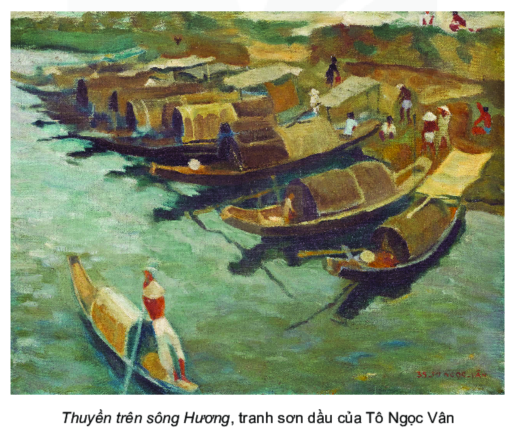
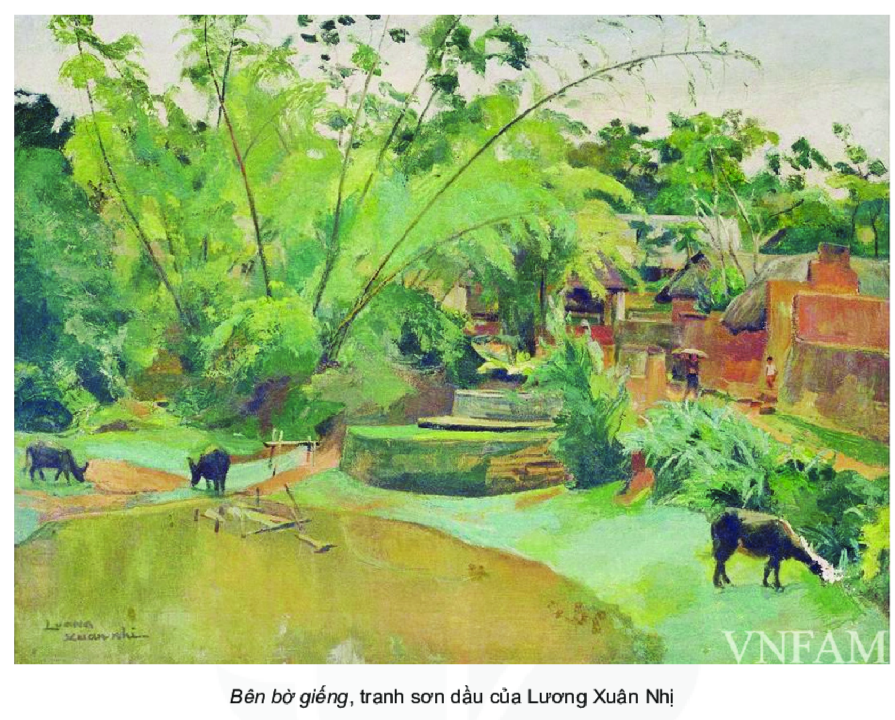

<!-- pdf:97 -->

# BÀI 4: QUÊ HƯƠNG YÊU DẤU

*Việt Nam đất nước ta ơi*
*Mênh mông biển lúa đâu trời đẹp hơn.*
(Nguyễn Đình Thi)

## Giới thiệu bài học

- Cây có cội, nước có nguồn, con người có quê hương. Quê hương là nơi tổ tiên, ông bà, cha mẹ ta đã sinh sống. Quê hương là đất đai xứ sở, truyền thống ông cha, là những điều giản dị và thân thuộc ta gắn bó hằng ngày. Tình yêu quê hương là tình cảm ấm áp, chân thành, bền lâu của con người.
- Tình yêu quê hương đất nước Việt Nam từ xưa đến nay đã đi vào văn học, âm nhạc, hội hoạ, điện ảnh,... Trong bài học này, em sẽ cảm nhận tình yêu quê hương trong những bài ca dao và thơ trữ tình hiện đại viết theo thể lục bát – một thể thơ mang đậm bản sắc Việt Nam.

<!-- pdf:98 -->

## 🎯 Mục tiêu bài học

- Nhận biết được số tiếng, số dòng, vần, nhịp của thơ lục bát; bước đầu nhận xét được nét độc đáo của một bài thơ thể hiện qua từ ngữ, hình ảnh, biện pháp tu từ.
- Bước đầu biết làm bài thơ lục bát và viết đoạn văn ghi lại cảm xúc sau khi đọc một bài thơ lục bát.
- Biết nói lên ý kiến về một vấn đề trong đời sống.
- Trân trọng, tự hào về các giá trị văn hoá truyền thống và vẻ đẹp của quê hương, đất nước.

## Đọc

### TRI THỨC NGỮ VĂN

*Thơ lục bát*

<!-- term: gieo vần -->
<!-- term: vần thơ -->
<!-- term: ngắt nhịp -->
<!-- term: nhịp điệu -->
<!-- term: nhịp thơ -->
<!-- term: thể thơ -->
<!-- term: thơ -->
<!-- term: hình ảnh -->
<!-- term: văn bản -->
<!-- term: miêu tả -->
<!-- term: đề tài -->
- **Thể thơ lục bát** (6 – 8) là thể thơ mà các dòng thơ được sắp xếp thành từng cặp, một dòng sáu tiếng và một dòng tám tiếng.
- **Vần**: Tiếng cuối của dòng sáu vần với tiếng thứ sáu của dòng tám; tiếng cuối của dòng tám lại vần với tiếng cuối của dòng sáu tiếp theo.
- **Thanh điệu**: Trong dòng sáu và dòng tám, các tiếng thứ sáu, thứ tám là thanh bằng còn tiếng thứ tư là thanh trắc. Riêng trong dòng tám, mặc dù tiếng thứ sáu và thứ tám đều là thanh bằng nhưng nếu tiếng thứ sáu là thanh huyền thì tiếng thứ tám là thanh ngang và ngược lại.
- **Nhịp**: **Thơ lục bát** thường ngắt nhịp chẵn (2/2/2, 2/4, 4/4,...).

*Lục bát biến thể*

- **Lục bát biến thể** không hoàn toàn tuân theo luật thơ của lục bát thông thường, có sự biến đổi số tiếng trong các dòng, biến đổi cách gieo vần, cách phối thanh, cách ngắt nhịp,...

*Từ đồng âm và từ đa nghĩa*

- **Từ đồng âm** là những từ có âm giống nhau nhưng nghĩa khác xa nhau, không có mối liên hệ nào với nhau.
- **Từ đa nghĩa** là từ có hai hoặc nhiều hơn hai nghĩa, các nghĩa này có liên quan với nhau.

*Hoán dụ*

<!-- term: biện pháp tu từ hoán dụ -->
<!-- term: biện pháp tu từ -->
- **Hoán dụ** là biện pháp tu từ dùng từ ngữ vốn chỉ sự vật, hiện tượng này để gọi tên sự vật, hiện tượng khác có mối quan hệ tương cận (gần nhau) nhằm tăng khả năng gợi hình, gợi cảm cho sự diễn đạt.

<!-- pdf:99 -->

### VĂN BẢN ĐỌC

- Chùm ca dao về quê hương đất nước
- *Chuyện cổ nước mình*, Lâm Thị Mỹ Dạ
- *Cây tre Việt Nam*, Thép Mới

**Chùm ca dao(1) về quê hương đất nước**

**Trước khi đọc**

1. Với em, nơi đâu là quê hương yêu dấu? Nếu có thể nói những ấn tượng đẹp đẽ và sâu sắc nhất về quê hương, em sẽ nói điều gì?
2. Em thích bài thơ nào viết về quê hương? Hãy đọc diễn cảm một vài câu trong bài thơ đó.

**Đọc văn bản**

1. Gió đưa cành trúc la đà
Tiếng chuông Trấn Võ(2) canh gà(3) Thọ Xương(4).
Mịt mù khói toả ngàn sương
Nhịp chày Yên Thái(5), mặt gương Tây Hồ(6).

(Nguyễn Xuân Kính – Phan Đăng Nhật – Phan Đăng Tài – Nguyễn Thuý Loan – Đặng Diệu Trang, *Kho tàng ca dao người Việt*, tập 1, NXB Văn hoá – Thông tin, Hà Nội, 2001, tr. 1145)

<!-- term: trữ tình -->
> (1) **Ca dao**: thơ trữ tình dân gian, nội dung biểu hiện đời sống tâm hồn, tình cảm của người bình dân. Ngôn ngữ ca dao giản dị, trong sáng, gần với lời ăn tiếng nói hằng ngày của nhân dân lao động.
> (2) *Trấn Võ*: một ngôi đền nằm bên cạnh Hồ Tây (còn có tên là đền Trấn Vũ, đền Quán Thánh). Đền được xây dựng vào thời Lý, thờ Huyền Thiên Trấn Vũ, một vị thần trấn giữ hướng bắc của Thăng Long xưa.
> (3) *Canh gà*: tiếng gà báo canh. Canh là đơn vị tính thời gian ban đêm ngày xưa. Người xưa chia một đêm ra thành năm canh, hai tiếng là một canh.
> (4) *Thọ Xương*: tên một huyện của thành Thăng Long xưa, nay là các quận Hoàn Kiếm, Hai Bà Trưng và một phần các quận Đống Đa, Ba Đình của Hà Nội.
> (5) *Nhịp chày Yên Thái*: nhịp chày giã dó (vỏ cây dó) để làm giấy ở làng Yên Thái, thành Thăng Long xưa.
> (6) *Tây Hồ*: tức Hồ Tây, một thắng cảnh nổi tiếng của Thủ đô Hà Nội, còn được gọi là đầm Xác Cáo, hồ Kim Ngưu, hồ Lãng Bạc,...

<!-- pdf:100 -->

2. Đường lên xứ Lạng(1) bao xa?
Cách một trái núi với ba quãng đồng.
Ai ơi, đứng lại mà trông:
Kìa núi thành Lạng, kìa sông Tam Cờ(2).

(Vũ Ngọc Phan, *Tục ngữ, ca dao, dân ca Việt Nam*, NXB Thời đại, Hà Nội, 2010, tr. 118)

3. Đò từ Đông Ba(3), đò qua Đập Đá(4),
Đò về Vĩ Dạ(5), thẳng ngã ba Sình(6).
Lờ đờ bóng ngả trăng chênh
Tiếng hò xa vọng, nặng tình nước non.

(Nguyễn Xuân Kính – Phan Đăng Nhật – Phan Đăng Tài – Nguyễn Thuý Loan – Đặng Diệu Trang, *Kho tàng ca dao người Việt*, tập 1, Sđd, tr. 917)

*Thuyền trên sông Hương*, tranh sơn dầu của Tô Ngọc Vân

> (1) *Xứ Lạng*: tức Lạng Sơn, một tỉnh thuộc vùng Đông Bắc nước ta. Lạng Sơn có nhiều thắng cảnh như động Nhị Thanh, chùa Tam Thanh,...
> (2) *Sông Tam Cờ*: (sông Tam Kì) một con sông của tỉnh Lạng Sơn.
> (3) *Đông Ba*: chợ nổi tiếng của Huế, nằm bên bờ bắc của sông Hương.
> (4) *Đập Đá*: một con đập của Huế, chạy ngang qua một nhánh sông Hương.
> (5) *Vĩ Dạ*: một ngôi làng nằm bên bờ sông Hương, phong cảnh thơ mộng, đã đi vào thơ ca nhạc hoạ.
> (6) *Ngã ba Sình*: ngã ba sông nơi gặp nhau giữa sông Hương và sông Bồ.

<!-- pdf:101 -->

**Sau khi đọc**

**TRẢ LỜI CÂU HỎI**

1. Đọc các bài ca dao 1, 2 và cho biết: Mỗi bài ca dao có mấy dòng? Cách phân bố số tiếng trong các dòng cho thấy đặc điểm gì của thơ lục bát?
2. Đối chiếu với những điều được nêu trong mục *Tri thức đọc hiểu* ở đầu bài học, hãy xác định cách gieo vần, ngắt nhịp và phối hợp thanh điệu trong các bài ca dao 1 và 2.
3. So với hai bài ca dao đầu, bài ca dao 3 là bài lục bát biến thể. Hãy chỉ ra tính chất biến thể của thể thơ lục bát trong bài ca dao này trên các phương diện: số tiếng trong mỗi dòng, cách gieo vần, cách phối hợp thanh điệu,...
4. Trong cụm từ *mặt gương Tây Hồ*, tác giả dân gian đã sử dụng biện pháp tu từ gì? Hãy phân tích tác dụng của biện pháp tu từ đó.
5. Nêu cảm nhận của em về tình cảm tác giả dân gian gửi gắm trong lời nhắn gửi: *Ai ơi, đứng lại mà trông*. Hãy liệt kê một số câu ca dao có sử dụng từ *ai* hoặc có lời nhắn *Ai ơi...* mà em biết.
6. Bài ca dao 3 đã sử dụng những từ ngữ, hình ảnh nào để miêu tả thiên nhiên xứ Huế? Những từ ngữ, hình ảnh đó giúp em hình dung như thế nào về cảnh sông nước nơi đây?
7. Các bài ca dao trữ tình thường bộc lộ trực tiếp tình cảm, cảm xúc của con người. Qua chùm ca dao trên, em cảm nhận được gì về tình cảm của tác giả dân gian đối với quê hương đất nước?

#### Viết kết nối với đọc

Viết đoạn văn (khoảng 5 – 7 câu) nêu cảm nghĩ của em về một danh lam thắng cảnh của quê hương đất nước.

*Đèo Phượng Hoàng*, ảnh của Đặng Bá Tiến
<!-- ocr-ok: chú thích ảnh uốn cong theo khung ảnh nền tràn lề cuối trang 100 (PDF 101) bị OCR tách rời chữ "Đèo Phượng Hoàng" và đọc nhầm "Tiến" thành "Tiền", đã đối chiếu ảnh trang PDF 101 -->

<!-- pdf:102 -->

### Thực hành tiếng Việt

*TỪ ĐỒNG ÂM*

1. Từ nào trong ba trường hợp sau phản ánh hiện tượng đồng âm? Giải thích nghĩa của từ đó trong từng trường hợp.
   a. *Lờ đờ bóng ngả trăng chênh*
      *Tiếng hò xa vọng, nặng tình nước non.*
   b. *Bóng đã lăn ra khỏi đường biên dọc.*
   c. *Mặt bàn được đánh véc-ni thật bóng.*
2. Phân biệt nghĩa của các từ in đậm trong những câu sau. Theo em, đó có phải là hiện tượng đồng âm hay không? Vì sao?
   a. – **Đường** *lên xứ Lạng bao xa?*
      – *Những cây mía óng ả này chính là nguyên liệu để làm* **đường**.
   b. – *Đứng bên ni đồng, ngó bên tê* **đồng**, *mênh mông bát ngát.*
      *Đứng bên tê đồng, ngó bên ni đồng, cũng bát ngát mênh mông.*
      (Vũ Ngọc Phan, *Tục ngữ, ca dao, dân ca Việt Nam*, Sđd, tr. 185)
      – *Tôi mua cái bút này với giá hai mươi nghìn* **đồng**.

> **Nhận biết từ đồng âm**
>
> Đọc câu sau: *Con ngựa* **đá** *con ngựa* **đá**. Từ *đá* thứ nhất và từ *đá* thứ hai trong câu không có mối liên hệ nào với nhau. Đó là hai **từ đồng âm**.
> Tuy hai từ *đá* này đồng âm với nhau, nhưng người đọc (người nghe) thường không hiểu sai nghĩa do hiện tượng đồng âm gây nên nhờ vào những từ kết hợp với mỗi từ *đá* trong câu. Việc sử dụng từ đồng âm làm cho câu trên trở nên thú vị. Đó là một trong những lí do chính của việc dùng từ đồng âm trong khi nói và viết.

*TỪ ĐA NGHĨA*

3. Nghĩa của từ *trái* trong những trường hợp dưới đây có liên quan với nhau không? Vì sao?
   a. *Cây xoài trước sân nhà em có rất nhiều* **trái**.
   b. *Bố vừa mua cho em một* **trái** *bóng.*
   c. *Cách một* **trái** *núi với ba quãng đồng.*
4. Xác định hiện tượng đồng âm và đa nghĩa trong các câu sau:
   a. *Con cò có cái* **cổ** *cao.*
   b. **Cổ** *tay em trắng như ngà*
      *Con mắt em liếc như là dao cau.*
      (Vũ Ngọc Phan, *Tục ngữ, ca dao, dân ca Việt Nam*, Sđd, tr. 176)
   c. *Phố* **cổ** *tạo nên vẻ đẹp riêng của Hà Nội.*

> **Nhận biết từ đa nghĩa**
>
> Đọc hai câu sau:
> (1) *Tôi* **ăn** *cơm.*
> (2) *Xe này* **ăn** *xăng nhiều.*
> Từ **ăn** trong *ăn cơm* có nghĩa là “tự cho vào cơ thể thức nuôi sống”, còn trong *ăn xăng* có nghĩa là “tiếp nhận cái cần thiết cho sự hoạt động”. Có thể thấy rõ hai nghĩa này liên quan với nhau. Như vậy ở đây có một từ *ăn* được dùng với hai nghĩa khác nhau. Nhờ sự kết hợp giữa **từ đa nghĩa** với những từ khác ở trong câu, người đọc (người nghe) có thể nhận biết nghĩa nào của từ đa nghĩa được sử dụng.

<!-- pdf:103 -->

5. Hãy giải thích nghĩa của từ *nặng* trong câu ca dao: *Tiếng hò xa vọng, nặng tình nước non.* Tìm thêm một số ví dụ có từ *nặng* được dùng với nghĩa khác.

**Chuyện cổ(1) nước mình**
<!-- ocr-ok: nhan đề màu đỏ có số cước chú mũ (1) bị OCR đọc nhầm "Chuyện cổ(1)" thành "Chuyện cốt!)", đã đối chiếu ảnh trang PDF 103 -->

**LÂM THỊ MỸ DẠ**

**Trước khi đọc**

1. Em biết những câu chuyện cổ nào?
2. Em thích những nhân vật nào trong các câu chuyện đó? Vì sao?

**Đọc văn bản**

Tôi yêu chuyện cổ nước tôi
Vừa nhân hậu lại tuyệt vời sâu xa
Thương người rồi mới thương ta
Yêu nhau dù mấy cách xa cũng tìm
Ở hiền thì lại gặp hiền
Người ngay thì gặp người tiên độ trì(2)
Mang theo chuyện cổ tôi đi
Nghe trong cuộc sống thầm thì tiếng xưa
Vàng cơn nắng, trắng cơn mưa
Con sông chảy có rặng dừa nghiêng soi
Đời cha ông với đời tôi
Như con sông với chân trời đã xa
Chỉ còn chuyện cổ thiết tha
Cho tôi nhận mặt ông cha của mình

> **HÌNH DUNG:** Những màu sắc, đường nét miêu tả quê hương.

> (1) *Chuyện cổ*: câu chuyện được lưu truyền từ xa xưa.
> (2) *Độ trì*: cứu giúp.

<!-- pdf:104 -->

Rất công bằng, rất thông minh
Vừa độ lượng(1) lại đa tình(2), đa mang(3).
Thị thơm thì giấu người thơm
Chăm làm thì được áo cơm cửa nhà
Đẽo cày theo ý người ta
Sẽ thành khúc gỗ chẳng ra việc gì
Tôi nghe chuyện cổ thầm thì
Lời cha ông dạy cũng vì đời sau
Đậm đà cái tích trầu cau
Miếng trầu đỏ thắm nặng sâu tình người
Sẽ đi qua cuộc đời tôi
Bấy nhiêu thời nữa chuyển dời xa xôi
Nhưng bao chuyện cổ trên đời
Vẫn luôn mới mẻ rạng ngời lương tâm.

(Lâm Thị Mỹ Dạ, *Tuyển tập*, NXB Hội Nhà văn, Hà Nội, 2011, tr. 203)

**Sau khi đọc**

**LÂM THỊ MỸ DẠ**

- Lâm Thị Mỹ Dạ sinh năm 1949, quê ở Quảng Bình. Thơ Lâm Thị Mỹ Dạ nhẹ nhàng, đằm thắm, trong trẻo, thể hiện một tâm hồn tinh tế, giàu yêu thương.
- *Chuyện cổ nước mình* sáng tác năm 1979. Bài thơ đậm chất truyền thống, khẳng định nét đẹp tâm hồn của con người Việt Nam.

> (1) *Độ lượng*: đức tính của người có tấm lòng khoan dung, rộng lượng, dễ tha thứ.
> (2) *Đa tình*: giàu tình cảm.
> (3) *Đa mang*: ràng buộc vào mình nhiều điều để phải lo lắng, bận tâm.

<!-- pdf:105 -->

**TRẢ LỜI CÂU HỎI**

1. Bài thơ được viết theo thể thơ gì? Những dấu hiệu nào giúp em nhận ra thể thơ đó?
2. Qua lời thơ, em nhận thấy bóng dáng của những câu chuyện cổ nào? Tìm từ ngữ, hình ảnh gợi ấn tượng rõ rệt về những câu chuyện đó.
3. Chuyện cổ “thầm thì” với nhà thơ những điều gì về vẻ đẹp tình người?
4. Tình cảm của nhà thơ với những câu chuyện cổ được thể hiện như thế nào qua hai dòng thơ:
   *Chỉ còn chuyện cổ thiết tha*
   *Cho tôi nhận mặt ông cha của mình*
5. Em hiểu như thế nào về hai dòng thơ:
   *Tôi nghe chuyện cổ thầm thì*
   *Lời cha ông dạy cũng vì đời sau*
6. Vì sao với nhà thơ, những câu chuyện cổ “Vẫn luôn mới mẻ rạng ngời lương tâm”?

#### Viết kết nối với đọc

Viết đoạn văn (khoảng 5 – 7 câu) nêu cảm nhận của em về đoạn thơ sau:
*Đời cha ông với đời tôi*
*Như con sông với chân trời đã xa*
*Chỉ còn chuyện cổ thiết tha*
*Cho tôi nhận mặt ông cha của mình*

**Cây tre Việt Nam**

**THÉP MỚI**

**Đọc văn bản**

[...] Cây tre là người bạn thân của nông dân Việt Nam, bạn thân của nhân dân Việt Nam.

Nước Việt Nam xanh muôn ngàn cây lá khác nhau. Cây nào cũng đẹp, cây nào cũng quý, nhưng thân thuộc nhất vẫn là tre nứa. Tre Đồng Nai, nứa Việt Bắc, tre ngút ngàn Điện Biên Phủ, luỹ tre thân mật làng tôi... đâu đâu ta cũng có nứa tre làm bạn.

<!-- pdf:106 -->

Tre, nứa, trúc, mai, vầu(1) mấy chục loại khác nhau, nhưng cùng một mầm non măng mọc thẳng. Vào đâu, tre cũng sống. Ở đâu, tre cũng xanh tốt. Dáng tre vươn mộc mạc, màu tre tươi nhũn nhặn(2). Rồi tre lớn lên, cứng cáp, dẻo dai, vững chắc. Tre trông thanh cao, giản dị, chí khí như người.

Nhà thơ đã có lần ca ngợi:

*Bóng tre trùm mát rượi.*

Bóng tre trùm lên âu yếm làng, bản, xóm, thôn. Dưới bóng tre của ngàn xưa, thấp thoáng mái đình mái chùa cổ kính. Dưới bóng tre xanh, ta gần gũi một nền văn hoá lâu đời. Dưới bóng tre xanh, đã từ lâu đời, người dân cày Việt Nam dựng nhà, dựng cửa, vỡ ruộng, khai hoang. Tre ăn ở với người đời đời kiếp kiếp. Tre, nứa, mai, vầu giúp người hàng nghìn công việc khác nhau. Tre là cánh tay của người nông dân.

*Cánh đồng ta năm đôi ba vụ*
*Tre với người vất vả quanh năm.*

Tre với người như thế đã mấy nghìn năm [...]. Tre vẫn phải còn vất vả mãi với người.

Cối xay tre nặng nề quay, từ nghìn đời nay, xay nắm thóc.

Trong mỗi gia đình nông dân Việt Nam, tre là người nhà, tre khăng khít với đời sống hằng ngày.

Giang(3) chẻ lạt, buộc mềm, khít chặt những mối tình quê. Cái thuở ban đầu thường nỉ non dưới bóng tre, bóng nứa.

*Lạt này gói bánh chưng xanh*
*Cho mai lấy trúc(4), cho anh lấy nàng...*

Tre còn là nguồn vui duy nhất của tuổi thơ. Các em bé còn có đồ chơi gì nữa ngoài mấy que chuyền đánh chắt(5) bằng tre.

> (1) *Nứa, trúc, mai, vầu*: các loài cây cùng họ với tre.
> (2) *Nhũn nhặn*: khiêm tốn, nhún nhường; ở đây nói về màu xanh bình dị, tươi mà không rực rỡ của tre.
> (3) *Giang*: cây thuộc họ tre, thân dẻo, gióng dài, thường dùng chẻ lạt để đan lát, buộc,...
> (4) *Cho mai lấy trúc*: mai là cây hoa mai (không phải cây mai cùng họ với tre, như ở chú thích (1)), mai và trúc là hai cây đẹp thường đi đôi với nhau trong văn chương, hội hoạ thời cổ để biểu thị sự hoà hợp, tương xứng; ở đây là cách ví von để nói về ước nguyện kết duyên đôi lứa.
> (5) *Đánh chắt*: (còn gọi là chuyền thẻ) trò chơi dân gian của trẻ em, thường là của con gái, dùng một số que trải ra đất rồi tung một hòn sỏi hoặc một quả nhỏ lên lượm lấy que tre và hứng lấy vật vừa tung lên. Trò chơi này rèn luyện sự nhanh nhẹn và khéo léo.

<!-- pdf:107 -->

*Bên bờ giếng*, tranh sơn dầu của Lương Xuân Nhị

[...] Suốt một đời người, từ thuở lọt lòng trong chiếc nôi tre, đến khi nhắm mắt xuôi tay, nằm trên giường tre, tre với mình, sống có nhau, chết có nhau, chung thuỷ.

Như tre mọc thẳng, con người không chịu khuất phục. Người xưa có câu: “Trúc dẫu cháy, đốt ngay vẫn thẳng”. Tre là thẳng thắn, bất khuất! Ta kháng chiến, tre lại là đồng chí chiến đấu của ta. Tre vốn cùng ta làm ăn, lại vì ta mà cùng ta đánh giặc.

Buổi đầu, không một tấc sắt trong tay, tre là tất cả, tre là vũ khí. Muôn đời biết ơn chiếc gậy tầm vông(1) đã dựng nên Thành đồng Tổ quốc(2)! Và sông Hồng bất khuất có cái chông tre.

> (1) *Tầm vông*: loại tre thân nhỏ, cứng, đặc, không có gai, thường dùng làm gậy. Buổi đầu cuộc kháng chiến chống thực dân Pháp ở Nam Bộ, vì thiếu vũ khí, nhân dân ta đã dùng gậy tầm vông đánh giặc.
> (2) *Thành đồng Tổ quốc*: danh hiệu Chủ tịch Hồ Chí Minh tặng cho Nam Bộ trong cuộc chiến đấu bảo vệ độc lập, tự do.

<!-- pdf:108 -->

Gậy tre, chông tre chống lại sắt thép của quân thù. Tre xung phong vào xe tăng, đại bác. Tre giữ làng, giữ nước, giữ mái nhà tranh, giữ đồng lúa chín. Tre hi sinh để bảo vệ con người. Tre, anh hùng lao động! Tre, anh hùng chiến đấu!

[...] Nhạc của trúc, nhạc của tre là khúc nhạc của đồng quê. Nhớ một buổi nào, nồm nam cơn gió thổi, khóm tre làng rung lên man mác khúc nhạc đồng quê.

Diều bay, diều lá tre bay lưng trời...

Sáo tre, sáo trúc vang lưng trời...

Gió đưa tiếng sáo, gió nâng cánh diều.

Trời cao lồng lộng, đồng ruộng mênh mông hãy lắng nghe tiếng hát giữa trời cao của trúc, tre...

[...] Điệu múa sạp tre có từ ngày chiến thắng Điện Biên. Sạp là những thanh tre gõ vào nhau. Tre của những đòn tre đã từng đỡ gánh nặng cho bước chân đi, đến chợ xa hay ra tiền tuyến, hôm nay ca vang gõ nhịp những bước chân ta nhảy múa.

*Tre già măng mọc.* Măng mọc trên huy hiệu ở ngực thiếu nhi Việt Nam, lứa măng non của nước Việt Nam Dân chủ Cộng hoà(1).

Các em, các em rồi đây lớn lên, sẽ quen dần với sắt, thép và xi măng cốt thép.

Nhưng, nứa, tre sẽ còn mãi với các em, còn mãi với dân tộc Việt Nam, còn mãi với chúng ta, với hạnh phúc, hoà bình.

[...] Ngày mai, trên đất nước này, sắt, thép có thể nhiều hơn tre, nứa. Nhưng, trên đường trường ta dấn bước, tre xanh vẫn là bóng mát. Tre vẫn mang khúc hát tâm tình. Tre sẽ càng tươi những cổng chào thắng lợi. Những chiếc đu tre vẫn dướn lên bay bổng. Tiếng sáo diều tre cao vút mãi.

Cây tre Việt Nam! Cây tre xanh, nhũn nhặn, ngay thẳng, thuỷ chung, can đảm. Cây tre mang những đức tính của người hiền là tượng trưng cao quý của dân tộc Việt Nam.

1955

(Thép Mới, *Cây tre Việt Nam*, NXB Chính trị quốc gia, Hà Nội, 2001, tr. 353 – 357)

> (1) *Việt Nam Dân chủ Cộng hoà*: quốc hiệu của nước ta ở thời điểm tác giả viết tác phẩm này.

<!-- pdf:109 -->

**Sau khi đọc**

**THÉP MỚI**

- Thép Mới (1925 – 1991) là nhà văn, nhà báo nổi tiếng. Tác phẩm của ông giàu chất trữ tình, cảm hứng nổi bật là ca ngợi tinh thần yêu nước của nhân dân.
- Bài *Cây tre Việt Nam* là lời bình cho bộ phim cùng tên của các nhà làm phim Ba Lan.

**TRẢ LỜI CÂU HỎI**

1. Vẻ đẹp của cây tre Việt Nam được tác giả miêu tả như thế nào?
2. Khi nói về cây tre, tác giả đồng thời nói đến khung cảnh, cuộc sống, văn hoá của Việt Nam. Hãy chỉ ra những chi tiết đó trong bài.
3. Những từ ngữ nào trong văn bản biểu đạt rõ nhất đặc điểm của cây tre?
4. Vì sao tác giả có thể khẳng định: “Cây tre mang những đức tính của người hiền là tượng trưng cao quý của dân tộc Việt Nam”?
5. Em hãy giải thích vì sao cây tre là “người bạn thân của nông dân Việt Nam, bạn thân của nhân dân Việt Nam”.
6. Em đang sống ở thời điểm “ngày mai” mà tác giả nhắc đến trong văn bản, khi “sắt thép có thể nhiều hơn tre nứa”. Theo em, vì sao cây tre vẫn là một hình ảnh vô cùng thân thuộc với đất nước, con người Việt Nam?

### Thực hành tiếng Việt

*BIỆN PHÁP TU TỪ*

1. Các từ ngữ in đậm trong những câu sau có nghĩa hoán dụ. Em hãy giải thích nghĩa của các từ ngữ đó.
   a. *Suốt một đời người, từ thuở lọt lòng trong chiếc nôi tre, đến khi* **nhắm mắt xuôi tay**, *nằm trên giường tre, tre với mình, sống có nhau, chết có nhau, chung thuỷ.*
<!-- ocr-ok: câu 1 và mục a cột trái Thực hành tiếng Việt bị OCR bỏ sót dòng đầu và dòng có cụm in đậm "nhắm mắt xuôi tay" do vướng hộp hồng cột phải, đã đối chiếu ảnh trang PDF 109 -->

> **Nhận biết hoán dụ**
>
> Đọc câu thơ sau:
> **Áo chàm** *đưa buổi phân li*
> *Cầm tay nhau biết nói gì hôm nay.*
> (Tố Hữu, *Việt Bắc*)
> Ở đây *áo chàm* được dùng với nghĩa **hoán dụ**, chỉ những người dân Việt Bắc với trang phục đặc trưng là áo chàm. Quan hệ giữa trang phục với người mang trang phục đó được coi là quan hệ tương cận (gần nhau). Ngoài ra, quan hệ tương cận có thể là quan hệ toàn thể – bộ phận, vật chứa – vật được chứa, sự vật – chất liệu,...

<!-- pdf:110 -->

b. *Tre giữ làng, giữ nước, giữ* **mái nhà tranh**, *giữ* **đồng lúa chín**.
   c. *Thị thơm thì giấu người thơm*
      *Chăm làm thì được* **áo cơm cửa nhà**.
2. Chỉ ra các biện pháp tu từ được sử dụng trong những câu sau và nêu tác dụng của chúng:
   a. *Đời cha ông với đời tôi*
      *Như con sông với chân trời đã xa*
   b. *Gậy tre, chông tre chống lại sắt thép của quân thù. Tre xung phong vào xe tăng, đại bác.*

<!-- term: thành ngữ -->
*NGHĨA CỦA TỪ NGỮ*

3. Những dòng thơ: *Đẽo cày theo ý người ta/ Sẽ thành khúc gỗ chẳng ra việc gì* gợi cho em liên tưởng đến thành ngữ nào? Giải thích ngắn gọn ý nghĩa của thành ngữ đó.
4. “Tre già măng mọc” là một thành ngữ quen thuộc. Dựa vào bài *Cây tre Việt Nam*, hãy nêu cách hiểu của em về thành ngữ này.

## Viết

### A. TẬP LÀM MỘT BÀI THƠ LỤC BÁT

Qua những bài ca dao và thơ làm theo thể lục bát được học trong bài, em đã nắm được những đặc điểm cơ bản của thể thơ này. Dựa trên những hiểu biết đó, hãy thử làm một bài thơ lục bát về đề tài mà em yêu thích.

### 1. KHỞI ĐỘNG VIẾT

**a. Tập gieo vần, tìm từ ngữ phù hợp**

Hãy tập gieo vần bằng cách chọn những tiếng hoặc từ ngữ thích hợp để đặt vào chỗ trống trong các đoạn thơ dưới đây:

*Tiếng chim vách núi nhỏ dần*
*Rì rầm tiếng suối khi ... khi xa*
*Ngoài thềm rơi chiếc lá ...*
*Tiếng rơi rất mỏng như ... rơi nghiêng.*
(*Theo* Trần Đăng Khoa)

<!-- pdf:111 -->

*Tre già yêu lấy măng ...*
*Chắt chiu như mẹ yêu ... tháng ngày*
*Mai sau con lớn hơn thầy*
*Các con ôm cả ... ... đất tròn.*
(*Theo* Tố Hữu)

**b. Xác định đề tài**

Có thể chọn bất kì đề tài nào gợi cho em nhiều cảm xúc, chẳng hạn: thiên nhiên, quê hương, gia đình, bạn bè, mái trường,...

### 2. THỰC HÀNH VIẾT

- Hình dung cụ thể về đề tài em định viết (Có hình ảnh gì nổi bật? Hình ảnh ấy gợi cho em liên tưởng tới điều gì?...). Thử tìm một nhan đề thích hợp cho bài thơ theo đề tài mà em định chọn (cũng có thể đặt tên bài thơ sau khi em đã hoàn thành).
- Bắt đầu bằng cách thử viết dòng lục hoặc cặp câu lục bát đầu tiên với những hình ảnh gợi ấn tượng rõ rệt nhất trong cảm xúc, suy nghĩ của em. Chú ý sử dụng số tiếng, lựa chọn vần, ngắt nhịp theo đúng quy định của thể thơ lục bát. Cũng có thể thử biến đổi một bài thơ 4 chữ, 5 chữ thành bài thơ lục bát.
  Ví dụ, với ý tưởng gió đi tìm bạn, em có thể đặt nhan đề bài thơ là *Bạn của gió* và viết cặp câu lục bát đầu tiên như sau:
  *Ai là bạn gió, gió* **ơi**
  *Gió đi tìm bạn, đất* **trời** *mênh* **mông**.
- Viết những cặp câu lục bát tiếp theo. Đọc lên để cảm nhận rõ hơn về vần, nhịp và từ ngữ, hình ảnh trong các câu thơ. Điều này sẽ giúp em cảm thấy hứng thú và thể hiện được cảm xúc, ý tưởng một cách dễ dàng hơn.
  Chẳng hạn, để tiếp nối hai câu thơ *Ai là bạn gió, gió ơi / Gió đi tìm bạn, đất trời mênh mông*, có thể viết:
  *Gió đưa con sáo sang* **sông**
  *Gió lùa tóc mẹ bềnh* **bồng** *như mây.*
<!-- term: ẩn dụ -->
<!-- term: biện pháp tu từ ẩn dụ -->
- Hãy thử phát triển ý tưởng, cảm xúc và hình ảnh thơ theo nhiều cách khác nhau. Tập sử dụng các biện pháp tu từ như so sánh, nhân hoá, ẩn dụ; dùng từ láy tả âm thanh, màu sắc,... Vừa viết vừa đọc, không ngại xoá đi viết lại cho đến khi em cảm nhận được âm thanh nhịp nhàng và vẻ đẹp cuốn hút của từ ngữ, hình ảnh trong bài thơ. Có thể kết thúc bài thơ khi em đã bộc lộ được ý tưởng một cách tương đối trọn vẹn.

Sáng tác một bài thơ không phải là điều dễ dàng. Nhưng em có thể thử sức để hiểu rõ hơn cách mà một bài thơ xuất hiện ra sao. Đó quả thật là một điều kì diệu!

<!-- pdf:112 -->

### 3. CHỈNH SỬA

<!-- term: lời thơ -->
- Sau khi bài thơ lục bát ra đời, em hãy đọc diễn cảm bài thơ của mình. Khi lời thơ vang lên, hãy chú ý xem bài thơ đã làm theo đúng thể thơ lục bát chưa (số tiếng trong mỗi dòng thơ, cách gieo vần, phối hợp thanh điệu).
- Chỉnh sửa lỗi chính tả (nếu có) và xét xem có từ ngữ nào cần thay thế để bài thơ hay hơn.

### B. VIẾT ĐOẠN VĂN THỂ HIỆN CẢM XÚC VỀ MỘT BÀI THƠ LỤC BÁT

<!-- term: nhạc điệu -->
Những bài thơ lục bát đã học, đã đọc gợi cho em những cảm xúc gì? Hình ảnh, ngôn từ, nhạc điệu của nó khiến em rung động như thế nào? Hãy ghi lại cảm nhận của em về một bài thơ lục bát yêu thích.

*Yêu cầu đối với đoạn văn thể hiện cảm xúc về một bài thơ lục bát:*

- Giới thiệu được bài thơ, tác giả (nếu có).
- Nêu được cảm xúc về nội dung chính hoặc một khía cạnh nội dung của bài thơ.
- Thể hiện được cảm nhận về một số yếu tố hình thức nghệ thuật của bài thơ (thể thơ, từ ngữ, hình ảnh, biện pháp tu từ,...).

### Phân tích bài viết tham khảo

**Nét đẹp của bài ca dao**
*Anh đi anh nhớ quê nhà...*

*Anh đi anh nhớ quê nhà*
*Nhớ canh rau muống, nhớ cà dầm tương*
*Nhớ ai dãi nắng dầm sương*
*Nhớ ai tát nước bên đường hôm nao.*

<!-- term: dị bản -->
Đây vốn là một bài thơ của Á Nam Trần Tuấn Khải, nhưng đã được lưu truyền trong dân gian như một bài ca dao. Lời thơ tràn đầy nỗi nhớ da diết của người con xa xứ hướng về quê nhà. Từ “nhớ” được lặp đi lặp lại trong cả bốn câu thơ bộc lộ nỗi niềm bồi hồi không dứt. Trở đi trở lại cùng nỗi nhớ là những kí ức sâu đậm về hương vị của quê hương trong

> Giới thiệu tác giả.

<!-- pdf:113 -->

những món ăn dân dã: “canh rau muống”, “cà dầm tương”. Hình ảnh con người nơi quê nhà cũng hiện lên vô cùng thân thiết trong những công việc lao động hằng ngày: “dãi nắng dầm sương”, “tát nước bên đường”,... Nhịp điệu nhẹ nhàng, êm đềm của thể thơ lục bát quen thuộc đã góp phần diễn tả niềm thương mến, nỗi nhớ da diết và tình cảm gắn bó sâu nặng của người ra đi. Bài ca dao khơi dậy trong ta tình yêu, sự gắn bó với những gì gần gũi, thân thuộc của quê hương.

> Nêu cảm xúc về nội dung chính của bài ca dao.
> Nêu cảm nhận về một số yếu tố hình thức nghệ thuật của bài ca dao.

*(Nhóm biên soạn)*

**Thực hành viết theo các bước**

### 1. TRƯỚC KHI VIẾT

**a. Lựa chọn bài thơ**

- Nhớ lại những bài thơ lục bát mà em đã học, đã đọc hoặc tìm đọc một bài thơ lục bát mới.
- Bài thơ được chọn có thể là một bài ca dao (khuyết danh) hoặc là sáng tác của một nhà thơ.

<!-- term: mục đích viết -->
> *Mục đích viết:* Bày tỏ cảm xúc của em về một bài thơ lục bát.
>
> *Người đọc:* Thầy cô, bạn bè, người thân và những người yêu thích bài thơ em chọn.
<!-- ocr-ok: hộp Mục đích viết / Người đọc nền cam ở cột phải bị OCR đọc nhầm thành "bạn bò, người tôn kànnhứng người yêu Ihich", đã đối chiếu ảnh trang PDF 113 -->

**b. Tìm ý**

- Đọc bài thơ nhiều lần. Khi lời thơ vang lên, hãy lắng nghe những cảm xúc, suy nghĩ của em và ghi lại điều đó. Nên viết nhanh ra giấy những ý tưởng nảy sinh bằng những cụm từ ngắn gọn.
- Có thể tìm ý bằng cách tự đặt ra và trả lời các câu hỏi: Cảm nhận chung khi đọc bài thơ là gì? Bài thơ biểu lộ những điều gì? Bài thơ có những từ ngữ, hình ảnh, biện pháp tu từ,... nào nổi bật?

**c. Lập dàn ý**

Sắp xếp các thông tin, ý tưởng tìm được cho bài viết thành một dàn ý như sau:

<!-- pdf:114 -->

**Dàn ý**

1. Mở đoạn: Giới thiệu ngắn gọn về bài thơ, tác giả (nếu có).
2. Thân đoạn: Trình bày cảm xúc về bài thơ.
   - Nêu ấn tượng chung về nội dung của bài thơ.
   - Nêu ý nghĩa, chủ đề của bài thơ.
   - Nêu cảm nhận về từ ngữ, hình ảnh, biện pháp tu từ.
3. Kết đoạn: Khái quát lại những ấn tượng, cảm xúc về bài thơ.

### 2. VIẾT BÀI

<!-- term: chủ đề -->
Khi viết bài, cần lưu ý:

- Bám sát dàn ý, chú trọng những yếu tố đã khơi gợi cảm xúc của em như nhan đề bài thơ, thể thơ (lục bát), nhịp thơ, vần thơ, từ ngữ, hình ảnh, biện pháp tu từ,...
- Lựa chọn những từ ngữ để diễn tả cảm xúc của em về bài thơ. Kết nối các ý thành đoạn văn. Mỗi ý nên diễn đạt thành hai, ba câu.
- Bảo đảm cách trình bày của một đoạn văn: Lùi đầu dòng ở chỗ mở đầu đoạn, chữ đầu viết hoa và có dấu câu kết thúc đoạn. Bố cục đoạn văn bao gồm ba phần mở đoạn, thân đoạn, kết đoạn. Nội dung các câu trong đoạn cần hướng về một chủ đề chung.

### 3. CHỈNH SỬA BÀI VIẾT

Sau khi hoàn thành, hãy rà soát đoạn văn theo những yêu cầu ở cột trái và gợi ý chỉnh sửa ở cột phải.

| Yêu cầu | Gợi ý chỉnh sửa |
| --- | --- |
| Giới thiệu được nhan đề và tác giả của bài thơ lục bát. | Nếu bài thơ có nhan đề và tên tác giả mà bài viết chưa nêu được thì cần bổ sung. |
| Nêu được cảm xúc về nội dung chính của bài thơ. | Nếu cần thì bổ sung các ý cụ thể để người đọc hiểu rõ nội dung bài thơ. |
| Nêu được cảm nhận về một số yếu tố hình thức nghệ thuật. | Xem lại những từ ngữ, hình ảnh, biện pháp tu từ,... nổi bật của bài thơ. Hãy bổ sung vào đoạn văn nếu cần thiết. |
| Bảo đảm yêu cầu về chính tả và diễn đạt. | Rà soát lỗi chính tả, dùng từ, đặt câu,... và chỉnh sửa (nếu có). |

<!-- pdf:115 -->

## Nói và nghe

**Trình bày ý kiến về tình cảm gắn bó của con người với quê hương**

Trong phần Đọc, em đã được tiếp xúc với những tác phẩm thơ, văn thể hiện tình yêu, sự gắn bó với quê hương; lòng tự hào về cảnh sắc, truyền thống văn hoá,... của nơi chúng ta sinh ra và lớn lên. Chắc hẳn trong em đã nảy nở những suy nghĩ, cảm xúc mới mẻ về sự gắn kết của mỗi người với chính quê hương mình. Hãy trình bày những suy nghĩ ấy.

### 1. TRƯỚC KHI NÓI

<!-- term: nội dung nói -->
**a. Chuẩn bị nội dung nói**

- Viết ra giấy các ý chính của bài nói. Gợi ý: Tìm một câu thể hiện khái quát suy nghĩ của em về tình cảm gắn bó của con người với quê hương, ví dụ: “Quê hương là nơi thân thuộc nhất với mỗi con người”. Mở rộng thêm ý này bằng cách nêu bằng chứng lấy từ các bài em đã học, những thông tin em biết hoặc những trải nghiệm của chính em. Chẳng hạn, những vật dụng gia đình, cảnh làng quê có luỹ tre được gợi ra từ bài *Cây tre Việt Nam*; hình ảnh quả thị, cô Tấm,... được nhắc đến trong bài *Chuyện cổ nước mình*; những món ăn gần gũi, hình ảnh người lao động và tình cảm nhớ thương quê nhà của một người con xa quê trong bài viết tham khảo *Nét đẹp của bài ca dao “Anh đi anh nhớ quê nhà”*;... sẽ là những gợi ý cho em trong quá trình chuẩn bị nội dung bài nói.
- Chuẩn bị tranh ảnh, bài hát,... về quê hương để minh hoạ cho bài trình bày (nếu có).

<!-- term: mục đích nói -->
> *Mục đích nói:* Trình bày ý kiến về tình cảm gắn bó của con người với quê hương.
>
> *Người nghe:* Thầy cô, bạn bè, người thân và những ai quan tâm đến vấn đề em nói.

**b. Tập luyện**

- Để trình bày tốt, em hãy tập luyện trước. Có thể tập luyện một mình hoặc trước bạn bè, người thân và tiếp thu những nhận xét, góp ý để phần trình bày của mình hay hơn, ấn tượng hơn.
- Tập nói rõ ràng, điều chỉnh ngữ điệu phù hợp và kiểm soát thời gian trình bày.

### 2. TRÌNH BÀY BÀI NÓI

- Khi trình bày bài nói, cần tập trung vào mục đích nói lên suy nghĩ của em về tình cảm

<!-- pdf:116 -->

gắn bó của con người với quê hương nói chung, có thể liên hệ với tình cảm của em với quê hương mình.
- Để nội dung trình bày được tập trung, không bỏ sót những ý quan trọng, thỉnh thoảng em có thể nhìn lướt các ý đã được ghi ra giấy.
- Chú ý kết hợp trình bày ý kiến với việc sử dụng tranh ảnh, bài hát,... để tăng sức hấp dẫn cho bài nói. Có thể thu hút sự chú ý của người nghe bằng cách đặt câu hỏi gợi mở về tình cảm của mỗi người đối với quê hương. Trong khi nói có thể kết hợp ngâm thơ hoặc hát một hai đoạn về quê hương để bài nói thêm sinh động và ấn tượng.

### 3. SAU KHI NÓI

Trao đổi về bài nói theo một số gợi ý sau:

| Người nghe | Người nói |
| --- | --- |
| Bày tỏ sự đồng cảm với suy nghĩ, cảm xúc, của người nói sau khi nghe bài trình bày. | Lắng nghe và phản hồi những chia sẻ của người nghe một cách tích cực. |
| Có thể nêu câu hỏi về những điểm còn chưa rõ hay có sự khác biệt trong suy nghĩ giữa người nói và người nghe về tình cảm gắn bó của con người với quê hương. | Giải thích những điều người nghe cần làm rõ và trao đổi lại những ý kiến khác biệt. |
| Góp ý về cách trình bày (ngữ điệu, diễn đạt, sự tương tác với người nghe). | Cảm ơn và tiếp thu những góp ý xác đáng. |

## Củng cố, mở rộng

1. Kẻ bảng vào vở theo mẫu sau và điền thông tin ngắn gọn về các văn bản đã học:

| Đặc điểm \ Văn bản | **Chùm ca dao về quê hương đất nước** | *Chuyện cổ nước mình* | *Cây tre Việt Nam* |
| --- | --- | --- | --- |
| Biện pháp tu từ nổi bật | | | |
| Tình cảm, cảm xúc của tác giả | | | |

2. Tìm và đọc diễn cảm một số bài thơ lục bát.

<!-- pdf:117 -->

## Thực hành đọc

*Khi đọc văn bản, em cần chú ý những vấn đề sau:*

- Đặc điểm của thể thơ lục bát được thể hiện trong bài thơ.
- Vẻ đẹp của quê hương, đất nước.
- Ý nghĩa được gợi lên từ “hành trình của bầy ong”.

**Hành trình của bầy ong(1)**

**NGUYỄN ĐỨC MẬU(2)**

Với đôi cánh đẫm nắng trời
Bầy ong bay đến trọn đời tìm hoa.
Không gian là nẻo đường xa
Thời gian vô tận mở ra sắc màu.

Tìm nơi thăm thẳm rừng sâu
Bập bùng hoa chuối, trắng màu hoa ban.
Tìm nơi bờ biển sóng tràn
Hàng cây chắn bão dịu dàng mùa hoa.
Tìm nơi quần đảo khơi xa
Có loài hoa nở như là không tên...

> (1) Văn bản bài thơ do tác giả cung cấp.
> (2) Nguyễn Đức Mậu sinh năm 1948 tại Nam Định, là nhà thơ, nhà văn quân đội.

<!-- pdf:118 -->

Bầy ong rong ruổi trăm miền
Rù rì đôi cánh nối liền mùa hoa.
Nối rừng hoang với biển xa
Đất nơi đâu cũng tìm ra ngọt ngào.
(Nếu hoa có ở trời cao
Thì bầy ong cũng mang vào mật thơm)

Chắt trong vị ngọt mùi hương
Lặng thầm thay những con đường ong bay.
Trải qua mưa nắng vơi đầy
Men trời đất đủ làm say đất trời.
Bầy ong giữ hộ cho người
Những mùa hoa đã tàn phai tháng ngày.

Vầng trăng dâng đĩa mật đầy
Trời sao mở cánh ong bay ngang trời.
Đêm nay như thức cùng tôi
Bầy ong – con chữ nối lời bài ca.

## 📷 Danh sách hình trong bài

| Mã hình | Trang PDF | Vị trí trong bài | Chú thích gốc |
| --- | --- | --- | --- |
| H6-ngu_van-b04-01 | 100 | Văn bản 1 – Chùm ca dao về quê hương đất nước (trang 99) | Thuyền trên sông Hương, tranh sơn dầu của Tô Ngọc Vân |
| H6-ngu_van-b04-02 | 107 | Văn bản 3 – Cây tre Việt Nam (trang 106) | Bên bờ giếng, tranh sơn dầu của Lương Xuân Nhị |
