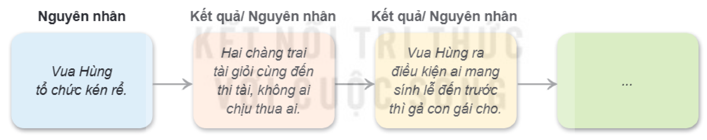

<!-- pdf:5 -->

# BÀI 6: CHUYỆN KỂ VỀ NHỮNG NGƯỜI ANH HÙNG

*Và con phải kể cho con của con nghe*
*những truyền thuyết mà mẹ đã kể cho con – giống như*
*bà đã kể cho mẹ và bà cố đã kể cho bà...*

Bét-ti Xmít (Betty Smith)

## Giới thiệu bài học

- Cộng đồng hình thành và phát triển được nhờ một phần rất lớn vào những con người kiệt xuất. Những con người này sinh trưởng trong lòng cộng đồng, nhận được sự trợ giúp tích cực của cộng đồng và họ đã đền đáp bằng những cống hiến lớn lao với năng lực phi thường của bản thân. Trong con mắt cộng đồng, họ chính là những anh hùng.
- Trong bài học về truyền thuyết này, em sẽ được gặp những nhân vật anh hùng huyền thoại – những “tượng đài” mang sức mạnh và ý chí của tập thể được lưu giữ trong kí ức cộng đồng qua nhiều thế hệ.

## 🎯 Yêu cầu cần đạt

- Nhận biết được một số yếu tố của truyền thuyết như: cốt truyện, nhân vật, lời kể, yếu tố kì ảo; nhận biết được chủ đề của văn bản.
- Nhận biết được văn bản thông tin thuật lại một sự kiện và cách triển khai văn bản theo trật tự thời gian.
- Hiểu được công dụng của dấu chấm phẩy (đánh dấu ranh giới giữa các bộ phận trong một chuỗi liệt kê phức tạp).
- Bước đầu biết viết văn bản thông tin thuật lại một sự kiện.
- Kể được một truyền thuyết.
- Tự hào về lịch sử và truyền thống văn hoá của dân tộc, có khát vọng cống hiến vì những giá trị cộng đồng.

<!-- pdf:6 -->

## Đọc

### TRI THỨC NGỮ VĂN

**Truyền thuyết**

**Truyền thuyết** là loại truyện dân gian kể về các sự kiện và nhân vật ít nhiều có liên quan đến lịch sử, thông qua sự tưởng tượng, hư cấu. <!-- term: truyện dân gian -->

**Một số yếu tố của truyền thuyết**

- Truyền thuyết thường kể lại cuộc đời và chiến công của nhân vật lịch sử hoặc giải thích nguồn gốc các phong tục, sản vật địa phương theo quan điểm của tác giả dân gian. <!-- term: đề tài -->
- Truyền thuyết được kể theo mạch tuyến tính (có tính chất nối tiếp, theo trình tự thời gian). Nội dung thường gồm ba phần gắn với cuộc đời của nhân vật chính: hoàn cảnh xuất hiện và thân thế; chiến công phi thường; kết cục. <!-- term: cốt truyện -->
- Nhân vật chính của truyền thuyết là những người anh hùng. Họ thường phải đối mặt với những thử thách to lớn, cũng là thử thách của cả cộng đồng. Họ lập nên những chiến công phi thường nhờ có tài năng xuất chúng và sự hỗ trợ của cộng đồng. <!-- term: nhân vật -->
- Lời kể của truyền thuyết cô đọng, mang sắc thái trang trọng, ngợi ca, có sử dụng một số thủ pháp nghệ thuật nhằm gây ấn tượng về tính xác thực của câu chuyện. <!-- term: lời kể -->
- **Yếu tố kì ảo** (lạ và không có thật) xuất hiện đậm nét ở tất cả các phần nhằm tôn vinh, lí tưởng hoá nhân vật và chiến công của họ.

**Văn bản thông tin thuật lại một sự kiện**

- **Văn bản thông tin** là văn bản chủ yếu dùng để cung cấp thông tin.
- **Văn bản thông tin thuật lại một sự kiện** dùng để trình bày những gì mà người viết chứng kiến hoặc tham gia. Diễn biến của sự kiện thường được sắp xếp theo trình tự thời gian.

**Dấu chấm phẩy**

**Dấu chấm phẩy** thường được dùng để đánh dấu ranh giới giữa các bộ phận trong một chuỗi liệt kê phức tạp.

### VĂN BẢN ĐỌC

- VĂN BẢN 1. *Thánh Gióng*
- VĂN BẢN 2. *Sơn Tinh, Thuỷ Tinh*
- VĂN BẢN 3. *Ai ơi mồng 9 tháng 4*, Anh Thư

<!-- pdf:7 -->

### VĂN BẢN 1: Thánh Gióng

**Trước khi đọc**

Anh hùng là những người được ngưỡng mộ vì những phẩm chất cao quý hay thành tích phi thường. Họ có thể là những người nổi tiếng hoặc là những người bình thường sống xung quanh ta.

1. Đối với em, ai là người anh hùng? Người đó có những phẩm chất và thành tích gì khiến em ngưỡng mộ?
2. Thiết kế bản giới thiệu ngắn về một người anh hùng với các nội dung: tên, phẩm chất, chiến công. Trang trí bản giới thiệu bằng các hình ảnh phù hợp và sử dụng bản giới thiệu để nói về người anh hùng.

**Đọc văn bản**

**Thánh Gióng**(1)

Tục truyền(2), đời Hùng Vương(3) thứ sáu, ở làng Phù Đổng(4), có hai vợ chồng ông lão nhà nghèo, chăm làm ăn và có tiếng là phúc đức(5). Hai ông bà ao ước có một chút con để tuổi già đỡ hiu quạnh.

Một hôm, bà ra đồng, trông thấy một vết chân to hơn vết chân người thường. Thấy hay hay, bà đặt bàn chân mình vào, ướm thử. Không ngờ về nhà bà thụ thai, rồi sau mười hai tháng thai nghén, bà sinh ra một em bé, mặt mũi rất khôi ngô. Hai vợ chồng lấy làm mừng lắm. Nhưng kì lạ thay, chú bé đã ba tuổi mà chẳng biết cười, biết nói gì cả, và cũng không nhích đi được bước nào, đặt đâu nằm đấy [...].

> **HÌNH DUNG:** Hình dáng, sức mạnh của chủ nhân vết chân to lớn.

Bấy giờ, có giặc Ân(6) đến xâm phạm bờ cõi nước ta. Thế giặc rất mạnh,

> (1) *Thánh Gióng*: vị thánh làng Gióng (*Gióng* còn có cách viết là “Dóng”). *Thánh*: nhân vật có tài năng, đức độ, trí tuệ vượt lên trên người thường đến mức siêu phàm, ở đây chỉ bậc thần thánh theo tín ngưỡng của Đạo giáo (tức những vị thần bất tử, có năng lực siêu phàm, có phép thần thông).
> (2) *Tục truyền*: theo dân gian truyền lại.
> (3) *Hùng Vương*: Vua Hùng.
> (4) *Làng Phù Đổng*: trước thuộc huyện Tiên Du, tỉnh Bắc Ninh; nay thuộc xã Phù Đổng, thành phố Hà Nội.
> (5) *Phúc đức*: sống lương thiện, thường và ưa làm những điều tốt lành cho người khác.
> (6) *Ân*: tên một triều đại trong lịch sử Trung Quốc (còn gọi là *Thương*, *Ân Thương*). Ở đây, *giặc Ân* chỉ giặc phương Bắc.

<!-- pdf:8 -->

nhà vua lo sợ, bèn truyền(1) sứ giả(2) đi khắp nơi, tìm người tài giỏi cứu nước. Chú bé nghe tin, bỗng dưng cất tiếng nói với mẹ:

– Mẹ ra mời sứ giả vào đây, con xin thưa chuyện.

Sứ giả vào. Chú bé bảo:

– Ông về tâu(3) với vua, đúc cho ta một con ngựa bằng sắt, làm cho ta một bộ áo giáp(4) bằng sắt, và rèn cho ta một cái roi cũng bằng sắt, ta nguyện phá tan lũ giặc này.

> **THEO DÕI:** Lời của chú bé ba tuổi có gì đặc biệt?

Sứ giả vừa ngạc nhiên vừa mừng rỡ, vội vàng về tâu với vua. Vua lập tức sai thợ đêm ngày phải làm cho đủ những đồ vật như lời chú bé dặn.

Càng lạ hơn nữa, sau hôm gặp sứ giả, chú bé lớn nhanh như thổi. Cơm ăn mấy cũng không no. Áo vừa may xong đã chật ních. Hai vợ chồng làm ra bao nhiêu cũng không đủ nuôi con, thành thử(5) phải chạy nhờ bà con hàng xóm. Bà con hàng xóm cũng vui lòng gom góp gạo thóc để nuôi chú bé, vì ai cũng mong chú bé giết giặc, cứu nước.

> **HÌNH DUNG:** Cảnh bà con hàng xóm gom góp gạo thóc nuôi chú bé.

Giặc đã đến chân núi Trâu Sơn(6). Thế rất nguy, ai nấy đều hoảng hốt. Vừa lúc đó thì sứ giả đem ngựa sắt, áo giáp sắt, roi sắt đến. Chú bé vùng dậy, vươn vai một cái, bỗng biến thành một tráng sĩ, oai phong lẫm liệt(7). Tráng sĩ bước lại, vỗ vào mông ngựa. Ngựa hí vang lên mấy tiếng. Tráng sĩ mặc áo giáp vào, cầm roi, nhảy lên mình ngựa. Ngựa phun lửa, phi thẳng đến chỗ quân giặc đóng. Tráng sĩ xông vào trận đánh giết; giặc chết như ngả rạ(8). Bỗng roi sắt gãy(9). Tráng sĩ bèn nhổ những cụm tre cạnh đường quật vào giặc. Giặc tan vỡ.

> (1) *Truyền*: ra lệnh.
> (2) *Sứ giả*: người được vua phái đi giao thiệp với nước ngoài hoặc thực hiện một nhiệm vụ quan trọng.
> (3) *Tâu*: chỉ việc bề tôi nói với vua (thời xưa).
> (4) *Áo giáp*: bộ đồ mặc ngoài, thường được làm bằng chất liệu bền chắc (da thú, kim loại,...), được dùng trong chiến trận, có khả năng chống được các loại binh khí, sự tấn công từ bên ngoài để bảo vệ cơ thể người mặc.
> (5) *Thành thử*: như *cho nên, vì vậy*.
> (6) *Trâu Sơn*: một ngọn núi nằm ở tỉnh Bắc Ninh ngày nay.
> (7) *Oai phong lẫm liệt*: (dáng vẻ) hùng dũng, làm cho người ta phải kính phục, nể sợ.
> (8) *Chết như ngả rạ*: người (ở đây là quân giặc) đổ xuống hàng loạt như người ta cắt thân cây lúa (rạ) cho đổ xuống.
> (9) Theo một số dị bản khác, Gióng đã bỏ khúc roi gãy ở làng Cáo hay làng Xuân Tảo (nay thuộc phường Xuân Đỉnh, thành phố Hà Nội), sau đó xuống Hồ Tây tắm mát rồi về Sóc Sơn và bay lên trời. Ở Xuân Tảo hiện nay vẫn còn đền thờ Thánh Gióng.

<!-- pdf:9 -->

Đám tàn quân(1) giẫm đạp nhau mà trốn thoát. Tráng sĩ đuổi đến núi Ninh Sóc(2). Nhưng đến đấy, không biết vì sao, Người một mình cưỡi ngựa lên đỉnh núi, cởi giáp sắt bỏ lại, rồi cả người lẫn ngựa từ từ bay lên trời, biến mất.

Vua nhớ công ơn, không biết lấy gì đền đáp, bèn phong là Phù Đổng Thiên Vương, và lập miếu thờ ngay ở quê nhà.

> **TƯỞNG TƯỢNG:** Miếu thờ ban đầu trông như thế nào?

Hiện nay, vẫn còn đền thờ ở làng Phù Đổng, tục gọi là làng Gióng. Mỗi năm đến tháng Tư, làng mở hội to lắm. Người ta kể rằng những bụi tre đằng ngà ở huyện Gia Bình(3) vì ngựa phun lửa bị cháy, nên mới ngả màu vàng óng như thế. Còn những vết chân ngựa nay thành những hồ ao liên tiếp. Và khi ngựa thét ra lửa có cháy mất cả một làng. Làng đó nay gọi làng Cháy(4).

(*Theo* Lê Trí Viễn, *Văn tuyển* (*Lớp 5 tập I*), Bộ Giáo dục xuất bản, Hà Nội, 1957, tr. 18 – 19)

> (1) *Tàn quân*: quân lính còn sót lại sau khi đã bị thất bại.
> (2) *Núi Ninh Sóc*: còn gọi là núi Đền hay núi Vệ Linh nằm ở địa bàn thôn Vệ Linh, xã Sóc Sơn, thành phố Hà Nội. Tương truyền, Thánh Gióng bay lên trời từ đỉnh Vây Rồng. Cây mà Thánh Gióng vắt áo lên được gọi là cây Dịch Phục (cởi áo).
> (3) *Huyện Gia Bình*: thuộc tỉnh Bắc Ninh ngày nay.
> (4) *Làng Cháy*: tức làng Phù Chẩn (nay thuộc phường Từ Sơn, tỉnh Bắc Ninh).

<!-- pdf:10 -->

**Sau khi đọc**

> **Em có biết?**
>
> - Truyện *Thánh Gióng* được lưu truyền rộng rãi ở nước ta (đặc biệt là ở miền Bắc) từ nhiều thế kỉ nay với một số dị bản. Văn bản truyện *Thánh Gióng* trên đây chỉ là một trong số các dị bản đó.
> - Thánh Gióng được thờ ở nhiều nơi, trong đó nổi tiếng nhất là ở làng Phù Đổng, thôn Vệ Linh và làng Xuân Tảo.

**Trả lời câu hỏi**

1. Nêu thời gian, địa điểm, hoàn cảnh diễn ra các sự việc trong câu chuyện.
2. Thánh Gióng đã ra đời một cách kì lạ như thế nào?
3. Chỉ ra ý nghĩa của các chi tiết sau:
   a. Câu nói của chú bé: “Ông về tâu với vua, đúc cho ta một con ngựa bằng sắt, làm cho ta một bộ áo giáp bằng sắt, và rèn cho ta một cái roi cũng bằng sắt, ta nguyện phá tan lũ giặc này.”.
   b. Bà con hàng xóm vui lòng gom góp gạo thóc để nuôi chú bé.
   c. Chú bé vươn vai trở thành một tráng sĩ oai phong lẫm liệt.
   d. Ngựa sắt phun ra lửa, roi sắt quật giặc chết như ngả rạ và những cụm tre cạnh đường quật giặc tan vỡ.
   e. Tráng sĩ đánh giặc xong, cởi giáp sắt bỏ lại và bay thẳng lên trời.
4. Chiến công phi thường mà Thánh Gióng đã làm nên là gì? Em hãy nêu ý nghĩa của hình tượng Thánh Gióng.
5. Theo em, chủ đề của truyện *Thánh Gióng* là gì?
6. Lời kể nào trong truyện *Thánh Gióng* hàm ý rằng câu chuyện đã thực sự xảy ra trong quá khứ? Nhận xét về ý nghĩa của lời kể đó.

#### Viết kết nối với đọc
<!-- ocr-ok: tiêu đề VIẾT KẾT NỐI VỚI ĐỌC bị OCR đọc nhầm NỐI thành NÔI, đã đối chiếu ảnh trang PDF 10 -->

Viết đoạn văn (khoảng 5 – 7 câu) về một hình ảnh hay hành động của Thánh Gióng đã để lại cho em ấn tượng sâu sắc nhất.

### Thực hành tiếng Việt

*NGHĨA CỦA TỪ NGỮ*

1. *Giả* trong *sứ giả* có nghĩa là *người, kẻ*. Hãy tìm một số từ có yếu tố *giả* được dùng theo nghĩa như vậy và giải thích nghĩa của những từ đó.

<!-- pdf:11 -->

*TỪ GHÉP VÀ TỪ LÁY*

2. Xác định từ ghép và từ láy trong những từ sau: *mặt mũi, xâm phạm, lo sợ, tài giỏi, vội vàng, gom góp, hoảng hốt, đền đáp*. Cho biết cơ sở để xác định như vậy.

*CỤM TỪ*

3. Chỉ ra cụm động từ và cụm tính từ trong những cụm từ sau: *chăm làm ăn, xâm phạm bờ cõi, cất tiếng nói, lớn nhanh như thổi, chạy nhờ*. Chọn một cụm động từ, một cụm tính từ và đặt câu với mỗi cụm từ được chọn.

*BIỆN PHÁP TU TỪ*

4. Nêu biện pháp tu từ được dùng trong những cụm từ sau: *lớn nhanh như thổi, chết như ngả rạ*. Vận dụng biện pháp tu từ này để nói về một sự vật hoặc hoạt động được kể trong truyện *Thánh Gióng*.

### VĂN BẢN 2: Sơn Tinh, Thuỷ Tinh

**Trước khi đọc**

1. Đối với cuộc sống của con người, tuỳ từng thời điểm cụ thể, các hiện tượng tự nhiên có thể bộc lộ một trong hai mặt: ích lợi và tác hại. Nêu một số ích lợi và tác hại của các hiện tượng đó.
2. Hãy nêu những hoạt động của con người nhằm hạn chế tác hại của các hiện tượng tự nhiên mà em biết.

**Đọc văn bản**

**Sơn Tinh, Thuỷ Tinh**

Hùng Vương thứ mười tám có một người con gái là Mị Nương, người đẹp như hoa, tính nết hiền dịu. Vua cha yêu thương Mị Nương rất mực, muốn kén cho con một người chồng thật xứng đáng.

> **THEO DÕI:** Chú ý thời gian diễn ra câu chuyện.

Một hôm có hai chàng trai đến cầu hôn(1). Một người ở vùng núi Tản Viên(2) có tài lạ: vẫy tay về phía đông, phía đông nổi cồn bãi; vẫy tay về phía tây, phía tây mọc lên từng dãy núi đồi. Người ta gọi chàng là Sơn Tinh. Một người ở miền biển, tài năng cũng không kém: gọi gió, gió đến; hô mưa, mưa về. Người ta gọi chàng là Thuỷ Tinh.

> (1) *Cầu hôn*: ở đây nghĩa là xin lấy làm vợ.
> (2) *Tản Viên*: còn gọi là núi Ba Vì, thuộc địa phận thành phố Hà Nội. Núi có ba đỉnh, đỉnh cao nhất 1 281 m, có hình thắt cổ bồng, trên toả ra tròn như cái tán nên gọi là Tản Viên.

<!-- pdf:12 -->

Một người là chúa miền non cao, một người là chúa vùng nước thẳm, cả hai đều xứng đáng làm rể Vua Hùng. Vua Hùng băn khoăn, không biết nhận lời ai, từ chối ai, bèn cho vời các Lạc hầu(1) vào bàn bạc. Xong, vua phán(2):

– Hai ngài đều vừa ý ta, nhưng ta chỉ có một người con gái, biết gả cho ngài nào? Thôi thì ngày mai, ai đem sính lễ(3) đến trước, ta sẽ cho cưới con ta.

Hai chàng tâu hỏi đồ sính lễ cần sắm những gì, vua bảo: "Một trăm ván(4) cơm nếp, một trăm nệp(5) bánh chưng và voi chín ngà, gà chín cựa, ngựa chín hồng mao(6), mỗi thứ một đôi".

> **THEO DÕI:** Sính lễ ở đây có gì đặc biệt?

Hôm sau, mới tờ mờ sáng, Sơn Tinh đã đem đầy đủ lễ vật đến rước Mị Nương về núi.

Thuỷ Tinh đến sau, không lấy được vợ, đùng đùng nổi giận, đem quân đuổi theo, đòi cướp Mị Nương. Thần hô mưa, gọi gió, làm thành dông bão rung chuyển cả đất trời, dâng nước sông lên cuồn cuộn đánh Sơn Tinh. Nước ngập ruộng đồng,

> **THEO DÕI:** Điều gì đã xảy ra khi Thuỷ Tinh tức giận? Sơn Tinh đã ngăn chặn dòng nước lũ bằng cách nào?

> (1) *Lạc hầu*: chức danh chỉ người giúp Vua Hùng trông coi việc nước.
> (2) *Phán*: (vua chúa, thần thánh hay người bề trên nói chung) truyền bảo, ra lệnh.
> (3) *Sính lễ*: lễ vật (ở đây là lễ vật nhà trai mang đến biếu nhà gái để xin cưới).
> (4) *Ván*: tấm gỗ phẳng và mỏng, ở đây có lẽ là cái mâm gỗ để đựng cơm nếp. Cũng có thể hiểu là cơm nếp được dàn ra thành từng tấm.
> (5) *Nệp* (hoặc *đệp*): đồ được đan bằng tre nứa, dùng để đựng, tương tự như cái rổ, cái thúng.
> (6) *Hồng mao*: lông màu hồng. “Ngựa chín hồng mao” ý chỉ một loài ngựa quý hiếm.

<!-- pdf:13 -->

nước tràn nhà cửa, nước dâng lên lưng đồi, sườn núi, thành Phong Châu(1) như nổi lềnh bềnh trên một biển nước.

Sơn Tinh không hề nao núng(2). Thần dùng phép lạ bốc từng quả đồi, dời từng dãy núi, dựng thành luỹ đất, ngăn chặn dòng nước lũ. Nước sông dâng lên bao nhiêu, đồi núi cao lên bấy nhiêu. Hai bên đánh nhau ròng rã mấy tháng trời, cuối cùng Sơn Tinh vẫn vững vàng mà sức Thuỷ Tinh đã kiệt. Thần Nước đành rút quân.

Từ đó, oán nặng, thù sâu, hằng năm Thuỷ Tinh làm mưa gió, bão lụt dâng nước đánh Sơn Tinh. Nhưng năm nào cũng vậy, vị Thần Nước đánh mỏi mệt, chán chê vẫn không thắng nổi Thần Núi để cướp Mị Nương, đành rút quân về.

(*Theo* Huỳnh Lý, *Văn 6*, tập một, NXB Giáo dục, 1994, tr. 7 – 9)

**Sau khi đọc**

**Trả lời câu hỏi**

1. Các sự kiện trong một câu chuyện dân gian thường được kết nối với nhau bởi quan hệ nguyên nhân và kết quả.

   Hãy tóm lược cốt truyện *Sơn Tinh, Thuỷ Tinh* theo chuỗi quan hệ *nguyên nhân – kết quả* và thể hiện chuỗi quan hệ đó theo mẫu sau:

   

   | Nguyên nhân | Kết quả/ Nguyên nhân | Kết quả/ Nguyên nhân | ... |
   | --- | --- | --- | --- |
   | *Vua Hùng tổ chức kén rể.* | *Hai chàng trai tài giỏi cùng đến thi tài, không ai chịu thua ai.* | *Vua Hùng ra điều kiện ai mang sính lễ đến trước thì gả con gái cho.* | *...* |
   <!-- ocr-ok: sơ đồ 4 hộp màu trên trang PDF 13 bị OCR ghép ngang và đọc lỗi dấu tiếng Việt, đã đối chiếu ảnh trang PDF 13 -->

2. Trong câu chuyện này, những nhân vật nào được gọi là thần? Hãy chỉ ra những đặc điểm khiến cho họ được coi là những vị thần.
3. Cuộc thi tài kén rể trong câu chuyện này có gì đặc biệt?
4. Sơn Tinh phải giao tranh với Thuỷ Tinh vì lí do gì? Ai là người thắng cuộc và vì sao người thắng cuộc xứng đáng được xem là một anh hùng?
5. Chủ đề của truyện *Sơn Tinh, Thuỷ Tinh* là gì?
6. Truyền thuyết cũng thường lí giải nguồn gốc các sự vật, hiện tượng hoặc nguyên nhân của một hiện tượng thời tiết trong năm. Truyện *Sơn Tinh, Thuỷ Tinh* lí giải hiện tượng tự nhiên nào? Theo tác giả dân gian, nguyên nhân hiện tượng tự nhiên đó là gì?

> (1) *Thành Phong Châu*: kinh đô của nước Văn Lang (theo truyền thuyết).
> (2) *Nao núng*: dao động, lung lay.

<!-- pdf:14 -->

7. Thử tưởng tượng em là Thuỷ Tinh và nêu những suy nghĩ, cảm xúc của nhân vật sau khi bị thua cuộc.

#### Viết kết nối với đọc
<!-- ocr-ok: tiêu đề VIẾT KẾT NỐI VỚI ĐỌC bị OCR đọc nhầm thành VIẾT KÉT NÓI VỚI ĐỌC, đã đối chiếu ảnh trang PDF 14 -->

Đây là tưởng tượng của nhà thơ Nguyễn Nhược Pháp về hình ảnh Sơn Tinh và Thuỷ Tinh:

*Sơn Tinh có một mắt ở trán*
*Thuỷ Tinh râu ria quăn xanh rì*
*Một thần phi bạch hổ trên cạn*
*Một thần cưỡi lưng rồng uy nghi.*
<!-- ocr-ok: khổ thơ in nghiêng trên trang PDF 14 bị OCR đọc lỗi nhiều dấu thanh và phụ âm, đã đối chiếu ảnh trang PDF 14 -->

(Nguyễn Nhược Pháp, *Sơn Tinh, Thuỷ Tinh*, trích trong tập *Ngày xưa*, NXB Hội Nhà văn, Hà Nội, 1996, tr. 9)

Điều này cho thấy, từ những thông tin về nhân vật trong câu chuyện, mỗi chúng ta có thể tưởng tượng ra ngoại hình của nhân vật Sơn Tinh, Thuỷ Tinh theo cách riêng. Hãy ghi lại tưởng tượng của em bằng một đoạn văn (khoảng 5 – 7 câu).

### Thực hành tiếng Việt

*DẤU CÂU*

1. Tìm và cho biết công dụng của dấu chấm phẩy trong đoạn văn sau:

   *Một người ở vùng núi Tản Viên có tài lạ: vẫy tay về phía đông, phía đông nổi cồn bãi; vẫy tay về phía tây, phía tây mọc lên từng dãy núi đồi. Người ta gọi chàng là Sơn Tinh. Một người ở miền biển, tài năng cũng không kém: gọi gió, gió đến; hô mưa, mưa về. Người ta gọi chàng là Thuỷ Tinh.*

2. Viết đoạn văn (khoảng 5 – 7 câu) có dùng dấu chấm phẩy.

> **Nhận biết công dụng của dấu chấm phẩy**
>
> Đọc câu sau để nhận biết công dụng của dấu chấm phẩy: *Én bố mẹ tấp nập đi, về, mải mốt mớm mồi cho con; én anh chị rập rờn bay đôi; én ra ràng chấp chới vỗ cánh bên rìa hốc đá.*
>
> Đây là một câu ghép được tạo thành từ ba vế câu. Giữa *đi, về, mải mốt mớm mồi* trong vế câu thứ nhất đã có dấu phẩy nên ranh giới giữa ba vế trong câu ghép cần được đánh dấu bằng dấu chấm phẩy.

*NGHĨA CỦA TỪ NGỮ*

3. Trong truyện *Sơn Tinh, Thuỷ Tinh*, nhân vật Thuỷ Tinh còn được gọi là “Thần Nước”. Trong tiếng Việt, nhiều từ có yếu tố *thuỷ* có nghĩa là “nước”. Tìm một số từ có yếu tố *thuỷ* được dùng theo nghĩa như vậy và giải thích ngắn gọn nghĩa của những từ đó.
4. Giải thích nghĩa của các thành ngữ sau: *hô mưa gọi gió, oán nặng thù sâu*. Trong mỗi thành ngữ, các từ ngữ được sắp xếp theo kiểu: *hô – gọi, mưa – gió, oán – thù, nặng – sâu*. Hãy tìm thêm một số thành ngữ được tạo nên bằng cách tương tự.

*BIỆN PHÁP TU TỪ*

5. Tìm những câu văn có sử dụng biện pháp tu từ điệp ngữ trong văn bản *Sơn Tinh, Thuỷ Tinh* (Huỳnh Lý *kể*) và nêu tác dụng của biện pháp tu từ này.

<!-- pdf:15 -->

### VĂN BẢN 3: Ai ơi mồng 9 tháng 4

**Đọc văn bản**

**Ai ơi mồng 9 tháng 4**

ANH THƯ

Từ xưa, người Kẻ Chợ(1) đã có câu ngạn ngữ(2): “Nắng ông Từa, mưa ông Gióng”. Có nghĩa là cứ vào ngày hội thánh Từa (tức Từ Đạo Hạnh(3)) mồng 7 tháng 3 âm lịch thì thế nào cũng nắng to; còn vào hội Gióng, mồng 9 tháng 4 âm lịch thì có mưa, vì bắt đầu mùa mưa dông. Lễ hội Gióng hay còn gọi là hội làng Phù Đổng là một trong những lễ hội lớn nhất ở khu vực đồng bằng Bắc Bộ.

[...] Lễ hội Gióng diễn ra trên một khu vực rộng lớn xung quanh những vết tích còn lại của Thánh tại quê hương. Cố Viên, tức vườn cũ, nay ở giữa đồng thôn Đổng Viên, tương truyền là vườn cà của mẹ Gióng, tại đây bà đã giẫm phải vết chân ông Đổng, tảng đá có dấu chân kì lạ cũng ở vườn này. Miếu Ban, thuộc thôn Phù Dực, tên cũ là rừng Trại Nòn, là nơi Thánh được sinh ra. Hiện tại sau toà miếu còn có một ao nhỏ, giữa ao có gò nổi, trên gò có một bể con bằng đá tượng trưng cho bồn tắm và một chiếc liềm bằng đá là dụng cụ cắt rốn người anh hùng. Đền Mẫu (còn gọi là đền Hạ), nơi thờ mẹ Gióng, xây ở ngoài đê. Đặc biệt, đền Thượng là nơi thờ phụng Thánh, vốn được xây cất từ vị trí ngôi miếu tương truyền có từ thời Hùng Vương thứ sáu, trên nền nhà cũ của mẹ Thánh. Trong đền có tượng Thánh, sáu tượng quan văn, quan võ chầu hai bên cùng hai phỗng(4) quỳ và bốn viên hầu cận.

Từ mồng 1 tháng 3 đến mồng 5 tháng 4 âm lịch là thời gian chuẩn bị lễ hội. Hội bắt đầu từ ngày mồng 6. Trong những ngày này, dân làng tổ chức lễ rước cờ tới đền Mẫu, rước cơm chay (cơm cà) lên đền Thượng. Mồng 8 có lễ rước nước từ đền Hạ về đền Thượng, tượng trưng cho việc tôi luyện vũ khí trước khi đánh giặc. Mồng 9 vào chính hội có múa hát thờ(5), có hội trận và lễ khao quân. Hát thờ diễn ra trước thuỷ đình(6) ở đền Thượng,

> (1) *Kẻ Chợ*: từ cổ, chỉ nơi đô thị đông đúc, thường là kinh đô. Ở đây chỉ Thăng Long – Hà Nội.
> (2) *Ngạn ngữ*: lời nói hay, có ý nghĩa sâu sắc (thường đúc rút một kinh nghiệm, bài học) từ xưa truyền lại.
> (3) *Từ Đạo Hạnh* (1072 – 1116): thiền sư nổi tiếng thời Lý, được thờ ở chùa Thầy, xã Quốc Oai, thành phố Hà Nội.
> (4) *Phỗng*: tượng người đứng (hoặc quỳ) hầu tại một số nơi thờ tự.
> (5) *Múa hát thờ*: ca hát và vũ đạo dùng trong nghi lễ thờ cúng thần linh.
> (6) *Thuỷ đình*: ngôi nhà nhỏ được dựng trên mặt nước.

<!-- pdf:16 -->

chủ yếu là hát dân ca. Hội trận(1) mô phỏng lại cảnh Thánh Gióng đánh giặc tại một cánh đồng rộng lớn. 28 cô tướng từ 9 đến 12 tuổi mặc tướng phục đẹp, tượng trưng cho 28 đạo quân thù. 80 phù giá(2) lưng đeo túi dết(3), chân quấn xà cạp(4) là quân ta. Đi đầu đám rước là dăm ba bé trai cầm roi rồng(5), mặc áo đỏ đi dọn đường, tượng trưng cho đạo quân mục đồng(6). Theo sau là ông Hổ từng giúp Thánh phá giặc. Trong đám rước còn có cả ông Trống, ông Chiêng và 3 viên Tiểu Cổ(7) mặc áo xanh lĩnh xướng(8). Ngoài ra còn có cả đánh cờ người. Trong khi ông hiệu cờ(9) đang say sưa múa cờ thì dân chúng xem hội chia nhau những đồ tế lễ. Họ tin rằng như vậy là được Thánh ban lộc, những vật dụng kia sẽ đem lại may mắn cho cả năm. Đám rước đi đến tận Đổng Viên, đi đến đâu cờ quạt tưng bừng đến đấy. Vào ngày mồng 10, vãn hội có lễ duyệt quân, tạ ơn Thánh. Ngày 11 làm lễ rửa khí giới và ngày 12 làm lễ rước cờ báo tin thắng trận với trời đất.

Lễ hội Gióng không chỉ giúp người xem được chứng kiến các nghi thức với những thao tác thuần thục, mang tính nghệ thuật và biểu trưng cao mà còn là dịp để mỗi người Việt Nam có thể cảm nhận mối quan hệ nhiều chiều: cá nhân và cộng đồng, thực tại và hư vô, thiêng liêng và trần thế,... Tất cả đều được gìn giữ như một tài sản vô giá lưu truyền mãi về sau. [...]

(*Theo* Anh Thư, báo điện tử *Hà Nội mới*, ngày 07/4/2004)

**Sau khi đọc**

**Trả lời câu hỏi**

1. Văn bản này thuật lại sự kiện gì?
2. Đoạn mở đầu của văn bản nêu rõ những thông tin gì?
3. Hội Gióng diễn ra ở những địa điểm nào? Những địa điểm đó nhắc em nhớ đến các chi tiết nào trong truyền thuyết *Thánh Gióng*?

> (1) *Hội trận*: hội tổ chức theo hình thức chiến trận để ca ngợi chiến công của thần linh (người anh hùng được thờ).
> (2) *Phù giá*: những người đi theo kiệu thờ để bảo vệ.
> (3) *Túi dết*: túi bằng vải hoặc bằng da dày, có quai đeo dài.
> (4) *Xà cạp*: dải vải dài quấn quanh ống chân hoặc ngoài ống quần để bảo vệ chân.
> (5) *Roi rồng*: roi được làm như hình con rồng (con vật trong tưởng tượng của người xưa).
> (6) *Mục đồng*: trẻ chăn trâu, bò.
> (7) *Tiểu Cổ*: cái trống con.
> (8) *Lĩnh xướng*: hát đơn ca một câu, một đoạn trước hoặc sau phần hát của tập thể (trong tốp ca, dàn đồng ca, dàn hợp xướng).
> (9) *Hiệu cờ*: người cầm cờ, múa cờ chỉ huy.

<!-- pdf:17 -->

4. Hãy tóm tắt tiến trình diễn ra hội Gióng bằng một bảng với các nội dung: thứ tự, thời gian, không gian, sự kiện, người tham gia.
5. Một số hình ảnh, hoạt động trong lễ hội được tác giả bài viết giải thích rõ ý nghĩa tượng trưng. Tìm và liệt kê các hình ảnh, hoạt động đó.
6. Theo tác giả bài viết, lễ hội Gióng có ý nghĩa, giá trị gì?

## Viết

**Viết bài văn thuyết minh thuật lại một sự kiện (một sinh hoạt văn hoá)**

Trong cuộc sống, nhiều khi chúng ta cần trình bày, cung cấp thông tin hay giải thích về sự vật, hiện tượng dưới dạng một văn bản. Kiểu văn bản đó được gọi là **văn bản thuyết minh** (thuộc loại văn bản thông tin). Bài *Ai ơi mồng 9 tháng 4* là văn bản thuyết minh thuật lại một sự kiện (một lễ hội dân gian). Em hãy viết bài văn thuyết minh thuật lại một sự kiện (một sinh hoạt văn hoá như: lễ hội dân gian, hội chợ xuân,...) mà em đã tìm hiểu, quan sát hoặc trực tiếp tham gia. <!-- term: thuyết minh -->

*Yêu cầu đối với bài văn thuyết minh thuật lại một sự kiện:*

- Xác định rõ người tường thuật tham gia hay chứng kiến sự kiện và sử dụng ngôi tường thuật phù hợp.
- Giới thiệu được sự kiện cần thuật lại, nêu được bối cảnh (không gian và thời gian).
- Thuật lại được diễn biến chính, sắp xếp các sự việc theo một trình tự hợp lí.
- Tập trung vào một số chi tiết tiêu biểu, hấp dẫn, thu hút được sự chú ý của người đọc.
- Nêu được cảm nghĩ, ý kiến của người viết về sự kiện.

### Phân tích bài viết tham khảo

**Hội chợ xuân ở trường tôi**

Một cái Tết nữa sắp đến. Trong những ngày này, việc chuẩn bị chào đón năm mới diễn ra náo nhiệt ở khắp mọi nơi. Học sinh trường tôi cũng tổ chức hội chợ xuân truyền thống trong sân trường.

> Người tường thuật ngôi thứ nhất số ít (“tôi”).

<!-- pdf:18 -->

Hội chợ này đã được nhà trường chuẩn bị suốt hai tuần. Các thầy cô giáo, nhất là các thầy cô giáo chủ nhiệm lớp, cùng với hội phụ huynh và nhiều học sinh, sau mỗi buổi học, lại cùng bắt tay vào các công việc như: trang trí sân khấu chính, dựng các gian hàng, sắp xếp các vật dụng cần thiết, tập nấu các món ăn cổ truyền, sắm sửa các món hàng truyền thống của địa phương,... Đây là hoạt động thường niên của nhà trường, nhưng năm nay là năm đầu tiên tôi được tham gia nên cảm thấy rất hào hứng.

> Giới thiệu hội chợ xuân (bối cảnh, mục đích,...).
<!-- ocr-ok: thẻ chỉ dẫn cột phải trên trang PDF 18 bị OCR đọc nhầm "mục đích,..." thành "nxcgcoi..à", đã đối chiếu ảnh trang PDF 18 -->

Sáng ngày 20 tháng Chạp, gần như toàn bộ các thầy cô giáo và học sinh cùng nhiều phụ huynh đã có mặt trong sân trường. Mọi người ai vào việc nấy hết sức khẩn trương. Đúng 8 giờ, lễ khai mạc chính thức bắt đầu. Sau màn tuyên bố lí do, giới thiệu đại biểu của hai bạn dẫn chương trình, thầy Hiệu trưởng lên sân khấu phát biểu khai mạc hội chợ. Liền sau đó là một số tiết mục văn nghệ chào mừng như: hát múa quạt, nhảy sạp, hát dân ca,... Ấn tượng nhất là màn sân khấu hoá các tác phẩm văn học dân gian, trong đó vở kịch *Bánh chưng, bánh giầy* được khen ngợi hơn cả. Vở kịch giúp tôi hình dung rõ hơn, sinh động hơn về nguồn gốc của loại bánh cổ truyền trong ngày Tết truyền thống của người Việt. Đồng thời, các gian hàng cũng chính thức mở cửa chào đón người mua với nhiều mặt hàng phong phú. Có lớp bán bánh trôi, bánh chay; có lớp bán bánh chưng, bánh tét, bánh giầy; lại có lớp bán con tò he hay các sản phẩm gốm thủ công xinh xắn; cũng có lớp bán mũ nan, nón lá, tăm tre; thậm chí có lớp bày bán cả các bức thư pháp chữ Hán và chữ Quốc ngữ,... Các mặt hàng rất phong phú, đẹp mắt nhưng giá cả lại rất rẻ, vừa với túi tiền của đa số học sinh. Đó cũng là những món đồ mà trong những ngày thường, nhiều người không dễ tìm mua. Nhiều thứ tôi được thấy lần đầu tiên và phải hỏi kĩ người bán mới biết tên và cách dùng. Không chỉ có các gian hàng cố định, trong sân trường còn xuất hiện cả những gánh hàng rong y như những gánh hàng rong ở quê mà thỉnh thoảng tôi còn được nhìn thấy. Mọi người tham gia đều cố gắng đi hết các gian hàng, hoặc dừng lại ở những gánh hàng rong và mua cho mình một món đồ gì đó để ăn hoặc làm kỉ niệm. Tiếng rao hàng, tiếng trả giá, tiếng cười nói râm ran cả sân trường.

> Sắp xếp các chi tiết hợp lí (theo trình tự thời gian trước – sau, không gian trung tâm – xung quanh).

> Tập trung vào một số chi tiết tiêu biểu, hấp dẫn (lễ khai mạc, màn sân khấu hoá,...).
<!-- ocr-ok: thẻ chỉ dẫn cột phải trên trang PDF 18 bị OCR gộp lệch dòng và đọc lỗi dấu, đã đối chiếu ảnh trang PDF 18 -->

Cứ như thế, hội chợ kéo dài đến 6 giờ chiều mới tan. Ai cũng có vẻ mệt nhưng đều rất vui vẻ.

<!-- pdf:19 -->

Hội chợ lần này đã để lại cho tôi ấn tượng rất sâu sắc. Qua hội chợ, tôi biết thêm được nhiều món đồ mà ngày xưa tổ tiên ta đã làm ra và sử dụng. Tôi cũng được sống trong một bầu không khí rộn rã, vui tươi, đầy màu sắc. Nó cho tôi cảm nhận được sự đầm ấm, yên vui của những ngày chuẩn bị đón tết Nguyên đán. Nhất định, đây sẽ là một kỉ niệm đáng nhớ trong cuộc đời học sinh của tôi.

> Thể hiện đánh giá, cảm nghĩ của người viết.

(*Bài làm của học sinh, có chỉnh sửa*)

**Thực hành viết theo các bước**

### 1. TRƯỚC KHI VIẾT

> *Mục đích viết*
> Cung cấp thông tin xác thực, đầy đủ, mới mẻ, hữu ích cho người đọc về sự kiện.
>
> *Người đọc*
> Thầy cô, bạn bè, người thân và những người quan tâm đến sự kiện được tường thuật trong bài viết.

**a. Lựa chọn đề tài**

- Hãy nhớ lại một sự kiện (một sinh hoạt văn hoá) mà em trực tiếp tham gia hoặc tìm hiểu, quan sát được qua các phương tiện thông tin.
- Có thể tham khảo một số đề tài sau:
  + Hội chợ sách
  + Hội chợ hoa xuân ở thành phố, làng quê của em
  + Lễ hội dân gian (hội Đền Hùng, hội Gióng, hội làng,...)
  + Hội khoẻ Phù Đổng ở trường hoặc địa phương em.

**b. Tìm ý**

Sau khi đã lựa chọn được sự kiện định tường thuật, hãy tìm ý cho bài viết bằng một số hoạt động sau:

- Hồi tưởng và ghi lại vắn tắt những điều có thể giúp em hình dung rõ về sự kiện:
  + Thời gian, địa điểm diễn ra sự kiện
  + Hoạt động chính (trình tự, kết quả của hoạt động)
  + Ý nghĩa của sự kiện.
- Sưu tầm các đồ vật có thể minh hoạ, gợi ấn tượng về sự kiện: vật lưu niệm, lô-gô, huy hiệu, tranh ảnh, đoạn phim ngắn,...

**c. Lập dàn ý**

Sắp xếp các thông tin đã tìm được cho bài viết thành một dàn ý như sau:

<!-- pdf:20 -->

> **Dàn ý**
>
> - Mở bài: Giới thiệu sự kiện (không gian, thời gian, mục đích tổ chức sự kiện).
> - Thân bài: Tóm tắt diễn biến của sự kiện theo trình tự thời gian.
>   + Những nhân vật tham gia sự kiện.
>   + Các hoạt động chính trong sự kiện; đặc điểm, diễn biến của từng hoạt động.
>   + Hoạt động để lại ấn tượng sâu sắc nhất.
> - Kết bài: Nêu ý nghĩa của sự kiện và cảm nghĩ của người viết.

### 2. VIẾT BÀI

Khi viết bài, cần bám sát dàn ý đã lập. Ngoài ra, cần chú ý thêm:

- Chọn ngôi tường thuật phù hợp, thống nhất. Trong bài thuyết minh này, em sẽ dùng ngôi thứ nhất (có thể số ít hoặc số nhiều) để tường thuật.
- Thuyết minh về sự kiện một cách chi tiết và có trình tự. Cần cung cấp cho người đọc các thông tin về bối cảnh, nhân vật tham gia, diễn biến của sự kiện (nên theo trình tự thời gian).
- Cần biểu lộ cảm xúc, đánh giá của em về sự kiện một cách ngắn gọn.

### 3. CHỈNH SỬA BÀI VIẾT

Rà soát và chỉnh sửa bài viết của em theo gợi ý sau:

| Yêu cầu | Gợi ý chỉnh sửa |
| --- | --- |
| Xác định rõ người tường thuật trực tiếp tham gia hay chỉ chứng kiến sự kiện và sử dụng ngôi tường thuật thích hợp. | Nếu chưa xác định người tường thuật, cần xác định rõ. Rà soát để thống nhất về ngôi tường thuật (đại từ nhân xưng). |
| Giới thiệu được sự kiện cần thuật lại, nêu được bối cảnh (không gian, thời gian). | Nếu chưa giới thiệu được sự kiện và nêu được bối cảnh, cần bổ sung. |
| Thuật lại được diễn biến chính, sắp xếp các sự việc theo một trình tự hợp lí. | Rà soát trình tự sự việc xem đã hợp lí chưa; nếu chưa thì cần sắp xếp lại sao cho hợp lí. |
| Cung cấp đầy đủ các chi tiết về sự kiện, trong đó có một số chi tiết hấp dẫn, thu hút được sự chú ý của người đọc. | Rà soát các chi tiết trong bài viết xem đã đầy đủ chưa, đã có những chi tiết hấp dẫn chưa. Nếu thiếu thì bổ sung. |
| Nêu được cảm nghĩ, ý kiến của người viết về sự kiện. | Cảm xúc, đánh giá có thể trình bày sau mỗi hoạt động được tường thuật hoặc ở phần Kết bài. Nếu thiếu thì cần bổ sung. |
| Bảo đảm yêu cầu về chính tả và diễn đạt. | Rà soát lỗi chính tả và diễn đạt (dùng từ, đặt câu,...). Chỉnh sửa nếu phát hiện lỗi. |

<!-- pdf:21 -->

## Nói và nghe

**Kể lại một truyền thuyết**

Truyền thuyết cũng như các truyện dân gian khác được lưu truyền nhờ lời kể, bằng lời kể. Nếu muốn kể hoặc được yêu cầu kể một truyền thuyết đã đọc, đã nghe, em sẽ thực hiện như thế nào?

### 1. TRƯỚC KHI NÓI

> *Mục đích nói*
> Kể lại một truyền thuyết, giúp người nghe hiểu được cốt truyện và ý nghĩa của truyện.
>
> *Người nghe*
> Thầy cô, các bạn, người thân và những người quan tâm đến truyền thuyết em kể.
<!-- ocr-ok: hộp Mục đích nói / Người nghe ở cột phải trang PDF 21 bị OCR ghép lẫn vào cột trái và đọc lỗi dấu, đã đối chiếu ảnh trang PDF 21 -->

**a. Chuẩn bị nội dung nói**

- *Chọn truyền thuyết và ngôi kể*:
  + Nên chọn truyền thuyết mà em yêu thích, có nội dung hấp dẫn, giàu ý nghĩa, có độ dài vừa phải. Nếu được chỉ định kể lại một truyền thuyết cụ thể, hãy đọc kĩ để nắm được các sự kiện, chi tiết tiêu biểu.
  + Chọn ngôi kể là ngôi thứ ba (giống như ở truyền thuyết mà em đã đọc hoặc đã nghe).
- *Tóm tắt câu chuyện*: ghi các sự việc chính của câu chuyện theo một trật tự hợp lí (thường theo trình tự thời gian trước – sau, quan hệ nguyên nhân – kết quả) để dễ dàng ghi nhớ và kể lại.
- *Xác định từ ngữ then chốt và giọng kể thích hợp*: nhớ chính xác các từ ngữ chỉ thời gian, địa điểm diễn ra câu chuyện; xác định đúng những lời nói quan trọng của nhân vật để không bỏ qua khi kể lại; chọn giọng kể phù hợp với nội dung của câu chuyện (sôi nổi, hào hứng, trầm lắng,...).

**b. Tập luyện**

- Tập luyện một mình hoặc cùng bạn bè, người thân. Thử nhiều cách khác nhau để tìm ra cách kể tốt nhất.
- Có thể lựa chọn và sử dụng thêm các phương tiện hỗ trợ nếu thấy cần thiết (âm nhạc, tranh ảnh, bản trình chiếu, đạo cụ,...).

### 2. TRÌNH BÀY BÀI NÓI

Ngoài một số kĩ năng trình bày đã được học ở các bài trước, em cần chú ý thêm một số điều sau:

- Với truyền thuyết, giọng kể phù hợp nhất là trang nghiêm nhưng cũng có lúc cần thay đổi linh hoạt cho phù hợp với nội dung câu chuyện (tình cảm, hào sảng, trầm lắng,...). Khi kể, sử dụng hợp lí ngôn ngữ cơ thể (động tác, điệu bộ, khẩu hình, nét mặt,...) để tăng thêm tính sinh động, hấp dẫn của truyện kể.

<!-- pdf:22 -->

- Không nên kể dàn trải mà nên tập trung vào những sự việc quan trọng; chú ý cách chuyển tiếp giữa các sự việc để tạo sự kết nối liền mạch của câu chuyện em kể.
- Ở một số truyền thuyết, kết thúc của câu chuyện có thể chỉ dẫn đến một địa danh, một sự vật, hiện tượng,... nào đó vẫn tồn tại trong cuộc sống hôm nay. Nên chuẩn bị một số tranh, ảnh, đoạn phim ngắn,... về địa danh, sự vật, hiện tượng đó để bài nói của em thêm hấp dẫn.

### 3. SAU KHI NÓI

Trao đổi về bài nói theo một số gợi ý sau:

| Người nghe | Người nói |
| --- | --- |
| - Yêu cầu người nói kể lại hay làm rõ những chi tiết liên quan đến các sự việc được kể. - Nêu nhận xét về bài kể (từ ngữ, giọng kể, độ chính xác về nội dung,...). | - Bổ sung, làm rõ các chi tiết hoặc diễn biến câu chuyện. - Trao đổi lại các ý kiến nhận xét của người nghe. Cảm ơn và tiếp thu những góp ý, nhận xét xác đáng. |

## Củng cố, mở rộng

1. Thảo luận về các đặc điểm của truyền thuyết và hoàn thiện bảng theo mẫu sau:

| STT | Các yếu tố | Đặc điểm |
| --- | --- | --- |
| 1 | Chủ đề | |
| 2 | Nhân vật | |
| 3 | Cốt truyện | |
| 4 | Lời kể | |
| 5 | Yếu tố kì ảo | |
<!-- ocr-ok: bảng mẫu câu 1 trên trang PDF 22 bị OCR đọc dính chữ Cốttruyện, Yêutố và lỗi dấu, đã đối chiếu ảnh trang PDF 22 -->

2. Sưu tầm một số bản kể khác của các truyền thuyết đã học. So sánh và nêu nhận xét về sự giống và khác nhau (sự kiện, chi tiết,...) giữa các bản kể.
3. Tìm hiểu, giới thiệu một tác phẩm thơ hoặc vở kịch thể hiện nội dung truyện *Thánh Gióng* và nội dung truyện *Sơn Tinh, Thuỷ Tinh*.
4. Theo em, vì sao hội thi thể thao trong nhà trường phổ thông thường được đặt tên là *Hội khoẻ Phù Đổng*?

<!-- pdf:23 -->

## Thực hành đọc

*Khi đọc văn bản dưới đây, em cần chú ý những vấn đề sau:*

- Hoàn cảnh và sự kiện được kể.
- Những đặc điểm chính của nhân vật Lang Liêu.
- Những truyền thống tốt đẹp của người Việt được câu chuyện ca ngợi.

**Bánh chưng, bánh giầy**(1)

Hùng Vương lúc về già, muốn truyền ngôi, nhưng nhà vua có những hai mươi người con trai, biết chọn ai cho xứng đáng? Giặc ngoài đã dẹp yên, nhưng giặc trong phải đề phòng; dân có ấm no, ngai vàng mới vững.

Nhà vua bèn gọi các con lại, nói:

– Tổ tiên ta từ khi dựng nước, đã truyền được sáu đời. Giặc Ân nhiều lần xâm lấn bờ cõi, nhờ phúc ấm(2) Tiên vương(3) ta đều đánh đuổi được, thiên hạ được hưởng thái bình. Nhưng ta già rồi, không sống mãi ở đời, người nối ngôi ta phải biết nối chí ta, không nhất thiết phải là con trưởng. Năm nay, nhân lễ Tiên vương, hễ trong các con, người nào làm vừa ý ta, ta sẽ truyền ngôi cho, có Tiên vương chứng giám(4).

Các ông lang(5) ai cũng muốn ngôi báu về mình, nên ai cũng cố làm vừa ý vua cha. Nhưng ý vua cha như thế nào, không ai đoán được. Họ chỉ biết đua nhau làm cỗ thật hậu(6), thật ngon đem về lễ Tiên vương.

Người buồn nhất là Lang Liêu. Ông là con thứ mười tám; mẹ ông trước kia bị vua cha ghẻ lạnh(7), ốm mà chết. So với anh em, ông thiệt thòi nhất. Anh em, tả hữu(8) nhiều, khắp trên núi, dưới biển, đâu có của quý là sai người đi tìm. Còn ông neo đơn biết lấy gì lễ Tiên vương cho vừa ý vua cha? Từ khi lớn lên,

> (1) *Bánh giầy*: có nhiều cách viết: *bánh giầy (giày), bánh dầy (dày)*. Ở đây chúng tôi chọn cách viết *bánh giầy*.
> (2) *Phúc ấm*: phúc lành của tổ tiên để lại cho con cháu.
> (3) *Tiên vương*: vị vua cùng triều đời trước, đã mất.
> (4) *Chứng giám*: soi xét, chứng kiến, làm chứng cho.
> (5) *Lang*: ở đây chỉ các hoàng tử con Vua Hùng.
> (6) *Hậu*: chỉ sự đầy đặn, thường nói về lễ vật, ơn nghĩa, phúc đức,...
> (7) *Ghẻ lạnh*: thờ ơ, xa lánh, không quan tâm.
> (8) *Tả hữu*: chỉ người thân cận giúp việc cho vua, quan thời xưa.

<!-- pdf:24 -->

ra ở riêng, ông chỉ chăm lo việc đồng áng, trồng lúa, trồng khoai; bây giờ nhìn quanh quẩn trong nhà, cũng chỉ khoai lúa là nhiều. Nhưng khoai lúa thì tầm thường quá!

Một đêm, ông nằm mộng thấy thần nhân đến bảo:

– Trong trời đất, không gì quý bằng hạt gạo. Chỉ có gạo mới nuôi sống con người và ăn không bao giờ chán. Các thứ khác, tuy ngon, nhưng hiếm, mà người không làm ra được. Còn lúa gạo thì tự tay ta trồng lấy, trồng nhiều được nhiều. Hãy lấy gạo làm bánh mà lễ Tiên vương!

Tỉnh dậy, Lang Liêu mừng thầm. Ngẫm nghĩ bao nhiêu, ông càng thấy lời thần nhân nói đúng bấy nhiêu. Ông bèn chọn thứ gạo nếp thơm lừng, trắng tinh, hạt nào hạt nấy tròn mẩy(1), đem vo thật sạch, lấy đậu xanh, thịt lợn làm nhân, dùng lá dong trong vườn đùm lại thành hình vuông, nấu một ngày một đêm thật nhừ. Để đổi vị, đổi kiểu, cũng thứ gạo nếp ấy, ông đồ(2) lên, giã nhuyễn, nặn hình tròn.

Đến ngày lễ Tiên vương, các ông lang mang sơn hào hải vị(3), nem công chả phượng(4) tới, chẳng thiếu thứ gì. Vua cha xem qua một lượt rồi dừng lại trước chồng bánh của Lang Liêu, rất vừa ý, bèn cho gọi lên hỏi. Lang Liêu đem giấc mộng gặp thần nhân ra kể lại. Vua cha ngẫm nghĩ rất lâu rồi chọn hai thứ bánh ấy đem tế(5) Trời, Đất, cúng Tiên vương.

Lễ xong, vua cho đem bánh ra ăn cùng với quần thần(6). Ai cũng tấm tắc khen ngon.

Vua họp mọi người lại nói:

– Bánh hình tròn là tượng *Trời*(7), đặt tên là bánh giầy. Bánh hình vuông là tượng *Đất*(8), các thứ thịt mỡ, đậu xanh, lá dong là tượng cầm thú, cây cỏ, muôn loài, đặt tên là bánh chưng. Lá gói ngoài, mĩ vị(9) để trong là ngụ ý đùm bọc nhau. Lang Liêu đã dâng lễ vật hợp với ý ta. Lang Liêu sẽ nối ngôi ta, xin Tiên vương chứng giám.

Từ đấy, nước ta chăm nghề trồng trọt, chăn nuôi và mới có tục ngày Tết làm bánh chưng, bánh giầy. Thiếu bánh chưng, bánh giầy là thiếu hẳn hương vị ngày Tết.

(Theo Trương Chính, *Hợp tuyển thơ văn Việt Nam*, tập I – *Văn học dân gian*, NXB Văn học, Hà Nội, 1977, tr. 548 – 550)

> (1) *Mẩy*: to, dày và chắc.
> (2) *Đồ*: nấu chín bằng hơi nước bốc lên ở nhiệt độ cao.
> (3) *Sơn hào hải vị*: những món ngon và lạ.
> (4) *Nem công chả phượng*: chỉ món ăn ngon, sang trọng, quý hiếm nói chung.
> (5) *Tế*: làm lễ cúng vái.
> (6) *Quần thần*: các bề tôi, các quan trong triều.
> (7) *Tượng Trời*: gợi hình ảnh bầu trời, người xưa quan niệm trời hình tròn.
> (8) *Tượng Đất*: gợi hình ảnh mặt đất, người xưa quan niệm đất hình vuông.
> (9) *Mĩ vị*: vị ngon, ở đây chỉ các vật liệu quý để làm bánh chưng.

## 📷 Danh sách hình trong bài

| Mã hình | Trang PDF | Vị trí trong bài | Chú thích gốc |
| --- | --- | --- | --- |
| H6-ngu_van-b06-01 | 13 | Văn bản 2 – Sau khi đọc, câu 1 (trang 12) | Sơ đồ chuỗi quan hệ nguyên nhân – kết quả trong cốt truyện Sơn Tinh, Thuỷ Tinh |
