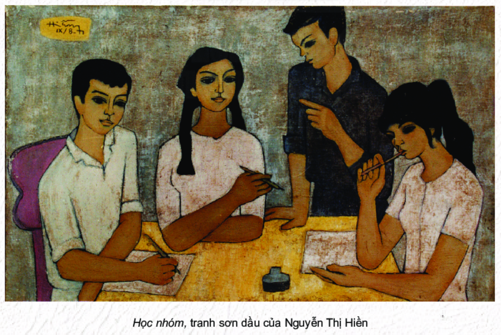
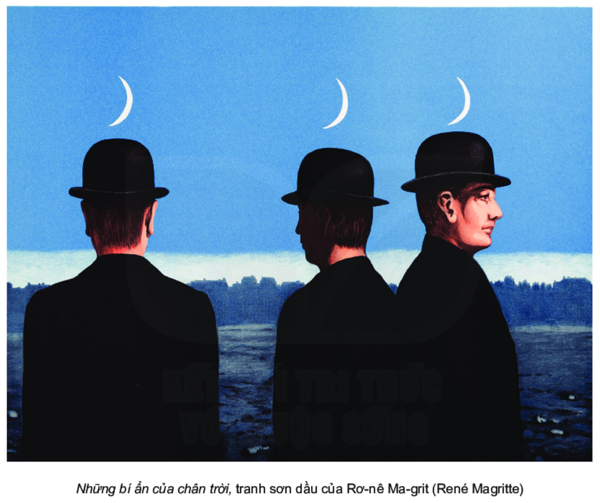
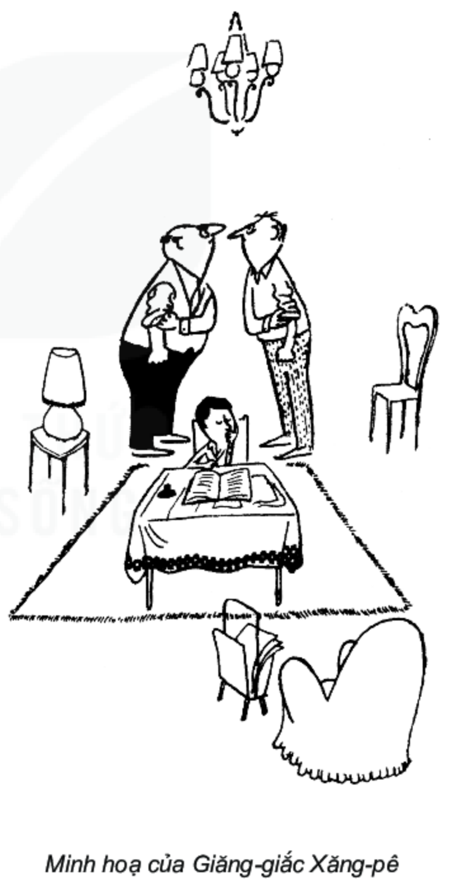

<!-- pdf:50 -->

# BÀI 8: KHÁC BIỆT VÀ GẦN GŨI

*Trên đời chẳng có người tẻ nhạt.*

Ép-ghê-nhi Ép-tu-sen-cô (Evgheni Evtushenko)

## Giới thiệu bài học

- Hãy nhìn xem, cuộc sống quanh ta đa dạng và phong phú biết bao. Mỗi người đều có những đặc điểm riêng về thể chất và tâm hồn. Nhưng bên cạnh những khác biệt, giữa mọi người vẫn có nhiều điều gần gũi, nhiều điểm chung. Nhờ đó, chúng ta mới có khả năng thấu hiểu nhau, để hợp tác và chia sẻ.

- Vì sao giữa mọi người vừa có sự khác biệt lại vừa có nét gần gũi? Sự khác biệt và gần gũi như vậy có ý nghĩa gì? Để trả lời những câu hỏi này, cần phải đưa ra những lí lẽ, bằng chứng để bàn luận một cách thuyết phục.

*Học nhóm*, tranh sơn dầu của Nguyễn Thị Hiền

<!-- pdf:51 -->

## 🎯 Mục tiêu bài học

- Nhận biết được đặc điểm nổi bật của văn bản nghị luận (ý kiến, lí lẽ, bằng chứng); chỉ ra được mối liên hệ giữa các ý kiến, lí lẽ, bằng chứng.
- Tóm tắt được nội dung chính trong một văn bản nghị luận có nhiều đoạn.
- Nhận ra được ý nghĩa của vấn đề đặt ra trong văn bản đối với suy nghĩ, tình cảm của bản thân.
- Bước đầu biết viết bài văn trình bày ý kiến về một hiện tượng (vấn đề) mà em quan tâm.
- Trình bày được ý kiến (bằng hình thức nói) về một hiện tượng (vấn đề); tóm tắt được ý kiến của người khác và biết tham gia thảo luận trong nhóm nhỏ về một vấn đề cần có giải pháp thống nhất.
- Sống trung thực, thể hiện đúng những suy nghĩ riêng của bản thân; có ý thức trách nhiệm với cộng đồng.

## Đọc

### TRI THỨC NGỮ VĂN

**Văn bản nghị luận**

**Văn bản nghị luận** là văn bản chủ yếu dùng để thuyết phục người đọc (người nghe) về một vấn đề.

**Các yếu tố cơ bản trong văn bản nghị luận**

Văn bản nghị luận thường bàn về một hiện tượng, một vấn đề nhằm khẳng định ý kiến của người viết (người nói) về hiện tượng (vấn đề) đó. Để có sức thuyết phục, người viết (người nói) cần sử dụng lí lẽ và bằng chứng. **Lí lẽ** là những lời diễn giải có lí mà người viết (người nói) đưa ra để khẳng định ý kiến của mình. **Bằng chứng** là những ví dụ được lấy từ thực tế đời sống hoặc từ các nguồn khác để chứng minh cho lí lẽ.

**Trạng ngữ**

**Trạng ngữ** là thành phần phụ của câu, có thể được đặt ở đầu câu, giữa câu hoặc cuối câu, nhưng phổ biến là ở đầu câu. Trạng ngữ được dùng để nêu thông tin về thời gian, địa điểm,

<!-- pdf:52 -->

mục đích, cách thức,... của sự việc được nói đến trong câu. Ngoài ra, trạng ngữ còn có chức năng liên kết câu trong đoạn.

**Tác dụng của lựa chọn từ ngữ và cấu trúc câu đối với việc thể hiện nghĩa của văn bản**

Để thể hiện một ý, có thể dùng những từ ngữ khác nhau, những kiểu cấu trúc câu khác nhau. Khi tạo lập văn bản, người viết thường xuyên phải lựa chọn từ ngữ hoặc cấu trúc câu phù hợp để biểu đạt chính xác, hiệu quả nhất điều muốn nói.

### VĂN BẢN ĐỌC

- *Xem người ta kìa!*, Lạc Thanh
- *Tiếng cười không muốn nghe*, Minh Đăng
- *Bài tập làm văn* (trích *Nhóc Ni-cô-la (Nicolas): những chuyện chưa kể*), Rơ-nê Gô-xi-nhi (René Goscinny) và Giăng-giắc Xăng-pê (Jean-Jacques Sempé).

**Xem người ta kìa!**

**LẠC THANH**

**Trước khi đọc**

1. Có bao giờ em phải cố gắng để giống với một người bạn mà em ngưỡng mộ?

2. Trong cuộc sống, mỗi người có quyền thể hiện cái riêng của mình hay không? Vì sao?

**Đọc văn bản**

“Xem người ta kìa!” – đó là câu mẹ tôi thường thốt lên mỗi khi không hài lòng với tôi về một điều gì đó. Cùng với câu này, mẹ còn nói: “Người ta cười chết!”, “Có ai như thế không?”, “Có ai làm vậy không?”, “Ai đời lại thế?”,... Tôi là đứa trẻ được dạy

> **THEO DÕI:** Chú ý cách vào bài bằng lời kể. Phải chăng, kể chuyện cũng là một cách để nêu vấn đề cần bàn luận?
<!-- ocr-ok: hộp THEO DÕI cột phải bị OCR trộn ngang và đọc nhầm "chuyện cũng là một cách để" thành "cxyenicgiiamGticachhoe", đã đối chiếu ảnh trang PDF 52 -->

<!-- pdf:53 -->

nhiều về hiếu thuận(1), tôi đã cố sức vâng lời để mẹ vui lòng. Nhưng mỗi lần
như vậy, thú thật, tôi không thấy thoải mái chút nào.

Giờ đây, mẹ tôi đã khuất(2) và tôi cũng đã lớn. Tôi luôn nhớ về mẹ với niềm
xúc động khôn nguôi(3). Tôi đã hiểu ra, mỗi lần bảo tôi: “Xem người ta kìa!” là
một lần mẹ mong tôi làm sao để bằng người, không thua em kém chị, không
làm xấu mặt gia đình, dòng tộc, không để ai phải phàn nàn, kêu ca điều gì.
Mà có lẽ không riêng gì mẹ tôi. Có người mẹ nào trên đời không ước mong
điều đó?

Mẹ tôi không phải không có lí khi đòi hỏi tôi phải lấy người khác làm chuẩn mực(4) để noi theo. Trên đời, mọi người giống nhau nhiều điều lắm. Ai chẳng muốn thông minh, giỏi giang? Ai chẳng muốn được tin yêu, tôn trọng? Ai chẳng muốn thành đạt? Thành công của người này có thể là niềm ao ước của người kia. Vì lẽ đó, xưa nay, đã có không ít người tự vượt lên chính mình nhờ noi gương những cá nhân xuất chúng(5). Mẹ muốn tôi giống người khác, thì “người khác” đó trong hình dung của mẹ nhất định phải là người hoàn hảo(6), mười phân vẹn mười.

> **THEO DÕI:** Lí do khiến mẹ muốn con giống người khác?

Tuy vậy, trong thâm tâm(7), tôi không hề cảm thấy dễ chịu mỗi lần nghe mẹ trách cứ.

Từ khi biết nhìn nhận và suy nghĩ, tôi dần dần hiểu ra rằng, thế giới này là muôn màu muôn vẻ, vô tận và hấp dẫn lạ lùng. Chim thú trên rừng, cá tôm dưới biển cũng thế mà xã hội con người cũng thế. Kìa, các bạn trong lớp tôi mỗi người một vẻ, sinh động biết bao. Ngoại hình cao thấp, béo gầy, đen trắng khác nhau, giọng nói khác nhau đã đành, mà thói quen, sở thích cũng có giống nhau đâu. Tùng thích vẽ vời; Nhung ưa ca hát, nhảy múa. Hoài thì sôi nổi, nhí nhảnh;

> **THEO DÕI:** Những bằng chứng nào chứng tỏ thế giới này là muôn màu muôn vẻ?

> (1) *Hiếu thuận*: có lòng kính yêu và biết nghe lời cha mẹ.
> (2) *Khuất*: chết.
> (3) *Khôn nguôi*: không thể quên.
> (4) *Chuẩn mực*: cái được chọn làm căn cứ để theo đó mà làm cho đúng.
> (5) *Xuất chúng*: nổi bật, hơn hẳn mọi người về tài năng, trí tuệ.
> (6) *Hoàn hảo*: tốt đẹp về mọi mặt.
> (7) *Thâm tâm*: nơi sâu kín trong lòng.

<!-- pdf:54 -->

Thơ lúc nào cũng kín đáo, trầm tư. Trần Long nổi tiếng là một “danh hài”,
Minh Diệu thì hơn người ở trí nhớ siêu việt(1),... Người ta thường nói học trò
“nghịch như quỷ”, ai ngờ “quỷ” cũng là cả một thế giới, chẳng “quỷ” nào giống
“quỷ” nào! Tôi đã đọc đâu đó một câu rất hay: “Chỗ giống nhau nhất của mọi
người trên thế gian này là... không ai giống ai cả”. Chính chỗ “không giống ai”
nhiều khi lại là một phần rất đáng quý trong mỗi con người.

*Những bí ẩn của chân trời*, tranh sơn dầu của Rơ-nê Ma-grit (René Magritte)

Tôi muốn trở lại với dòng hồi ức(2) được khai mở ở đầu bài. Dù có ý định tốt
đẹp, những người thân yêu của ta đôi lúc cũng không hẳn đúng khi ngăn cản,
không để ta được sống với con người thực của mình. Ai cũng cần hoà nhập,
nhưng sự hoà nhập có nhiều lối chứ không phải một. Mỗi người phải được
tôn trọng, với tất cả những cái khác biệt vốn có. Sự độc đáo của từng cá nhân
làm cho tập thể trở nên phong phú. Nếu chỉ ao ước được giống người khác,
thì làm sao ta có hi vọng đóng góp cho tập thể, cho cộng đồng một cái gì đó

> (1) *Siêu việt*: vượt lên hẳn so với người bình thường.
> (2) *Hồi ức*: nhớ lại điều bản thân đã trải qua.

<!-- pdf:55 -->

của chính mình? Đòi hỏi chung sức chung lòng không có nghĩa là gạt bỏ cái
riêng của từng người.

Càng lớn, tôi càng hiểu nỗi lòng, mong ước của mẹ hơn. Tôi không còn
cái cảm giác khó chịu nữa bởi đã nhận thức được rằng, những lời trách cứ(1)
mẹ dành cho tôi cũng có thể là câu mà bao người mẹ trên đời đã nói với con.
Tôi muốn đổi nội dung câu nói “Xem người ta kìa!” thành một lời khích
lệ: Người ta đã khác, đã hay như thế, sao mình lại không khác, không hay, theo cách của mình? Biết hoà đồng, gần gũi mọi người, nhưng cũng phải biết giữ lại cái riêng và tôn trọng sự khác biệt. Chẳng phải vậy sao?

> **SUY LUẬN:** Việc kết thúc văn bản bằng các câu hỏi có ý nghĩa gì?

(*Theo* Lạc Thanh, tạp chí *Sông Lam*, số 8/2020)

**Sau khi đọc**

**Trả lời câu hỏi**

1. Khi thốt lên “Xem người ta kìa!”, người mẹ muốn con làm gì?

2. Chỉ ra ở văn bản:

   a. Đoạn văn nêu vấn đề bằng cách kể một câu chuyện.

   b. Đoạn văn là lời diễn giải của người viết.

   c. Đoạn văn dùng bằng chứng để làm sáng tỏ vấn đề.

3. Nội dung văn bản nhấn mạnh ý nghĩa của sự khác nhau hay giống nhau giữa mọi người?

4. Đọc lại đoạn văn có câu: *Mẹ tôi không phải không có lí khi đòi hỏi tôi phải lấy người khác làm chuẩn mực để noi theo.* Hãy cho biết người mẹ có lí ở chỗ nào.

5. *Chính chỗ “không giống ai” nhiều khi lại là một phần rất đáng quý trong mỗi con người.* Tác giả đưa ra những ví dụ nào để làm sáng tỏ ý ở câu trên? Qua tìm hiểu các ví dụ đó, em học được gì về cách sử dụng bằng chứng trong bài nghị luận?

6. *Biết hoà đồng, gần gũi mọi người, nhưng cũng phải biết giữ lại cái riêng và tôn trọng sự khác biệt* – em có đồng ý với ý kiến này không? Vì sao?

7. Nếu được đặt lại tên cho văn bản, em sẽ đặt như thế nào?

8\*. Bức tranh *Những bí ẩn của chân trời* của Rơ-nê Ma-grit đã được sử dụng để minh hoạ cho văn bản *Xem người ta kìa!* Theo em, điều đó có hợp lí không? Vì sao?

> (1) *Trách cứ*: nói ra điều thể hiện sự không bằng lòng.

<!-- pdf:56 -->

#### Viết kết nối với đọc

Viết đoạn văn (khoảng 5 – 7 câu) trình bày suy nghĩ của em về vấn đề: *Mỗi người cần có cái riêng của mình.*

### Thực hành tiếng Việt

**TRẠNG NGỮ**

> **Nhận biết trạng ngữ**
> - Đọc câu sau để biết vị trí của trạng ngữ: ***Hồi nhỏ**, chúng tôi cùng học một lớp.* Trong câu này, ***hồi nhỏ*** là trạng ngữ. Trạng ngữ đứng ở đầu câu như thế rất phổ biến trong tiếng Việt.
> - Đọc các câu sau để hiểu chức năng của trạng ngữ:
>   – ***Vì lẽ đó, xưa nay**, đã có không ít người tự vượt lên chính mình nhờ noi gương những cá nhân xuất chúng.* (***Vì lẽ đó*** là trạng ngữ vừa chỉ nguyên nhân, vừa để liên kết với câu trước; ***xưa nay*** là trạng ngữ chỉ thời gian.)
>   – ***Để nói tốt ngoại ngữ**, các bạn nên mạnh dạn giao tiếp với người nước ngoài.* (***Để nói tốt ngoại ngữ*** là trạng ngữ chỉ mục đích.)
>   – *Nhiều người thường cãi nhau **chỉ vì những bất đồng nhỏ**.* (***Chỉ vì những bất đồng nhỏ*** là trạng ngữ chỉ nguyên nhân.)
>   Trạng ngữ trong mỗi câu có một chức năng riêng (chỉ thời gian, chỉ mục đích, chỉ nguyên nhân, liên kết với câu trước,...).

1. Chỉ ra trạng ngữ trong các câu sau và cho biết chức năng của trạng ngữ ở từng câu:

   a. *Từ khi biết nhìn nhận và suy nghĩ, tôi dần dần hiểu ra rằng, thế giới này là muôn màu muôn vẻ, vô tận và hấp dẫn lạ lùng.*

   b. *Giờ đây, mẹ tôi đã khuất và tôi cũng đã lớn.*

   c. *Dù có ý định tốt đẹp, những người thân yêu của ta đôi lúc cũng không hẳn đúng khi ngăn cản, không để ta được sống với con người thực của mình.*

2. Thử lược bỏ trạng ngữ trong các câu sau và chỉ ra sự khác nhau về nội dung giữa câu có trạng ngữ với câu không còn trạng ngữ:

   a. *Cùng với câu này, mẹ còn nói: “Người ta cười chết!”.*

   b. *Trên đời, mọi người giống nhau nhiều điều lắm.*

   c. *Tuy vậy, trong thâm tâm, tôi không hề cảm thấy dễ chịu mỗi lần nghe mẹ trách cứ.*

3. Thêm trạng ngữ cho các câu sau:

   a. *Hoa đã bắt đầu nở.*

   b. *Bố sẽ đưa cả nhà đi công viên nước.*

   c. *Mẹ rất lo lắng cho tôi.*
<!-- ocr-ok: câu 3c bị OCR mất chữ "c." và đọc nhầm "rất" thành "rắt", đã đối chiếu ảnh trang PDF 56 -->

<!-- pdf:57 -->

**NGHĨA CỦA TỪ NGỮ**

4. Thành ngữ trong các câu sau có những cách giải thích khác nhau. Theo em, cách giải thích nào hợp lí?

   a. *Đòi hỏi **chung sức chung lòng** không có nghĩa là gạt bỏ cái riêng của từng người.*

   ***Chung sức chung lòng*** có nghĩa là:
   – Nhất trí
   – Đoàn kết
   – Quyết tâm cao độ.

   b. *Mẹ muốn tôi giống người khác, thì “người khác” đó trong hình dung của mẹ nhất định phải là người hoàn hảo, **mười phân vẹn mười**.*

   ***Mười phân vẹn mười*** có nghĩa là:
   – Tài giỏi
   – Toàn vẹn, không có khiếm khuyết
   – Đầy đủ, toàn diện.

5. Hãy xác định nghĩa của thành ngữ (in đậm) trong các câu sau:

   a. *Tôi đã hiểu ra, mỗi lần bảo tôi: “Xem người ta kìa!” là một lần mẹ mong tôi làm sao để bằng người, không **thua em kém chị**.*
<!-- ocr-ok: câu 5a chữ in nghiêng bị OCR đọc sai nhiều dấu ("hiểu" thành "hiều", "lần" thành "lằn", "kìa" thành "kia", "để" thành "đề"), đã đối chiếu ảnh trang PDF 57 -->

   b. *Kìa, các bạn trong lớp tôi **mỗi người một vẻ**, sinh động biết bao.*

   c. *Người ta thường nói học trò **“nghịch như quỷ”**, ai ngờ quỷ cũng là cả một thế giới, chẳng “quỷ” nào giống “quỷ” nào!*

**Tiếng cười không muốn nghe**

**MINH ĐĂNG**

**Trước khi đọc**

1. Em đã từng bị cười nhạo hay chứng kiến cảnh bạn mình bị cười nhạo chưa? Em có nhận thấy hành động cười nhạo người khác là vô lí không?

2. Cần ứng xử như thế nào khi bị người ta cười nhạo?

**Đọc văn bản**

Mỗi khi được nghe tiếng cười tươi trẻ, hồn nhiên của bạn bè trong
lớp hay của ai đó bên ngoài, tôi đều cảm thấy ấm lòng. Nó như truyền
thêm cho tôi niềm vui sống, sự yêu đời. Hoá ra, tiếng cười cũng có nhiều

<!-- pdf:58 -->

âm sắc(1), chứa nhiều hàm ý. Có tiếng cười trao gửi một niềm tin yêu; có tiếng cười thay cho một lời cảm ơn, một tình cảm chân thành muốn nói; có tiếng cười hài hước, dí dỏm khiến người ta quên cả mệt nhọc; có tiếng cười phê phán những thói hư tật xấu. Tuy nhiên, tôi cũng biết rằng, trong cuộc sống hằng ngày, còn có những tiếng cười mà người ta không bao giờ muốn nghe, không bao giờ chờ đợi. Những tiếng cười khiến ta phải phiền lòng, khó chịu và ước sao nó không hướng vào mình. Ấy là kiểu cười được nói đến trong câu tục ngữ: *Cười người chớ vội cười lâu/ Cười người hôm trước, hôm sau người cười.*

> **THEO DÕI:** Những tiếng cười có sự khác nhau như thế nào về ý nghĩa?
<!-- ocr-ok: hộp THEO DÕI cột phải bị OCR mất dấu "DÕI", "tiếng" và đọc nhầm "về" thành "vô", đã đối chiếu ảnh trang PDF 58 -->

Câu tục ngữ nêu lên bài học: không nên mải cười cợt người khác, bởi biết đâu bản thân mình rồi cũng có lúc lộ ra những nét đáng chê cười.

> **THEO DÕI:** Câu văn nào khái quát ý nghĩa của câu tục ngữ được dẫn ra ở phần mở đầu?
<!-- ocr-ok: hộp THEO DÕI cột phải bị OCR đọc nhầm "tục ngữ được dẫn ra ở phần" thành "ÐÐẼẼẼẼ", đã đối chiếu ảnh trang PDF 58 -->

Kiểu cười mà câu tục ngữ nhắc nhở đồng nghĩa với chê bai, mỉa mai, dè bỉu. Người cười cảm thấy mình ở một vị trí rất cao, tự cho mình cái quyền phán xét(2), cợt nhạo(3) kẻ khác. Lí do để cười thì muôn hình vạn trạng(4): một sai phạm, một lỗi lầm, một dị tật(5), một tính cách, một sở thích(6),... của người nào đó. Hay đơn giản hơn: cười vì người khác có những điều không giống ta.

Trên đời, không ai hoàn hảo cả. Ai cũng có mặt tốt, mặt xấu, có ưu điểm,
khiếm khuyết, khó tránh được va vấp, sai lầm. Điều quan trọng là biết nhận ra
những điểm yếu của mình để tự khắc phục. Cười cợt về lỗi lầm, khuyết điểm
của người ta, kẻ cười chỉ cốt thoả mãn ý thích không mấy tốt đẹp. Đó còn là
cách tự đề cao mình. Nhưng họ có biết đâu rằng, nhiều khi bản thân cũng
vướng phải những điều mà mình đã từng chê bai. Hãy nghĩ xem, lúc ấy, mình
có đáng bị chê cười không!

> (1) *Âm sắc*: tính chất riêng biệt của một âm thanh nào đó.
> (2) *Phán xét*: xem xét, đánh giá có tính chất quyết định.
> (3) *Cợt nhạo*: giống nghĩa từ *cười cợt, chế nhạo*.
> (4) *Muôn hình vạn trạng*: rất nhiều kiểu khác nhau.
> (5) *Dị tật*: hiện tượng biến đổi bất thường của bộ phận nào đó trên cơ thể khi sinh ra.
> (6) *Sở thích*: ý thích riêng của mỗi người.

<!-- pdf:59 -->

Sự khác biệt về gia cảnh(1), ngoại hình, thể chất(2), sở thích, sở trường(3),...
giữa người này với người kia là điều tất yếu. Nhờ đó mà cộng đồng mới có
sự đa dạng, phong phú. Cái khác, cái riêng không phải là nhược điểm mà là
bản chất của mỗi cá thể(4). Hơn thế, nó còn là yếu tố
quyết định giá trị của mỗi con người. Vậy thì, ta lấy quyền gì, lấy cớ gì để cười cợt những người không giống ta? Nếu ai đó chế nhạo cái khác biệt của ta, ta có thấy dễ chịu không?

> **THEO DÕI:** Hai câu hỏi khái quát lí lẽ trong đoạn.

Bị cười, không phải mọi người đều phản ứng giống nhau. Có người tỏ thái độ mặc kệ, bất cần, ai cười, người ấy nghe. Có người, nhân bị thiên hạ cười mà nghiêm túc soi xét bản thân, lặng lẽ sửa mình. Nhưng cũng có những người, bị tiếng cười của đám đông nhằm tới, do thiếu bản lĩnh(5), nên hoảng hốt, lo âu và tưởng rằng khiếm khuyết của mình là rất nghiêm trọng. Rơi vào bế tắc, họ tìm lối thoát trong hành vi tiêu cực. Như vậy, sự cười nhạo chẳng phải đã vô tình làm hại người ta đó sao?

> **THEO DÕI:** Khi bị cười cợt, người ta có thể có những phản ứng gì?

Trước những sai lầm, khiếm khuyết của người khác, thái độ đúng đắn là
nói rõ sự thật, góp ý chân thành chứ không phải cất lên tiếng cười hả hê, thể
hiện một tâm địa(6) hẹp hòi, không muốn thấy người ta tiến bộ.

Viết đến đây, tôi bỗng nhớ tới hình ảnh chú Nam – một người dị tật có
bước đi khập khiễng, khó khăn. Chú là con út trong một gia đình ở quê tôi.

> (1) *Gia cảnh*: hoàn cảnh riêng của gia đình.
> (2) *Thể chất*: cơ thể, sức khoẻ con người.
> (3) *Sở trường*: những điểm mạnh vốn có.
> (4) *Cá thể*: ở đây có nghĩa là từng con người riêng biệt.
> (5) *Bản lĩnh*: khả năng tự quyết một cách độc lập, dứt khoát, không chịu sự chi phối của bên ngoài.
> (6) *Tâm địa*: lòng dạ không tốt của con người.

<!-- pdf:60 -->

Rất nhiều bạn cùng lứa thường bắt chước dáng đi nghiêng nghiêng của chú để làm hề. Có người còn đá bóng vào chân chú và thách chú đá trả lại. Những lúc như vậy, chú chỉ cười trừ(1). Nhiều buổi trưa, khi mọi người nghỉ cả, chú Nam lúi húi đẽo, gọt. Hoá ra chú đang tự chế chiếc đàn bầu. Nghe những tiếng “bật bông” ban đầu, ai cũng cười cợt. Chỉ có bố chú luôn nhìn con với ánh mắt khích lệ(2), tin tưởng. Chú kiên trì tập. Tiếng đàn bầu của chú ngày càng “ngọt” hơn, khiến mọi người không khỏi ngạc nhiên. Được bố đồng ý, chú đã dự thi vào trường trung cấp âm nhạc. Cùng thi đợt ấy, còn có con của một cô hàng xóm. Tự hào về con trai khoẻ mạnh, giỏi giang, nhìn sự tật nguyền(3) của chú Nam, cô ta đã từng có lúc buông ra những lời “ác khẩu”(4): *Chuông khánh còn chả ăn ai/ Nữa là mảnh chĩnh vứt ngoài bờ tre.* Vậy mà, bạn biết không, kì thi đó, chú Nam đã đậu, trong khi con cô kia lại trượt. Bây giờ, chú Nam đã là cây độc tấu(5) đàn bầu có hạng trong một đoàn nghệ thuật. Sự cười nhạo ngày nào của mấy người giờ đây đã phải thay bằng thái độ thán phục.

> **THEO DÕI:** Cách chọn bằng chứng để tăng sức thuyết phục.
<!-- ocr-ok: hộp THEO DÕI cột phải bị OCR đọc nhầm "chứng để tăng sức thuyết phục" thành "chứng đồđông hức 0é cược", đã đối chiếu ảnh trang PDF 60 -->

Bạn đã bao giờ cười chê một người có khiếm khuyết chưa? Bất cứ ai được hỏi như thế, hẳn chẳng dám trả lời rằng chưa. Chê bai người khác là một nhược điểm phổ biến trong tính cách con người. Tuy nhiên, đây không phải là điều quá nghiêm trọng, và càng không phải là “căn bệnh” hết cách chữa. Lòng nhân ái, sự cảm thông, ấy là “phương thuốc” hữu hiệu(6) để trị “căn bệnh” này. Thật vậy, khi mà khả năng yêu thương, đồng cảm, chia sẻ đối với người khác dần dần được bồi đắp trong ta, khi ta biết đặt mình vào hoàn cảnh người khác để nghĩ suy và thức tỉnh, thì lúc ấy, tiếng cười ngạo mạn vô lối sẽ không có lí do gì để bật ra.

> **THEO DÕI:** “Phương thuốc” nào được xem là hữu hiệu dùng để trị “căn bệnh” cười cợt người khác?

(Minh Đăng, tạp chí *Hồng Lĩnh*, số 170/2020)

> (1) *Cười trừ*: lấy tiếng cười thay cho hành động hay lời nói có tính chất phản ứng trước cách đối xử của người khác với mình.
> (2) *Khích lệ*: tác động đến tinh thần làm cho hăng hái, mạnh mẽ thêm.
> (3) *Tật nguyền*: bị một tật nghiêm trọng trong cơ thể.
> (4) *Ác khẩu*: lời cay độc.
> (5) *Độc tấu*: biểu diễn âm nhạc một mình, dùng một loại nhạc cụ là chính.
> (6) *Hữu hiệu*: có hiệu quả.

<!-- pdf:61 -->

**Sau khi đọc**

**Trả lời câu hỏi**

1. Những đặc điểm nào cho thấy *Tiếng cười không muốn nghe* là một văn bản nghị luận?

2. Đoạn mở đầu nói đến nhiều ý nghĩa khác nhau của tiếng cười. Ý nghĩa nào được bàn luận trong văn bản này?

3. Người viết có thái độ, suy nghĩ như thế nào trước hiện tượng cười cợt khiếm khuyết của người khác? Thái độ, suy nghĩ đó dựa trên những lí lẽ nào?

4. Nhận xét các bằng chứng tác giả sử dụng để chứng minh cho lí lẽ đã nêu.

5. Lòng nhân ái, sự cảm thông là “phương thuốc” hữu hiệu để trị “căn bệnh” cười nhạo người khác. Em có đồng ý với ý kiến này không? Vì sao?

6\*. Em có lí lẽ hay bằng chứng nào có thể bổ sung cho văn bản? Hãy tìm một số câu tục ngữ nói về cách ứng xử trong cuộc sống.

#### Viết kết nối với đọc

Với câu mở đầu *Tôi không muốn bị người khác cười nhạo...*, em hãy viết tiếp khoảng 5 – 7 câu để hoàn thành đoạn văn.

### Thực hành tiếng Việt

**LỰA CHỌN TỪ NGỮ**

> **Nhận biết tác dụng của lựa chọn từ ngữ**
> Đọc câu sau để biết tác dụng của việc lựa chọn từ ngữ trong câu: *Vì lẽ đó, xưa nay, đã có không ít người tự vượt lên chính mình nhờ noi gương những cá nhân xuất chúng.* Ở vị trí của từ *noi gương*, có một số từ gần nghĩa như: *học đòi, làm theo, bắt chước*,... Người viết đã chọn từ *noi gương*. Lựa chọn từ này là phù hợp nhất cho câu trên.

1. Trả lời các câu hỏi sau:

   a. Với câu: *Mỗi khi được nghe tiếng cười tươi trẻ, hồn nhiên của bạn bè trong lớp hay của ai đó bên ngoài, tôi đều cảm thấy ấm lòng*, theo em, có thể dùng từ *tự nhiên* để thay cho *hồn nhiên* được không? Vì sao?

   b. Từ *khuất* được dùng trong câu: *Giờ đây, mẹ tôi đã khuất và tôi cũng đã lớn* có phù hợp hơn so với một số từ khác cũng có nghĩa là *chết* như: *mất, từ trần, hi sinh*?

   c. Theo em, vì sao trong câu: *Điều quan trọng là biết nhận ra những điểm yếu của mình để tự khắc phục*, không thể dùng từ *tồn tại* thay cho từ *điểm yếu*?

<!-- pdf:62 -->

2. Chọn từ phù hợp nhất trong ngoặc đơn để đặt vào khoảng trống ở các câu sau và giải thích lí do lựa chọn:

   a. *Bị cười, không phải mọi người đều ... giống nhau.* (phản ứng, phản xạ, phản đối, phản bác)

   b. *Rơi vào ..., họ tìm lối thoát trong hành vi tiêu cực.* (tắc tị, bế tắc, cùng đường, cùng quẫn)

   c. *Đi đường phải luôn luôn ... để tránh tai nạn.* (nhìn, dòm ngó, quan sát, ngó nghiêng)

   d. *Ngoài ... của bản thân, tôi còn được bạn bè, thầy cô thường xuyên động viên, khích lệ.* (phấn đấu, sức lực, khả năng, nỗ lực)

**LỰA CHỌN CẤU TRÚC CÂU**

> **Nhận biết tác dụng của lựa chọn cấu trúc câu**
> Đọc câu sau để biết tác dụng của việc lựa chọn cấu trúc câu phù hợp: *Càng lớn, tôi càng hiểu nỗi lòng, mong ước của mẹ hơn.* Cặp quan hệ từ *càng... càng* là một kiểu cấu trúc của câu tiếng Việt. Sử dụng cấu trúc này giúp người viết biểu đạt được ý quan trọng: sự nhận thức của con về tình mẹ là một quá trình, nó đầy đặn hơn theo thời gian và sự trưởng thành của con.

3. Thực hiện các yêu cầu sau:

   a. Chỉ ra ý nghĩa của cụm từ in đậm trong câu sau và cho biết, nếu bỏ thành phần đó, câu thay đổi như thế nào về cấu trúc.

   ***Nhiều buổi trưa, khi mọi người nghỉ cả**, chú Nam lúi húi đẽo, gọt.*

   b. Văn bản *Tiếng cười không muốn nghe* có câu: *Nếu ai đó chế nhạo cái khác biệt của ta, ta có thấy dễ chịu không?* Giả sử câu này được viết lại thành: *Ta có thấy dễ chịu không nếu ai đó chế nhạo cái khác biệt của ta?* thì ý nghĩa sẽ thay đổi như thế nào?

   c. Câu *Ai chẳng muốn thông minh, giỏi giang?* có thể đổi cấu trúc: *Thông minh, giỏi giang thì ai chẳng muốn.* Chỉ ra sự khác nhau về ý nghĩa giữa câu gốc và câu biến đổi.

4. Sau đây là những câu được thay đổi cấu trúc so với câu gốc trong văn bản đã học. Nghĩa của câu được thay đổi cấu trúc khác như thế nào so với nghĩa của câu gốc?

   a. – Câu trong văn bản: *“Xem người ta kìa!” – đó là câu mẹ tôi thường thốt lên mỗi khi không hài lòng với tôi về một điều gì đó.*
      – Câu được thay đổi: *Mỗi khi không hài lòng với tôi về một điều gì đó, mẹ tôi thường thốt lên: “Xem người ta kìa!”.*

   b. – Câu trong văn bản: *Khi nghe những tiếng “bật bông” ban đầu, ai cũng cười cợt.*
      – Câu được thay đổi: *Ai cũng cười cợt khi nghe những tiếng “bật bông” ban đầu.*

   c. – Câu trong văn bản: *Tuy nhiên, đây không phải là điều quá nghiêm trọng, và càng không phải là “căn bệnh” hết cách chữa.*
      – Câu được thay đổi: *Tuy nhiên, đây không phải là “căn bệnh” hết cách chữa và càng không phải là điều quá nghiêm trọng.*

<!-- pdf:63 -->

**Bài tập làm văn**

Trích *Nhóc Ni-cô-la: những chuyện chưa kể*, RƠ-NÊ GÔ-XI-NHI và GIĂNG-GIẮC XĂNG-PÊ

**Đọc văn bản**

Bố đi làm đã về đến nhà, bố ôm mẹ, ôm tôi và bố nói rằng: “Giời ạ, sao mà
một ngày làm việc ở văn phòng nó lại mệt mỏi đến thế không biết”, rồi bố xỏ
giày păng-túp(1), bố vớ lấy báo, bố ngồi xuống ghế phô-tơi(2), còn tôi thì nói
với bố rằng bố cần phải giúp tôi làm bài tập.

[...] Bố thật sự là rất khá. Bố bế tôi đặt tôi lên đầu gối, bố lau mặt cho tôi
bằng cái khăn mùi soa(3) to của bố, bố nói với tôi rằng bố của bố ấy thì chẳng
bao giờ giúp bố làm bài tập cả, nhưng mà bố thì khác, bố sẽ giúp, nhưng mà
là lần cuối cùng. Bố tôi í à, rất là tuyệt!

Chúng tôi chuyển sang cái bàn nhỏ trong phòng khách.

– Xem nào, bố hỏi tôi, xem cái bài tập lẫy lừng này nó ra làm sao nào?

Tôi trả lời bố rằng đó là một bài tập làm văn, đầu bài là: “Tình bạn; hãy
miêu tả người bạn thân nhất của em”.

– Ồ, đầu bài ra hay, rất hay đấy chứ, bố nói, mà bố lại còn rất giỏi về tập
làm văn chứ lị, các thầy giáo bố còn nói là có cả một Ban-dắc(4) (Balzac) ở
trong bố nữa kia.

Tôi không hiểu tại sao các thầy giáo bố lại nói thế với bố, nhưng đã nói thế
thì chắc là phải oách lắm, cho nên bố mới có vẻ tự hào đến vậy.

Bố bảo tôi cầm lấy bút và bắt đầu viết.

– Phải bố cục(5) một tí, bố nói. Trước tiên, ai là bạn thân nhất của con?

– Con có hàng đống bạn thân, tôi trả lời bố. Còn những đứa khác thì
chẳng bạn bè gì sất(6).

> (1) *Giày păng-túp*: giày vải, để đi trong nhà.
> (2) *Ghế phô-tơi*: ghế bành.
> (3) *Khăn mùi soa*: khăn nhỏ và mỏng, thường bỏ túi để lấy lau mặt cho tiện.
> (4) *Ban-dắc*: Hô-nô-rê đơ Ban-dắc (Honoré de Balzac) (1799 – 1850), nhà văn Pháp.
> (5) *Bố cục*: sắp xếp các ý, các phần trước sau cho hợp lí.
> (6) *Sất*: nhấn mạnh sự phủ định. Nói “chẳng bạn bè gì sất” cũng giống như nói: “chẳng bạn bè gì hết”.

<!-- pdf:64 -->

Bố nhìn tôi như thể là bố hơi ngạc nhiên một tí, rồi bố nói: “Rồi, rồi” và bố
yêu cầu tôi chọn một đứa bạn thân nhất trong cả đống và ghi ra những đức
tính mà tôi thích ở thằng đó. Làm thế sẽ lập được dàn ý bài tập làm văn của
chúng tôi, sau đó, viết sẽ rất dễ.

Thế là tôi bèn giới thiệu với bố thằng An-xe-xtơ (Alceste), cái thằng lúc
nào cũng ăn luôn miệng và chẳng bao giờ bị ốm. Nó là thằng to béo nhất cả
bọn, và nó rất là hay. Sau thằng An-xe-xtơ, tôi lại nói với bố thằng Giơ-phroa
(Geoffroy), cái thằng có hàng đống đức tính hay: bố nó giàu ơi là giàu và
toàn mua cho nó đồ chơi, và Giơ-phroa thỉnh thoảng lại mang cho bọn
bạn mượn rồi làm vỡ mất. Rồi cả thằng Ơt-đơ (Eudes), cực khoẻ, và rất
là thích đấm đá, nhưng mà chỉ đấm bạn bè thôi, bởi vì nó rất dát. Rồi còn
cả thằng Ruy-phus (Rufus) nữa, như những đứa khác, cũng có rất nhiều
đức tính: nó có một cái còi thổi nảy hột, và bố nó thì là cảnh sát. Rồi đến
thằng Me-xăng (Maixent), chạy nhanh ơi là nhanh, và đầu gối thì vừa to
vừa bẩn. Rồi đến thằng Gioa-chim (Joachim), không bao giờ muốn cho ai
mượn gì, nhưng mà lúc nào thì cũng có hàng đống tiền trong túi để mua kẹo
ca-ra-men(1) mà ngậm; còn chúng tôi thì chỉ được chầu(2) mồm nó. Rồi tôi
ngừng lại, bởi vì bố tôi cứ tròn mắt ra mà nhìn tôi.

– Thế thì sẽ khó hơn là bố tưởng rồi đây, bố nói.

Có ai đó nhấn chuông cửa ra vào và bố đi ra mở cửa. Bố quay vào cùng với
ông Blê-đúc (Blédurt). Ông Blê-đúc là ông hàng xóm rất thích gây sự với bố.

– Tôi sang với anh, ta làm một ván cờ nhé, ông Blê-đúc nói.

– Không được rồi, bố trả lời, tôi phải làm bài tập cùng với thằng bé.

Bài tập của tôi lại có vẻ khiến ông Blê-đúc hết sức quan tâm, và khi ông biết
chủ đề bài tập làm văn của tôi, ông liền nói là để ông làm cho, và đảm bảo sẽ
cực nhanh.

– Hãy gượm(3), bố nói, tôi sẽ làm bài tập cho con tôi.

– Đừng cãi nhau nữa, ông Blê-đúc nói; cả hai người mà cùng làm thì càng
nhanh hơn, hay hơn chứ sao.

> (1) *Kẹo ca-ra-men*: một loại kẹo có màu nâu nhạt, làm từ đường được nung nóng cho chảy ra.
> (2) *Chầu*: hướng về, nhìn.
> (3) *Gượm*: chờ một lát.

<!-- pdf:65 -->

Thế rồi ông ấy ngồi xuống cái bàn nhỏ cùng với chúng tôi, ông gãi gãi cái
đầu, ông nhìn ngơ ngẩn ra phía trước, và ông nói: “Xem nào, xem nào, xem
nào”, rồi ông hỏi ai là bạn thân nhất của tôi. Tôi đang định trả lời thì bố đã
ngắt lời không để tôi kịp nói. Bố nói với ông Blê-đúc rằng hãy để chúng tôi
yên, rằng chúng tôi không cần gì ông cả.

– Tốt thôi, ông Blê-đúc nói, tôi ấy à, tôi có bảo gì thì cũng chỉ là muốn
cho con anh được điểm tốt hơn mà thôi, chả lẽ cứ lẹt đẹt(1) mãi.

Điều này lại khiến bố phật ý(2).
[...] Vì tôi thấy bố không bằng lòng

nên tôi muốn bênh bố, tôi bèn nói với
ông Blê-đúc rằng bố viết văn giỏi lắm
và rằng các thầy giáo bố đã nói rằng
có hàng đống Ban-dắc ở trong bố. Ông
Blê-đúc bắt đầu cười rũ. Thế là bố đã
vẩy mực vào ca-vát(3) của ông Blê-đúc.

Ông Blê-đúc rất tức giận.

– Ra ngoài kia, nếu anh còn là đàn
ông, ông ta nói với bố.

[...] Tôi hiểu rằng bài tập làm văn
của tôi thì tốt nhất là tôi tự làm một
mình, bởi vì bây giờ thì nó chỉ là cớ để
bố và ông Blê-đúc huých(4) nhau mà
thôi. Nhưng đã thế thì càng tiện cho
tôi, bởi vì phòng khách thì rất là yên
tĩnh và tôi đã làm được một bài tập
làm văn ra trò, trong đó tôi bảo rằng
thằng Ác-nhăng (Agnan) là người bạn
thân nhất.

*Minh hoạ của Giăng-giắc Xăng-pê*

> (1) *Lẹt đẹt*: chậm chạp, kém cỏi, không theo kịp người khác.
> (2) *Phật ý*: không vui, không được vừa ý.
> (3) *Ca-vát*: một vật dụng thuộc trang phục, dùng để quàng quanh cổ áo sơ mi, thắt nút, buông xuống trước ngực, thường làm bằng vải hoặc lụa.
> (4) *Huých*: cố tình xô đẩy do tức nhau.

<!-- pdf:66 -->

[...] Tôi được điểm rất cao với bài tập làm văn ở trường, và cô giáo còn viết
vào vở của tôi: “Bài viết rất cá tính, đề tài độc đáo”.

Chỉ có một vấn đề duy nhất là, từ cái bài tập làm văn về tình bạn, ông
Blê-đúc và bố không nói chuyện với nhau nữa.

(Rơ-nê Gô-xi-nhi & Giăng-giắc Xăng-pê, *Nhóc Ni-cô-la: những chuyện chưa kể*, tập 1, Trác Phong và Hương Lan *dịch*, NXB Hội Nhà văn & Nhã Nam, Hà Nội, 2016, tr. 340 – 347)

**Sau khi đọc**

> **RƠ-NÊ GÔ-XI-NHI VÀ GIĂNG-GIẮC XĂNG-PÊ**
> - Rơ-nê Gô-xi-nhi (1926 – 1977) là nhà văn Pháp, chuyên sáng tác truyện tranh, viết kịch, làm phim.
>   Giăng-giắc Xăng-pê (sinh năm 1932) là hoạ sĩ người Pháp, chuyên vẽ truyện tranh và tranh biếm hoạ.
> - *Bài tập làm văn* trích trong *Nhóc Ni-cô-la: những chuyện chưa kể*, xuất bản lần đầu năm 2004.

**Trả lời câu hỏi**

1. Do đâu khi làm bài tập làm văn, Ni-cô-la phải nhờ đến bố?

2. Vì sao bố Ni-cô-la lại tỏ ra sốt sắng giúp cậu con trai làm bài văn?

3. *Ai là người bạn thân nhất của cậu bé?* – đó là điều cả bố Ni-cô-la và ông Blê-đúc cần phải biết khi muốn làm hộ bài tập làm văn. Vì sao vậy?

4. Vì sao sau khi Ni-cô-la đã kể ra nhiều người bạn của mình mà bố của cậu vẫn thấy khó viết?

5. *Tôi hiểu rằng bài tập làm văn của tôi thì tốt nhất là tôi tự làm một mình* – nhân vật trong câu chuyện rút ra một kinh nghiệm như thế qua những gì đã xảy ra khi nhờ bố làm bài. Em có đồng ý với điều đó không? Vì sao?

6. Nếu gặp một đề văn như của Ni-cô-la, theo em, việc đầu tiên phải làm là gì?

<!-- pdf:67 -->

## Viết

**Viết bài văn trình bày ý kiến về một hiện tượng (vấn đề) mà em quan tâm**

*Xem người ta kìa!* và *Tiếng cười không muốn nghe* là những văn bản nghị luận. Vấn đề được nêu và bàn luận trong đó rất gần gũi với đời sống của mỗi người. Hằng ngày, xung quanh chúng ta còn có bao nhiêu điều đáng suy nghĩ. Nắm được đặc điểm của văn bản nghị luận qua các bài đã đọc, em hãy viết một bài văn bàn về một hiện tượng (vấn đề) mà em quan tâm.

*Yêu cầu đối với bài văn nghị luận trình bày ý kiến về một hiện tượng (vấn đề):*

- Nêu được hiện tượng (vấn đề) cần bàn luận.
- Thể hiện được ý kiến của người viết.
- Dùng lí lẽ và bằng chứng để thuyết phục người đọc.

#### Phân tích bài viết tham khảo

**Câu chuyện đồng phục**

Lên lớp 6, trong buổi tập trung đầu tiên, cô giáo chủ nhiệm lớp tôi đã dặn: “Bắt đầu từ ngày khai giảng, trừ những lúc lao động hoặc tham gia các hoạt động ngoài giờ, mỗi khi đi học, các em đều cần phải mặc đồng phục. Điều này thuộc nội quy của nhà trường, không em nào được vi phạm đấy nhé”. Một cậu thốt lên: “Tưởng đồng phục là chuyện của tiểu học, nào ngờ...” Một vài người hưởng ứng cậu ấy. Tôi không tán thành thái độ đó của các bạn, bởi vì, theo suy nghĩ của tôi, mặc đồng phục khi đến trường là điều cần thiết.

> Nêu hiện tượng (vấn đề) cần bàn luận: quy định mặc đồng phục đối với học sinh khi đến trường.

> Thể hiện ý kiến của người viết: tán thành quy định mặc đồng phục đối với học sinh.

<!-- pdf:68 -->

Đồng phục có đẹp không? Không biết các bạn khác nghĩ thế nào, riêng tôi,
tôi thấy đồng phục toát lên cái đẹp chung của cả tập thể. Buổi sáng, các bạn tôi
đều mặc đồng phục đến trường, sát cánh bên nhau, vừa hài hoà vừa đẹp mắt.
Mỗi khi tập trung toàn trường, hàng trăm học sinh xếp hàng ngay ngắn, mọi
người đều mặc đồng phục, từ trên cao nhìn xuống, giống như những mảng
màu lớn trong một bức tranh khổng lồ.

Đồng phục không chỉ đẹp mà còn góp phần tạo nên bản sắc riêng của mỗi
trường. Cậu này là học sinh Trường THCS Lê Quý Đôn, bạn ấy thuộc Trường
THCS Lương Thế Vinh, còn cô bé kia học ở Trường THCS Đặng Thai Mai,...
tất cả đều được nhận ra nhờ bộ đồng phục mà họ mặc. Trong cuộc thi “Nhóm
bạn lí tưởng” ở huyện, “màu cờ sắc áo” không chỉ thể hiện ở tài trí của năm
bạn trong đội hình thi đấu trên sân khấu, mà còn ở các nhóm cổ động viên
tưng bừng, nổi bật trong bộ đồng phục của trường mình trên khán đài.

Trong lớp tôi, hoàn cảnh của từng bạn rất khác nhau. Đây là Hoàn, bố mẹ làm kinh doanh, gia đình khá giả. Kia là Lê, bố mẹ làm công nhân, kinh tế gia đình bình thường. Còn Phương, bố mất sớm, mẹ làm việc ở một công ti nhỏ, cuộc sống hằng ngày còn nhiều khó khăn,... Vì các bạn đều mặc đồng phục nên khoảng cách giàu nghèo giữa người này với người kia không còn nhận thấy nữa, mọi người trở nên bình đẳng, gần gũi nhau hơn.

> Dùng lí lẽ và bằng chứng để thuyết phục người đọc.

Đồng phục có làm cho tính cách, suy nghĩ của mọi người giống hệt nhau?
Hẳn có người sợ điều đó xảy ra, nhưng tôi thì không nghĩ vậy. Ở lớp tôi, mỗi
bạn có tính cách riêng, không ai giống ai. Bích Hiền trầm lặng, ít nói; Cẩm
Vân thì như sáo sậu, ca hát luôn miệng; Văn Hoạt khéo léo, nhẹ nhàng,...
Trí thông minh, tính cách riêng của những bạn ấy không hề bị xoá nhoà bởi
bộ đồng phục.

Như vậy, các trường quy định học sinh mặc đồng phục là một việc cần
thiết. Qua một số chương trình ti vi, tôi thấy các trường học ở nước ngoài, học
sinh cũng mặc đồng phục. Bộ đồng phục còn nhắc nhở tôi về tính ngăn nắp,
ý thức kỉ luật. Mỗi buổi tối, học bài xong, trước khi đi ngủ, bao giờ tôi cũng
chuẩn bị sẵn bộ đồng phục để sáng mai mặc đến trường. Tôi cho rằng đó là
một thói quen tốt. Còn bạn, bạn nghĩ sao?

*(Bài làm của học sinh)*

<!-- pdf:69 -->

#### Thực hành viết theo các bước

### 1. TRƯỚC KHI VIẾT

**a. Lựa chọn đề tài**

> *Mục đích viết*
> Thuyết phục người đọc về ý kiến của em trước một hiện tượng (vấn đề) gần gũi trong đời sống.
>
> *Người đọc*
> Thầy cô, bạn bè và những người quan tâm đến hiện tượng (vấn đề) đời sống được bàn luận.

Đề tài có thể được ấn định (đề kiểm tra, đề thi) hoặc do người viết lựa chọn. Nếu được tự chọn đề tài, em hãy suy nghĩ xem trong cuộc sống hằng ngày, có hiện tượng (vấn đề) nào khiến em quan tâm và muốn thể hiện ý kiến.

Tham khảo một số đề tài sau:

- Tôn trọng người khác và mong muốn được người khác tôn trọng
- Thái độ đối với người khuyết tật
- Noi gương những người thành công
- Đánh giá khả năng của bản thân
- Tệ bắt nạt trong trường học hiện nay

Ngoài những đề tài nêu trên, em cũng có thể tự tìm một đề tài mà mình am hiểu và cảm thấy thú vị để thực hiện bài viết.

**b. Tìm ý**

- Cần hiểu như thế nào về hiện tượng (vấn đề) này?
- Những khía cạnh cần bàn bạc.
- Bài học rút ra từ vấn đề bàn luận.

**c. Lập dàn ý**

Sắp xếp các ý đã tìm được thành một dàn ý.

**Dàn ý**

1. Mở bài: Giới thiệu hiện tượng (vấn đề) cần bàn luận.
2. Thân bài: Đưa ra ý kiến bàn luận.
   - Nêu ý 1 (lí lẽ, bằng chứng)
   - Nêu ý 2 (lí lẽ, bằng chứng)
   - Nêu ý 3 (lí lẽ, bằng chứng)
   - ...
3. Kết bài: Khẳng định lại ý kiến của bản thân.

<!-- pdf:70 -->

### 2. VIẾT BÀI

Bám sát dàn ý để viết bài. Khi viết cần chú ý:

- Có thể mở bài trực tiếp: nêu thẳng hiện tượng (vấn đề), hoặc mở bài gián tiếp bằng cách kể một câu chuyện ngắn để giới thiệu hiện tượng (vấn đề).
- Mỗi ý trong bài phải trình bày thành một đoạn văn, có lí lẽ và bằng chứng cụ thể.

### 3. CHỈNH SỬA BÀI VIẾT

Đọc lại bài viết, rà soát từng phần, từng đoạn để chỉnh sửa theo gợi ý sau đây:

| Yêu cầu | Gợi ý chỉnh sửa |
| --- | --- |
| Nêu được hiện tượng (vấn đề) cần bàn luận. | Đọc lại phần mở bài, nếu chưa thấy hiện tượng (vấn đề) cần bàn luận thì phải nêu cho rõ. |
| Thể hiện được ý kiến (tình cảm, thái độ, cách đánh giá,...) của người viết về hiện tượng (vấn đề). | Bổ sung những câu thể hiện tình cảm, thái độ, cách đánh giá về hiện tượng (vấn đề) nếu thấy còn thiếu. |
| Đưa ra được các lí lẽ và bằng chứng để bài viết có sức thuyết phục. | Kiểm tra lại các lí lẽ và bằng chứng, nếu lí lẽ chưa chắc chắn, bằng chứng chưa tiêu biểu hoặc còn thiếu thì phải chỉnh sửa, thay thế, bổ sung. |
| Bảo đảm các yêu cầu về chính tả và diễn đạt. | Tự phát hiện các lỗi về chính tả và diễn đạt để sửa lại cho phù hợp. |

## Nói và nghe

**Trình bày ý kiến về một hiện tượng (vấn đề) đời sống**

Trong sinh hoạt, học tập hằng ngày, có nhiều hiện tượng (vấn đề) nảy sinh, chẳng hạn: quan hệ bạn bè, cách chọn sách để đọc, yêu cầu bảo vệ môi trường,... Những hiện tượng (vấn đề) đó tác động đến đời sống của em, đòi hỏi em phải tìm hiểu và phát biểu ý kiến. Tuy nhiên, trước một hiện tượng (vấn đề), các ý kiến được nêu ra có thể rất khác nhau. Vì thế, trao đổi, thảo luận là điều cần thiết. Khi trao đổi, thảo luận, mỗi người cần biết cách trình bày ý kiến của mình và phản hồi về ý kiến của người khác.

<!-- pdf:71 -->

### 1. TRƯỚC KHI NÓI

**a. Chuẩn bị nội dung nói**

> *Mục đích nói*
> Thuyết phục người nghe về ý kiến của em trước một hiện tượng (vấn đề) trong đời sống.
>
> *Người nghe*
> Thầy cô giáo, các bạn học sinh trong lớp và những người quan tâm đến hiện tượng (vấn đề) được trao đổi.

- Tóm lược nội dung bài viết thành dạng đề cương.
- Chú ý sự khác nhau về cách mở đầu, cách triển khai, cách kết thúc giữa bài viết và bài nói để trình bày các nội dung bằng ngôn ngữ nói phù hợp.
- Đánh dấu những chỗ cần nhấn mạnh, ghi chú thêm các số liệu, các bằng chứng,...

**b. Tập luyện**

Đối với bài nói trình bày ý kiến về một hiện tượng (vấn đề) đời sống, hình thức tập luyện tốt nhất là theo nhóm. Các thành viên luân phiên nói, nghe và góp ý cho nhau để rút kinh nghiệm.

### 2. TRÌNH BÀY BÀI NÓI

**a. Mở đầu**

Nêu hiện tượng (vấn đề) cần bàn một cách gọn, rõ. Thu hút sự chú ý của người nghe bằng cách dùng câu chuyện để giới thiệu hiện tượng (vấn đề).

**b. Triển khai**

- Lần lượt trình bày các ý theo nội dung đã chuẩn bị. Khi nói, cần sử dụng lí lẽ và bằng chứng.
- Nhấn mạnh ý kiến riêng của bản thân.

**c. Kết luận**

- Tóm lược nội dung đã trình bày.
- Gợi suy nghĩ và kích thích sự đối thoại của người nghe.

*Chú ý:*

- Điều chỉnh giọng nói và tốc độ nói phù hợp (không nói to hay nhỏ quá; không nói nhanh hay chậm quá; lên giọng, xuống giọng ở những chỗ cần thiết).
- Giọng nói truyền cảm; cách nói nghiêm túc nhưng vui vẻ.
- Ánh mắt, nét mặt, cử chỉ, điệu bộ phù hợp, thể hiện sự tương tác với người nghe.

### 3. SAU KHI NÓI

Trao đổi về bài nói theo một số gợi ý sau:

<!-- pdf:72 -->

| Người nghe | Người nói |
| --- | --- |
| - Trao đổi lại với người nói về hiện tượng (vấn đề) đời sống được bàn luận, về cách trình bày bài nói. - Thảo luận bằng cách nêu thắc mắc, yêu cầu người nói giải đáp thêm. Nhận xét về lí lẽ và bằng chứng mà người nói sử dụng. | - Lắng nghe ý kiến phản hồi của người nghe. - Giải thích thêm những chỗ người nghe thắc mắc. - Bảo vệ ý kiến của mình nếu nhận thấy ý kiến đó đúng. |

## Củng cố, mở rộng

1. Qua việc học các văn bản trong bài, hãy trả lời các câu hỏi sau:

   a. Vì sao việc khẳng định cái riêng của mỗi người luôn là điều cần thiết?

   b. Vì sao trong cuộc sống, giữa mọi người cần có sự thấu hiểu, chia sẻ?

2. Sau đây là hai đoạn văn có mục đích giao tiếp khác nhau. Kẻ bảng vào vở theo mẫu và điền các thông tin thể hiện sự khác nhau giữa hai đoạn văn.
<!-- term: mục đích giao tiếp -->

   a. *Thế rồi ông ấy ngồi xuống cái bàn nhỏ cùng với chúng tôi, ông gãi gãi cái đầu, ông nhìn ngơ ngẩn ra phía trước, và ông nói: “Xem nào, xem nào, xem nào”, rồi ông hỏi ai là bạn thân nhất của tôi. Tôi đang định trả lời thì bố đã ngắt lời không để tôi kịp nói. Bố nói với ông Blê-đúc rằng hãy để chúng tôi yên, rằng chúng tôi không cần gì ông cả.*

   b. *Bị cười, không phải mọi người đều phản ứng giống nhau. Có người tỏ thái độ mặc kệ, bất cần, ai cười, người ấy nghe. Có người, nhân bị thiên hạ cười mà nghiêm túc soi xét bản thân, lặng lẽ sửa mình. Nhưng cũng có những người, bị tiếng cười của đám đông nhằm tới, do thiếu bản lĩnh, nên hoảng hốt, lo âu và tưởng rằng khiếm khuyết của mình là rất nghiêm trọng. Rơi vào bế tắc, họ tìm lối thoát trong hành vi tiêu cực. Như vậy, sự cười nhạo chẳng phải đã vô tình làm hại người ta đó sao?*

| Những vấn đề cần xác định | Đoạn (a) | Đoạn (b) |
| --- | --- | --- |
| Nội dung của đoạn văn | | |
| Mục đích của đoạn văn (kể chuyện, bộc lộ cảm xúc, miêu tả, thuyết phục, thuyết minh) | | |
| Kiểu văn bản có chứa đoạn văn (tự sự, biểu cảm, thuyết minh, nghị luận,...) | | |

<!-- pdf:73 -->

3. Văn bản nghị luận thường bàn về những hiện tượng (vấn đề) gì của cuộc sống? Hãy nêu hai hiện tượng (vấn đề) đời sống được bàn trong hai văn bản nghị luận mà em biết.

4. Trong các đề tài sau, theo em, những đề tài nào phù hợp với yêu cầu viết bài văn nghị luận? Vì sao?

   a. Trải nghiệm một chuyến đi biển cùng bố mẹ.
   b. Cây bàng trong sân trường kể chuyện về mình.
   c. Bàn về ý nghĩa của việc trồng cây.
   d. Kỉ niệm về người bạn thân nhất.
   e. Vai trò của tình bạn.

## Thực hành đọc

*Khi đọc văn bản, em cần chú ý những vấn đề sau:*

- Sự khác biệt có ý nghĩa.
- Kiểu văn bản.

**Hai loại khác biệt**

**GIONG MUN(1) (YOUNGME MOON)**
<!-- ocr-ok: dòng tên tác giả có số chú thích (1) bị OCR đọc nhầm thành ký tự lạ, đã đối chiếu ảnh trang PDF 73 -->

Khi tôi còn học trung học, một trong những giáo viên của tôi đã giao cho
cả lớp một bài tập mà chúng tôi buộc phải hoàn thành trong 24 tiếng đồng
hồ. Bài tập là trong suốt 24 tiếng đồng hồ chúng tôi phải cố gắng trở nên khác
biệt. Theo lời giáo viên, mục đích của bài tập là tạo cơ hội để chúng tôi bộc lộ
một phiên bản(2) chân thật hơn về bản thân trước những người xung quanh.
Quy định duy nhất là chúng tôi không được làm bất cứ điều gì gây hại, làm
phiền người khác, hoặc vi phạm nội quy nhà trường.

> (1) Giong Mun sinh năm 1964, người Hàn Quốc, Tiến sĩ Trường Đại học Kinh doanh Ha-vớt (Harvard)(Mỹ).
> (2) *Phiên bản*: bản sao lại từ một bản chính.

<!-- pdf:74 -->

Vào buổi sáng thực hiện bài tập, tôi quyết định tỏ ra khác biệt bằng cách
mặc một bộ trang phục kì dị đến trường, với đồ pi-gia-ma(1) kết hợp với áo
thun dài tay. Trông tôi như thể vừa lăn ra khỏi giường ngủ. Khi đến trường,
tôi phát hiện ra rằng rất nhiều bạn cùng lớp cũng chọn cách tương tự – họ sử
dụng quần áo để biểu lộ cá tính; hành lang trường đầy những học sinh mặc
quần áo quái lạ. Một số bạn để kiểu tóc kì quặc, trong khi một số khác lại làm
trò quái đản(2) với trang sức(3) hoặc phấn trang điểm. Một số lại quyết định
tham gia vào những hoạt động ngu ngốc, gây chú ý. Tôi còn nhớ có một nhóm
con gái nắm tay nhau, vừa đi dọc theo hành lang qua các lớp học, vừa cười,
vừa hát như một nhóm trẻ mẫu giáo. Tôi còn nhớ có một bạn nữ, một vận
động viên, đã nhào lộn trong phòng ăn trưa.

Giờ đây khi hồi tưởng lại, tôi đoán bạn có thể nói rằng bài tập là một kỉ
niệm khó quên. Xin đừng hiểu sai, ý tôi là, khi ấy, không ai trong chúng tôi
*thật sự* thể hiện con người thật của mình, hay ít nhất tôi cũng nghĩ như thế.
Ngẫm lại, tôi thậm chí không chắc rằng giáo viên thật sự trông đợi điều đó;
vì bài tập này quá sức những cô cậu thanh niên luôn chú trọng hình ảnh
cá nhân. Hầu hết chúng tôi chỉ hùa theo trào lưu(4), làm một vài trò lố(5) để
mua vui đôi chút.

Duy nhất, có một bạn – hãy tạm gọi bạn ấy là J – tạo ấn tượng trong tôi.
Nhân tiện, bạn không thể hình dung một người như cậu ấy có thể làm được
điều đó. J là người ít nói, không đặc biệt quái dị(6) cũng như không đặc biệt
nổi tiếng. Chắc chắn cậu càng không phải là loại thích chơi trội. Thế rồi, sáng
hôm đó, J đến trường, ăn mặc như bình thường và trông hệt như mọi ngày.
Nhưng khi cậu giơ tay trong tiết đầu tiên – tôi không còn nhớ tiết học về môn
gì, có lẽ là Lịch sử hay Vật lí gì đó – cậu đã làm một điều bất ngờ khi giáo viên
gọi cậu phát biểu: Cậu đã đứng lên trả lời câu hỏi.

Đúng vậy, cậu đã *đứng lên*. Để trả lời câu hỏi. Và khi phát biểu, cậu nói
một cách thật từ tốn, dõng dạc và lễ độ. Như thể không có gì quan trọng hơn,

> (1) *Pi-gia-ma*: bộ đồ mặc ở nhà.
> (2) *Quái đản*: kì quái đến mức khó tin là có thật.
> (3) *Trang sức*: những vật được đeo vào để làm tôn thêm vẻ đẹp của con người.
> (4) *Trào lưu*: xu hướng đang lôi cuốn nhiều người theo.
> (5) *Trò lố*: điều diễn ra không hợp với lẽ thường, đáng chê cười.
> (6) *Quái dị*: rất khác với những gì thường thấy, gây cảm giác khó coi.

<!-- pdf:75 -->

không có gì ý nghĩa hơn tiết học này, câu trả lời này đây. Tôi còn nhớ khi đó
tôi và những bạn khác trong lớp nhìn nhau như tự hỏi, *Cậu ấy nghiêm túc thật đấy ư?*

Rồi tiết học tiếp theo cũng như vậy. Bất cứ khi nào J được gọi, cậu đều đứng lên
trả lời câu hỏi. Và mỗi lần phát biểu, cậu sẽ nói với giọng hoàn toàn chân thành.
Như thể cậu rất quan tâm đến câu hỏi, như thể cậu thật sự muốn câu trả lời của
mình có một giá trị nhất định. Không những thế – cậu còn nói với giáo viên là
*Thưa thầy/ cô*. Cậu gọi tất cả chúng tôi bằng *anh chị*. Và đến cuối tiết học, cậu tiến
lên phía trước và bắt tay thầy giáo như một lời cảm ơn thầm lặng.

Lần đầu tiên khi J làm như thế, cả bọn chúng tôi cứ cười khúc khích, và
thành thật mà nói, ai cũng sẽ cười thôi. Hành động của cậu thật kì quặc và
dường như tất cả chúng tôi đều trông đợi một trò đùa nào đó. Nhưng khi
ngày dần trôi qua, tiếng cười khúc khích vơi đi, vì – tôi cũng chẳng biết nữa –
chúng tôi bắt đầu nhận ra điều J đang làm mới tuyệt làm sao. Một điều gì đó
trang trọng, một điều gì đó chững chạc, thậm chí có phần dũng cảm. Và cậu
làm rất tốt – lại thêm một điểm nữa. Cậu hiểu rõ mình đang làm gì, cậu hành

<!-- pdf:76 -->

xử rất mực nghiêm trang. Tôi không thể đại diện cho cả lớp, nhưng đến cuối
ngày, chúng tôi đều nhất trí rằng những điều J đã làm khá là mẫu mực.

Điều tôi học được từ bài tập này là: sự khác biệt chia làm hai loại. Một loại
khác biệt vô nghĩa, và một loại khác biệt có ý nghĩa. Khi tôi quyết định mặc
bộ đồ quái dị đến trường, tôi biết rằng mình không phải là người duy nhất,
nhưng tôi đã chọn trò đơn giản nhất vì không quan tâm tìm kiếm một thứ ý
nghĩa hơn. Và thành thật mà nói, tôi đoán rằng mình thật sự chẳng hề cố tỏ ra
khác biệt, hoặc nếu có, tôi chỉ chọn loại khác biệt vô nghĩa. Về vấn đề này, tôi
cũng chẳng đơn độc; đa số chúng tôi đều chọn loại vô nghĩa.

Chỉ có J là ngoại lệ. Trong 24 tiếng đồng hồ đó, cái nhìn của tôi về J đã hoàn
toàn thay đổi; tất cả chúng tôi đều nhận thấy điều đó. Tôi không rõ tại sao cậu lại
làm thế; có lẽ cậu thực sự có điều gì đó muốn nhắn nhủ với chúng tôi. Bất kể vì lí
do gì, J là người duy nhất chọn loại khác biệt có ý nghĩa. Kết quả là vào cuối ngày
hôm đó, tôi cảm giác rằng không một ai trong chúng tôi lại không nể phục cậu.

Khi nói đến việc thu hút sự chú ý, sẽ có những người chọn cách dễ dàng,
không tốn chút tâm sức. Họ cố thu hút chúng ta bằng cách gây náo động
hoặc tỏ ra ngu ngốc, hoặc bằng cách mặc đồ pi-gia-ma nhàu nhĩ đến trường.
Nhưng khi điều này xảy ra, hoá ra nếu chúng ta có đủ thời gian để suy nghĩ,
thì đây chính là điều chúng ta sẽ làm: Chúng ta chỉ đơn thuần tách những
người vô nghĩa ra khỏi những người có ý nghĩa, và chúng ta bỏ qua nhóm đầu
tiên vì họ chẳng có gì khác biệt. Với nhóm thứ hai, họ là những người khiến
chúng ta đặc biệt chú ý, những người chúng ta cho là khác biệt thật sự.

(Giong Mun, *Khác biệt – thoát khỏi bầy đàn cạnh tranh*, Dương Ngọc Lâm *dịch*, NXB Khoa học xã hội & An-pha-búc, Hà Nội, 2017, tr. 242 – 246)

## 📷 Danh sách hình trong bài

| Mã hình | Trang PDF | Vị trí trong bài | Chú thích gốc |
| --- | --- | --- | --- |
| H6-ngu_van-b08-01 | 50 | Giới thiệu bài học (trang 60) | Học nhóm, tranh sơn dầu của Nguyễn Thị Hiền |
| H6-ngu_van-b08-02 | 54 | Văn bản 1: *Xem người ta kìa!* (trang 64) | Những bí ẩn của chân trời, tranh sơn dầu của Rơ-nê Ma-grit (René Magritte) |
| H6-ngu_van-b08-03 | 65 | Văn bản 3: *Bài tập làm văn* (trang 75) | Minh hoạ của Giăng-giắc Xăng-pê |
