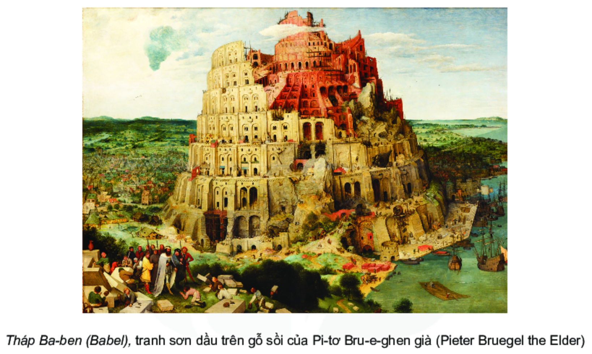
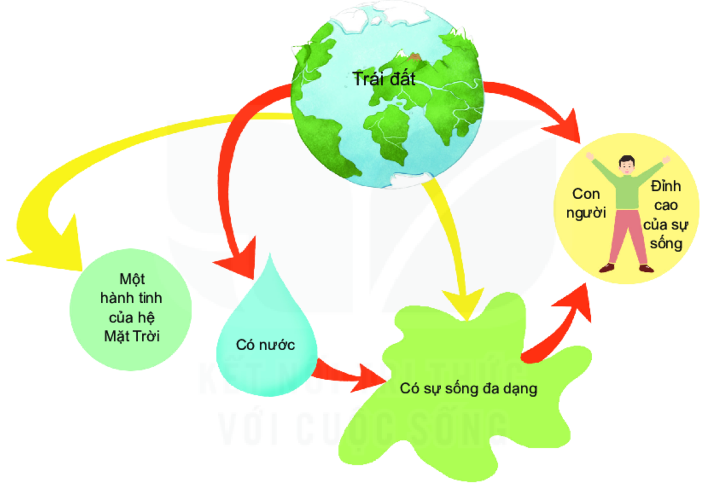

<!-- pdf:77 -->

# BÀI 9: TRÁI ĐẤT – NGÔI NHÀ CHUNG

*Chúng ta phải học cách “có mặt” trên hành tinh này.*

Ét-ga Mô-ranh (Edgar Morin)

*Hòn bi ve xanh* – Bức ảnh Trái Đất chụp từ tàu vũ trụ A-pô-lô (Apollo) 17, ngày 07 tháng 12 năm 1972

## Giới thiệu bài học

- Chúng ta ai cũng có ý thức chăm chút, bảo vệ ngôi nhà riêng mà gia đình mình sinh sống. Nhưng với ngôi nhà chung Trái Đất, chúng ta đã thực sự thấu hiểu và quan tâm chưa? Chúng ta đã làm gì để Trái Đất mãi an toàn và tươi đẹp?

- Đến với bài học này, em sẽ có thêm những hiểu biết về văn bản thông tin và cách truyền đạt thông tin, thông qua những văn bản cụ thể nói về sự sống trên Trái Đất, về trách nhiệm của chúng ta đối với việc bảo vệ Trái Đất – ngôi nhà chung.

<!-- pdf:78 -->

## 🎯 Mục tiêu bài học

- Nhận biết được cách triển khai văn bản thông tin theo quan hệ nhân quả, tóm tắt được các ý chính của mỗi đoạn trong một văn bản thông tin có nhiều đoạn.
- Nhận biết được các chi tiết trong văn bản thông tin; chỉ ra được mối liên hệ giữa các chi tiết, dữ liệu với thông tin cơ bản của văn bản; hiểu được tác dụng của nhan đề, sa-pô(1), đề mục, chữ đậm, số thứ tự, dấu đầu dòng, hình ảnh, số liệu.
- Viết được biên bản ghi chép đúng quy cách; tóm tắt được nội dung chính của một số văn bản đơn giản đã đọc bằng sơ đồ.
- Trình bày được ý kiến (dưới hình thức nói) về một vấn đề trong đời sống.
- Chỉ ra được những vấn đề đặt ra trong văn bản có liên quan đến suy nghĩ và hành động của bản thân; thể hiện được thái độ yêu quý và trân trọng sự sống của muôn loài; có ý thức bảo vệ môi trường sống trên Trái Đất.

## Đọc

### TRI THỨC NGỮ VĂN

**Văn bản**

**Văn bản** là một đơn vị giao tiếp, có tính hoàn chỉnh về nội dung và hình thức, tồn tại ở dạng viết hoặc dạng nói. Văn bản được dùng để trao đổi thông tin, trình bày suy nghĩ, cảm xúc,...

**Đoạn văn trong văn bản**

**Đoạn văn** là bộ phận quan trọng của văn bản, có sự hoàn chỉnh tương đối về ý nghĩa và hình thức, gồm nhiều câu (có khi chỉ một câu) được tổ chức xoay quanh một ý nhỏ. Đoạn văn bắt đầu bằng chữ viết hoa lùi đầu dòng và kết thúc bằng một dấu chấm câu.

**Các yếu tố và cách triển khai của văn bản thông tin**

- Một văn bản thông tin thường có các yếu tố như: nhan đề (một số văn bản có sa-pô dưới nhan đề), đề mục (tên gọi của các phần), đoạn văn, tranh ảnh,...
- Mỗi văn bản thông tin có một cách triển khai riêng. Bên cạnh cách triển khai theo trật tự thời gian, văn bản thông tin có thể được triển khai theo quan hệ nhân quả, nguyên nhân được nêu trước, tiếp sau đó là kết quả, tất cả tạo thành một chuỗi liên tục.
<!-- term: văn bản thông tin -->

> (1) **Sa-pô**: đoạn văn nằm giữa nhan đề và phần chính của bài báo hay văn bản thông tin nhằm mục đích giới thiệu, tóm tắt nội dung của văn bản.

<!-- pdf:79 -->

**Văn bản đa phương thức**

**Văn bản đa phương thức** là loại văn bản có sử dụng phối hợp phương tiện ngôn ngữ và các phương tiện phi ngôn ngữ như kí hiệu, sơ đồ, biểu đồ, hình ảnh, âm thanh,...
<!-- term: phương tiện giao tiếp phi ngôn ngữ -->

**Từ mượn và hiện tượng vay mượn từ**

- **Từ mượn** là từ có nguồn gốc từ một ngôn ngữ khác. Tiếng Việt từng vay mượn nhiều từ của tiếng Hán và tiếng Pháp. Hiện nay, tiếng Việt có xu hướng vay mượn nhiều từ của tiếng Anh.
- Trong sự tiếp xúc, giao lưu ngôn ngữ giữa các dân tộc, các ngôn ngữ thường vay mượn từ của nhau để làm giàu cho vốn từ của mình.

### VĂN BẢN ĐỌC

- *Trái Đất – cái nôi của sự sống*, Hồ Thanh Trang
- *Các loài chung sống với nhau như thế nào?*, Ngọc Phú
- *Trái Đất*, Ra-xun Gam-da-tốp (Rasul Gamzatov)

**Trái Đất – cái nôi của sự sống**

**HỒ THANH TRANG**

**Trước khi đọc**

1. Em từng nghe, đọc hay đã thuộc những ca khúc, bài thơ nào viết về Trái Đất? Chúng đã gợi lên trong em ấn tượng, cảm xúc gì? Theo em, để hiểu biết và yêu quý hơn hành tinh xanh này, chúng ta còn cần phải tìm đến những nguồn thông tin hay loại tài liệu nào khác?

2. Người ta thường nói: “Sự sống muôn màu”. Em hiểu điều này như thế nào?

**Đọc văn bản**

***Vì sao Trái Đất thường được gọi là hành tinh xanh? Trên hành tinh xanh ấy, sự sống đã nảy nở tốt đẹp như thế nào? Con người có thể làm gì để bảo vệ Trái Đất?***

> **THEO DÕI:** Phần sa-pô với những dòng chữ in đậm.

<!-- pdf:80 -->

**Trái Đất trong hệ Mặt Trời**

Trái Đất là một trong tám hành tinh của hệ Mặt Trời (gồm sao Thuỷ, sao Kim, sao Mộc, sao Thổ, sao Hoả, Trái Đất, sao Thiên Vương, sao Hải Vương – tính theo thứ tự từ Mặt Trời ra ngoài). Trái Đất vừa tự quay quanh trục của nó, mỗi vòng quay hết trọn một ngày (23,934 giờ), vừa quay quanh Mặt Trời theo quỹ đạo hình e-líp(1) với vận tốc xấp xỉ 30 km/s. Một vòng quay của Trái Đất quanh Mặt Trời hết trọn một năm (365,25 ngày).

> **THEO DÕI:** Văn bản được triển khai với nhiều đề mục in đậm.

**“Vị thần hộ mệnh” của sự sống trên Trái Đất**

Nhờ có nước, đặc biệt là nước ở dạng lỏng, Trái Đất trở thành nơi duy nhất trong hệ Mặt Trời có sự sống. Do vậy, khi khẳng định hành tinh này là cái nôi của sự sống, ta không thể không nói đến nước.

> **THEO DÕI:** Những miêu tả về sự hiện diện của nước trên Trái Đất.

Hành tinh của chúng ta quả là giàu nước. Nước
bao phủ trên 2/3 bề mặt Trái Đất. Nước dào dạt trong lòng các đại dương;
nước đông cứng thành những khối băng trùng điệp, khổng lồ ở hai địa cực(2);
nước ngự(3) trắng loá trên những chóp núi được ví là nóc nhà của thế giới;
nước tuôn chảy không ngừng với hệ thống sông ngòi được phân bố ở khắp
bề mặt các lục địa(4);... Chính nước đã tạo cho Trái Đất một vẻ đẹp lộng lẫy.
Những bức ảnh chụp từ các tàu vũ trụ cho thấy Trái Đất không khác gì giọt
nước xanh khổng lồ giữa không gian vũ trụ đen thẳm bao la.

Nếu không có nước thì Trái Đất chỉ là hành tinh khô chết, trơ trụi.
Nước chính là “vị thần hộ mệnh” của sự sống, là tác nhân(5) quan trọng thúc đẩy
quá trình tiến hoá của các vật chất sống trên hành tinh này. Nhờ nước, sự sống
trên Trái Đất phát triển dưới nhiều dạng phong phú, từ vi sinh vật mang cấu tạo
đơn giản đến động vật bậc cao có hệ thần kinh vô cùng phức tạp.

> (1) *E-líp*: một loại hình bầu dục, có hai trục đối xứng.
> (2) *Địa cực*: cực của Trái Đất, bao gồm Bắc Cực và Nam Cực.
> (3) *Ngự*: ngồi ở nơi cao nhất, trang trọng nhất với vẻ uy nghi.
> (4) *Lục địa*: đất liền, phân biệt với biển, đại dương.
> (5) *Tác nhân*: yếu tố thúc đẩy một quá trình nào đó.

<!-- pdf:81 -->

**Trái Đất – nơi cư ngụ của muôn loài**

Trong số muôn loài tồn tại trên Trái Đất, có loài chỉ có thể quan sát được bằng kính hiển vi như vi sinh vật. Có loài mang kích thước khổng lồ như cây bao báp(1) ở vùng hoang mạc châu Phi, cá voi xanh hay các động vật thuộc họ khủng long mà giờ ta chỉ còn được biết chúng ở dạng hoá thạch(2),... Những bộ xương khủng long mà các nhà khoa học phục dựng(3) cho biết từ xa xưa đã từng có một
loài thú khổng lồ tung hoành giữa bầu trời, dưới nước hay trên mặt đất này.
Trên những cánh rừng nguyên sinh trùng điệp hay giữa lòng đại dương bao la,
có vô số loài thực vật, động vật khác nhau sinh sôi nảy nở, trở thành đối tượng
được con người khai thác hằng ngày để phục vụ cho cuộc sống của mình. Rồi
những hoa cỏ trong vườn, những loài gia súc, gia cầm gắn bó thân thiết với mỗi
gia đình,... Tất cả mọi dạng sự sống đều tồn tại, phát triển theo những quy luật
sinh học lạ lùng, bí ẩn.

> **THEO DÕI:** Sự sống trên Trái Đất phong phú như thế nào?

**Con người trên Trái Đất**

Đỉnh cao kì diệu của sự sống trên Trái Đất chính là con người. Là động vật bậc cao, con người có bộ não và hệ thần kinh phát triển nhất, có ý thức,

> **THEO DÕI:** Vì sao có thể khẳng định con người là đỉnh cao kì diệu của sự sống trên Trái Đất?

> (1) *Bao báp*: một loại cây thân gỗ có kích thước lớn, xuất hiện nhiều ở châu Phi.
> (2) *Hoá thạch*: di tích hoá đá của thực vật, động vật cổ xưa còn lưu lại ở các tầng đất đá.
> (3) *Phục dựng*: làm đúng lại như hình dáng ban đầu của hiện vật.

<!-- pdf:82 -->

có tình cảm, có ngôn ngữ, biết tổ chức cuộc sống theo hướng tích cực. Bằng
bàn tay lao động sáng tạo, con người đã cải tạo lại bộ mặt của Trái Đất, khiến
cho nó “người” hơn, thân thiện hơn. Nhưng đáng buồn thay, con người cũng
đã khai thác thiên nhiên – món quà quý giá mà tạo hoá ban tặng – một cách
bừa bãi, gây ảnh hưởng xấu đến quá trình tồn tại và phát triển của sự sống
trên Trái Đất.

*Tháp Ba-ben (Babel)*, tranh sơn dầu trên gỗ sồi của Pi-tơ Bru-e-ghen già (Pieter Bruegel the Elder)

**Tình trạng Trái Đất hiện ra sao?**

Hiện tại, hành tinh xanh – ngôi nhà chung của nhân loại – đang từng ngày
từng giờ bị tổn thương bởi nhiều hành động vô ý thức hay bất chấp tất cả của
con người. Thiên nhiên đang bị tàn phá. Theo đó, màu xanh trải rộng của
rừng bị co hẹp lại, nhường chỗ cho sự xâm lấn của màu xám hoang mạc nhức
nhối. Nhiều loài thú bị giết vô tội vạ giờ đã hoặc gần như tuyệt chủng(1). Biển
bị khai thác quá mức không kịp hồi sinh, cá tôm không kịp sinh sôi nảy nở,
rác thải nhựa tràn ngập giết dần giết mòn bao sinh vật biển,... Do kế hoạch
phát triển công nghiệp thiếu bền vững, Trái Đất đang nóng dần lên, băng ở
Bắc Cực và Nam Cực đang tan chảy, khiến nước biển dâng cao, nhấn chìm
nhiều thành phố, làng mạc, nhiều cánh đồng màu mỡ. Tầng ô-dôn(2) bị thủng

> (1) *Tuyệt chủng*: bị mất hẳn nòi giống.
> (2) *Tầng ô-dôn*: một khu vực trong tầng bình lưu (một lớp thuộc khí quyển) của Trái Đất, hấp thụ hầu hết các bức xạ cực tím của Mặt Trời.
<!-- ocr-ok: cước chú chân trang chữ nhỏ bị OCR dính chữ và đọc nhầm dấu ("mất", "Tầng", "tầng", "quyển"), đã đối chiếu ảnh trang PDF 82 -->

<!-- pdf:83 -->

nhiều chỗ, đất đai, nước, không khí bị ô nhiễm nặng nề, đe doạ sự sống của
muôn loài.

Trái Đất có thể chịu đựng đến bao giờ? Đó là câu hỏi nhức nhối, khiến nhân loại không thể làm ngơ. Sự sống trên hành tinh xanh, trong đó có con người, đang đứng trước những thách thức to lớn.

> **SUY LUẬN:** Ý sau cùng của bài có lạc đề không?

(Hồ Thanh Trang, báo điện tử *Đất Việt* – Diễn đàn của Liên hiệp các hội khoa học và kĩ thuật Việt Nam, tháng 9/2020)

**Sau khi đọc**

**Trả lời câu hỏi**

1. Liệt kê theo hình thức gạch đầu dòng những thông tin chủ yếu mà văn bản đã đưa đến cho người đọc.

2. Các bức tranh minh hoạ đã hỗ trợ gì cho em trong việc nắm bắt thông tin của văn bản?

3. Phần 2 (*“Vị thần hộ mệnh” của sự sống trên Trái Đất*) tập trung thông tin về vấn đề gì? Việc nói về vấn đề đó liên quan như thế nào đối với hướng triển khai những nội dung khác ở các phần kế tiếp?

4. Văn bản đã nói được đầy đủ về sự kì diệu của sự sống trên Trái Đất chưa? Em có thể bổ sung điều gì xung quanh vấn đề này?

5. Bằng hiểu biết của mình, em hãy nêu thêm bằng chứng để khẳng định con người là đỉnh cao kì diệu của sự sống trên Trái Đất.

6. Làm rõ lí do xuất hiện câu hỏi: *Trái Đất có thể chịu đựng đến bao giờ?* trong đoạn cuối của văn bản. Câu hỏi đó gợi lên trong em những suy nghĩ gì?

7. Bức tranh ở trang 92 lấy cảm hứng từ huyền thoại về tháp Ba-ben, thể hiện cảnh con người thực hiện ý đồ xây một toà tháp cao đến tận trời. Bức tranh đó gợi lên trong em suy nghĩ gì về khát vọng và khả năng của con người?

8. Từ việc đọc hiểu văn bản *Trái Đất – cái nôi của sự sống*, em rút ra được kinh nghiệm gì về cách đọc một văn bản thông tin?

#### Viết kết nối với đọc

Hãy viết đoạn văn (khoảng 5 – 7 câu) về chủ đề: *Để hành tinh xanh mãi xanh...*

<!-- pdf:84 -->

### Thực hành tiếng Việt

**VĂN BẢN VÀ ĐOẠN VĂN**
<!-- ocr-ok: tiểu mục chữ trắng trên băng màu cam bị OCR bỏ sót, đã đối chiếu ảnh trang PDF 84 -->

> **Nhận biết đặc điểm và chức năng văn bản**
> - Căn cứ vào sự có mặt hay không có mặt của các phương tiện phi ngôn ngữ để xác định tính chất văn bản: văn bản thông thường hay văn bản đa phương thức.
> - Những nhu cầu giao tiếp đa dạng dẫn đến việc hình thành nhiều loại văn bản khác nhau: văn bản thông tin, văn bản nghị luận, văn bản văn học. Có thể căn cứ vào chức năng chính mà một văn bản phải đảm nhiệm như thông tin, thuyết phục, hay thẩm mĩ để biết được văn bản thuộc loại nào.
<!-- term: phương tiện giao tiếp phi ngôn ngữ -->
<!-- term: văn bản thông tin -->
<!-- term: văn bản văn học -->

1. Nêu bằng chứng cụ thể để khẳng định *Trái Đất – cái nôi của sự sống* là một văn bản.

2. Hãy liệt kê những bộ phận tạo thành văn bản *Trái Đất – cái nôi của sự sống*.

3. Có thể cắt bỏ các tranh ảnh có trong văn bản hay không? Vì sao?

4. Nhắc lại những thông tin, thông điệp mà em tiếp nhận được từ văn bản *Trái Đất – cái nôi của sự sống*.

> **Nhận biết chức năng đoạn văn trong văn bản**
> Một đoạn văn có thể đảm nhiệm một trong các chức năng: mở đầu văn bản; trình bày một khía cạnh nào đó của nội dung chính; kết thúc văn bản hoặc mở rộng, liên kết vấn đề. Cần dựa vào vị trí (thứ tự) và nội dung của đoạn văn để xác định đúng chức năng của nó trong văn bản.

5. Chọn một đoạn văn trong văn bản *Trái Đất – cái nôi của sự sống* và điền thông tin cần thiết vào bảng theo mẫu sau (làm vào vở):

| Thứ tự đoạn văn trong văn bản | Điểm mở đầu và điểm kết thúc của đoạn văn | Ý chính của đoạn văn | Chức năng của đoạn văn trong văn bản |
| --- | --- | --- | --- |
| ............... | ............... | ............... | ............... |
| ............... | ............... | ............... | ............... |

<!-- pdf:85 -->

**Các loài chung sống với nhau như thế nào?**

**NGỌC PHÚ**

**Trước khi đọc**

1. Em biết những chương trình nào trên các phương tiện truyền thông, in-tơ-nét cung cấp nhiều thông tin thú vị, bổ ích về đời sống của muôn loài trên Trái Đất? Em suy nghĩ gì về việc chúng ta phải thường xuyên tìm hiểu các tài liệu nói về sự đa dạng của thế giới tự nhiên?

2. Trong số những tài liệu, bộ phim kể về các loài sinh vật mà em đã đọc, đã xem, tài liệu, bộ phim nào để lại cho em nhiều ấn tượng nhất? Vì sao?

**Đọc văn bản**

Trong bộ phim hoạt hình *Vua sư tử* sản xuất năm 1994 của hãng Oan Đi-xnây (Walt Disney), khi giới thiệu với đứa con Xim-ba (Simba) bé bỏng của mình về vương quốc hoang dã mà nó sắp tiếp quản, vua
sư tử Mu-pha-sa (Mufasa) đã
nói: “Tất cả những gì con thấy,
cùng nhau tồn tại trong một sự
cân bằng rất mong manh. Là
vua, con cần phải hiểu rõ về sự
cân bằng ấy và tôn trọng muôn

loài, từ đàn kiến lúc nhúc cho

đến bầy linh dương nhảy nhót”. Khi Xim-ba thắc mắc: “Nhưng cha ơi, chẳng
phải chúng ta ăn thịt linh dương hay sao?”, Mu-pha-sa trả lời: “Đúng vậy,
nhưng để cha giải thích đã. Khi chết đi, thân xác chúng ta trở về với cỏ, và
linh dương lại ăn cỏ. Vì thế, tất cả chúng ta đều thuộc về vòng đời bất tận”.
Cuộc đối thoại trên đã gợi lên trong chúng ta biết bao suy nghĩ về đời sống
muôn loài trên Trái Đất và sự cân bằng rất dễ bị tổn thương của nó.

<!-- pdf:86 -->

\*

Theo ước tính của nhiều nhà khoa học, trên Trái Đất hiện có khoảng trên 10 000 000 loài sinh vật, bao gồm cả động vật và thực vật. Hiện nay, con người mới chỉ nhận biết được khoảng trên 1 400 000 loài, trong đó có hơn 300 000 loài thực vật và hơn 1 000 000 loài động vật. Rõ ràng, phải rất lâu nữa chúng ta mới lập được một danh sách sát thực tế hơn về những cư dân của hành tinh này. Dù vậy, điều đó không ngăn cản các nhà khoa học đưa ra những nhận định khái quát nhất về lịch sử tiến hoá(1) hay sự phụ thuộc lẫn nhau của muôn loài.

> **THEO DÕI:** Số lượng các loài sinh vật hiện tồn tại trên Trái Đất và số lượng loài đã được con người nhận biết.

\*

Các loài động vật và thực vật thường tồn tại và phát triển thành từng
quần xã(2), trong những bai-ôm(3) khác nhau. Mỗi quần xã có thể được xem
như một thế giới riêng, trong đó có sự chung sống của một số loài nhất định
với số lượng cá thể hết sức khác nhau ở riêng từng loài.

\*

Tính đa dạng ở mỗi quần xã phụ thuộc vào sự cạnh tranh giữa các loài, mối quan hệ con mồi – vật ăn thịt và mức độ thay đổi của các yếu tố vật lí – hoá học của môi trường,...

> **THEO DÕI:** Những điều gây ảnh hưởng đến sự đa dạng ở từng quần xã.

\*

Bên cạnh việc nhận diện các loài theo đặc điểm sinh học riêng của chúng,
khi dựa vào tính chất của loài trong quần xã, ta có thể nói tới: loài ưu thế,
loài thứ yếu, loài ngẫu nhiên, loài chủ chốt, loài đặc trưng,... Loài ưu thế (như cây thông trong quần xã rừng thông) đóng vai trò quan trọng trong quần xã do số lượng nhiều và có khả năng hoạt động mạnh.

> **THEO DÕI:** Trật tự trong cuộc sống của muôn loài được thể hiện như thế nào?

> (1) *Tiến hoá*: biến đổi dần dần theo hướng phát triển đi lên.
> (2) *Quần xã*: tập hợp tất cả các sinh vật cùng loài và khác loài, cùng sống trong một khu vực xác định vào một thời gian nhất định.
> (3) *Bai-ôm*: chỉ tập hợp sinh vật cùng môi trường sống mang những nét đặc thù của chúng, thường được dịch là *khu sinh học*. Tên gọi của các bai-ôm luôn thể hiện rõ đặc điểm của từng hệ sinh thái riêng biệt.

<!-- pdf:87 -->

Loài chủ chốt (như sư tử ở các đồng cỏ hay cá sấu ở đầm nước châu Phi) đóng
vai trò kiểm soát, khống chế hoạt động của các loài khác và duy trì sự phát
triển ổn định của quần xã. Như vậy, trong quần xã luôn tồn tại một trật tự.
Ngoài những điều kể trên, trật tự này còn được thể hiện ở sự phân bố các loài
trong không gian sống chung, hoặc theo chiều thẳng đứng (như sự phân tầng
của thực vật trong rừng mưa nhiệt đới), hoặc theo chiều ngang (trải ra theo bề
rộng của địa hình), để giảm bớt sự cạnh tranh giữa các loài và giúp từng loài
có thể sử dụng nguồn sống của môi trường một cách hiệu quả nhất.

\*

Giữa các loài trong quần xã luôn tồn
tại mối quan hệ hỗ trợ và đối kháng.
Quan hệ hỗ trợ gắn liền với việc chia
sẻ cùng nhau cơ hội sống. Quan hệ đối
kháng được biểu hiện qua việc cạnh
tranh, kí sinh(1), ăn thịt lẫn nhau. Với
sự tồn tại song song của các quan hệ đó,
thiên nhiên đã tạo nên một sự cân bằng
tuyệt hảo, đảm bảo cho loài nào cũng có
được “chỗ đứng dưới mặt trời”, cũng có
đủ điều kiện để sinh trưởng. Như vậy, có
một nhịp điệu chung trong quá trình tiến
hoá của các loài, mà sự sinh sôi mạnh mẽ
hay suy giảm số lượng của loài này dẫn
đến sự phát triển theo hướng nhiều thêm
hay bớt đi tương ứng của loài kia.

\*

Trên Trái Đất, con người cũng chỉ là một loài sinh vật. Qua quá trình lịch sử dài lâu, con người đã bộc lộ khả năng sáng tạo vô tận và xã hội loài người ngày càng phát triển phức tạp. Con người trở nên quá tự kiêu, thấy mình là chúa tể của cả thế giới, có thể tuỳ ý xếp đặt lại trật tự mà tạo hoá đã bền bỉ gây dựng. Chính vì điều này mà

> **SUY LUẬN:** Hành động của con người có ảnh hưởng đến cuộc sống của muôn loài không?

> (1) *Kí sinh*: sống bằng cách hút chất dinh dưỡng từ cơ thể những sinh vật khác.

<!-- pdf:88 -->

sự cân bằng trong đời sống của muôn loài ít nhiều bị xáo trộn, phá vỡ, thêm
vào đó, những yếu tố vô sinh của môi trường(1) cũng phải chịu những tác động
xấu. Hiện nay, có vẻ như con người bắt đầu tỉnh ngộ, biết nhìn nhận vấn đề
một cách sáng suốt hơn, biết tìm cách chung sống hài hoà với muôn loài và
nói chung là với tất cả những gì làm nên thế giới đẹp đẽ này.

\*

“Tất cả chúng ta đều thuộc về vòng đời bất tận”. Vua sư tử Mu-pha-sa đã
nói với Xim-ba – kẻ kế nghiệp – như thế. Một câu nói thông thái, cho thấy
sự am hiểu bản chất cuộc sống và cách ứng xử khôn ngoan đối với đời sống
của muôn loài.

(Ngọc Phú, báo điện tử *Đất Việt* – Diễn đàn của Liên hiệp các hội khoa học và kĩ thuật Việt Nam, tháng 9/2020)

**Sau khi đọc**

**Trả lời câu hỏi**

1. Những con số, dữ liệu nào trong đoạn (2) (*Theo ước tính... lẫn nhau của muôn loài*) thể hiện sự phong phú của các loài trên Trái Đất?

2. Đoạn (3) (*Các loài động vật... riêng từng loài*) đã nói gì về sự đa dạng của các quần xã sinh vật?

3. Nêu những căn cứ giúp ta hiểu được tính trật tự trong đời sống của muôn loài. Theo em, việc thiên nhiên duy trì trật tự ấy có ý nghĩa như thế nào?

4. Nếu chỉ tồn tại quan hệ đối kháng, sự cân bằng trong từng quần xã sinh vật sẽ bị ảnh hưởng ra sao?

5. Theo em, đoạn nào trong văn bản thể hiện rõ nhất cách trình bày văn bản thông tin theo quan hệ nhân quả?

6. Cách mở đầu và kết thúc của văn bản thông tin này có gì đặc sắc?

7. Con người có thể làm gì để bảo vệ sự phát triển phong phú của thế giới sinh vật?

#### Viết kết nối với đọc

Hãy viết đoạn văn (khoảng 5 – 7 câu) về chủ đề: *Trên hành tinh đẹp đẽ này, muôn loài luôn cần thiết cho nhau.*

> (1) *Yếu tố vô sinh của môi trường*: phần không sống, không sinh sản trong không gian bao quanh sinh vật.

<!-- pdf:89 -->

### Thực hành tiếng Việt

**TỪ MƯỢN**

> **Nhận biết và sử dụng từ mượn**
> - Các từ mượn tiếng Hán có cách đọc và hình thức chính tả giống các từ thuần Việt. Do vậy, cần dựa vào tính chất khái quát, trừu tượng về nghĩa của từ hay màu sắc trang trọng của hoàn cảnh sử dụng để nhận biết chúng.
> - Các từ mượn tiếng Pháp và tiếng Anh thường có cách đọc và hình thức chính tả khác biệt so với từ thuần Việt (ví dụ: sa-pô, vét-tông, smartphone, internet,...). Có thể nhận biết chúng nhờ những gạch nối giữa các âm tiết hay hình thức viết liền khối các âm tiết tạo nên từ.
> - Lưu ý: chỉ nên dùng từ mượn trong hoàn cảnh giao tiếp phù hợp, không gây khó hiểu, khó chịu cho người nghe, người đọc. Tránh dùng từ mượn một cách tuỳ tiện, làm mất đi sự trong sáng của tiếng Việt.

Đọc đoạn văn và thực hiện các yêu cầu sau:

*Các loài động vật và thực vật thường tồn tại và phát triển thành từng quần xã, trong những bai-ôm khác nhau. Mỗi quần xã có thể được xem như một thế giới riêng, trong đó có sự chung sống của một số loài nhất định với số lượng cá thể hết sức khác nhau ở riêng từng loài.*

1. Trong đoạn văn trên có nhiều từ là từ mượn, chẳng hạn: *động vật*, *thực vật*, *tồn tại*, *bai-ôm*,... Theo em, từ nào được vay mượn từ tiếng Hán, từ nào được vay mượn từ tiếng Anh? Dấu hiệu nào giúp em nhận biết được điều đó?

2. Tìm thêm những từ phức có yếu tố *tồn*, *phát*, *cá* tương tự các từ sau đây: *tồn tại*, *phát triển*, *cá thể*.

3. Trong số những từ mượn, có rất nhiều từ đã được Việt hoá (khó nhận biết là từ mượn). So sánh các từ *động vật*, *thực vật*, *tồn tại*, *bai-ôm* với nhau, em thấy từ nào đã được Việt hoá, từ nào vẫn còn mang vẻ xa lạ?

4. Thử thay thế một số từ mượn trong đoạn văn trên bằng những từ khác em cho là dễ hiểu và đơn giản hơn mà không làm sai lệch điều tác giả muốn nói.

5. Qua việc thực hiện các yêu cầu trên, em rút ra nhận xét gì về đặc điểm của vốn từ tiếng Việt?

<!-- pdf:90 -->

**Trái Đất**

**RA-XUN GAM-DA-TỐP**

**Đọc văn bản**

Trái Đất! Có bọn xem người là quả dưa
Họ bổ, cắn người thành muôn mảnh nhỏ
Lũ khác nhìn người như quả bóng trên sân

Để giành giật, họ lao vào, đá, đá.

Trái Đất với tôi – chẳng là dưa là bóng
Với tôi, người – khuôn mặt thân thương
Nước mắt người tôi lau – xin đừng khóc nữa

Rửa sạch máu cho người đây, tôi hát, dịu dàng.

Minh Tâm *dịch (theo bản tiếng Nga của Na-um Grép-nhi-ốp (Naum Grebniov(1)))*

(Báo điện tử *Đất Việt* – Diễn đàn của Liên hiệp các hội khoa học và kĩ thuật Việt Nam, tháng 9/2020)

**Sau khi đọc**

> **RA-XUN GAM-DA-TỐP**
> - Ra-xun Gam-da-tốp (1923 – 2003), người dân tộc A-va (Avar) nước Cộng hoà Đa-ghe-xtan (Daghestan) (thuộc Liên bang Nga). Thơ ông tràn đầy tình yêu đối với quê hương, con người, sự sống và luôn hướng tới việc xây đắp tình hữu nghị giữa các dân tộc. Các tác phẩm chính của ông: *Năm tôi sinh*, *Mùa xuân Đa-ghe-xtan*, *Trái tim tôi trên núi*, *Những ngôi sao xa*, *Đa-ghe-xtan của tôi*,...
> - Bài thơ *Trái Đất* viết năm 1987 bằng tiếng A-va, được phổ biến rộng rãi qua bản dịch ra tiếng Nga của Na-um Grép-nhi-ốp.

> (1) Nguồn: *http://pakhmutova.ru/songs/gamzatov.shtml*

<!-- pdf:91 -->

**Trả lời câu hỏi**

1. Bốn câu đầu của bài thơ tập trung nói về điều gì?

2. Bốn câu sau cho biết thái độ của nhà thơ đối với Trái Đất như thế nào?

3. Nhắc đến nước mắt và máu, nhà thơ muốn nói lên tình trạng gì của Trái Đất?

4. Chỉ ra sự khác nhau giữa các cách hình dung về Trái Đất và thái độ cư xử với Trái Đất được thể hiện trong bài thơ.

5. Hãy tìm ra điểm chung về mặt nội dung giữa bài thơ của Ra-xun Gam-da-tốp với hai văn bản *Trái Đất – cái nôi của sự sống* và *Các loài chung sống với nhau như thế nào?*

6\*. Theo em, để cùng “lau nước mắt” và “rửa sạch máu” cho Trái Đất, mỗi người chúng ta cần phải làm gì?

7. Cùng đưa ra một thông điệp giống nhiều văn bản khác, nhưng bài thơ *Trái Đất* của Ra-xun Gam-da-tốp vẫn có được sự độc đáo, sức hấp dẫn riêng. Theo em, những gì đã tạo nên sự độc đáo, sức hấp dẫn riêng ấy?

## Viết

### A. VIẾT BIÊN BẢN MỘT CUỘC HỢP, CUỘC THẢO LUẬN

Văn bản thông tin có nhiều loại, trong đó có văn bản nhật dụng. **Biên bản** là một loại nhỏ của văn bản nhật dụng, dùng để ghi chép về một vụ việc hay một cuộc họp, cuộc thảo luận, giúp ta nắm bắt được đầy đủ, chính xác về điều đã diễn ra. Nó có thể được lưu lại như một hồ sơ quan trọng, lúc cần được đưa ra như bằng chứng để đánh giá một vụ việc, vấn đề nào đó. Biên bản đòi hỏi được viết đúng thể thức, theo một quy cách riêng.
<!-- term: văn bản nhật dụng -->

*Thể thức của biên bản thông thường:*

- Đầu biên bản, phía bên phải ghi quốc hiệu và tiêu ngữ; phía bên trái ghi tên cơ quan chức năng đứng ra xử lí vụ việc hay tổ chức cuộc họp, cuộc thảo luận,...
- Dưới từ “Biên bản”, ghi khái quát nội dung của vụ việc cần xử lí hay vấn đề mà cuộc họp, cuộc thảo luận cần giải quyết, làm thành tên gọi của biên bản.
- Ghi thời gian và địa điểm diễn ra cuộc xử lí vụ việc hay cuộc họp, cuộc thảo luận,...
- Ghi thành phần tham dự và tên người chủ trì, người thư kí.
- Ghi diễn biến của cuộc xử lí vụ việc hay cuộc họp, cuộc thảo luận,... với các nội dung cụ thể, theo đúng thực tế đã diễn ra (bao gồm các ý kiến tường trình, phát biểu và kết luận).
- Ghi thời gian kết thúc cuộc xử lí vụ việc hay cuộc họp, cuộc thảo luận,...
- Người chủ trì và thư kí (tuỳ trường hợp, có thể thêm người làm chứng) kí tên.

<!-- pdf:92 -->

**Phân tích biên bản tham khảo**

| TRƯỜNG THCS P. H. C. **LỚP 6C** | **CỘNG HOÀ XÃ HỘI CHỦ NGHĨA VIỆT NAM** **Độc lập – Tự do – Hạnh phúc** |
| :---: | :---: |

**BIÊN BẢN**

**Bàn về kế hoạch tổ chức hoạt động hưởng ứng “Ngày Chủ nhật xanh”**

*Thời gian:* bắt đầu từ lúc 11h ngày 13 tháng 02 năm 2019

*Địa điểm:* phòng học lớp 6C

*Thành phần tham dự:* toàn thể học sinh lớp 6C. Vắng: 01 (bạn Trần Văn Th., có lí do)

*Chủ trì:* lớp trưởng Lê Tiến H.

*Thư kí:* Nguyễn Thị Thanh T.

*Nội dung:* bàn kế hoạch tổ chức hoạt động “Ngày Chủ nhật xanh” do nhà trường phát động, diễn ra vào ngày 17 tháng 02 năm 2019.

1. Lớp trưởng trình bày ý nghĩa của “Ngày Chủ nhật xanh” và nội dung hoạt động hưởng ứng “Ngày Chủ nhật xanh” theo sự phân công của trường.

2. Bố trí công việc:

   a. Làm băng rôn, căng ở vị trí quy định: tổ 1 (hoàn thành vào chiều thứ Bảy).

   b. Chuẩn bị loa đài: bạn N. (tham gia cùng các bạn lớp 6A, hoàn thành vào chiều thứ Bảy).

   c. Tham gia soạn nội dung phát thanh: bạn L. (tập đọc vào chiều thứ Bảy).

   d. Chuẩn bị dụng cụ lao động: các tổ nắm công việc được giao và phân công dụng cụ phù hợp:

   - Tổ 1: tham gia quét dọn phòng học và không gian trong trường.
   - Tổ 2: tham gia tưới và xén tỉa cây cảnh ở vườn hoa trong trường.
   - Tổ 3: tham gia khơi thông cống rãnh xung quanh trường.
   - Tổ 4: tham gia làm vệ sinh các công trình công cộng gần trường: phòng truyền thống xã, đài tưởng niệm.

   e. Bộ phận kiểm tra công việc: lớp trưởng, lớp phó phụ trách lao động.

<!-- pdf:93 -->

3. Thảo luận về kế hoạch:

   - Ý kiến 1: đề nghị tiến hành hoạt động sớm, lúc 6h30.
   - Ý kiến 2: đề nghị điều chỉnh phân công công việc cho một số bạn.
   - Ý kiến 3: đề nghị chọn người chụp ảnh làm tư liệu (sau này sẽ đưa vào tập san).

4. Kết luận: Lớp trưởng tóm tắt những nội dung chính đã được thống nhất.

Cuộc họp kết thúc vào hồi 11h30, ngày 13 tháng 02 năm 2019.

| **THƯ KÍ** | **CHỦ TRÌ** **LỚP TRƯỞNG** |
| :---: | :---: |
| *(Đã kí)* | *(Đã kí)* |
| **Nguyễn Thị Thanh T.** | **Lê Tiến H.** |

*Phân tích:*

1. Nêu nhận xét chung về việc tuân thủ thể thức biên bản trong văn bản trên.
2. Vì sao biên bản phải có tên gọi và phải ghi đủ thời gian, địa điểm, thành phần tham dự, người chủ trì, người thư kí?
3. Khi làm biên bản, nội dung nào cần được ghi chi tiết, cụ thể hơn cả?
4. Vì sao cuối biên bản phải có chữ kí của người chủ trì, người thư kí?
5. Ngôn ngữ của biên bản có đặc điểm gì dễ nhận biết?

#### Thực hành viết biên bản

### 1. TRƯỚC KHI VIẾT

> *Mục đích viết*
> Ghi chép trung thực nội dung, diễn biến của cuộc họp, cuộc thảo luận nhằm xây dựng hồ sơ đáng tin cậy về cuộc họp, cuộc thảo luận đó.

- Hình dung lại các buổi họp, thảo luận cần được ghi biên bản (cuộc họp bàn kế hoạch tổ chức một hoạt động; cuộc họp kiểm điểm tình hình thực hiện một dự án chung của lớp,...).

<!-- pdf:94 -->

> *Người đọc*
> Tất cả những người tham gia cuộc họp, cuộc thảo luận và những cá nhân, cơ quan muốn nắm thông tin về cuộc họp, cuộc thảo luận đó.

- Xác định tên gọi của biên bản, đồng nghĩa với việc lựa chọn nội dung cho biên bản sắp viết.

### 2. VIẾT BIÊN BẢN

- Viết phần mở đầu theo đúng thể thức.
- Viết phần chính của biên bản dựa theo trình tự hợp lí cần có trong buổi họp, thảo luận với những nội dung cụ thể (có đánh số rõ ràng).
- Viết chi tiết về những nội dung quan trọng của buổi họp, thảo luận như kế hoạch triển khai, giải pháp dự kiến, phân công công việc,...
- Thuật lại đầy đủ các ý kiến bàn đúng về vấn đề cần bàn, nhất là những ý kiến có giá trị.
- Viết đầy đủ nội dung kết luận của người chủ trì.
- Ghi thời gian kết thúc buổi họp, thảo luận và viết đầy đủ họ tên của người có trách nhiệm kí vào biên bản.

### 3. CHỈNH SỬA BIÊN BẢN

Dựa vào phần *Thể thức của biên bản thông thường* để tự kiểm tra và chỉnh sửa:

- Xem xét lại sự phù hợp giữa nội dung biên bản và tên biên bản.
- Kiểm tra tính chính xác, đầy đủ của việc ghi chép những vấn đề quan trọng nhất được bàn bạc, triển khai trong cuộc họp, cuộc thảo luận.
- Lược bỏ những ghi chép về các chi tiết không liên quan tới vấn đề chính của cuộc họp, cuộc thảo luận.
- Sửa lại ngôn ngữ diễn đạt nhằm bảo đảm sự chính xác và tính khách quan.

### B. TÓM TẮT BẰNG SƠ ĐỒ NỘI DUNG CỦA MỘT VĂN BẢN ĐƠN GIẢN

Tóm tắt nội dung một văn bản đã đọc bằng sơ đồ là việc làm cần thiết để từng bước nâng cao, hoàn thiện kĩ năng đọc. Nếu thường xuyên thực hiện việc tóm tắt, người đọc sẽ rèn luyện được khả năng nắm bắt nhanh những thông tin chủ yếu của văn bản, bao quát tốt mối quan hệ giữa các bộ phận (các đoạn) trong văn bản. Những sơ đồ hợp lí có thể giúp ta nhớ lại khá dễ dàng nội dung cốt lõi của những văn bản từng đọc.
<!-- term: sơ đồ -->

<!-- pdf:95 -->

*Yêu cầu của việc tóm tắt bằng sơ đồ nội dung của một văn bản đơn giản:*

- Làm nổi bật được nội dung chủ yếu của văn bản.
- Làm sáng tỏ được những mối liên hệ bên trong giữa các bộ phận chính của văn bản.
- Bảo đảm tính trực quan, thẩm mĩ, gây được ấn tượng tích cực về mặt thị giác để có thể hỗ trợ tốt cho trí nhớ.

**Tham khảo sơ đồ tóm tắt nội dung văn bản *Trái Đất – cái nôi của sự sống***

**Thực hành tóm tắt văn bản bằng sơ đồ**

### 1. TRƯỚC KHI TÓM TẮT

- Xác định đúng nội dung cốt lõi của văn bản và hệ thống ý triển khai nội dung đó.
- Lựa chọn từ khoá phản ánh nội dung cốt lõi và các ý triển khai đã xác định được.
- Xác định mối liên hệ giữa các từ khoá.

  Ví dụ: Khi tóm tắt quan niệm của vua sư tử Mu-pha-sa về “vòng đời bất tận” (trong đoạn đầu văn bản *Các loài chung sống với nhau như thế nào?*), em cần thực hiện các bước sau:

  a. Xác định nội dung cốt lõi của đoạn văn: những mối quan hệ ràng buộc lẫn nhau giữa các loài trong cuộc sống, tạo thành một “vòng đời bất tận”.

  b. Xác định các từ khoá: *chúng ta, linh dương, chết, cỏ*.

<!-- pdf:96 -->

  c. Xác định mối liên hệ giữa các từ khoá: *chúng ta ăn linh dương; chúng ta chết; chúng ta trở về với cỏ; linh dương ăn cỏ*.

### 2. TÓM TẮT

- Vẽ các hình cụ thể chứa các từ khoá.
- Sắp xếp các hình (chứa từ khoá) theo trật tự thích hợp.
- Vẽ các đường cong, thẳng hoặc mũi tên nối các hình (chứa từ khoá) với nhau.

### 3. CHỈNH SỬA

- Kiểm tra xem sơ đồ đã phản ánh đúng cách hiểu của bản thân về nội dung văn bản chưa.
- Xoá hay chỉnh sửa những chi tiết khiến người đọc sơ đồ có thể hiểu sai lệch điều bản thân muốn thể hiện hay chia sẻ về nội dung văn bản.
- Xem xét tính chính xác, phù hợp của việc xếp đặt vị trí các hình và việc thiết lập đường nối giữa chúng.

## Nói và nghe

**Trình bày ý kiến về vấn đề môi trường**

Trong cuộc sống, ta thường xuyên phải trình bày ý kiến của bản thân về một vấn đề nào đó. Để ý kiến của mình được trình bày một cách rõ ràng và có tính thuyết phục, người nói phải có hiểu biết về vấn đề được trình bày, tiếp nhận những ý kiến trái chiều với tinh thần xây dựng và tôn trọng. Với yêu cầu trình bày ý kiến về một vấn đề môi trường, em sẽ học được cách chọn vấn đề, cách tổng hợp và xử lí những thông tin có liên quan kết hợp với việc nêu ý kiến cá nhân trước những nỗ lực bảo vệ môi trường.

### 1. TRƯỚC KHI NÓI

**a. Chuẩn bị nội dung nói**

> *Mục đích nói*
> Chia sẻ mối quan tâm chung về vấn đề môi trường.
>
> *Người nghe*
> Thầy cô, bạn bè và những người không thờ ơ với việc bảo vệ môi trường sống trên Trái Đất.

– *Lựa chọn vấn đề:* Trước hết, có thể lựa chọn vấn đề do chính em phát hiện ra khi chứng kiến thực trạng môi trường hay khi trực tiếp tham gia vào hoạt động bảo vệ môi trường. Cũng có thể chọn vấn đề được gợi ý từ nhiều nguồn tư liệu khác nhau về môi trường mà em đã chủ động cập nhật.

<!-- pdf:97 -->

– *Tìm ý và sắp xếp ý:*

- Để có chất liệu xây dựng bài nói, có thể thu thập và tổng hợp những thông tin cụ thể từ nhiều nguồn như sách báo, in-tơ-nét, người thân, bạn bè,... Nếu tìm kiếm thông tin trên in-tơ-nét, có thể dùng các từ khoá sau: *vấn đề môi trường, ô nhiễm môi trường, giải pháp cho vấn đề môi trường*,...
- Từ những thông tin đã thu thập được, cần chọn ra các thông tin phù hợp, tiêu biểu nhất và xây dựng ý tưởng cho bài nói trên cơ sở đó. Các ý cụ thể thường nảy sinh trên cơ sở trả lời một số câu hỏi nhất định. Chính vì vậy, cần tự đặt ra một hệ thống câu hỏi và lần lượt giải đáp. Chẳng hạn, khi chọn vấn đề “Ngày Chủ nhật xanh” để trình bày ý kiến, các câu hỏi có thể tự đặt ra là: *Thực chất của “Ngày Chủ nhật xanh” là gì? Người ta đề xướng “Ngày Chủ nhật xanh” dựa trên cơ sở nào? Chúng ta có thể làm gì trong “Ngày Chủ nhật xanh”? Những việc cụ thể chúng ta làm trong “Ngày Chủ nhật xanh” có tác dụng như thế nào trong việc bảo vệ môi trường, chăm sóc sức khoẻ Trái Đất? Làm sao để “Ngày Chủ nhật xanh” trở thành mối bận tâm hằng ngày của mọi người?*...
- Sắp xếp các ý cụ thể theo trật tự phù hợp, có thể theo quan hệ thời gian, quan hệ nhân quả hay quan hệ thực trạng và giải pháp,...

**b. Tập luyện**

- Nói một mình (nói thầm; nói to; nói kèm theo điệu bộ, cử chỉ,...).
- Nói trước nhóm học tập.

### 2. TRÌNH BÀY BÀI NÓI

Ngoài việc tuân thủ những yêu cầu chung (về nội dung nói, ngữ điệu, sử dụng từ ngữ, tương tác với người nghe, đảm bảo thời gian,...), em cần lưu ý thêm các điểm sau đây khi trình bày ý kiến về một vấn đề môi trường:

**a. Mở đầu**

Có nhiều hình thức khác nhau, chẳng hạn:

- Nêu câu hỏi, tạo áp lực phải suy nghĩ.

  Ví dụ: *Bạn nghĩ sao nếu một ngày nào đó toàn bộ công viên trong thành phố của bạn bỗng nhiên biến mất?* Hay: *Vì sao những lúc cần thư giãn, nghỉ ngơi, người ta thường đến với thiên nhiên?*,...

- Nêu một mệnh đề ngắn gọn, độc đáo để gây chú ý.

  Ví dụ: *“Con quái vật” rác thải nhựa đang nhe nanh đe doạ cuộc sống của chúng ta.* Hay: *Lá phổi của Trái Đất đang bị cháy đen*...

- Kể một tình huống mới gặp hoặc cung cấp những số liệu cập nhật, buộc người nghe ngay lập tức đối diện với một thực trạng môi trường.

  Ví dụ: *Hôm trước, khi đi qua..., tôi thấy...* Hay: *Theo những số liệu thống kê mới nhất của Chương trình môi trường Liên hợp quốc (UNEP), hiện nay, diện tích rừng*...

**b. Triển khai**

- Trình bày các thông tin và ý tưởng theo trình tự đã được sắp xếp trong phần chuẩn bị nội dung nói.

<!-- pdf:98 -->

- Có thể nhìn nhanh vào đề cương đã chuẩn bị sẵn mỗi khi cần viện dẫn những bằng chứng, số liệu khó nhớ.

**c. Kết luận**

- Khái quát lại nội dung ý kiến vừa trình bày.
- Liên hệ tới việc phải làm của từng thành viên trong lớp trên vấn đề đang bàn.

### 3. SAU KHI NÓI

Trao đổi về bài nói theo một số gợi ý sau:

| Người nghe | Người nói |
| --- | --- |
| - Đặt mình vào vị trí người nói để thấu hiểu lí do khiến người nói chọn vấn đề và trình bày. - Các nhận xét, trao đổi hướng vào trọng tâm, không sa vào những chi tiết vụn vặt. - Nêu được điểm tâm đắc của em về bài nói. - Nêu những điều em chưa đồng tình với bài nói. - Bổ sung những điều mà bài nói chưa đề cập đầy đủ. | - Tiếp nhận mọi trao đổi với tinh thần học hỏi, cầu tiến. - Làm rõ một số điểm mà người nghe có thể thắc mắc. - Bảo vệ những ý kiến của bản thân mà em cho là đúng. - Tự rút ra những kinh nghiệm cần thiết trong việc trình bày bài nói. |

## Củng cố, mở rộng

1. Trong bài học này, em đã được đọc ba văn bản hoàn chỉnh. Kẻ bảng sau vào vở, đánh dấu x vào các ô trống thích hợp.

| Tên văn bản | Nội dung: Trái Đất – môi trường | Loại văn bản: Văn bản thông tin | Loại văn bản: Văn bản văn học | Hình thức văn bản: Văn bản chỉ có kênh chữ | Hình thức văn bản: Văn bản đa phương thức |
| --- | --- | --- | --- | --- | --- |
| *Trái Đất – cái nôi của sự sống* | | | | | |

<!-- pdf:99 -->

| Tên văn bản | Nội dung: Trái Đất – môi trường | Loại văn bản: Văn bản thông tin | Loại văn bản: Văn bản văn học | Hình thức văn bản: Văn bản chỉ có kênh chữ | Hình thức văn bản: Văn bản đa phương thức |
| --- | --- | --- | --- | --- | --- |
| *Các loài chung sống với nhau như thế nào?* | | | | | |
| *Trái Đất* | | | | | |
<!-- ocr-ok: bảng nối tiếp từ trang PDF 98 sang trang PDF 99 lặp lại hàng tiêu đề để đúng cú pháp bảng Markdown, đã đối chiếu ảnh trang PDF 98–99 -->

**Trả lời câu hỏi**

a. Theo em, lí do nào khiến ba văn bản này được xếp chung vào một bài học?
b. Bài học giúp em hiểu thêm gì về vấn đề bảo vệ môi trường sống trên Trái Đất?
c. Nêu những kiến thức mà em đã học được về văn bản thông tin.

2. Kẻ bảng sau vào vở. Điền thông tin vào ô trống, xem như chuẩn bị ý tưởng và dữ liệu cho một văn bản thông tin (có thể dưới dạng văn bản đa phương thức) viết về một vấn đề mà em quan tâm.

   Vấn đề em định viết là: ........................................................................................
<!-- ocr-ok: dòng điền chấm lửng trước bảng bị OCR đọc nhầm thành "V1 —__", đã đối chiếu ảnh trang PDF 99 -->

| Đoạn | Ý lớn | Các ý nhỏ | Số liệu | Tranh ảnh | Những từ khoá |
| --- | --- | --- | --- | --- | --- |
| Đoạn 1 | | | | | |
| Đoạn 2 | | | | | |
| Đoạn 3 | | | | | |
| Đoạn n | | | | | |

*Lưu ý:* có thể bỏ trống một số ô ở hai cột *Số liệu* và *Tranh ảnh*.

## Thực hành đọc

*Khi đọc văn bản, em cần chú ý những vấn đề sau:*

- Văn bản này thuộc thể loại nào? Nội dung của nó cho em biết thêm điều gì về sự sống trên Trái Đất?
- Từ mượn đã được dùng khá nhiều trong văn bản. Đó là những từ nào? Theo em, có thể thay thế chúng bằng các từ khác được không? Vì sao?
- Sự sống được hình thành qua một quá trình dài đằng đẵng, nhưng việc huỷ diệt sự sống có thể chỉ diễn ra trong chớp mắt. Điều này gợi lên trong em cảm xúc và suy nghĩ gì?

<!-- pdf:100 -->

**Sinh vật trên Trái Đất được hình thành như thế nào?**

**NGUYỄN QUANG RIỆU(1)**

Trái Đất khi mới được hình thành cách đây 4,6 tỉ năm, đã có một khí
quyển(2) nguyên thuỷ chứa hi-đrô(3), a-mô-ni-ắc(4), mê-tan(5) và hơi nước. Có
ý kiến cho rằng khí nguyên thuỷ(6) có thể tạo ra những loại phân tử hữu cơ
trong tế bào. Quan niệm này đã được minh hoạ bằng cuộc thí nghiệm nổi
tiếng thực hiện bởi nhà hoá học Min-lơ (Miller, người Mỹ) cách đây đã nửa
thế kỉ. Nhà nghiên cứu Min-lơ đã điều chế được a-xít a-min(7), thành phần
của chất đạm trong cơ thể, bằng cách tổng hợp những loại khí nguyên thuỷ
trong phòng thí nghiệm. Có giả thuyết(8) khác cho rằng, bụi từ những sao
chổi(9) và thiên thạch(10) đã gieo rắc trên hành tinh của chúng ta, mầm mống
của sự sống dưới dạng vi sinh vật. Vấn đề liên quan đến nguồn gốc của sự
sống trên Trái Đất và khả năng có sự sống trên các hành tinh khác vẫn còn
đang được tranh luận. Đối tượng nghiên cứu này huy động các nhà khoa học
trong nhiều lĩnh vực: thiên văn, vật lí, hoá học và sinh học.

Nước, một thành phần thiết yếu của những phản ứng hoá học, là dung
môi(11) có khả năng hoà tan những phân tử, dẫn đến sự nảy nở của sự sống.

> (1) *Nguyễn Quang Riệu*: sinh năm 1932, là nhà vật lí thiên văn gốc Việt, hiện định cư tại Cộng hoà Pháp.
> (2) *Khí quyển*: lớp không khí dày bao ngoài Trái Đất.
> (3) *Hi-đrô*: một nguyên tố hoá học tồn tại ở thể khí.
> (4) *A-mô-ni-ắc*: một hợp chất vô cơ. Ở điều kiện tiêu chuẩn, là một chất khí độc, có mùi khai, tan nhiều trong nước.
> (5) *Mê-tan*: thành phần chính của khí tự nhiên, khí dầu mỏ, khí bùn ao và đầm lầy.
> (6) *Khí nguyên thuỷ*: chất khí có mặt sớm nhất khi khí quyển mới hình thành.
> (7) *A-xít a-min*: những hợp chất hữu cơ, có tính dinh dưỡng, thường được sử dụng trong công nghệ thực phẩm, bổ sung dinh dưỡng và chế tạo phân bón.
> (8) *Giả thuyết*: điều tạm nêu ra để giải thích một hiện tượng nào đó.
> (9) *Sao chổi*: thiên thạch giống như những tảng nước đá khổng lồ trộn với bụi. Khi chúng di chuyển gần Mặt Trời thì nước đá và các khí phân tử bốc hơi. Một luồng gió từ Mặt Trời thổi vào sao chổi tạo thành một cái đuôi khí và bụi trông như cái chổi (chú thích của Nguyễn Quang Riệu).
> (10) *Thiên thạch*: những mảnh hành tinh nhỏ quay xung quanh Mặt Trời và rơi xuống Trái Đất (chú thích của Nguyễn Quang Riệu).
> (11) *Dung môi*: chất lỏng hoà tan được chất khác để tạo thành dung dịch.

<!-- pdf:101 -->

Dưới ánh sáng Mặt Trời, khí các-bô-níc kết hợp
với nước để biến thành glu-cô (đường) và
ô-xi. Khí ô-xi bốc lên khí quyển và duy trì
sự sống trên Trái Đất. Sự hô hấp của
sinh vật dùng ô-xi để “đốt” glu-cô
và sản xuất ra hơi nước và khí
các-bô-níc cần thiết cho thực
vật. Sự cộng sinh(1) giữa giới
động vật và thực vật trên
Trái Đất đã được thực hiện
nhờ tác động hữu ích của
Mặt Trời.

Điều đáng ngạc nhiên là
sự phát hiện những vi sinh
vật loại côn trùng nhỏ li ti,
sống bên cạnh những suối nước
nóng bỏng chìm sâu hàng nghìn
mét dưới đáy biển, trong một môi
trường tối tăm và nóng hàng trăm độ C!
Bình thường ta không thể ngờ là môi
trường này thích hợp với đời sống của sinh
vật. Đây là những vùng rạn nứt trên vỏ Trái Đất
có những miệng núi lửa phun vật chất mang tính dinh
dưỡng(2). Chính những vi sinh vật lại được sinh sản trong môi trường khắc
nghiệt này và được nuôi dưỡng bằng những vật chất phun ra từ trong lòng
Trái Đất. Hiện nay các nhà khoa học đang phân vân và cho rằng sinh vật trên
Trái Đất cũng có thể xuất phát từ những vi sinh vật sinh sống tận dưới
đáy biển.

(Nguyễn Quang Riệu, *Bầu trời tuổi thơ*, NXB Giáo dục, 2002, tr. 75 – 76)

> (1) *Cộng sinh*: hiện tượng sống chung cùng có lợi, hỗ trợ lẫn nhau giữa các loài động vật hay thực vật tồn tại trong cùng một môi trường.
> (2) *Dinh dưỡng*: chất cần thiết trong việc nuôi sống cơ thể sinh vật.

<!-- pdf:102 -->

## ĐỌC MỞ RỘNG

- Tìm đọc một số văn bản nghị luận và văn bản thông tin có nội dung gần gũi với những văn bản mà em đã học ở các bài *Khác biệt và gần gũi*, *Trái Đất – ngôi nhà chung*. Khi đọc những văn bản này, cần chú ý những đặc điểm cơ bản của văn bản nghị luận và văn bản thông tin để đọc hiểu một cách hiệu quả.
- Trao đổi, thảo luận về những văn bản mà em đã đọc.

## 📷 Danh sách hình trong bài

| Mã hình | Trang PDF | Vị trí trong bài | Chú thích gốc |
| --- | --- | --- | --- |
| H6-ngu_van-b09-01 | 82 | Văn bản 1: *Trái Đất – cái nôi của sự sống* (trang 92) | Tháp Ba-ben (Babel), tranh sơn dầu trên gỗ sồi của Pi-tơ Bru-e-ghen già (Pieter Bruegel the Elder) |
| H6-ngu_van-b09-02 | 95 | Viết – B. Tóm tắt bằng sơ đồ nội dung của một văn bản đơn giản (trang 105) | Tham khảo sơ đồ tóm tắt nội dung văn bản Trái Đất – cái nôi của sự sống |
