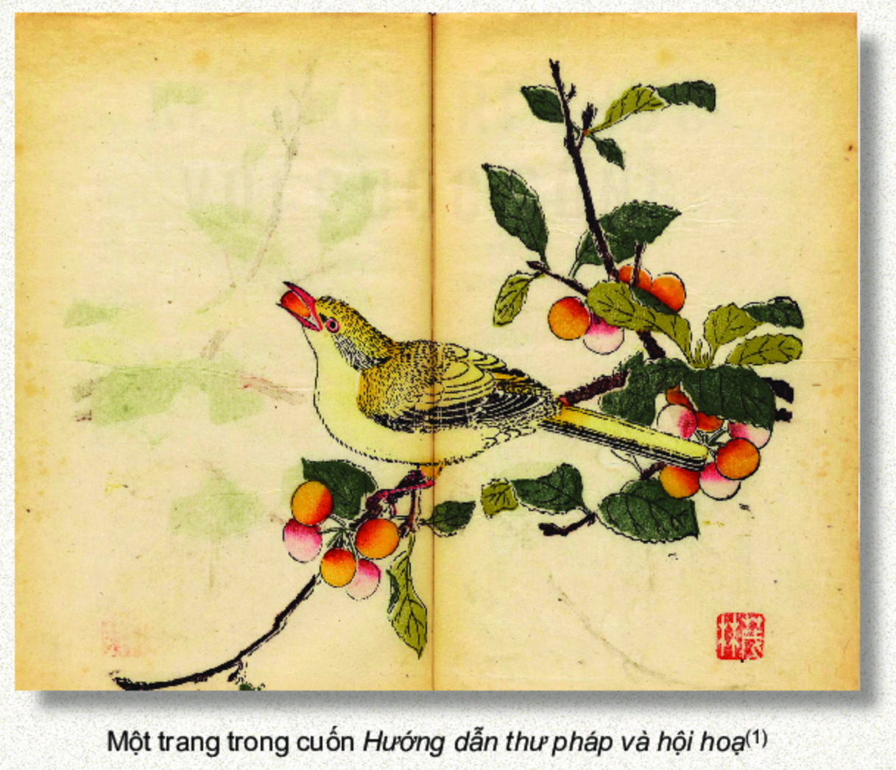
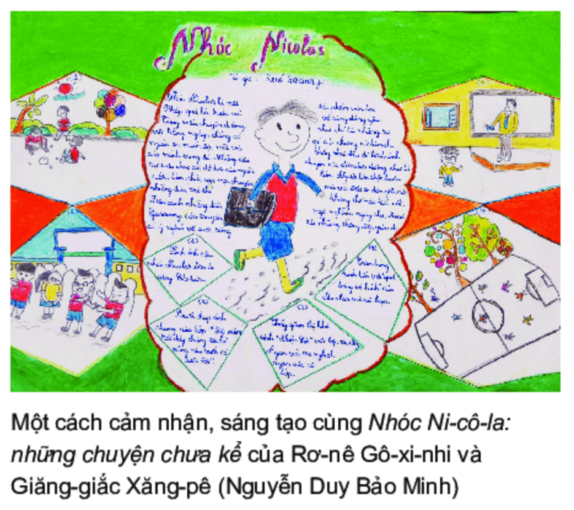
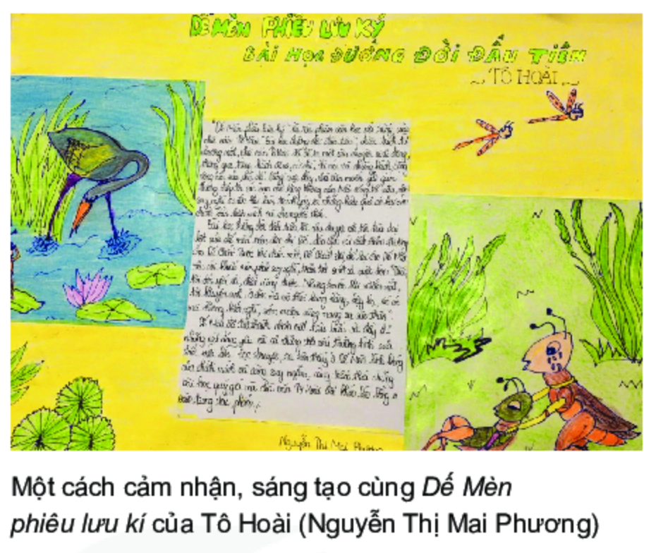
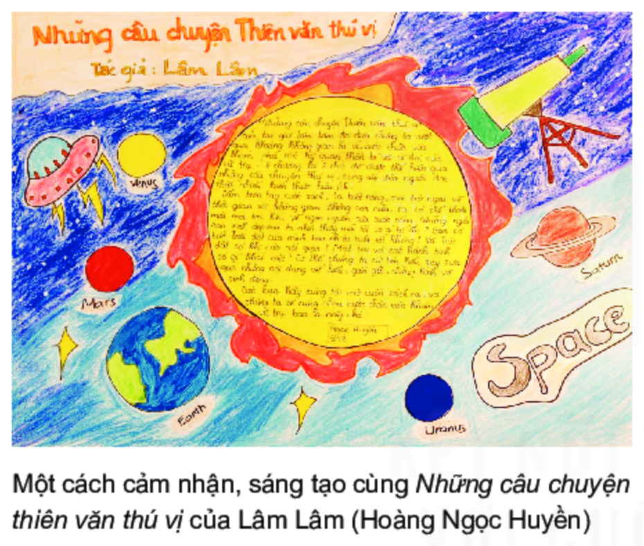
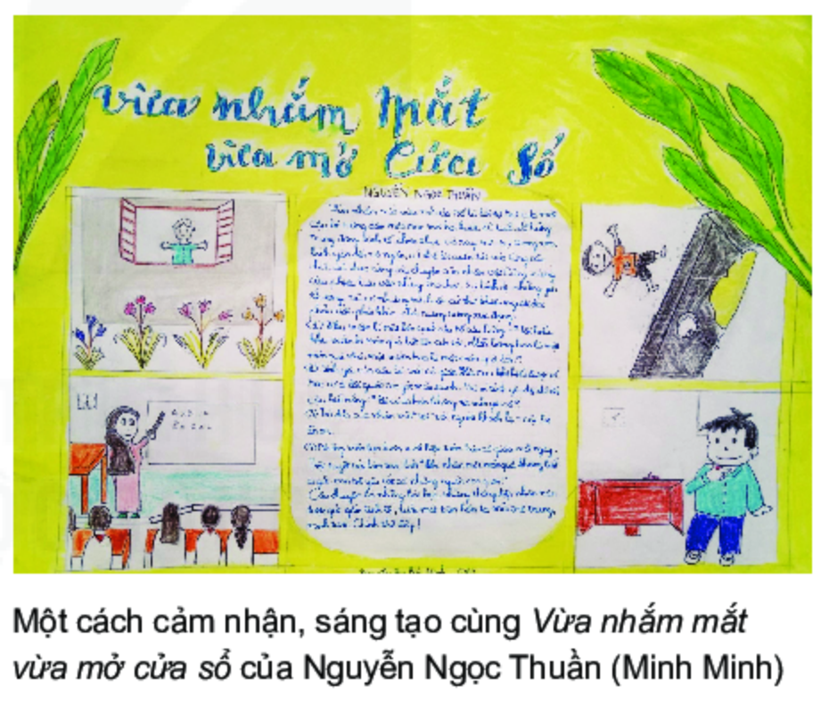

<!-- pdf:103 -->

# BÀI 10: CUỐN SÁCH TÔI YÊU

*Thiên nhiên và sách thuộc về những đôi mắt thấy chúng.*
<!-- ocr-ok: đề từ chữ in nghiêng bị OCR đọc nhầm "và" thành "bà", "về" thành "pề", "thấy" thành "thấu", đã đối chiếu ảnh trang PDF 103 -->

Ơ-mơ-sơn (R.W. Emerson)
<!-- ocr-ok: tên tác giả đề từ bị OCR mất dấu "Ơ-mơ-sơn" thành "O-mo-son", đã đối chiếu ảnh trang PDF 103 -->

## Giới thiệu bài học

- Trong những bài học trước, em đã được tìm hiểu các tác phẩm văn học về nhiều chủ đề. Những tác phẩm đó đã giúp em cảm nhận sâu sắc hơn về tình bạn, tình cảm gia đình, tình yêu quê hương đất nước,... Để có thể hiểu đầy đủ hơn về các đoạn trích, tác phẩm, tác giả, em hãy tìm đọc trọn vẹn một số cuốn sách như: *Dế Mèn phiêu lưu kí* (Tô Hoài), *Ra vườn nhặt nắng* (Nguyễn Thế Hoàng Linh), *Hoàng tử bé* (Ăng-toan đơ Xanh-tơ Ê-xu-pe-ri),... Em cũng có thể tìm đọc thêm một số tác phẩm văn học phù hợp với những chủ đề đã học.
<!-- term: văn bản văn học -->

- Các văn bản nghị luận, văn bản thông tin đã học cũng giúp em hiểu biết nhiều hơn về đời sống xã hội, thiên nhiên: ý nghĩa của sự khác biệt và tôn trọng sự khác biệt, sự cần thiết của việc khẳng định cái riêng ở mỗi người, môi trường sống và vấn đề bảo vệ môi trường. Em hãy cùng các bạn tìm đọc thêm một số văn bản nghị luận và văn bản thông tin có nội dung tương tự.

- Qua những trang sách mới, em sẽ được tự mình khám phá thế giới và cảm nhận niềm vui của việc đọc sách.

Một trang trong cuốn *Hướng dẫn thư pháp và hội hoạ*(1)

> (1) Một trong những cuốn sách đầu tiên trên thế giới có sử dụng kĩ thuật in màu, xuất bản năm 1633 tại Trung Quốc, hiện đang được lưu tại Thư viện Cam-brit (Cambridge) (Anh).

<!-- pdf:104 -->

## 🎯 Mục tiêu bài học

- Phát triển kĩ năng tự đọc sách trên cơ sở vận dụng những điều đã học.
- Nhận ra được đặc điểm của bài nghị luận văn học (bàn về một tác giả).
- Viết được đoạn văn giới thiệu về một nhân vật trong cuốn sách yêu thích.
- Biết trình bày ý kiến, thảo luận về một cuốn sách hoặc trình diễn một nội dung trong cuốn sách đó dưới hình thức: đóng kịch, ngâm thơ,...
- Yêu thích đọc sách và có ý thức giữ gìn sách.

## 💡 Em có biết?

*1. Sách có từ bao giờ? Sách đã được làm bằng những cách nào?*

Theo các nhà khảo cổ, cuốn sách đầu tiên là của người Ai Cập, xuất hiện vào khoảng thế kỉ XXV trước Công nguyên. Ban đầu, “sách” được làm bằng hình thức khắc trên đá, thân cây, xương, đất sét, gỗ,... hoặc viết, vẽ trên lá cây, vải,... Cuốn sách in theo cách sắp chữ đầu tiên ra đời ở châu Âu vào thế kỉ XV (1440). Hiện nay, ngoài sách in chúng ta còn có sách điện tử với nhiều hình thức khác nhau.

*2. Những kỉ lục thế giới liên quan đến sách*

Theo Tổ chức Kỉ lục Thế giới Ghi-nét (Guinness), tính đến năm 2015, cuốn sách có kích thước lớn nhất là cuốn viết về vương quốc Bu-tan (Bhutan) do nhà khoa học Mỹ Ha-li (M. Hawlay) vận động gây quỹ để làm ra. Cuốn sách này có kích cỡ tương đương... một cái bàn ăn, dày 112 trang và nặng 59 kg. Còn cuốn sách nhỏ nhất thế giới cho đến nay vẫn được cho là cuốn *Ti-ni Tét (Teeny Ted) ở thị trấn Tơ-níp (Turnip)*, ra đời năm 2007, có kích thước 0,1 mm x 0,07 mm. Em có thể tìm thêm những kỉ lục khác liên quan đến sách. Chắc hẳn sẽ có nhiều điều thú vị.

*3. Thư viện đầu tiên và thư viện lớn nhất*

Thư viện đầu tiên được xác định là thư viện A-lếch-xan-đri-a (Alexandria) ở Ai Cập. Thư viện này tồn tại từ thế kỉ III trước Công nguyên, có kho sách gồm 700 000 bản chép tay về các lĩnh vực văn học, nghệ thuật, tôn giáo, triết học, lịch sử, khoa học tự nhiên,... Đến năm 47 trước Công nguyên thì thư viện bị thiêu huỷ trong một vụ hoả hoạn.

Thư viện rất cần thiết và thật quý giá vì nơi ấy lưu trữ những cuốn sách – lịch sử tinh thần và tri thức của nhân loại. Em và các bạn hãy tự lập một thư viện nhỏ để cùng đọc những cuốn sách yêu thích và bổ ích.

<!-- pdf:105 -->

## Đọc

### THÁCH THỨC ĐẦU TIÊN: Mỗi ngày một cuốn sách

**Trước khi đọc**

1. Cùng thiết kế một góc đọc sách nhỏ trong lớp học. Hãy mang đến lớp một vài cuốn sách mà em muốn cùng đọc với các bạn.

2. Chia sẻ những điều thú vị nhất mà em cảm nhận được từ cuốn sách mới đọc.

3. Kể tên một cuốn sách mà em cho là cần đọc trong tuần này và thuyết phục các bạn cùng đọc.

**Đọc**

### 1. HOẠT ĐỘNG 1: SÁCH HAY CHUNG ĐỌC

a. Chọn hai trong số các chủ đề sau để định hướng cho việc đọc sách: *Tôi và các bạn*, *Gõ cửa trái tim*, *Yêu thương và chia sẻ*, *Quê hương yêu dấu*, *Những nẻo đường xứ sở*, *Chuyện kể về những người anh hùng*, *Thế giới cổ tích*, *Khác biệt và gần gũi*, *Trái Đất – ngôi nhà chung*.

b. Với mỗi chủ đề đã chọn, tìm một cuốn sách có nội dung liên quan, cùng đọc và viết lời giới thiệu ngắn về cuốn sách đó bằng pô-xtơ(1) hoặc phiếu đọc (tự thiết kế), với các yêu cầu sau:

- Nêu rõ tên sách, tên tác giả, nhà xuất bản, năm xuất bản hoặc tái bản;
- Tóm tắt nội dung: đề tài, chủ đề, bố cục, nhân vật, sự kiện, chi tiết;
- Liệt kê những câu văn, đoạn văn yêu thích được trích dẫn từ cuốn sách hoặc những câu nhận định về cuốn sách;
- Tự thiết kế một sản phẩm minh hoạ cho cuốn sách: tranh vẽ, sơ đồ,...

### 2. HOẠT ĐỘNG 2: CUỐN SÁCH YÊU THÍCH

Chọn một cuốn sách yêu thích, có thể là sách văn học hoặc sách khoa học, đọc và ghi chép những điều thu hoạch được vào nhật kí đọc sách theo các nội dung gợi ý sau:

- Nhan đề: Vì sao cuốn sách có nhan đề như vậy?
- Mở đầu: Phần mở đầu của cuốn sách có điều gì đáng chú ý? Vì sao?
- Thế giới từ trang sách: Em đã gặp những ai và đến nơi đâu qua trang sách đã đọc?
- Bài học từ trang sách: Những gì còn đọng trong tâm trí em? Vì sao em thích cuốn sách này?

> (1) **Pô-xtơ** (tiếng Anh: *poster*): bản viết bằng chữ to trên giấy, bìa, gỗ,... với những hình thức thiết kế, vẽ phù hợp nhằm giới thiệu hay quảng bá về một sản phẩm nào đó (ở đây là sách).

<!-- pdf:106 -->

### 3. HOẠT ĐỘNG 3: GẶP GỠ TÁC GIẢ
<!-- ocr-ok: tiêu đề mục màu đỏ có gạch chân bị OCR đọc nhầm số "3" thành "5" và "GỠ" thành "GÕ", đã đối chiếu ảnh trang PDF 106 -->

Thật thú vị khi được gặp ngoài đời chính nhà văn, nhà thơ mà mình yêu thích phải không? Nhưng nếu chưa có dịp đó, chúng ta vẫn vẹn nguyên niềm hạnh phúc khi được tiếp xúc, giao lưu với tác giả qua những trang sách. Tác phẩm chính là đời sống tâm hồn, là gương mặt tinh thần của nhà văn, nhà thơ. Để viết được một tác phẩm khiến bạn đọc yêu thích, luôn nhớ tới, thật chẳng dễ dàng. Mỗi khi phải trăn trở với bài viết của mình, chắc hẳn em thường tự hỏi: Làm thế nào mà nhà văn, nhà thơ có thể viết được những tác phẩm như vậy? Đã có nhiều câu hỏi tương tự và cũng có vô vàn câu trả lời khác nhau. Nhưng điều đó vẫn còn là một bí ẩn.

Bài đọc sau đây là một cách trả lời câu hỏi đó. Điều gì đã khiến một chú bé sinh ra ở một bản làng biên giới, một “người con của núi” trở thành nhà thơ Lò Ngân Sủn với những bài thơ vang vọng mãi trong tâm trí người đọc: *Chiều biên giới*, *Trời và đất*, *Chín khúc Bản Xèo*, *Ngôi nhà rông*,...?

### TRI THỨC NGỮ VĂN

**Văn bản nghị luận văn học**
- Là một loại của văn nghị luận, có nội dung bàn về một vấn đề văn học như tác giả, tác phẩm, thể loại,... **Nghị luận văn học** sử dụng lí lẽ và bằng chứng để làm sáng tỏ vấn đề văn học được nói tới.
<!-- term: bài nghị luận văn học -->
<!-- term: bài nghị luận -->

- **Lí lẽ** trong nghị luận văn học chính là những nhận xét cụ thể của người viết về tác giả, tác phẩm, thể loại,... **Bằng chứng** thường được lấy từ tác phẩm văn học.

**a. Đọc văn bản**

**Nhà thơ Lò Ngân Sủn – người con của núi**

Đọc thơ Lò Ngân Sủn ta như được khám phá những đỉnh núi xa thơ
mộng và mãnh liệt. Núi không chỉ là hình ảnh thường được nói đến trong
thơ ông mà còn hiện lên như là một phần hồn thơ Lò Ngân Sủn. Những
bài thơ tiêu biểu của Lò Ngân Sủn như *Chiều biên giới*, *Trời và đất*, *Chín
khúc Bản Xèo*, *Ngôi nhà rông*,... đều mang âm vọng của núi, mênh mang
lời của núi. Vậy điều gì đã nuôi dưỡng và bồi đắp nên vẻ đẹp thơ mộng và
mãnh liệt ấy trong thơ ông?

<!-- pdf:107 -->

Trước khi trở thành nhà thơ, Lò Ngân Sủn đích thực là một “người con của
núi”. Ông sinh ra và lớn lên ở bản Qua, huyện Bát Xát, tỉnh Lào Cai. Từ nhỏ,
chú bé Lò Ngân Sủn đã đắm mình trong hơi thở của cỏ cây, hoa lá núi rừng
biên cương, đã biết thả hồn cùng vẻ đẹp thanh thoát, hùng vĩ của dốc dựng,
thác đổ, suối tuôn,... nơi “tận cùng bờ cõi”:

Những đỉnh núi xa
Rừng thông gọi đàn dê hiện gọi mơ núi
Nâng niu hạt mạch
Rừng sa mộc vạm vỡ
Quay mình những vòng đường.
(*Đỉnh núi xa vùng mãnh liệt*)

Khi lớn lên, thế giới của cậu bé sinh ra từ bản Qua không chỉ giới hạn ở
bản làng biên giới. Mặt đất và bầu trời đã rộng mở, muôn dặm non sông từ
bắc vào nam, từ miền ngược đến miền xuôi, từ đầu non đến bãi biển,... đã
ùa vào tâm hồn mộc mạc, thiết tha, phóng khoáng của Lò Ngân Sủn. Nhưng
vùng đất Hoàng Liên Sơn hùng vĩ, miền biên cương phía bắc của Tổ quốc vẫn
là mảnh đất mẹ nuôi dưỡng, bồi đắp nên chất hào sảng, trầm hùng và mãnh
liệt của thơ ông, mà *Chiều biên giới* là một ví dụ tiêu biểu:

Chiều biên giới em ơi
Có nơi nào cao hơn
Như đầu sông đầu suối
Như đầu mây đầu gió
Như quê ta ngọn núi
Như đất trời biên cương.
(*Chiều biên giới*)

Dù có đi khắp mọi nẻo đường, những sườn non, dốc núi, những miền thác
đổ réo sôi, vắt vẻo như dây leo của quê hương vẫn là con đường quyến rũ nhất
với người con của núi. Dường như đó cũng chính là con đường thơ ca của Lò
Ngân Sủn:

<!-- pdf:108 -->

Ta đi trên chín khúc Bản Xèo
con đường là cái hạt ta gieo
con đường là cái rễ lan toả
dệt nên hoa trái, tiếng chim ca.
(*Đi trên chín khúc Bản Xèo*)

Núi rừng xứ sở muốn cất tiếng bằng thơ và nhà thơ Lò Ngân Sủn đã phần
nào đáp ứng được mong mỏi ấy, bằng tình yêu thương thuần khiết của mình.

Không có tình yêu tha thiết với núi rừng, với quê hương, với “chồi non cỏ
biếc”, với “đầu sông đầu suối”, với những “bậc thang mây”,... chắc hẳn không
thể có nhà thơ Lò Ngân Sủn với những câu thơ “vạm vỡ” mà âm vang như
“con suối thác đổ”, khiến trái tim của bao độc giả phải bồi hồi.

(*Theo* Minh Khoa, báo điện tử *giaoduc.net.vn*, tháng 12/2020)

**b. Trả lời câu hỏi**

1. Vì sao nhà thơ Lò Ngân Sủn được tác giả bài viết gọi là “người con của núi”?
2. Xác định câu văn nêu vấn đề chính được bàn luận trong bài.
3. Những câu thơ được dẫn đóng vai trò gì trong bài viết?
4. Câu cuối cùng của bài viết có mối quan hệ như thế nào với những câu mở đầu?

**c. Giới thiệu tác giả yêu thích**

Tìm kiếm thông tin về một tác giả mà em yêu thích để giới thiệu với các bạn.

### 4. HOẠT ĐỘNG 4: PHIÊU LƯU CÙNG TRANG SÁCH

a. Cùng xem một bộ phim được chuyển thể từ một cuốn sách hoặc một tác phẩm văn học có nội dung liên quan đến các chủ đề đã học.

b. Thảo luận và so sánh để thấy những điểm tương đồng, khác biệt giữa nội dung, hình thức của phim và sách hoặc tác phẩm đã đọc.

c. Cùng thiết kế một pô-xtơ nhằm giới thiệu bộ phim đã xem hoặc vẽ lại bìa cuốn sách yêu thích.

Pô-xtơ phim hoạt hình (trái) và bìa cuốn sách *Hoàng tử bé* (phải)(1)

> (1) Nguồn: *http://cand.com.vn/Giai-tri-van-hoa/Ra-mat-phim-Hoang-tu-be-378509/*

<!-- pdf:109 -->

## Viết

### THÁCH THỨC THỨ HAI: Sáng tạo cùng tác giả

Để có được một cuốn sách thú vị, cuốn hút người đọc, tác giả không chỉ cần tài năng mà còn phải rất đam mê, có cảm hứng, tâm huyết và dành nhiều thời gian, công sức vào việc viết. Cuốn sách là đứa con tinh thần của tác giả. Đọc sách là để hiểu biết về con người, đời sống xã hội, thế giới tự nhiên và cũng là để hiểu thêm về người viết.

Khi đọc sách, chúng ta không chỉ thưởng thức, cảm nhận mà còn có thể sáng tạo cùng tác giả. Có nhiều cách thể hiện kết quả thưởng thức, cảm nhận, sáng tạo cùng cuốn sách và tác giả yêu thích. Hãy lựa chọn một hoạt động phù hợp:

- Viết đoạn văn giới thiệu về một nhân vật trong cuốn sách yêu thích.
- Sáng tạo sản phẩm nghệ thuật lấy ý tưởng từ một cuốn sách.
- Dựng một hoạt cảnh từ tác phẩm đã đọc và biểu diễn hoạt cảnh đó.

### A. GIỚI THIỆU VỀ MỘT NHÂN VẬT TRONG CUỐN SÁCH YÊU THÍCH

Em có thể tự mình hoặc cùng các bạn viết đoạn văn giới thiệu về một nhân vật yêu thích.

*Yêu cầu đối với đoạn văn giới thiệu cuốn sách, tác phẩm văn học:*

- Nêu được tên nhân vật, tên sách và tác giả.
- Trình bày những đặc điểm chính (về hình dáng, tính nết, hành động, suy nghĩ,...) của nhân vật.
- Thể hiện rõ suy nghĩ, tình cảm của người viết đối với nhân vật.

<!-- pdf:110 -->

#### Phân tích bài viết tham khảo

**Nhóc Ni-cô-la – người bạn của tôi**

Nhóc Ni-cô-la – cậu học trò trạc tuổi chúng tôi trong những cuốn truyện *Nhóc Ni-cô-la: những chuyện chưa kể*, *Nhóc Ni-cô-la và các bạn*, *Những kì nghỉ của nhóc Ni-cô-la*,... đã trở thành người bạn thân thiết của tôi và các bạn. Từ trang sách của nhà văn Rơ-nê Gô-xi-nhi và họa sĩ Giăng-giắc Xăng-pê, chú nhóc ấy đã chạy thẳng vào sân trường và vui chơi cùng chúng tôi – lũ học trò “nhất quỷ nhì ma”...

> Nêu tên nhân vật, tên sách và tác giả.

Tôi hình dung nhóc Ni-cô-la với cái đầu dài và mái tóc dựng đứng, gầy nhom đứng bên cạnh anh bạn thân nhất – An-xe-xtơ to béo, ăn luôn mồm. Cái anh chàng bé nhỏ ấy lại chúa hay nghịch ngầm, luôn nhìn thấy những điều buồn cười trong

cả những chuyện tưởng như nghiêm túc nhất. Khi viết bài tập làm văn, tham
gia chuyến dã ngoại, chuẩn bị một buổi đón đoàn kiểm tra ở trường học hoặc
đón khách ở nhà, lúc nào chú nhóc ấy cũng rất cố gắng để làm được những
gì thầy cô và bố mẹ mong muốn nhưng rốt cuộc chú ta và các bạn vẫn vô
tình gây ra những chuyện bất ngờ... Không ít phen Ni-cô-la và các bạn phạm
lỗi như những “học sinh cá biệt”, những đứa trẻ khó bảo ở trường và ở nhà.
Câu cửa miệng của Ni-cô-la khi lỡ gây ra hoặc chứng kiến những chuyện
chẳng ngờ ấy là: “Thật kinh khủng!”. Ni-cô-la không phải lúc nào cũng ngoan
ngoãn, cũng nghe lời người lớn. Nhưng cậu ta lúc nào cũng chân thành muốn
làm gì đó tốt hơn.

> Trình bày đặc điểm của nhân vật: hình dáng, tính nết, hành động, suy nghĩ.

Hình như Ni-cô-la và lũ bạn của cậu ta cũng chính là tôi
và các bạn – tuy chẳng muốn làm thầy cô và bố mẹ phiền lòng nhưng lại lỡ
gây ra những chuyện rắc rối tày trời kiểu: đá bóng làm vỡ cửa kính nhà ai đó, bị bắt quả tang khi nghĩ mình quá khoẻ và giải quyết chuyện quả bóng bằng một quả đấm,... Lớp học, trường học nào chẳng có những bạn như vậy? Nhưng dù sao, cậu bé ấy cũng thật đáng yêu, phải không các bạn?

> Nêu suy nghĩ, tình cảm của người viết đối với nhân vật.

*(Bài làm của học sinh)*

<!-- pdf:111 -->

#### Thực hành viết theo các bước

### 1. TRƯỚC KHI VIẾT

> *Mục đích viết*
> Giới thiệu nhân vật yêu thích trong một cuốn sách.
>
> *Người đọc*
> Thầy cô, bạn bè và những người quan tâm đến nhân vật trong cuốn sách.

– *Lựa chọn đề tài:* Chọn một nhân vật em yêu thích.
<!-- ocr-ok: dòng đặt cạnh hộp Mục đích viết bị OCR trộn ngang và đọc nhầm "Chọn" thành "Ohọn", đã đối chiếu ảnh trang PDF 111 -->

– *Tìm ý:*

- Nhân vật em yêu thích là ai?
- Nhân vật đó xuất hiện trong cuốn sách nào?
- Nhân vật đó có những đặc điểm gì đáng nhớ?
- Em có suy nghĩ, tình cảm gì đối với nhân vật?

– *Lập dàn ý:* Sắp xếp các thông tin và ý tưởng theo một trật tự phù hợp.

**Dàn ý**

1. Mở đoạn: Nêu ngắn gọn tên nhân vật, tên sách, tác giả.
2. Thân đoạn: Trình bày lần lượt những đặc điểm thú vị của nhân vật.
3. Kết đoạn: Nêu suy nghĩ, tình cảm của người viết đối với nhân vật.

### 2. VIẾT BÀI

Khi viết đoạn văn giới thiệu về một nhân vật, cần lưu ý:

- Viết đúng tên nhân vật, tên sách, tên tác giả.
- Trình bày những chi tiết cụ thể khắc hoạ hình dáng, tính nết, hành động, suy nghĩ của nhân vật.
- Liên hệ với cuộc sống của em để nêu lên những suy nghĩ, tình cảm của bản thân đối với nhân vật một cách tự nhiên, sinh động.

### 3. CHỈNH SỬA BÀI VIẾT

Đọc lại đoạn văn đã viết để bảo đảm:

- Viết đúng tên nhân vật, tên sách, tên tác giả.
- Nêu được những đặc điểm thực sự ấn tượng, đáng nhớ của nhân vật.
- Viết đúng chính tả, dùng từ chính xác, đặt câu linh hoạt và sắp xếp các ý hợp lí.

### B. SÁNG TẠO SẢN PHẨM NGHỆ THUẬT

Từ cuốn sách yêu thích, có thể sáng tạo những sản phẩm nghệ thuật mới, chẳng hạn: sáng tác thơ, kể chuyện sáng tạo, vẽ tranh thể hiện một số chi tiết, nhân vật đáng nhớ hoặc minh hoạ cho chuỗi sự kiện (truyện tranh).

<!-- pdf:112 -->

Tham khảo một số sản phẩm của các bạn học sinh:

Một cách cảm nhận, sáng tạo cùng *Nhóc Ni-cô-la: những chuyện chưa kể* của Rơ-nê Gô-xi-nhi và Giăng-giắc Xăng-pê (Nguyễn Duy Bảo Minh)

Một cách cảm nhận, sáng tạo cùng *Dế Mèn phiêu lưu kí* của Tô Hoài (Nguyễn Thị Mai Phương)

Một cách cảm nhận, sáng tạo cùng *Những câu chuyện thiên văn thú vị* của Lâm Lâm (Hoàng Ngọc Huyền)

Một cách cảm nhận, sáng tạo cùng *Vừa nhắm mắt vừa mở cửa sổ* của Nguyễn Ngọc Thuần (Minh Minh)

### C. DỰNG HOẠT CẢNH ĐỂ BIỂU DIỄN

Tham khảo một mẫu đề cương để dựng hoạt cảnh:

1. Cốt truyện: tóm tắt, có thể chỉnh lí và mở rộng từ một truyện đã học, đã đọc.
2. Nhân vật: liệt kê các nhân vật và vai trò của từng nhân vật trong câu chuyện.
3. Đối thoại: xác định mạch của các cuộc thoại chính gắn với cốt truyện và nhân vật.
4. Bối cảnh: tóm tắt bối cảnh chính và sự thay đổi của bối cảnh theo cốt truyện (nếu có).
5. Trang phục, đạo cụ: miêu tả ngắn gọn về quần áo, vật dụng phù hợp với các nhân vật và bối cảnh.

<!-- pdf:113 -->

6. Nội dung, diễn biến

| Trình tự | Bối cảnh, nhân vật | Hội thoại | Ghi chú (trang phục, diễn xuất, âm thanh, ánh sáng) |
| --- | --- | --- | --- |
| Cảnh 1 | ... | ... | ... |
<!-- ocr-ok: bảng mẫu đề cương 4 cột trên nền màu bị OCR trộn ngang thứ tự từ, đã đối chiếu ảnh trang PDF 113 -->

## Nói và nghe

### VỀ ĐÍCH: Ngày hội với sách

Trong phần này, em và các bạn có thể lựa chọn giới thiệu các sản phẩm của dự án đọc sách phù hợp với năng lực và điều kiện học tập cụ thể theo một trong các hình thức sau đây:

### 1. HOẠT ĐỘNG 1: GIỚI THIỆU SẢN PHẨM MINH HOẠ SÁCH

Mỗi cá nhân, nhóm, lớp có thể đăng kí tham gia trưng bày, giới thiệu pô-xtơ, tranh ảnh, mô hình minh hoạ cho các nội dung của sách tại lớp học, thư viện hoặc một không gian phù hợp khác trong trường học.

### 2. HOẠT ĐỘNG 2: NÓI VỀ CUỐN SÁCH YÊU THÍCH

Tham gia hoạt động giới thiệu nhân vật, nội dung, những đặc điểm thú vị trong cuốn sách yêu thích của cá nhân, nhóm, lớp tại lớp học, thư viện hay phòng đọc của trường.

### 3. HOẠT ĐỘNG 3: BIỂU DIỄU HOẠT CẢNH

Nếu có thể, em cùng các bạn trong lớp, nhóm phân vai và tập luyện để biểu diễn một hoạt cảnh được dựng từ câu chuyện đã học, đã đọc. Em và các bạn sẽ có một ngày hội thật vui với sách.

Hãy dành thời gian để cảm nhận, suy ngẫm và chia sẻ về một cuốn sách (tác phẩm) hoặc nhân vật yêu thích của em. Đơn giản hơn, hãy để một bài thơ, một giai điệu nào đó ngân lên trong tâm trí. Như vậy, cuốn sách đã trở thành một phần cuộc sống của em. Những gì em đã thấy trong những cuốn sách không chỉ tồn tại trên trang giấy mà sẽ theo em đi suốt cuộc đời. Đó là hành trang tri thức để em bước vào thế giới rộng lớn.

## 📷 Danh sách hình trong bài

| Mã hình | Trang PDF | Vị trí trong bài | Chú thích gốc |
| --- | --- | --- | --- |
| H6-ngu_van-b10-01 | 103 | Giới thiệu bài học (trang 113) | Một trang trong cuốn Hướng dẫn thư pháp và hội hoạ |
| H6-ngu_van-b10-02 | 112 | Viết – B. Sáng tạo sản phẩm nghệ thuật (trang 122) | Một cách cảm nhận, sáng tạo cùng Nhóc Ni-cô-la: những chuyện chưa kể của Rơ-nê Gô-xi-nhi và Giăng-giắc Xăng-pê (Nguyễn Duy Bảo Minh) |
| H6-ngu_van-b10-03 | 112 | Viết – B. Sáng tạo sản phẩm nghệ thuật (trang 122) | Một cách cảm nhận, sáng tạo cùng Dế Mèn phiêu lưu kí của Tô Hoài (Nguyễn Thị Mai Phương) |
| H6-ngu_van-b10-04 | 112 | Viết – B. Sáng tạo sản phẩm nghệ thuật (trang 122) | Một cách cảm nhận, sáng tạo cùng Những câu chuyện thiên văn thú vị của Lâm Lâm (Hoàng Ngọc Huyền) |
| H6-ngu_van-b10-05 | 112 | Viết – B. Sáng tạo sản phẩm nghệ thuật (trang 122) | Một cách cảm nhận, sáng tạo cùng Vừa nhắm mắt vừa mở cửa sổ của Nguyễn Ngọc Thuần (Minh Minh) |
